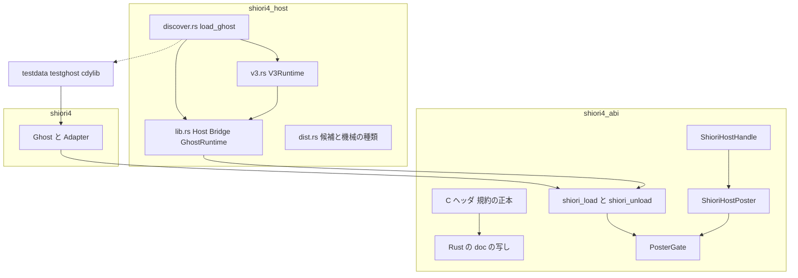
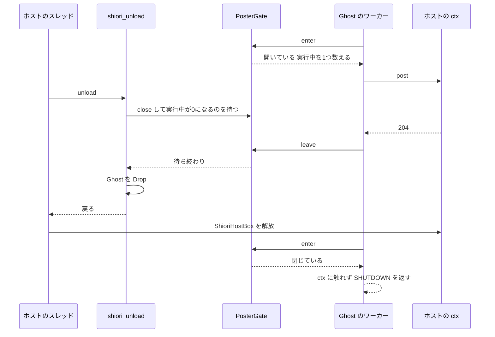
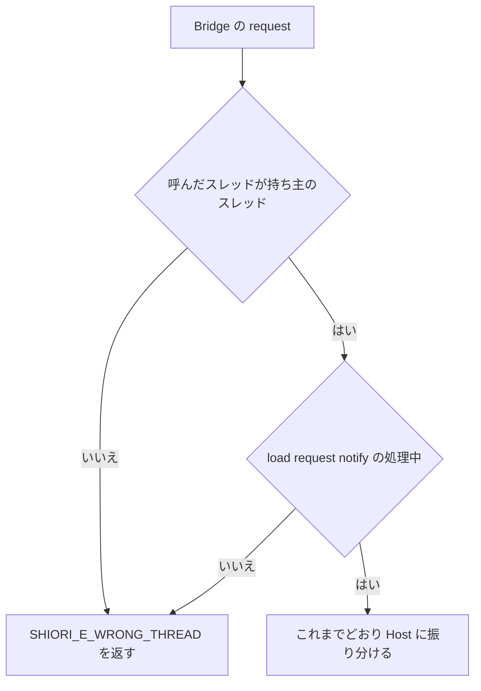
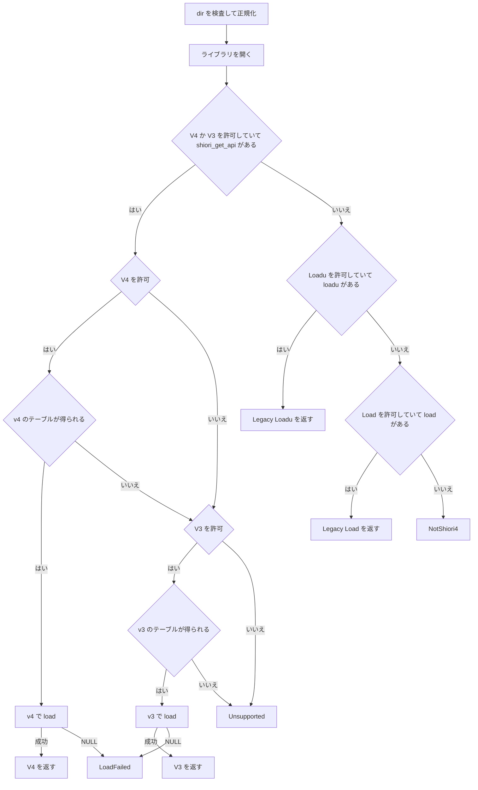

# 設計書 — abi-conventions

## Overview

**Purpose**: この spec は、SHIORI 次世代 ABI の規約（スレッド・寿命・load の失敗・dir の形・Charset・DLL の選び方と読み方）を 1 通りの意味に締め、C ヘッダ・Rust の doc・高水準層の 3 か所で同じ言葉にそろえる。あわせて、高水準層が規約を自動で守る仕組み（`ShioriHostPoster` の門・`SHIORI_E_WRONG_THREAD` の検出・dir の正規化）と、`shiori4_host` の読み込みの口（発見の順と許可・`from_library`・v3 互換モードの口・ファイル名の候補・機械の種類の確認）を足す。

**Users**: SHIORI 実装者（pasta など。`Ghost` を実装する人と `Shiori` を直接実装する人、Rust 以外で C ヘッダを読む人）と、ベースウェア実装者（areka など。`Host` を実装する人と、自分で DLL を選んで開く人）。

**Impact**: `shiori4_abi` の SHIORI 側の入口（`shiori_load`／`shiori_unload`）がインスタンスを門ごと包むようになり、`ShioriHostPoster` は `Copy` でなくなる。`shiori4_host` の `Bridge` は呼び出しのスレッドと期間を見て -7 を返し、`GhostRuntime` は相対パスの dir を断る。`shiori4_host/src/` は 1 ファイルから 4 ファイルに分かれる。構造体のレイアウト・公開シンボル・既存の定数の値は変えない。

### Goals
- C ヘッダの冒頭の注釈を規約の正本にし、Rust の `//!` をそれと同じ番号・同じ言葉にする（要件 1）。
- 高水準層を使う Ghost 実装者が join せずに、Host 実装者が自前のスレッド検査なしに規約を守れる（要件 3・4）。
- ベースウェアが DLL を 2 回読まずに「4 → 3 → SHIORI/3.0」の順で試せ、DLL を読む前にファイルと機械の種類を選べる（要件 11〜14）。
- 新しい外部の依存を足さず、版を上げず、3 OS の CI を通す（要件 15）。

### Non-Goals
- 運ぶ中身の語彙（property・post のコマンド・必ず付けるヘッダ・`OnHostComplete` の並び・拒否の返し方）。host-protocol が持つ。
- 従来の SHIORI/3.0 の DLL を HGLOBAL で初期化して動かすこと。shiori3-legacy-host が持つ。この spec は「どの口で解決したか」と開いたライブラリを返すまで。
- 教科書としての文書（全体図・移行の手引き・最小の例）。abi-textbook が持つ。
- x86 の v4 DLL を別プロセス越しに読むこと。ベースウェア・SHIORI の個別の実装。版を上げること。

## Boundary Commitments

### This Spec Owns
- **規約の本文**: `shiori4_abi/include/shiori4_abi.h` の冒頭の注釈（正本）と、規約の後の「配布の決まり」の節。`shiori4_abi/src/lib.rs` の `//!` の写し。規約に触れる各 doc（`Shiori`・`ShioriHostPoster`・`ShioriHostApi`・`ShioriApi`・`Ghost`・`Host`・`GhostRuntime`）と steering の `tech.md`・`structure.md` の該当行。
- **ABI の定数**: `SHIORI_E_WRONG_THREAD`（-7）を C と Rust に足すこと。
- **SHIORI 側の規約の守り方**（`shiori4_abi`）: Poster の門（無効化・実行中の post の待ち）、Poster からの log、v4 の load の失敗の自動の 1 行の log、`ShioriOwnedBytes`／`ShioriOwnedResponse` の `Send`。
- **ホスト側の規約の守り方**（`shiori4_host`）: -7 の検出、dir の検査と正規化、Charset を付けないこと、`Host::log` の任意スレッドの明記。
- **ホスト側の読み込みの口**（`shiori4_host`）: 許可する口の種類と発見の順（`load_ghost`・`load_ghost_with`）、`GhostRuntime::from_library` と `FromLibraryError`、v3 互換モードの口 `V3Runtime`、ファイル名の候補 `shiori_file_candidates`、機械の種類の確認 `machine_matches`、対象の OS・arch の型。
- **テスト**: 上の振る舞いのテストと、DLL を読むテストのためのテスト用の cdylib（`testdata/testghost/`）。

### Out of Boundary
- `Bridge` の振り分けの中身（組み込みの `property` の応答・`accept_post` の既定・`Completer` の組み立て）と `host_protocol` の語。host-protocol が変える。この spec は `Bridge::request` の**先頭**に -7 の門を置くだけで、振り分けには触れない。
- 従来の口（`loadu`・`load`）の初期化・HGLOBAL・CP_ACP の dir。shiori3-legacy-host。
- 発見の口が自動で機械の種類を確かめること（ホストが「配布の決まり」に従って先に確かめる。後述の決定）。
- SHIORI 側（pasta）のアクタースレッド、ホスト側（areka）の helper プロセスの作り。

### Allowed Dependencies
- 依存の向きは `shiori4_host` → `shiori4` → `shiori4_abi` だけ。逆向きの参照は禁止。
- `shiori4_abi`・`shiori4`: std だけ。`shiori4_host`: std と既存の `libloading`（0.8）だけ。新しい外部クレートを足さない。
- `shiori4_host` の新しいファイルは、`lib.rs` の型（`Host`・`GhostRuntime`・`LoadError`・`FromLibraryError`・`normalize_dir`）と `shiori4_abi` の公開 API だけを使う。`dist.rs` は `libloading` にも `shiori4` にも依存しない（純粋な関数）。
- テスト用の cdylib（`testdata/testghost/`）は `shiori4` だけに path で依存し、ワークスペースの外（自前の `[workspace]`）に置く。公開しない。

### Revalidation Triggers
- `ShioriHostPoster` の形（`Copy` を外す・`log` を足す）や `Shiori`／`Ghost` の約束が変わったとき → pasta の v4 対応、abi-textbook の例。
- `Bridge` の構造体や `ShioriHost::request` の先頭が変わったとき → host-protocol（同じファイルの統合）。
- 発見の順・許可する口の種類・`LoadedGhost` の `Legacy` の形・dir の正規化が変わったとき → shiori3-legacy-host。
- 規約の本文の番号や節の構成が変わったとき → abi-textbook、areka の `shiori4-api`。
- `LoadError` の変種や `Display` の文が変わったとき → `shiori4_host` の利用者（0.0.2 のリリースノート）。

## Architecture

### Existing Architecture Analysis
- 3 層のクレート（`shiori4_abi` → `shiori4` → `shiori4_host`）。各クレートは `src/lib.rs` 1 ファイルで、`// ====` の区切りでセクションを分ける。テストは同じファイルの `mod tests`。
- `ShioriHostPoster` は `#[derive(Clone, Copy)]` で `ctx` と `post` の関数ポインタだけを持つ。無効化の印を置く場所が無い。
- `shiori_load<S, V>` は `Box<S>` を返し、`shiori_unload<S>` が `drop(Box::from_raw)` する。「unload を始めた時点」を知るのはここだけ。
- `Bridge<H>`（`shiori4_host`、非公開）は `ShioriHostBox` の中にあり ctx として渡る。`request` は呼び出しのスレッドも期間も見ていない。
- `GhostRuntime::with_api(api, dir, host, lib: Option<Library>)` は非公開で、`from_library` の中身になる。`ShioriApi::load_v3` は v3 の口の土台になる。
- 規約の本文は C ヘッダと `//!` にほぼ同文であるが、Rust にだけ「規約 6（catch_unwind）」がある。join を求める記述が 4 か所ある（`Shiori`・`ShioriHostPoster`・`Ghost`・`tech.md`）。

### Architecture Pattern & Boundary Map

**選んだ形**: 既存の 3 層を保ったまま、規約の守り方を「その規約に責任を持つ層の入口」に置く（SHIORI 側の約束は `shiori4_abi` の `shiori_load`／`shiori_unload`、ホスト側の約束は `shiori4_host` の `Bridge`／`GhostRuntime`）。新しい読み込みの口と純粋な関数は `shiori4_host` の別ファイルにする（混合案）。



**Architecture Integration**:
- Domain boundaries: 規約の本文（文書）と規約の守り方（コード）を同じ spec で持つが、ファイルは分ける。`dist.rs` は DLL を読まない純粋な関数だけにし、`discover.rs`・`v3.rs` は `lib.rs` の型の上に組む。
- Existing patterns preserved: `!Send` のランタイム、`ManuallyDrop` による解放順の明示、`catch_unwind` での境界の保護、`ShioriInstance` の Drop での unload。
- New components rationale: 門（要件 4）・-7 の判定（要件 3）は規約の守り方そのもの。`from_library`（要件 12）・`V3Runtime`（要件 13）・発見（要件 11）・候補と機械の種類（要件 14）は areka・pasta の正式な要望。
- Steering compliance: 依存は下向きだけ。`unsafe` は ABI 層と `shiori4_host` のライブラリの境界に閉じる。規約を変えたら `//!` と C ヘッダを両方直す。

**依存の向き（違反は誤りとして扱う）**: `shiori4_abi` ← `shiori4` ← `shiori4_host`。`shiori4_host` の中では `dist.rs`（何にも依存しない）← `lib.rs` ← `v3.rs` ← `discover.rs`。`lib.rs` は `v3.rs`・`discover.rs` を `mod` 宣言と再エクスポートでしか参照しない。

### Technology Stack

| Layer | Choice / Version | Role in Feature | Notes |
|-------|------------------|-----------------|-------|
| 言語 | Rust 1.85、edition 2024 | 全クレート | 使う std の機能（`OnceLock`・`Condvar`・`Path::is_absolute`・`std::env::consts::DLL_PREFIX`）はすべて 1.85 で安定 |
| FFI 文書 | C ヘッダ `shiori4_abi.h` | 規約の正本 | 注釈と定数の追加だけ。レイアウトは不変 |
| 動的読み込み | `libloading` 0.8（既存） | `from_library`・発見・`V3Runtime` | 新しい依存は無し |
| ヘッダの読み取り | std（`File`・`Read`・`Seek`） | PE・ELF・Mach-O の機械の種類 | `object`／`goblin` は採らない（依存を足さない） |
| テスト用 DLL | 自前の cdylib（`testdata/testghost/`） | DLL を読むテスト | テストの中から `cargo build` で作る |

## File Structure Plan

### Directory Structure
```
shiori4_abi/
├── include/shiori4_abi.h      # 規約の正本（冒頭の注釈・配布の決まり）、SHIORI_E_WRONG_THREAD
└── src/lib.rs                 # //! の写し、-7、PosterGate、Instance 包み、Poster／Handle、Send、load 失敗の log、mod tests（新設）
shiori4/
└── src/lib.rs                 # Ghost の doc（unload・notify・Charset）、テスト（Charset・複数インスタンス・Poster の clone）
shiori4_host/
└── src/
    ├── lib.rs                 # //!、再エクスポート、Host::log の doc、Bridge の -7 の門、normalize_dir、
    │                          # GhostRuntime（dir・呼び出しの印・from_library・from_static の Path 化）、
    │                          # LoadError の doc、FromLibraryError、mod 宣言、テスト
    ├── v3.rs                  # V3Runtime（v3 互換モードの口）とそのテスト
    ├── discover.rs            # EntryKind・LoadedGhost・load_ghost／load_ghost_with とそのテスト
    ├── dist.rs                # 配布の決まり: TargetOs・TargetArch・shiori_file_candidates・machine_matches とそのテスト
    └── test_dll.rs            # #[cfg(test)] だけ: テスト用 cdylib を作って場所を返す・DLL の状態を守るロック
testdata/
└── testghost/                 # テスト用の cdylib（公開しない。自前の [workspace]）
    ├── Cargo.toml             # crate-type = cdylib、publish = false、shiori4 に path で依存
    └── src/lib.rs             # 自前の shiori_get_api（モードで v4／v3 を出し分け）、ダミーの loadu／load、testghost_set_mode
```

### Modified Files
- `shiori4_abi/include/shiori4_abi.h` — 冒頭の注釈を「Supporting References」の本文に置き換える。`SHIORI_E_WRONG_THREAD (-7)` を足す。`ShioriHostApi.request`・`log`、`ShioriApi.load` の dir の注釈を直す。
- `shiori4_abi/src/lib.rs` — `//!` を C ヘッダと同文にする。定数・門・Poster・Handle・入口・`Send`・doc を直す。`#[cfg(test)] mod tests` を新設する。
- `shiori4/src/lib.rs` — `Ghost` と `Adapter` の doc。テストを足す。コードの振る舞いは変えない（v4 は既に Charset を付けず、拒否もしない）。
- `shiori4_host/src/lib.rs` — 上の Directory Structure のとおり。`mod v3; mod discover; mod dist; #[cfg(test)] mod test_dll;` と再エクスポートを足す。
- `.kiro/steering/tech.md` — スレッド規約の「join してから返る」を結果の約束に直し、-7・log の任意スレッドを足す。Testing にテスト用 cdylib を足す。
- `.kiro/steering/structure.md` — 「1 クレートは現状 `src/lib.rs` 1 ファイル」を、`shiori4_host` が読み込みの口と純粋な関数を別ファイルに分けたことに合わせて直す。
- `.gitignore` — 変更なし（`target`・`Cargo.lock` は既に無視。テスト用 cdylib の出力は `target/testghost/` に置く）。

## System Flows

### unload と Poster の門

- 門を見る前に ctx に触れない。門の実体は `Arc` で Poster と共有するので、ctx が解放された後も門だけは読める。
- unload が待つのは、門を閉じた時点で実行中の post（または log）1 回分だけ。Ghost のスレッドの終わりは待たない（要件 4.5・4.6）。

### host->request の -7 の判定

- 持ち主のスレッドは `GhostRuntime` を作ったスレッド（`GhostRuntime` は `!Send` なので、以後の呼び出しもこのスレッド）。処理中の印は `GhostRuntime` が load（`with_api` の中）・request・notify の前後で立てて下ろす。

### 発見の順と許可（`load_ghost_with`）

- `shiori_get_api` が見つかったら、v4・v3 のどちらでも、その後に `loadu`・`load` へは進まない（要件 11.3・11.4・11.7）。許可されていない口は、DLL にあっても無いものとして扱う（要件 11.6）。

## Requirements Traceability

| Requirement | Summary | Components | Interfaces | Flows |
|-------------|---------|------------|------------|-------|
| 1.1, 1.2, 1.4 | 規約の正本と Rust の写し、パニックの規約 | ConventionText | C ヘッダ冒頭・`//!` | — |
| 1.3 | 食い違う doc を直す | ConventionText, PosterGate, GhostDocs, HostDocs, SteeringUpdate | `Shiori`・`ShioriHostPoster`・`Ghost`・`Host`・`GhostRuntime`・`tech.md` | — |
| 1.5, 1.6 | レイアウト・既存のシンボルと値を変えない | ConventionText, AbiConstants | `SHIORI_STATIC_ASSERT`・`const _` の検査 | — |
| 2.1, 2.3, 2.4 | 規約 2 の文・-7 を返してよい・インスタンスごと | ConventionText | 規約 1・2 | — |
| 2.2 | -7 の定義 | AbiConstants | `SHIORI_E_WRONG_THREAD` | — |
| 2.5 | 1 クレートで全 `SHIORI_E_*` | AbiConstants, HostReexports | `shiori4` の `pub use`・`shiori4_host` の再エクスポート | — |
| 3.1, 3.2, 3.3, 3.4, 3.5 | -7 の検出 | ThreadGuard | `Bridge::request`・`CallScope` | -7 の判定 |
| 4.1, 4.2 | unload の約束の本文 | ConventionText | 規約 5 | — |
| 4.3, 4.4, 4.5, 4.6, 4.7 | Poster の無効化と待ち、join 不要、Copy を外す | PosterGate | `ShioriHostPoster`・`shiori_unload` | unload と Poster の門 |
| 5.1, 5.2 | log と release のスレッドの本文 | ConventionText | 規約 4・6 | — |
| 5.3, 5.4 | ホストの log を任意スレッドで受ける | HostDocs, ThreadGuard | `Bridge::log`・`Host::log` | — |
| 5.5, 5.7 | release の任意スレッド・`Send` | OwnedSend | `ShioriOwnedBytes`・`ShioriOwnedResponse` | — |
| 5.6 | Poster からの log | PosterGate | `ShioriHostPoster::log` | unload と Poster の門 |
| 6.1, 6.2 | notify の後回しの本文 | ConventionText | 規約 7 | — |
| 6.3 | `Ghost::notify` の doc | GhostDocs | `Ghost::notify` | — |
| 7.1, 7.2, 7.3, 7.4 | load の失敗と複数インスタンスの本文 | ConventionText | load の規約 | — |
| 7.5 | 失敗の自動の 1 行 | LoadFailureLog | `shiori_load` | — |
| 7.6 | NULL → `LoadFailed` | RuntimeEntry | `GhostRuntime::load`・`from_library` | 発見の順と許可 |
| 7.7 | `export_ghost!` の複数インスタンス | PosterGate, GhostDocs | `shiori_load`（インスタンスごとの Box と門） | — |
| 8.1, 8.2 | dir とカレントの本文 | ConventionText | load の規約 | — |
| 8.3, 8.4, 8.5, 8.6, 8.7, 8.8 | dir の検査と正規化 | DirNormalizer | `normalize_dir`・dir を受ける全口 | 発見の順と許可 |
| 9.1 | Charset の本文 | ConventionText | 版の節 | — |
| 9.2 | ホストが Charset を付けない | HostDocs | `Bridge`・`Completer`（現状維持とテスト） | — |
| 9.3, 9.4, 9.5 | SHIORI 側の Charset | GhostDocs | `Adapter`（現状維持とテスト）・`v3::response` | — |
| 10.1, 10.2, 10.3 | 専用プロセスの注意 | ConventionText | ホストのプロセスの節 | — |
| 11.1 | 両方の口と見る順の本文 | ConventionText | DLL の口と発見の順の節 | — |
| 11.2, 11.3, 11.4, 11.5, 11.6, 11.7, 11.8, 11.9 | 発見の順と許可 | Discovery | `load_ghost`・`load_ghost_with`・`EntryKind`・`LoadedGhost` | 発見の順と許可 |
| 12.1, 12.2, 12.3, 12.4 | `from_library` | RuntimeEntry | `GhostRuntime::from_library`・`FromLibraryError` | 発見の順と許可 |
| 13.1, 13.2, 13.3, 13.4, 13.5, 13.6 | v3 互換モードの口 | V3Runtime | `V3Runtime` | 発見の順と許可 |
| 14.1, 14.2, 14.7 | 配布の決まりの本文 | ConventionText | 配布の決まりの節 | — |
| 14.3 | ファイル名の候補 | Distribution | `shiori_file_candidates`・`TargetOs`・`TargetArch` | — |
| 14.4, 14.5, 14.6 | 機械の種類の確認 | Distribution | `machine_matches` | — |
| 15.1, 15.2, 15.3, 15.4 | 持ち場・依存・文字列の口・版 | 全体（Allowed Dependencies） | — | — |
| 15.5, 15.6 | テストと CI | TestFixture, 各 component のテスト | `testdata/testghost`・`test_dll.rs` | — |

## Components and Interfaces

| Component | Domain/Layer | Intent | Req Coverage | Key Dependencies (P0/P1) | Contracts |
|-----------|--------------|--------|--------------|--------------------------|-----------|
| ConventionText | shiori4_abi（文書） | 規約の正本と写し | 1.1, 1.2, 1.3, 1.4, 1.5, 1.6, 2.1, 2.3, 2.4, 4.1, 4.2, 5.1, 5.2, 6.1, 6.2, 7.1, 7.2, 7.3, 7.4, 8.1, 8.2, 9.1, 10.1, 10.2, 10.3, 11.1, 14.1, 14.2, 14.7 | — | 文書 |
| AbiConstants | shiori4_abi | -7 の定数と再エクスポート | 1.6, 2.2, 2.5 | — | State |
| PosterGate | shiori4_abi | Poster の無効化と実行中の post の待ち | 1.3, 4.3, 4.4, 4.5, 4.6, 4.7, 5.6, 7.7 | `shiori_load`／`shiori_unload`（P0） | Service, State |
| LoadFailureLog | shiori4_abi | v4 の load の失敗を 1 行 log | 7.5 | `ShioriHostHandle::log`（P0） | Service |
| OwnedSend | shiori4_abi | 受け取ったバイト列を別スレッドで解放できる | 5.5, 5.7 | 規約 6（P0） | State |
| GhostDocs | shiori4 | Ghost の doc と Charset の現状維持 | 1.3, 6.3, 7.7, 9.3, 9.4, 9.5 | `Adapter`（P1） | 文書 |
| HostReexports | shiori4_host | 全 `SHIORI_E_*` の再エクスポート | 2.5 | `shiori4_abi`（P2） | — |
| HostDocs | shiori4_host | `Host`・`GhostRuntime` の doc、Charset を付けない | 1.3, 5.3, 5.4, 9.2 | `Bridge`（P1） | 文書 |
| ThreadGuard | shiori4_host（lib.rs） | 規約 2 の違反に -7 | 3.1, 3.2, 3.3, 3.4, 3.5, 5.3 | `GhostRuntime`（P0） | Service, State |
| DirNormalizer | shiori4_host（lib.rs） | dir の検査と見た目の正規化 | 8.3, 8.4, 8.5, 8.6, 8.7, 8.8 | std `Path`（P0） | Service |
| RuntimeEntry | shiori4_host（lib.rs） | `from_library` と `FromLibraryError` | 7.6, 12.1, 12.2, 12.3, 12.4 | `with_api`（P0）, `libloading`（P0） | Service |
| V3Runtime | shiori4_host（v3.rs） | v3 互換モードの口 | 13.1, 13.2, 13.3, 13.4, 13.5, 13.6 | `ShioriApi::load_v3`（P0）, DirNormalizer（P0） | Service, State |
| Discovery | shiori4_host（discover.rs） | 発見の順と許可 | 11.2, 11.3, 11.4, 11.5, 11.6, 11.7, 11.8, 11.9 | RuntimeEntry（P0）, V3Runtime（P0） | Service |
| Distribution | shiori4_host（dist.rs） | ファイル名の候補と機械の種類 | 14.3, 14.4, 14.5, 14.6 | std だけ | Service |
| TestFixture | testdata／shiori4_host（test_dll.rs） | DLL を読むテストの土台 | 15.5, 15.6 | `shiori4`（P1）, `cargo`（P1） | Batch |
| SteeringUpdate | .kiro/steering | steering の食い違いを直す | 1.3 | — | 文書 |

### shiori4_abi

#### ConventionText

| Field | Detail |
|-------|--------|
| Intent | C ヘッダの冒頭の注釈を規約の正本にし、`//!` を同文の写しにする |
| Requirements | 1.1, 1.2, 1.3, 1.4, 1.5, 1.6, 2.1, 2.3, 2.4, 4.1, 4.2, 5.1, 5.2, 6.1, 6.2, 7.1, 7.2, 7.3, 7.4, 8.1, 8.2, 9.1, 10.1, 10.2, 10.3, 11.1, 14.1, 14.2, 14.7 |

**Responsibilities & Constraints**
- 節の構成と番号（正本と写しで同じ）:

  | 節 | 中身 | 要件 |
  |---|---|---|
  | 版（abi_version） | 既存 ＋ v4 の Charset の 1 項 | 9.1 |
  | ABI 規約 | 既存 ＋ 公開シンボルの文の直し ＋ パニックの規約（言語によらない形） | 1.4, 11.1 |
  | 戻り値 | 既存のまま | — |
  | スレッド規約 1〜7 | 1: 単一スレッドはインスタンスごと / 2: host->request の期間と -7 / 3: 再入禁止（既存） / 4: post と log は任意スレッド / 5: unload の結果の約束と時間の注意 / 6: release は任意スレッド / 7: notify の後回し | 2.1, 2.3, 2.4, 4.1, 4.2, 5.1, 5.2, 6.1, 6.2 |
  | load の規約 | dir の形・カレント・失敗の log・v3 は理由なし・2 つ目の拒否・複数の推奨 | 7.1, 7.2, 7.3, 7.4, 8.1, 8.2 |
  | ホストのプロセス | 専用プロセスの注意・IPC で遅くなりうる | 10.1, 10.2, 10.3 |
  | DLL の口と発見の順 | 両方の口を持ってよい・`shiori_get_api` → `loadu` → `load`・フォールバックしない | 11.1 |
  | post の完了通知 | 既存のまま | — |
  | 配布の決まり（DLL の選び方） | 規約の後の節。名前の幹・OS と arch ごとの順・接尾辞・`lib`・macOS・機械の種類の確認 | 14.1, 14.2, 14.7 |

- 文面の案は「Supporting References」の「規約の本文の案」にある。実装はこれを正本として C ヘッダに書き、`//!` に同じ文を写す（C の `->` と Rust の `.` の表記の差だけを許す）。
- 旧 Rust の「規約 6（catch_unwind）」は ABI 規約の節へ移し、言語によらない形にする。スレッド規約 6 は release の規約になる。`shiori4_host` の doc が参照する「規約 1・3・4・5」の番号は変わらない。
- 「公開シンボルは `shiori_get_api` の 1 つだけ」は、両方の口を持つ DLL（要件 11.1）と食い違うので、「shiori4 の書き出しは `shiori_get_api` の 1 つだけ（SHIORI/3.0 の書き出しと並べてよい）」に直す。
- 構造体の注釈: `ShioriHostApi.request` は規約 2 と -7 を、`log` は規約 4 を、`ShioriApi.load` の dir は load の規約を指す。Rust の同じフィールドの doc も同じに直す。
- 構造体・関数テーブル・既存の定数の値は変えない（1.5, 1.6）。`SHIORI_STATIC_ASSERT` と `const _` の検査はそのまま通る。

**Implementation Notes**
- Validation: 正本と写しの一致は、レビューで節ごとに突き合わせる。自動の比較は作らない（簡素化。research.md の決定）。
- Risks: 文の写し漏れ。tasks で「C ヘッダ」と「`//!`」を同じタスクにまとめる。

#### AbiConstants

| Field | Detail |
|-------|--------|
| Intent | `SHIORI_E_WRONG_THREAD` を足し、1 クレートで全 `SHIORI_E_*` を使えるようにする |
| Requirements | 1.6, 2.2, 2.5 |

**Contracts**: State [x]
```rust
// shiori4_abi/src/lib.rs
/// 規約 2 に反する host.request の呼び出し（out は空）
pub const SHIORI_E_WRONG_THREAD: ShioriStatus = -7;
```
```c
/* shiori4_abi.h */
#define SHIORI_E_WRONG_THREAD  (-7)  /* 規約 2 に反する host->request の呼び出し */
```
- `shiori4` は `pub use shiori4_abi::*` で自動で再エクスポートする。`shiori4_host` は再エクスポートの列に `SHIORI_E_WRONG_THREAD` と、今漏れている `SHIORI_E_INVALID_UTF8` を足す（HostReexports）。

#### PosterGate

| Field | Detail |
|-------|--------|
| Intent | unload を始めたら、そのインスタンスのすべての Poster を無効にし、実行中の post・log が返るのを待つ |
| Requirements | 1.3, 4.3, 4.4, 4.5, 4.6, 4.7, 5.6, 7.7 |

**Responsibilities & Constraints**
- 門はインスタンスごとに 1 つ。`shiori_load<S, V>`（V = 4）が作り、`ShioriHostHandle` と、そこから取り出したすべての `ShioriHostPoster` が `Arc` で共有する。
- `shiori_load` が返すインスタンスのポインタは、`S` と門をまとめた非公開の箱（`Instance<S>`）を指す。`shiori_request`／`shiori_notify` はその中の `S` を使う。v3 の箱は門を持たない。
- `shiori_unload` の順: 門を閉じる → 実行中の数が 0 になるまで待つ → `S` を Drop する → 箱を解放する。`S` の Drop の中の post・log は、門が閉じているので `SHIORI_E_SHUTDOWN`／何もしないで返る。
- Poster は門を見てから ctx に触れる。門が閉じていれば ctx を一度も読まない（ctx はホストがすでに解放しているかもしれない）。
- `ShioriHostHandle`（`!Send`）の `request`・`log` は門を見ない。unload の中（`S` の Drop）では、ホストの ctx はまだ有効だから（規約 5: unload が返るまで有効）。ただし unload は規約 2 の期間（load / request / notify）に入らないので、Drop の中の `host->request`（`Properties::get` を含む）は、規約 2 を見分けるホスト（`shiori4_host` など）では `SHIORI_E_WRONG_THREAD` になる。Drop の中で使えるのは log だけである（`Ghost` の doc にも書く）。

**Dependencies**
- Inbound: `shiori_load`／`shiori_unload`／`shiori_request`／`shiori_notify` — 門の作成・閉鎖・インスタンスの取り出し（P0）
- Outbound: ホストの `ShioriHostApi.post`／`log` — 門が開いているときだけ（P0）

**Contracts**: Service [x] / State [x]

##### Service Interface
```rust
// 公開の形（変更点だけ）
#[derive(Clone)]                       // Copy を外す（要件 4.7）
pub struct ShioriHostPoster { /* ctx, post, log, gate: Arc<PosterGate> （非公開） */ }
unsafe impl Send for ShioriHostPoster {}
unsafe impl Sync for ShioriHostPoster {}

impl ShioriHostPoster {
    /// 204: 受付、400: 不正、SHIORI_E_SHUTDOWN: 終了中（unload を始めた後を含む）
    pub fn post(&self, msg: &[u8]) -> ShioriStatus;
    pub fn post_str(&self, msg: &str) -> ShioriStatus;
    /// 任意のスレッドから呼べる（規約 4）。unload を始めた後は何もしない
    pub fn log(&self, level: i32, msg: &str);
}

impl ShioriHostHandle {
    pub fn poster(&self) -> ShioriHostPoster;   // 形は変えない。門の Arc を複製して渡す
}

// 非公開
struct PosterGate { state: Mutex<GateState>, idle: Condvar }
struct GateState { closed: bool, in_flight: usize }
impl PosterGate {
    fn enter(&self) -> Option<GateTicket<'_>>;  // 閉じていれば None。開いていれば in_flight += 1
    fn close_and_wait(&self);                    // closed = true にし、in_flight == 0 まで待つ
}
// GateTicket の Drop で in_flight -= 1、0 になったら idle を知らせる
```
- Preconditions: `close_and_wait` は `shiori_unload` からだけ、1 回だけ呼ぶ。
- Postconditions: `close_and_wait` が返った後、そのインスタンスの Poster を通じて ShioriHostApi の関数が呼ばれることは無い（4.5）。
- Invariants: `closed` は一度 true になったら戻らない。`in_flight` は「門を通ってホストの関数を呼んでいる最中の数」。

##### State Management
- State model: 開いている → 閉じた（待ち中）→ 閉じた（待ち終わり）。逆の遷移は無い。
- Concurrency strategy: `Mutex` ＋ `Condvar`（std）。閉じた印を先に立てるので、待ちの間に新しい post が入って待ちが終わらない（飢え）ことは無い。待つ相手は規約 4 によりコピーしてすぐ返るホストの関数 1 回分。

**Implementation Notes**
- Integration: 既存の Ghost のコード（`h.poster()`・別スレッドへの move・`PendingTags::post(&poster, ..)`）は書き換えなしでビルドできる。暗黙のコピー（`let p2 = p;` の後に `p` を使う）だけが `.clone()` に直る。破壊的な変更なので、実装のコミットと PR の本文に移行の仕方（`.clone()` で複製する）を書く。0.0.2 のリリースで `/release` が見どころ `doc/release-notes/v0.0.2.md` を書くとき、`doc/release-notes/README.md` の決まり 4（動きが変わる点はすべて載せる）に従って載せる（要件 4.7 の「リリースノートに書く」はここで満たす）。
- Validation: `shiori4_abi` の新しい `mod tests` で、(a) unload の後の post が `SHIORI_E_SHUTDOWN` を返しホストの post が呼ばれない、(b) unload を始める前に入った post が返るまで unload が返らない、(c) 別スレッドで unload の後も動き続けるスレッドの post・log が安全、(d) unload の後の Poster の log がホストに届かない、を確かめる。
- Risks: ホストの post の実装が、unload を呼んでいるスレッドを待つと止まる（例: `Host::wake` が UI スレッドへの同期の送信をする）。規約 4（コピーしてすぐ返る）でホストの義務とし、`Host::wake`・`Host::accept_post` の doc に「unload を呼ぶスレッドを待たないこと」を書く。

#### LoadFailureLog

| Field | Detail |
|-------|--------|
| Intent | v4 の load が失敗（`Err` またはパニック）したら、NULL を返す前に `host->log` へ 1 行を出す |
| Requirements | 7.5 |

**Contracts**: Service [x]
- 置き場は `shiori_load<S, V>`（V = 4）。`Ghost`（`Adapter`）と `Shiori` を直接実装する人の両方を覆う。
- 出す条件: host が有効（`is_valid`）で、(a) dir の検査の失敗、(b) `S::load` が `Err(st)`、(c) `S::load` がパニック、のどれか。host が無効なとき・v3 のときは出さない（出せない）。
- 出す内容: レベル `SHIORI_LOG_ERROR`、1 行。ステータスを含む（例 `shiori load failed: status -1`、パニックなら `shiori load failed: panic (status -3)`）。文の正確な形は実装で決める（英語の 1 行。既存の `Display` に合わせる）。
- log の呼び出し自体も `catch_unwind` の内側で行い、境界の外へパニックを出さない。

#### OwnedSend

| Field | Detail |
|-------|--------|
| Intent | 受け取ったバイト列と応答を別のスレッドへ渡し、そこで解放できる |
| Requirements | 5.5, 5.7 |

**Contracts**: State [x]
```rust
// SAFETY: スレッド規約 6 により、release はどのスレッドから呼んでもよい
unsafe impl Send for ShioriOwnedBytes {}
// ShioriOwnedResponse は status と ShioriOwnedBytes だけなので自動で Send になる
```
- `Sync` は付けない（要件に無い）。`ShioriBytes` 自体は `Send` にしない（借用か所有かが型で分からないため）。
- 自分が確保する `release_vec` は `Box` の解放だけで、スレッドに依存しない（5.5）。テストで別スレッドへ送って解放する。

### shiori4

#### GhostDocs

| Field | Detail |
|-------|--------|
| Intent | `Ghost` の doc を規約に合わせ、Charset の現状の振る舞いをテストで守る |
| Requirements | 1.3, 6.3, 7.7, 9.3, 9.4, 9.5 |

**Responsibilities & Constraints**
- `Ghost` の doc: 「Drop で止めて join すること」を消し、「unload（Drop）を始めた時点で、そのインスタンスの Poster は無効になり `SHIORI_E_SHUTDOWN` を返す。join は要らない」に置き換える（1.3, 4.6）。
- `Ghost::notify` の doc: 即 204 で返して後回しにしてよい。後回しの処理では `host->request`（`Properties::get` を含む）を使えず、post を使う（6.3）。
- `Ghost::load` の doc: 失敗は高水準層が自動で 1 行 log する。詳しい理由は自分で log する（7.5 の案内）。インスタンスはロードごとに別の値で、グローバルな状態を持たないこと（7.7）。
- `Adapter` の doc: v4 では Charset を付けず、付いていても拒否しない。v3 は従来どおり（9.3, 9.4, 9.5）。コードは変えない。

**Implementation Notes**
- Validation: テストで (a) v4 の要求に `Charset: Shift_JIS` が付いていても 400 にならず、応答に Charset が無い、(b) 同じ `ShioriApi` から 2 つのインスタンスを load して状態が混ざらない、(c) Poster を `.clone()` して別スレッドから post できる、を確かめる。v3 の Charset は既存の `v3_roundtrip` で守る。

### shiori4_host

#### HostReexports と HostDocs

| Field | Detail |
|-------|--------|
| Intent | 再エクスポートの漏れを直し、`Host`・`GhostRuntime` の doc を規約に合わせる |
| Requirements | 1.3, 2.5, 5.3, 5.4, 9.2 |

- 再エクスポートに `SHIORI_E_WRONG_THREAD`・`SHIORI_E_INVALID_UTF8` を足す。新しい公開の型（`V3Runtime`・`FromLibraryError`・`EntryKind`・`LoadedGhost`・`load_ghost`・`load_ghost_with`・`TargetOs`・`TargetArch`・`shiori_file_candidates`・`machine_matches`）をクレート直下に `pub use` する。
- `Host` の doc: 呼ばれるスレッドの表で `log` を「任意のスレッド」へ移す（5.4）。`accept_post`・`wake` に「unload を呼ぶスレッドを待たないこと」を足す。
- `//!` の「規約との対応」: 規約 2（-7 の検出）、規約 5（Drop の順。SHIORI は join しない）、load の規約（dir の検査と正規化）、Charset を付けないことを足す。例の `GhostRuntime::load("ghost/master/shiori.dll", "ghost/master", ..)` は、dir が絶対パスでないと `InvalidPath` になるので、絶対パスを組み立てる形に直す。
- `GhostRuntime` の Drop のコメント「SHIORI は自分のスレッドを止めてから返る」を「unload が返った後、SHIORI はホストを呼ばない（規約 5）」に直す。
- Charset（9.2）: `Bridge` の応答と `Completer` の完了通知は今も Charset を付けない。テストで守る（`Bridge` の組み込みの応答と `Completer::complete` の見出しに `Charset` が無いこと）。host-protocol が `Bridge` を作り直すときも、この表明を保つ。

#### ThreadGuard

| Field | Detail |
|-------|--------|
| Intent | 規約 2 に反する `host->request` に `SHIORI_E_WRONG_THREAD` を返し、`Host` に渡さない |
| Requirements | 3.1, 3.2, 3.3, 3.4, 3.5, 5.3 |

**Responsibilities & Constraints**
- `Bridge<H>` に「持ち主のスレッド」（`ThreadId`。`with_api` を呼んだスレッド）と「処理中の印」（`AtomicBool`）を持たせる。
- `GhostRuntime` は、SHIORI の load（`with_api` の中）・request・notify を呼ぶ間だけ印を立てる。立て下ろしは Drop で戻す小さな値（`CallScope`）で行う。
- `Bridge::request`（`ShioriHost::request`）は、先頭で「今のスレッドが持ち主のスレッド、かつ印が立っている」を確かめ、外れたら `ShioriResponse::with_status(SHIORI_E_WRONG_THREAD, ShioriBytes::empty())` を返す。`Host` のどのメソッドも呼ばない（3.1, 3.3）。
- 判定はインスタンスごと（`Bridge` ごと）なので、別のスレッドの別の `GhostRuntime` に影響しない（3.4）。Host 実装者・Ghost 実装者に新しい手続きは無い（3.5）。
- `Bridge::post`・`Bridge::log` はスレッドを見ない（規約 4。5.3）。

**Contracts**: Service [x] / State [x]
```rust
// 非公開
struct Bridge<H> {
    host: Arc<H>,
    tx: mpsc::Sender<Msg>,
    shutdown: Arc<AtomicBool>,
    owner: std::thread::ThreadId,
    in_call: AtomicBool,
}
struct CallScope<'a>(&'a AtomicBool); // new で true、Drop で false
```
- Invariants: 持ち主のスレッド以外の読み書きは判定に影響しない（他のスレッドは `owner` との比較で必ず -7）。よって `in_call` の順序は `Relaxed` で足りる。
- 入れ子: `Host` の中から別の `GhostRuntime` を同じスレッドで呼ぶ場合も、印はそれぞれの `Bridge` にあるので正しく分かれる。

**Implementation Notes**
- Validation: (a) 別スレッドから（`std::thread::scope` で `&Bridge` を渡して）→ -7・`Host::request`／`property` が呼ばれない、(b) 同じスレッドで呼び出しの外 → -7、(c) `Ghost::load` の中の `Properties::get` が成功する（load の最中も期間に含む）、(d) 2 つのスレッドで 2 つの `GhostRuntime` を同時に動かし、どちらも成功する、(e) 別スレッドからの Poster の log が `Host::log` に届く。
- Risks: host-protocol が `Bridge::request` の本体を作り直す。門は本体の前の 1 つの `if` に閉じ、振り分けに触れない。

#### DirNormalizer

| Field | Detail |
|-------|--------|
| Intent | dir を検査し、絶対パス・OS の区切り・末尾に区切り 1 つの UTF-8 文字列にする |
| Requirements | 8.3, 8.4, 8.5, 8.6, 8.7, 8.8 |

**Contracts**: Service [x]
```rust
// shiori4_host/src/lib.rs（非公開。v3.rs・discover.rs から使う）
fn normalize_dir(dir: &Path) -> Result<String, LoadError>;
```
- 手順: (1) `Path::is_absolute()` が偽なら `InvalidPath`（Windows の `\ghost`・`C:ghost` を含む）。(2) `to_str()` が `None` なら `InvalidPath`。(3) Windows では `/` を `\` に置き換える。ただし `\\?\` で始まる文字列は置き換えない（その形では `/` は区切りではない）。Unix では何も置き換えない（`\` は名前の文字）。(4) 末尾の区切りをすべて落とし、区切りを 1 つ付ける。
- ファイルシステムに触れない。存在の確認・シンボリックリンク・`..` の解決をしない。`\\?\` を足さない。`std::path::absolute`・`canonicalize` を使わない（8.7）。
- 使う口: `GhostRuntime::load`・`GhostRuntime::from_library`・`GhostRuntime::from_static`・`V3Runtime::load`・`V3Runtime::from_library`・`V3Runtime::from_static`・`load_ghost`／`load_ghost_with`（8.8）。どれも dir を `impl AsRef<Path>` で受ける。`from_static` は `&str` から `impl AsRef<Path>` に変える（`&str` で呼ぶコードはそのままビルドできる）。
- `LoadError::InvalidPath` の doc と `Display` を「絶対パスでない、または UTF-8 で表せない」に直す。

**Implementation Notes**
- Validation: 表のテスト（OS ごとに `cfg`）: 末尾の区切りの有無が同じ結果、`C:/a/b` → `C:\a\b\`、`C:\` → `C:\`、`/` → `/`、`\\server\share` → `\\server\share\`、`\\?\C:\a/b` の `/` はそのまま、相対・`\ghost`・`C:ghost` → `InvalidPath`、UTF-8 でない（Unix の `OsStr::from_bytes`、Windows の対でないサロゲート）→ `InvalidPath`。既存のテストの `"/ghost"` は Windows で絶対でないので、OS ごとの絶対パスの定数に直す。

#### RuntimeEntry（`GhostRuntime::from_library`）

| Field | Detail |
|-------|--------|
| Intent | 読み終えたライブラリから v4 の `GhostRuntime` を作り、読み直せる失敗ではライブラリを返す |
| Requirements | 7.6, 12.1, 12.2, 12.3, 12.4 |

**Contracts**: Service [x]
```rust
impl<H: Host> GhostRuntime<H> {
    /// 形と振る舞いは今のまま（v4 だけを試す）。dir の検査と正規化だけが加わる
    pub fn load(lib_path: impl AsRef<OsStr>, ghost_dir: impl AsRef<Path>, host: H)
        -> Result<Self, LoadError>;
    /// 読み終えたライブラリから v4 で作る
    pub fn from_library(lib: libloading::Library, ghost_dir: impl AsRef<Path>, host: H)
        -> Result<Self, FromLibraryError>;
    pub fn from_static(api: &'static ShioriApi, ghost_dir: impl AsRef<Path>, host: H)
        -> Result<Self, LoadError>;
}

/// from_library の失敗。読み直せる失敗ではライブラリを返す
#[derive(Debug)]
pub struct FromLibraryError { /* error: LoadError, library: Option<Library>（非公開） */ }
impl FromLibraryError {
    pub fn error(&self) -> &LoadError;
    /// NotShiori4・Unsupported・InvalidPath のときだけ Some
    pub fn into_library(self) -> Option<libloading::Library>;
    pub fn into_parts(self) -> (LoadError, Option<libloading::Library>);
}
impl fmt::Display for FromLibraryError { /* error の Display */ }
impl std::error::Error for FromLibraryError { /* source は error */ }
impl From<FromLibraryError> for LoadError { /* ライブラリを捨てる */ }
```
- 手順: dir を正規化（`InvalidPath` ならライブラリを返す）→ `shiori_get_api` を探す（無ければ `NotShiori4` とライブラリ）→ `get(4)` を `ShioriApi::from_raw` で検査（だめなら `Unsupported` とライブラリ）→ `with_api`（NULL なら `LoadFailed`、ライブラリは返さない）。
- `LoadFailed` でライブラリを返さない理由を doc に書く（12.4）:「v4 の SHIORI が初期化に失敗したので読み直さない。`shiori_get_api` を持つ DLL は v4 だと宣言しているので、旧来の口で取り繕うと二重の初期化か作者の意図と違う動きになる」。
- 不変条件「ライブラリを返すのは読み直せる失敗だけ」は、フィールドを非公開にして型の中で守る。
- `GhostRuntime::load` は「ライブラリを開く → `from_library` → ライブラリを捨てて `LoadError` にする」に書き換えてよい（形と結果は同じ）。
- `InvalidPath` でライブラリを返すのは、要件 12.2 が挙げていない追加である（仮定。OPEN QUESTION）。

#### V3Runtime

| Field | Detail |
|-------|--------|
| Intent | v3 互換モード（`shiori_get_api(3)`）の DLL を読み、SHIORI/3.0 の全文を文字列で往復させる |
| Requirements | 13.1, 13.2, 13.3, 13.4, 13.5, 13.6 |

**Contracts**: Service [x] / State [x]
```rust
// shiori4_host/src/v3.rs
/// !Send（中の ShioriInstance が !Send）。作ったスレッドで使う。post と完了通知は無い
pub struct V3Runtime { /* instance: ManuallyDrop<ShioriInstance<'static>>, poisoned: bool, _lib: Option<Library> */ }

impl V3Runtime {
    pub fn load(lib_path: impl AsRef<OsStr>, ghost_dir: impl AsRef<Path>) -> Result<Self, LoadError>;
    pub fn from_library(lib: libloading::Library, ghost_dir: impl AsRef<Path>)
        -> Result<Self, FromLibraryError>;
    /// テスト用。同じプロセスの v3 のテーブル
    pub fn from_static(api: &'static ShioriApi, ghost_dir: impl AsRef<Path>) -> Result<Self, LoadError>;
    /// req は SHIORI/3.0 の要求の全文（GET も NOTIFY も）。Ok は応答の全文
    /// Err は ABI 層のエラー: 応答が UTF-8 でなければ SHIORI_E_INVALID_UTF8、
    /// poisoned の後は常に SHIORI_E_PANIC
    pub fn request(&mut self, req: &str) -> Result<String, ShioriStatus>;
    pub fn is_poisoned(&self) -> bool;
}
impl Drop for V3Runtime { /* unload → ライブラリの解放 の順 */ }
```
- load は `ShioriApi::load_v3`（host を渡さない。13.2）。NULL なら `LoadError::LoadFailed`（理由なし。13.3）。
- `from_library` のライブラリの返し方は `GhostRuntime::from_library` と同じ（`shiori_get_api` が無い → `NotShiori4`、`get(3)` が NULL → `Unsupported`、どちらもライブラリを返す）。`GhostRuntime::from_library` が `Unsupported` で返したライブラリをそのまま渡せる（13.4）。
- 応答は `ShioriOwnedBytes::as_str()` で検査し、だめなら壊れた文字列を作らず `Err(SHIORI_E_INVALID_UTF8)`（13.5）。成功ならコピーして `String` にし、相手のバッファは Drop で release する。
- 後始末の順は `GhostRuntime` と同じ: `instance`（unload）→ ライブラリ（13.6）。`ManuallyDrop` とフィールドの宣言順で表す。
- notify の口は持たない（v3 の request は NOTIFY の全文も受ける。要件 13.1 は request だけを求める）。

**Implementation Notes**
- Validation: `from_static` で (a) GET の往復で全文が返る、(b) NOTIFY の全文を request で送れる、(c) load が NULL → `LoadFailed`、(d) UTF-8 でない応答を返すテスト用の `Shiori`（ABI 層の trait を直接実装）で `Err(SHIORI_E_INVALID_UTF8)`、(e) unload が呼ばれてから解放される順。DLL を使うテスト（TestFixture）で (f) `GhostRuntime::from_library` の `Unsupported` から `V3Runtime::from_library` へ渡せる。

#### Discovery

| Field | Detail |
|-------|--------|
| Intent | 発見の順（`shiori_get_api` → `loadu` → `load`）と許可する口の種類で DLL を読み、解決した口ごとの結果を返す |
| Requirements | 11.2, 11.3, 11.4, 11.5, 11.6, 11.7, 11.8, 11.9 |

**Contracts**: Service [x]
```rust
// shiori4_host/src/discover.rs
/// 許可する口の種類。発見の順は並びによらず固定（V4 → V3 → Loadu → Load）
#[derive(Debug, Clone, Copy, PartialEq, Eq, Hash)]
pub enum EntryKind { V4, V3, Loadu, Load }
impl EntryKind {
    /// すべての口（既定）
    pub const ALL: [EntryKind; 4] = [Self::V4, Self::V3, Self::Loadu, Self::Load];
}

/// 解決した口ごとの結果
pub enum LoadedGhost<H: Host> {
    V4(GhostRuntime<H>),
    V3(V3Runtime),
    /// 従来の口で解決した。entry は Loadu か Load。この spec では初期化しない
    Legacy { entry: EntryKind, library: libloading::Library },
}

/// すべての口を許可して読む（許可を渡さない場合。11.8）
pub fn load_ghost<H: Host>(lib_path: impl AsRef<OsStr>, ghost_dir: impl AsRef<Path>, host: H)
    -> Result<LoadedGhost<H>, LoadError>;
/// 許可する口を渡して読む。allowed の重複は無視。空なら必ず NotShiori4
pub fn load_ghost_with<H: Host>(lib_path: impl AsRef<OsStr>, ghost_dir: impl AsRef<Path>,
    host: H, allowed: &[EntryKind]) -> Result<LoadedGhost<H>, LoadError>;
```
- 手順は「System Flows」の発見の順のとおり。中身は `GhostRuntime::from_library` と `V3Runtime::from_library` を順に呼び、`NotShiori4` で返ったライブラリだけを次（従来の口）へ回す。
  - V4 だけ許可されていないときは `GhostRuntime::from_library` を飛ばし、V3 だけ許可されていないときは `Unsupported` で止める。
  - `shiori_get_api` があって V4・V3 のどちらかを許可しているなら、v4・v3 の結果にかかわらず `loadu`・`load` へ進まない（11.3, 11.4, 11.7）。V4・V3 のどちらも許可していなければ、`shiori_get_api` は無いものとして扱う（11.6）。
  - 従来の口は `lib.get(b"loadu\0")`・`lib.get(b"load\0")` で有無だけを見る。呼ばない（11.5）。
- エラー: dir → `InvalidPath`（ライブラリを開く前）。開けない → `Library`。許可された口が 1 つも無い → `NotShiori4`（doc を「許可された口が見つからない」に広げる。新しい変種は足さない）。
- 古いホストへの影響（11.9）: 発見はホスト側の決まりで、DLL 側に追加の義務を課さない。`shiori_get_api` を知らないホストは従来の口で読める。テスト用 cdylib に両方の口を持たせ、`allowed = [Loadu, Load]` で従来の口に解決できることで確かめる。
- 発見の口は機械の種類を確かめない。ホストは「配布の決まり」に従い、`machine_matches` で確かめてから渡す（決定。OPEN QUESTION）。

**Implementation Notes**
- Validation（TestFixture を使う）: 既定で V4／モードで v4 を NULL にすると V3／v4・v3 とも NULL で `Unsupported`（`loadu` があっても進まない）／v4 の load が NULL で `LoadFailed`（v3 にも従来の口にも進まない）／`[V3]` で V3／`[Loadu, Load]` で `Legacy { Loadu }`／`[Load]` で `Legacy { Load }`／`[]` で `NotShiori4`／`shiori_get_api` の無い OS のライブラリ（Windows `kernel32.dll`、Linux `libc.so.6`、macOS `/usr/lib/libSystem.B.dylib`）で `NotShiori4`／相対の dir で `InvalidPath`。
- Risks: 発見のためにライブラリを開くと、その初期化コード（DllMain など）が走る。従来の口の結果では開いたライブラリを返すので、2 回は開かない。信頼できる DLL だけを渡すことを doc に書く（既存の `load` と同じ）。

#### Distribution（配布の決まり）

| Field | Detail |
|-------|--------|
| Intent | DLL を読まずに、ファイル名の候補を並べ、ファイルの機械の種類を確かめる |
| Requirements | 14.3, 14.4, 14.5, 14.6 |

**Contracts**: Service [x]
```rust
// shiori4_host/src/dist.rs（libloading にも shiori4 にも依存しない）
#[derive(Debug, Clone, Copy, PartialEq, Eq, Hash)]
pub enum TargetOs { Windows, Linux, MacOs }
#[derive(Debug, Clone, Copy, PartialEq, Eq, Hash)]
pub enum TargetArch { X64, Arm64 }
impl TargetOs { /// 今のプロセスの OS。表に無い OS なら None
    pub const CURRENT: Option<TargetOs>; }
impl TargetArch { /// 今のプロセスの arch。x86 など表に無い arch なら None
    pub const CURRENT: Option<TargetArch>; }

/// 名前の幹（または descript.txt の shiori, の値）から、探す順にファイル名を並べる
/// ファイルにもライブラリにも触れない。詳しくは C ヘッダの「配布の決まり」
pub fn shiori_file_candidates(name: &str, os: TargetOs, arch: TargetArch, can_spawn_x64: bool)
    -> Vec<String>;

/// ファイル先頭のヘッダ（PE・ELF・Mach-O）の機械の種類が arch と合うか
/// 読み込みも初期化もしない。形式が違う・壊れている・短い → Ok(false)。開けない・読めない → Err
pub fn machine_matches(path: impl AsRef<Path>, arch: TargetArch) -> std::io::Result<bool>;
```
- 名前の幹: 末尾の `.dll`（ASCII の大文字小文字を区別しない）を 1 つ落とした残り。ほかの加工はしない（仮定。OPEN QUESTION）。
- 候補の表（14.1 の順。`can_spawn_x64` は Windows arm64 でだけ効く。macOS では arch を見ない）:

  | os, arch | 候補 |
  |---|---|
  | Windows, X64 | `<幹>.x64.dll`, `<幹>.dll` |
  | Windows, Arm64 | `<幹>.arm64.dll`, （`can_spawn_x64` なら）`<幹>.x64.dll`, `<幹>.dll` |
  | Linux, X64 | `lib<幹>.x64.so`, `lib<幹>.so` |
  | Linux, Arm64 | `lib<幹>.arm64.so`, `lib<幹>.so` |
  | MacOs, 任意 | `lib<幹>.dylib` |

- 機械の種類の読み取り（std の `File`・`Read`・`Seek` だけ。先頭の最大 4 KiB と、PE の `e_lfanew` の先の 6 バイトだけを読む）:

  | 形式 | 見分け | X64 | Arm64 |
  |---|---|---|---|
  | PE | `MZ`、`e_lfanew`（0x3C、u32 LE）の先に `PE\0\0`、続く Machine（u16 LE） | 0x8664 | 0xAA64 |
  | ELF | `\x7FELF`、EI_CLASS = 2（64bit）、EI_DATA で端を決め、e_machine（オフセット 18、u16） | 62 | 183 |
  | Mach-O 単体 | magic 0xFEEDFACF（LE で格納） の cputype | 0x01000007 | 0x0100000C |
  | Mach-O ユニバーサル | 0xCAFEBABE（fat_arch 20 バイト）／0xCAFEBABF（fat_arch_64 32 バイト）、BE。nfat_arch が 1〜30 のときだけユニバーサルとみなし（Java の class ファイルと見分ける）、arch の表に指定の cputype があれば合う（14.6） | 0x01000007 | 0x0100000C |

- ARM64EC の DLL は Machine が 0x8664 なので X64 として扱い、ARM64X の DLL は 0xAA64 なので Arm64 として扱う（ヘッダの表すとおり。特別扱いしない。OPEN QUESTION）。
- すべての読み取りは範囲を確かめ、パニックしない（14.5）。

**Implementation Notes**
- Validation: 候補は表を全部たどるテスト（`pasta`・`pasta.dll`・`PASTA.DLL`）。機械の種類は、テストの中でバイト列を作って一時ファイル（`std::env::temp_dir()`）に書くテスト: PE x64／arm64／x86（合わない）、ELF x86_64／aarch64／32bit（合わない）、Mach-O 単体、ユニバーサル（x86_64 ＋ arm64 で両方に合う）、Java の class の頭（合わない）、空・短い・`e_lfanew` が範囲外（合わない、パニックしない）、無いファイル（Err）。さらに今のテストの実行ファイル（`std::env::current_exe()`）が `TargetArch::CURRENT` に合うことを確かめる（3 OS の CI で実物のヘッダを読む）。

#### TestFixture

| Field | Detail |
|-------|--------|
| Intent | DLL を実際に読む口（発見・`from_library`・`V3Runtime::from_library`）を 3 OS の CI で試す |
| Requirements | 15.5, 15.6 |

**Contracts**: Batch [x]
- Trigger: `shiori4_host` のテストが初めてテスト用 DLL を要求したとき（`OnceLock` で 1 テストバイナリにつき 1 回）。
- Input: `testdata/testghost/Cargo.toml`。`test_dll.rs` が `env!("CARGO")` で `cargo build --manifest-path <root>/testdata/testghost/Cargo.toml --target-dir <root>/target/testghost` を呼ぶ。
- Output: `<root>/target/testghost/debug/{DLL_PREFIX}testghost{DLL_SUFFIX}` のパス。
- テスト用 DLL の中身:
  - 自前の `shiori_get_api`。`ShioriApi::new::<Adapter<TestGhost>, 4>()` と `<.., 3>()` の static を持ち、DLL の static のモード（`testghost_set_mode(u32)` で設定。v4 を出す・v3 を出すのビット）で NULL を返し分ける。
  - `TestGhost::load` は dir に `fail` という部分を含むと `Err` を返す（`LoadFailed` の試験）。
  - ダミーの `loadu`・`load` の書き出し（呼ばれない。有無だけを見る）。
- 冪等と競争: モードは DLL の static でプロセスに 1 つなので、DLL を使うテストは `test_dll.rs` の `Mutex` を取ってから動かす。テストはモードを既定に戻してから終える。
- 公開と CI: ワークスペースの外（自前の `[workspace]`）に置くので、`cargo package --workspace`・`cargo clippy --workspace`・`cargo deny` の対象にならない。CI の設定は変えない。

**Implementation Notes**
- Risks: テストの中の `cargo build` は 3 OS の CI の時間を数十秒延ばす。外の `cargo test` の環境変数（`CARGO_TARGET_DIR`・`RUSTFLAGS` など）を引き継ぐので、`--target-dir` を明示する。CI ではすでにビルド済みの `shiori4` を path で使うだけでネットワークは要らない（OPEN QUESTION で代案を挙げる）。

### .kiro/steering

#### SteeringUpdate
- `tech.md`「スレッド規約」: 「unload は Drop で表す。SHIORI は post するスレッドを止めて join してから返る」を「unload は Drop で表す。unload が返った後、SHIORI はホストを呼ばない。高水準層は unload を始めた時点で Poster を無効にするので、join は要らない」に直す。「`host.request` は load / request / notify を呼ばれているスレッドから、その呼び出しの間だけ。違反には `SHIORI_E_WRONG_THREAD`」「`post` と `log` は任意スレッドから」を足す。「Testing」にテスト用 cdylib（`testdata/testghost/`）の使い方を 1 行足す（1.3）。
- `structure.md`: 「1 クレートは現状 `src/lib.rs` 1 ファイル」を「原則 `src/lib.rs` 1 ファイル。`shiori4_host` は読み込みの口（`v3.rs`・`discover.rs`）と純粋な関数（`dist.rs`）を別ファイルに分ける」に直す。

## Data Models

### Domain Model
- **インスタンスの箱**（`shiori4_abi`、非公開）: `Instance<S> { gate: Option<Arc<PosterGate>>, shiori: S }`。v4 は `Some`、v3 は `None`。`shiori_load` が作り、`shiori_unload` が門を閉じてから解放する。
- **門**（`PosterGate`）: 不変条件「閉じたら開かない」「閉じた後、`in_flight` は増えない」。
- **呼び出しの印**（`Bridge` の `owner` と `in_call`）: 不変条件「`in_call` が真なのは、持ち主のスレッドが SHIORI の load / request / notify を呼んでいる間だけ」。
- **許可する口**: `&[EntryKind]`。順序は意味を持たない（発見の順は固定）。

## Error Handling

### Error Strategy
- ABI の境界: 新しい失敗はすべて既存の負の値か、新しい -7 で返す。境界の外へパニックを出さない（`guard`／`catch_unwind` の内側に置く）。
- `shiori4_host` の読み込み: `LoadError` の既存の変種を使い、意味を広げる（`InvalidPath` に「絶対パスでない」、`NotShiori4` に「許可された口が見つからない」）。新しい変種は足さない。ライブラリを返す失敗は `FromLibraryError` で包む。

### Error Categories and Responses

| 場面 | 返すもの | ホストの次の動き |
|---|---|---|
| 規約 2 に反する `host->request` | `SHIORI_E_WRONG_THREAD`（out は空） | SHIORI 実装者が直す（ホストは何もしない） |
| unload を始めた後の Poster の post | `SHIORI_E_SHUTDOWN` | — |
| unload を始めた後の Poster の log | 何もしない | — |
| v4 の load の失敗 | NULL ＋ `host->log` の 1 行 → `LoadError::LoadFailed` | 読めなかったゴーストとして扱う |
| dir が絶対パスでない・UTF-8 でない | `LoadError::InvalidPath`（`from_library` ではライブラリも返す） | 呼び出し側がパスを組み立て直す |
| `shiori_get_api` が無い／許可された口が無い | `LoadError::NotShiori4`（`from_library` ではライブラリも返す） | SHIORI/3.0 として読み直すか、読めなかったものとする |
| 要求した版のテーブルが無い | `LoadError::Unsupported`（`from_library` ではライブラリも返す） | 別の版で読み直す |
| v3 の応答が UTF-8 でない | `Err(SHIORI_E_INVALID_UTF8)` | 応答を捨てる |
| ヘッダが PE・ELF・Mach-O でない・壊れている | `Ok(false)` | 次の候補へ |

### Monitoring
- v4 の load の失敗は、SHIORI 側の高水準層が `Host::log` に 1 行（`SHIORI_LOG_ERROR`）を自動で出す。ホストはそれをゴーストのログに出す。

## Testing Strategy

### Unit Tests
- `shiori4_abi`（新設の `mod tests`）: 門の 4 つの振る舞い（unload 後の post が `SHIORI_E_SHUTDOWN` でホストに触れない／実行中の post を待つ／unload 後も動くスレッドの post・log が安全／Poster の log が門を通る）、v4 の load の失敗（`Err` とパニック）でホストの log に 1 行が届く、`ShioriOwnedBytes` を別スレッドで解放できる（`Send` のコンパイル時の確認を含む）、-7 の値が -7 で既存の値が変わらない。
- `shiori4`: v4 で Charset 付きの要求を拒否せず応答に Charset を付けない、v3 の Charset の扱いが変わらない（既存）、同じテーブルから 2 インスタンス、Poster の `.clone()` と別スレッドの post。
- `shiori4_host`（lib.rs）: -7 の 4 つの場面（別スレッド・呼び出しの外・load の中は成功・2 ランタイムが別スレッドで同時に成功）、別スレッドからの log が `Host::log` に届く、`normalize_dir` の表、Charset が `Bridge` の応答と `Completer` の完了通知に無い、`GhostRuntime::load` が NULL で `LoadFailed`。
- `shiori4_host`（dist.rs）: 候補の表、機械の種類の合成バイト列と今の実行ファイル。
- `shiori4_host`（v3.rs）: `from_static` での往復、NOTIFY の全文、`LoadFailed`、UTF-8 でない応答。

### Integration Tests（テスト用 cdylib を読む）
- `GhostRuntime::from_library`: 成功／`NotShiori4`（OS のライブラリ）でライブラリが返る／`Unsupported`（モードで v4 を NULL）でライブラリが返る／`LoadFailed`（dir に `fail`）でライブラリが返らない。
- `Unsupported` で返ったライブラリを `V3Runtime::from_library` に渡して往復できる。
- `load_ghost`／`load_ghost_with`: Discovery の Validation の各場面（既定・v4 を NULL・両方 NULL・`LoadFailed`・`[V3]`・`[Loadu, Load]`・`[Load]`・`[]`・OS のライブラリ・相対の dir）。
- `V3Runtime` の後始末の順（unload → ライブラリの解放）は、`GhostRuntime` と同じ `ManuallyDrop` とフィールドの宣言順で表し、レビューで確かめる。テストでは `from_static` の `V3Runtime` を Drop すると `Ghost` の Drop（= unload）が 1 回呼ばれることを確かめる（ライブラリを解放した後は DLL の static を読めないため、順そのものは DLL のテストで観測しない）。

### CI
- 既存の `build.yml` の test（ubuntu・windows・macos で `cargo test --all` と `cargo clippy --all-targets --workspace -- -D warnings`）をそのまま通す（15.6）。CI の設定は変えない。

## Security Considerations
- `machine_matches` は信頼できないファイルを読むので、すべてのオフセットと長さを確かめ、読む量に上限（先頭 4 KiB と PE の 6 バイト）を置く。パニックしない。
- 発見・`from_library`・`V3Runtime::load` は DLL の初期化コードを動かす。信頼できる DLL だけを渡すことを doc に書く（既存の `GhostRuntime::load` と同じ注意）。機械の種類の確認は読み込まずにできるので、ホストは先にそれで候補を絞れる。

## Performance & Scalability
- -7 の判定は `host->request` ごとに `thread::current().id()` の比較 1 回。門は post・log ごとに `Mutex` の取得 2 回。どちらも 1 回の呼び出しの費用に比べて小さい。
- unload が待つのは実行中の post・log 1 回分だけ（規約 4 でコピーしてすぐ返る）。

## Migration Strategy
- 版は上げない（15.4）。0.0.2 のリリースで出す。
- 動きが変わる点（実装のコミットと PR の本文に移行の仕方を書き、0.0.2 の見どころに `doc/release-notes/README.md` の決まり 4 で載せる）:
  1. `ShioriHostPoster` が `Copy` でなくなる。複製は `.clone()` で書く。
  2. `GhostRuntime::load`・`from_static` は、絶対パスでない dir を `InvalidPath` で断る。dir は末尾に区切りの付いた形で SHIORI に届く。
  3. `ShioriHostApi` の `host->request` を load / request / notify の外や別スレッドから呼ぶと `SHIORI_E_WRONG_THREAD` が返る（`shiori4_host` のホスト）。
  4. `LoadError::InvalidPath`・`NotShiori4` の意味が広がる（`Display` の文が変わる）。
- host-protocol との統合: 両 spec は `shiori4/src/lib.rs`・`shiori4_host/src/lib.rs` に触れる。この spec は新しいコードを別ファイルに置き、`lib.rs` では `Bridge` の構造体のフィールドと `request` の先頭の門、再エクスポートの列、doc、テストに限る。この spec が先に統合する（host-protocol はまだ brief だけで、要件も始まっていないため）。host-protocol は、`Bridge::request` の先頭の門と、`Charset` を付けないことのテストを保って取り込む。

## Supporting References

### 規約の本文の案（C ヘッダ冒頭の注釈。`//!` も同文）
実装はこの案を出発点に書き、意味を変えずに言い回しを整えてよい。既存の文は「（既存）」とし、ここには変わる所だけを全文で示す。

```
版（abi_version）
 （既存の項目）
 - v4 の文字コードは UTF-8 固定。ホストは要求に Charset ヘッダを付けなくてよい。付いていても
   SHIORI は無視する。SHIORI は応答に Charset を付けない

ABI 規約
 - shiori4 の書き出しは shiori_get_api の 1 つだけ。対応できない版なら NULL を返す
   （SHIORI/3.0 の書き出しと並べてよい。「DLL の口と発見の順」を参照）
 （既存の項目）
 - エクスポートする関数は、例外・パニックを境界の外へ出さず SHIORI_E_PANIC を返す

戻り値（ShioriStatus）
 （既存）

スレッド規約
 1. ShioriApi の request / notify は、ホストが決めた単一のスレッドからだけ呼ぶ。
    このスレッドはインスタンスごとに決まり、プロセスで 1 つではない。
    同じ DLL の 2 つのインスタンスは、別々のスレッドから呼ばれうる
 2. SHIORI が host->request を呼べるのは、load / request / notify を呼ばれているスレッドから、
    その呼び出しが返るまでの間だけ（v4）。
    ホストは、これに反する呼び出しを見分けたら SHIORI_E_WRONG_THREAD を返してよい（out は空）。
    判定はインスタンスごとに行う
 3. host->request の処理中に、ホストから SHIORI を呼び返してはならない（SHIORI_E_REENTRANT）
 4. host->post と host->log は任意のスレッドから呼べる。ホストは msg をコピーしてすぐ返る
    （post はキューに積む）
 5. ShioriHostApi は unload が返るまで有効。SHIORI は、unload が返った後に ShioriHostApi の
    どの関数も呼ばない。unload を始めたホストは post に SHIORI_E_SHUTDOWN を返してよい。
    unload は長く止まらないこと。ホストは OS の終了の猶予の中で、各インスタンスの unload を
    呼ぶことがある
 6. ShioriBytes.release は、どのスレッドから呼んでもよい。release を実装する側（確保した側）は
    それに耐えること
 7. notify を即 204 で返し、処理を後で行う実装は合法である。後回しにした処理の中では
    host->request を使えない（規約 2 の期間の外であるため）。ホストへの依頼には post を使う

load の規約
 - dir は、v4・v3 互換モードとも、絶対パス・OS の区切り・末尾に区切りあり・UTF-8 の文字列
   （呼び出し中だけ有効）
 - カレントディレクトリはホスト次第である。SHIORI はカレントディレクトリに頼らず、load の dir を使う
 - v4 の load が失敗するときは、NULL を返す前に host->log で理由を出す。v3 は host が NULL なので、
   SHIORI 自身のログに出す。v3 の load は失敗の理由を返さない（NULL を返すだけ）
 - SHIORI は同じプロセスでの 2 つ目のインスタンスを拒否してよい（NULL ＋ log）。拒否されたホストは、
   そのゴーストを読めなかったものとして扱い、ゴーストごとに別のプロセスで読むか、拒否を受け入れる
 - SHIORI は、できれば複数のインスタンスを受けるべきである（状態をインスタンスごとに持ち、
   グローバルな状態を避ける）

ホストのプロセス
 - ホストは SHIORI を専用のプロセスで読むことがある。SHIORI は、ホストと同じプロセスにいること
   （ホストの窓・プロセスの状態を共有すること）を前提にしない
 - host->request は IPC を往復することがあり、遅くなりうる

DLL の口と発見の順
 - 1 つの DLL が、SHIORI/3.0 の書き出し（load・request・unload）と shiori_get_api の両方を持ってよい
 - ホストは書き出しを shiori_get_api → loadu → load の順に探し、最初に見つかった口で解決する。
   shiori_get_api が見つかったら 4、だめなら 3 を試す。どちらも NULL なら読めなかったものとして扱い、
   loadu・load へは進まない。解決した口の load が失敗しても、ほかの口へは進まない

post の完了通知（v4）
 （既存）

配布の決まり（DLL の選び方）
 - descript.txt の shiori,<名前> から名前の幹を取る（例 shiori,pasta.dll → pasta）
 - ホストは、ホストの OS と arch ごとに次の順で探す
     Windows x64   : <幹>.x64.dll → <幹>.dll
     Windows arm64 : <幹>.arm64.dll →（x64 のプロセスを起こせるホストだけ）<幹>.x64.dll → <幹>.dll
     Linux x64     : lib<幹>.x64.so → lib<幹>.so
     Linux arm64   : lib<幹>.arm64.so → lib<幹>.so
     macOS         : lib<幹>.dylib（ユニバーサルバイナリを推奨）
 - 接尾辞は x64・arm64 の 2 つだけ。x86 は作らない。接尾辞なしの Windows の DLL が、
   32bit の SHIORI/3.0 を担う
 - Linux と macOS は lib の付いた名前だけを探す。macOS は arch の接尾辞を持たない
 - ホストは選んだファイルの機械の種類をヘッダ（PE・ELF・Mach-O）で確かめ、合わなければ次の候補へ
   進み、候補が尽きたらそのゴーストを読めなかったものとして扱う。これは SHIORI/3.0 と v4 の両方に使える
```
