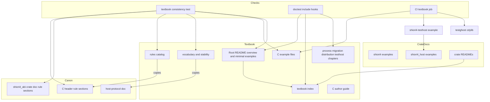
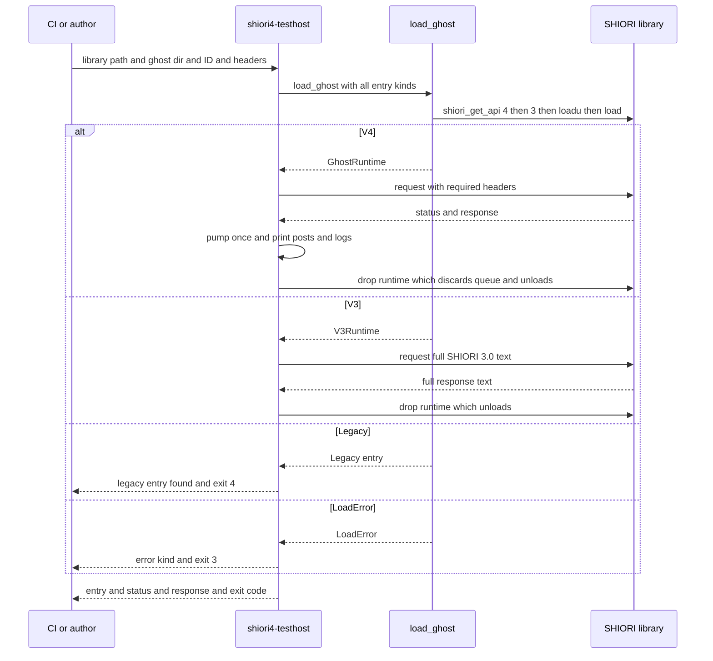
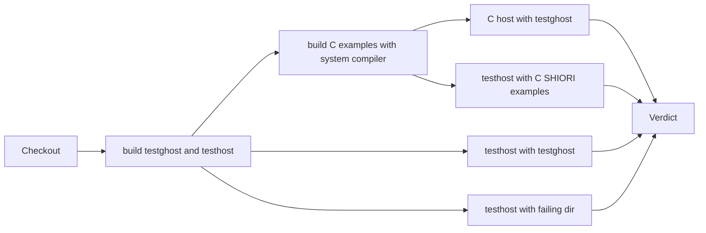

# 設計書: abi-textbook

## Overview

**Purpose**: shiori4 リポジトリに「ABI の教科書」を持たせる。SHIORI の作者（pasta など）とベースウェアの作者（areka など）が、Rust でも C でも、規約を一通りに読み、番号で引用し、理由を知ったうえで実装でき、ベースウェア無しで自分の DLL を試せる状態にする。

**Users**: SHIORI の作者は最小の例・docs.rs の `shiori4` の例・C の説明・配布の決まり・試験用のホストを使う。ベースウェアの作者は全体図・規約の一覧・語の表と確定の範囲・docs.rs の `shiori4_host` の例・別のプロセスの注意・移行の手引きを使う。

**Impact**: 語彙は変えない。規約と ABI は、設計の議論 #1 で決めた穴埋め（OwnershipChange。要件 15）だけを変える。ほかに変えるのは (1) 文書（ルートと各クレートの README・`doc/textbook/` の新しい章・各クレートの doc の例）、(2) C ヘッダ冒頭と `shiori4_abi` の `//!` の規約の節への**番号の書き入れ**（文言は変えない）、(3) 例と写しを検査する仕組み（テスト 1 本・doctest の取り込み・CI の job 1 つ）、(4) `shiori4_host` の example 1 本（試験用のホスト）である。

### Goals
- 読む順（全体図 → 最小の例 → 規約の一覧 → 語の表 → 細部）で辿れる道案内を、リポジトリの文書と docs.rs だけで持つ（1.1, 1.5）。
- 規約の全 40 項目（9 つの節）に変わらない番号を付け、正本と一字一句同じ写しに理由を添える。写しと番号の一致を CI で守る（4.1〜4.8, 14.6）。
- Rust・C・README・教科書の例のすべてを、ビルドし、DLL やベースウェアを要しないものは実行して検査する（14.1〜14.5）。
- 試験用のホスト `shiori4-testhost` を `shiori4_host` の example として持ち、3 OS の CI と他のリポジトリの CI から使える（13.1〜13.9）。

### Non-Goals
- 規約・語彙・API・ABI の決定と変更（abi-conventions・host-protocol の持ち物）。例外は要件 15 の穴埋めだけ。ほかに教科書を書く中で見つかった欠けや食い違いは、決めずに記録して開発者に回す（1.3）。
- ホストが使うメモリ確保の簡易版（C ヘッダの既定の実装・別のプロセスのホストが写しを減らす工夫）。問題になったら別の spec に切り出す。
- 従来の SHIORI/3.0 の DLL を読むこと（shiori3-legacy-host が試験用のホストの継ぎ目に足す）。
- docs.rs 以外のドキュメントサイト、pasta・areka の文書、版の更新と公開。
- 新しい公開クレート・新しい外部依存・新しいサードパーティの GitHub Action。

## Boundary Commitments

### This Spec Owns
- 全体図の穴を埋める ABI の変更（OwnershipChange。要件 15）: スレッド規約 1・5・6・ABI 規約・版の文言、`ShioriHostApi::copy_from_slice`、それに合わせた 3 クレートと testghost の直し。教科書の執筆より先に行う。
- 教科書の文書: ルートの `README.md`（全体図と最小の例と道案内）、各クレートの `README.md`（道案内の追加）、`doc/textbook/` の章（目次・規約の一覧・語の表と確定の範囲・C の書き手向けの説明・別のプロセスの注意・移行の手引き・配布の決まり・試験用のホストの使い方）。
- C の例: `doc/textbook/c/` の 3 本（最小の SHIORI・版ごとのテーブルを返す SHIORI・最小のホスト）。
- docs.rs の例: `shiori4` の `Ghost` と `protocol::PendingTags` の doc、`shiori4_host` の `Host`・`GhostRuntime`・`LoadError`・`Completer` などの doc に足す例。
- 規約の番号の付け方（「節の名前 ＋ 番号」）と、その番号を C ヘッダと `//!` に書き入れること。番号を使い回さない方針。
- 試験用のホスト `shiori4_host/examples/shiori4-testhost.rs` の引数・表示・終了の状態。
- 検査の仕組み: `shiori4_abi/tests/textbook.rs`（写し・番号・C の断片・語の表の一致）、`shiori4_host/src/lib.rs` の doctest の取り込み（`#[cfg(doctest)]` の項目）、`.github/workflows/build.yml` の job `textbook`。

### Out of Boundary
- 規約の節の**文言**・節の構成・項目の増減（abi-conventions の後継の spec か修正の PR が持つ）。この spec が行うのは、OwnershipChange の文言の直しと、番号の書き入れと、番号に伴う字下げの空白の調整だけである。
- `doc/host-protocol.md` の中身（語の正本）。教科書は引くだけで書き換えない。
- `shiori4_host` の公開 API の追加・変更（OwnershipChange の中身の直しを除く。試験用のホストは既存の `load_ghost`・`GhostRuntime`・`V3Runtime`・`LoadedGhost` だけで作る）。
- 従来の口（`LoadedGhost::Legacy`）を実際に読む処理（shiori3-legacy-host）。
- 規約の理由のうち、完了済みの spec の記録から引けないものの**確定**（草案として書き、統合の前に開発者が確かめる。4.8）。

### Allowed Dependencies
- Rust: std と、既存のクレートの依存の向き（`shiori4_host` → `shiori4` → `shiori4_abi`）だけ。新しい crate（`cc`・`windows-sys`・CLI の引数の crate など）は足さない。
- 試験用のホストは `shiori4_host` の公開 API と std だけを使う（`[dev-dependencies]` を足さない。`cargo install --example` が dev-dependencies を使わないため）。
- `shiori4_abi/tests/textbook.rs` は std だけを使い、`include_str!` でリポジトリの文書を読む。
- CI: 既存の Action（`actions/checkout@v6`・`dtolnay/rust-toolchain@stable`・`Swatinem/rust-cache@v2`）と、runner に入っている C のコンパイラ（Windows は Visual Studio の MSVC を `vswhere` と `vcvars64.bat` で呼ぶ、Linux は `cc`（gcc）、macOS は `cc`（Apple clang））だけ。
- 文書のリンク: crates.io の頁で切れないよう、README から教科書へは GitHub の絶対 URL（`https://github.com/ekicyou/shiori4/blob/main/...`）で導く。

### Revalidation Triggers
- **規約の番号**: 番号の振り方・番号の付いた項目の並びが変わったら、下流（pasta・areka・shiori3-legacy-host）の引用を確かめ直す。公開した版の番号は使い回さない（4.4）。
- **規約の節の文言・項目の追加**（上流の変更）: `shiori4_abi/tests/textbook.rs` が落ちるので、`doc/textbook/rules.md` の写しと理由を直す。
- **試験用のホストの名前・引数・終了の状態**: pasta などの CI の取り込みを壊す。変えるときは `doc/textbook/testhost.md` と申し送りを直す。
- **`shiori4_host` の公開 API・`LoadedGhost` の形**: 試験用のホストと docs.rs の例が落ちる（doctest と clippy が検出する）。
- **教科書のファイルの場所**（`doc/textbook/` の名前）: README・crate doc の GitHub の URL と、doctest の取り込み（`include_str!` の道）が切れる。
- **shiori3-legacy-host の統合**: 試験用のホストの `Legacy` の枝と、移行の手引きのホスト側の記述（11.3）を書き換える。

## Architecture

### Existing Architecture Analysis
- 3 クレートの層（`shiori4_abi` → `shiori4` → `shiori4_host`）と、下向きだけの依存。`shiori4` の doc の例は `shiori4_host` を使えない。
- 規約の正本は C ヘッダ冒頭の注釈と `shiori4_abi` の `//!` の 9 つの節（版／ABI 規約／戻り値／スレッド規約／load の規約／ホストのプロセス／DLL の口と発見の順／post の完了通知／配布の決まり）。両者の差は、C ヘッダが `host->request`・`host->post`・`host->log` と書き、`//!` が `host.request` などと書く 1 点だけで、ほかは同文。今は両者の一致を確かめる検査が無い。
- 語の正本は `doc/host-protocol.md`。`doc/` に置いた文書を README と crate doc から GitHub の URL で導く前例になっている。
- 芯が `protocol` を参照する所を数えるテスト（`shiori4/src/lib.rs` の `core_refers_to_protocol_only_by_its_declaration`、`shiori4_host/src/lib.rs` の `core_refers_to_protocol_only_by_its_reexport`）は、`mod tests {` より前の、`//` で始まらない行に `protocol` の語があるかを見る。doc の注釈（`//!`・`///`）は数えない。
- CI（`build.yml`）は test（3 OS）・deny・package・release-scripts の 4 つ。C のコンパイラを使う段は無い。`cargo test --all` は examples をビルドし、`cargo clippy --all-targets` は examples も検査する。
- リポジトリに `.gitattributes` は無く、Windows の runner の checkout は改行が CRLF になりうる。

### Architecture Pattern & Boundary Map

**選んだ形**: 「正本を引く文書 ＋ 正本に結び付けた検査」。読み物は `doc/textbook/` に置き（Q1）、例はそれぞれ実際にビルドされる場所（crate doc・C のファイル・example）に置き、文書に写したものは機械で正本と突き合わせる。



**Architecture Integration**:
- 選んだ形の理由: 規約と語は「写すときに変えない」が最重要の制約で、人の目だけでは守れない。写しの置き場所ごとに機械の検査を 1 つずつ結ぶ（Rust の例 → doctest、C の例 → CI でビルドと実行、規約の写し → テスト、語の写し → テスト）。
- 境界の分け方: 文書（`doc/textbook/`・README）・crate doc の例・C の例・試験用のホスト・検査の 5 つに分け、各ファイルの持ち主を 1 つにする（File Structure Plan）。
- 守る既存の形: `doc/` の文書を GitHub の URL で導く形（host-protocol と同じ）、テスト用 cdylib `testdata/testghost` を相手にする形、`//!` は規約、README は入口だけ（structure.md）。
- 新しいものの理由: `shiori4_abi/tests/textbook.rs` は正本の一致を守る唯一の機械の検査、job `textbook` は C のコンパイラと DLL の境界を要する検査の唯一の置き場所、`shiori4-testhost` は要件 13 の成果物そのもの。
- ステアリングとの整合: 外部依存ゼロ（std と libloading のまま）、依存は下向き、公開クレートは 3 つのまま、コメントと文書は日本語。

### Technology Stack

| 層 | 選択 / 版 | この機能での役割 | 備考 |
|----|-----------|------------------|------|
| 文書 | GitHub Flavored Markdown（`doc/textbook/*.md`・README） | 読み物の本文 | rustdoc の doctest にも取り込むので、フェンスには必ず言語を書く（```` ```text ````・```` ```c ````・```` ```sh ````）。字下げ 4 つの code block を使わない |
| Rust の例 | Rust 1.85+・edition 2024・rustdoc の doctest | docs.rs と README と教科書の Rust の例の検査 | `export_ghost!` を使う例は `fn main` を書く（merged doctest でも単独でビルドされることを確かめた） |
| C の例 | C11（`<stdint.h>`・`_Static_assert`） | C の SHIORI とホストの例 | MSVC は `/std:c11` が要る（無いと C ヘッダの `_Static_assert` で落ちることを確かめた）。日本語の注釈のため `/utf-8` |
| 試験用のホスト | `shiori4_host` の example（std だけ） | DLL を読んで要求を投げる CLI | 引数の解析も std だけで行う |
| 検査 | `cargo test`（integration test 1 本・doctest）・GitHub Actions | 写しの一致・例のビルドと実行 | 新しい Action を足さない |
| C のコンパイラ（CI） | Windows: Visual Studio 2022 の MSVC（`vswhere` → `vcvars64.bat` → `cl`）／Linux: `cc`（gcc）／macOS: `cc`（Apple clang） | C の例のビルド | runner に入っている物だけを使う |

## File Structure Plan

### Directory Structure
```text
README.md                                  # 全体図・4 つの最小の例・道案内（ルートの README。要件 2・3・6.1）
doc/
├── host-protocol.md                       # 既存（語の正本）。変えない
└── textbook/
    ├── README.md                          # 教科書の目次・読む順・当てはまる版・各章と docs.rs への道案内
    ├── rules.md                           # 規約の一覧（正本の写し）と理由・番号の付け方と引用の仕方
    ├── vocabulary.md                      # host-protocol の語の表（正本の節への導き）と確定の範囲の一覧
    ├── c.md                               # C の書き手向けの説明（所有権・release・静的 CRT・版の判定・HAS_FIELD・スレッド規約の言い直し・例外）
    ├── process.md                         # ホストを別のプロセスで動かすときの注意
    ├── migration.md                       # 移行の手引き（SHIORI 側・ホスト側・0.0.1 → 0.0.2）
    ├── distribution.md                    # ゴーストの配布の決まりの章
    ├── testhost.md                        # 試験用のホストの使い方と、他のリポジトリの CI への取り込み方
    └── c/
        ├── minimal_shiori.c               # 最小の C の SHIORI（v4 のテーブルだけ。OnBoot に応答）
        ├── versioned_shiori.c             # 版ごとに別の静的なテーブルを返す C の SHIORI（v4 と v3）
        └── minimal_host.c                 # 最小の C のホスト（開く → 4、無ければ 3 → HAS_FIELD → load → request → unload）
shiori4_abi/
├── Cargo.toml                             # exclude に tests/textbook.rs を足す（パッケージに入れない）
└── tests/
    └── textbook.rs                        # 正本と写しの一致の検査（std だけ。リポジトリの中だけで走る）
shiori4_host/
└── examples/
    └── shiori4-testhost.rs                # 試験用のホスト
```

### Modified Files
- **OwnershipChange（最初に行う。要件 15）**:
  - `shiori4_abi/include/shiori4_abi.h`・`shiori4_abi/src/lib.rs` — 版（v3 の host は `copy_from_slice` だけ）・ABI 規約（`out` は常にホストが作る）・スレッド規約 1（`load`・`unload` を足す）・5（例外は `release` だけ）・6（`release` は常にホストの関数・いつでも・どのスレッドからでも）の文言を両方で同じに直す。`ShioriHostApi` の末尾に `copy_from_slice: Option<unsafe extern "C" fn(ctx, ptr, len, out)>` を足す（戻り値は無い。写せなかったときはホストが自分で決めた印を `*out` に残し、SHIORI には知らせない。SHIORI は `out` をそのまま返し、印を見て扱うのはホスト。設計の議論 #3）。`load` の注釈の「v3 では NULL」を直す。`ShioriHostBox` が `copy_from_slice` を持つテーブルを組み、v3 の `load_v3` にも `copy_from_slice` だけのテーブルを渡す。`export_shiori!` の `request` は、応答を `host.copy_from_slice` で写してから `out` に入れ、テーブルに `copy_from_slice` が無ければ load を NULL にする。
  - `shiori4/src/lib.rs` — `Adapter` が v3 でも host のテーブル（`copy_from_slice` だけ）を持つ。`Ghost::load` に渡す host は v3 では `None` のまま。
  - `shiori4_host/src/lib.rs`・`shiori4_host/src/v3.rs` — `Bridge` が `copy_from_slice` と、インスタンスに頼らない `release` を持つ。`V3Runtime` が `copy_from_slice` だけのテーブルを渡す。`from_static` も同じ。
  - `testdata/testghost/` — 応答を `copy_from_slice` で作る（Rust の高水準層を使っていれば中身の直しだけ）。
  - 既存のテスト（DLL を通すものを含む）を新しい規約に合わせ、「ランタイムを Drop した後に応答を捨てても安全」「`copy_from_slice` の無いホストでは load が失敗する」のテストを足す。
- `shiori4_abi/include/shiori4_abi.h` — 冒頭の注釈: スレッド規約以外の 8 つの節の最上位の項目の `- ` を `1. `・`2. ` … に替え、続きの行と下位の項目の字下げを番号に合わせる（空白だけ）。冒頭の 1 行目の後に教科書への道案内を 1 行足す（規約の節の外）。
- `shiori4_abi/src/lib.rs` — `//!`: C ヘッダと同じ番号の書き入れと字下げ。冒頭の説明（`# 版` より前）に教科書への道案内を 1 行足す。
- `shiori4/src/lib.rs` — `//!` に教科書への道案内を 1 行。`Ghost` の `///` に例 4 本（アクターの中継・join しない unload・インスタンスごとの状態・v3 と v4 の両対応）。
- `shiori4/src/protocol.rs` — `PendingTags` の `///` に post → `Tag` → `OnHostComplete` の例 1 本。
- `shiori4_host/src/lib.rs` — `//!` に教科書への道案内を 1 行。`LoadError`・`GhostRuntime`（`load`・`from_static`・Drop）・`Host`（`request`・`wake`）・`Completer` の `///` に例。ファイル末尾の `mod tests` より前に、doctest だけの取り込みの節（`#[cfg(doctest)]` の項目。下の DoctestHooks）。
- `shiori4_abi/README.md`・`shiori4/README.md`・`shiori4_host/README.md` — 「詳しいドキュメント」に教科書の目次と関係する章への GitHub の絶対 URL を足す。コードの例は置かない。
- `.github/workflows/build.yml` — job `textbook`（3 OS）を足す。
- `.kiro/steering/tech.md`・`.kiro/steering/structure.md` — CI の job・`doc/textbook/`・検査の置き場所と、規約の番号の方針（「節の名前 ＋ 番号」・公開した番号は使い回さない・規約を足すときは節の末尾に新しい番号）を書き足す（最終タスクの Doc Gate。上流が規約を足すときに守れるよう、方針を steering にも置く）。

## System Flows

### 試験用のホストの流れ



- post は表示するだけで実行せず、`Completer` は使わずに捨てる（完了通知を返さない）。pump の後に残った post とイベントは、Drop が捨てる（13.5）。
- `Legacy` の枝が shiori3-legacy-host の継ぎ目になる。この spec では読まずに終わる（13.6）。

### CI の job `textbook`



- どの段の失敗も job を失敗にし、PR の検査を落とす（14.4）。PairD は終了の状態 3 を期待する（失敗の区別の確認。13.4）。

## Requirements Traceability

| Requirement | Summary | Components | Interfaces | Flows |
|-------------|---------|------------|------------|-------|
| 1.1 | 日本語・読む順の道案内 | TextbookIndex, RootReadme | 目次の順 | — |
| 1.2 | 規約は正本の文言・語は正本の綴り | RulesCatalog, VocabularyGuide, TextbookConsistencyTest | 写しの規則 | — |
| 1.3 | 正本の欠けは決めずに記録 | TextbookIndex（運用の規則）, research.md | 未決の記録 | — |
| 1.4 | 当てはまる版・タグで読む | TextbookIndex | 版の表示 | — |
| 1.5 | `doc/` と docs.rs だけ・GitHub の URL で導く | TextbookIndex, CrateReadmes, CrateDocLinks | 絶対 URL | — |
| 2.1 | 8 関数の表 | RootReadme（全体図） | 全体図の列 | — |
| 2.2 | 各行に規約の番号 | RootReadme | 根拠の列 | — |
| 2.3 | 外れたときの結果・unload の前後 | RootReadme | 結果の列・脚注 | — |
| 2.4 | v3 では host が NULL | RootReadme | v3 の行の注 | — |
| 3.1 | 4 つの最小の例 | RootReadme, CExamples | — | — |
| 3.2 | SHIORI の例は 30 行ほど・Rust は v3/v4・C は v4 だけ | RootReadme, CExamples（minimal_shiori.c） | — | — |
| 3.3 | ホストは読む → OnBoot → 受け取る → unload | RootReadme, CExamples（minimal_host.c） | — | — |
| 3.4 | 得られる応答を示す | RootReadme, CExamples | 期待する出力 | — |
| 4.1 | 9 節の全規約を順に正本のまま写す | RulesCatalog, TextbookConsistencyTest | 引用の書式 | — |
| 4.2 | スレッド規約の番号はそのまま | RulesCatalog, RuleNumbering | — | — |
| 4.3 | 「節の名前 ＋ 番号」を両方に書き入れる | RuleNumbering, TextbookConsistencyTest | 番号の書式 | — |
| 4.4 | 番号を使い回さない | RulesCatalog（方針）, RuleNumbering | — | — |
| 4.5 | 1〜2 文の理由は教科書だけ | RulesCatalog | 理由の書式 | — |
| 4.6 | 必ず述べる理由 5 つ | RulesCatalog | — | — |
| 4.7 | 規約に触れる所で番号を引く | RootReadme, CAuthorGuide, ShioriExamples, HostExamples, ProcessNotes | 引用の書き方 | — |
| 4.8 | 記録に無い理由は印を付けた草案 | RulesCatalog | 草案の印 | — |
| 5.1 | 語の表・正本の節への導き・ステータスの行 | VocabularyGuide | 語の表の列 | — |
| 5.2 | 綴りを変えない・意味は正本に委ねる | VocabularyGuide, TextbookConsistencyTest | — | — |
| 5.3 | 版ごとの確定の範囲 | VocabularyGuide | 確定の範囲の表 | — |
| 5.4 | 0.0.1 → 0.0.2 を付録 A から | VocabularyGuide | — | — |
| 5.5 | 書かれた語は確定・無い語は決まっていない | VocabularyGuide | — | — |
| 5.6 | 0.0.x は互換を壊しうる | VocabularyGuide | — | — |
| 6.1 | ルートの README は全体図・最小の例・道案内 | RootReadme | — | — |
| 6.2 | 各クレートの README の 6 項目 | CrateReadmes | — | — |
| 6.3 | crates.io で切れないリンク | CrateReadmes, RootReadme | 絶対 URL | — |
| 6.4 | README の例は検査の対象 | DoctestHooks, TextbookConsistencyTest | — | — |
| 6.5 | README は規約を写さない | RootReadme, CrateReadmes | — | — |
| 7.1 | アクターの中継（規約 2） | ShioriExamples | `Ghost` の doc | — |
| 7.2 | PendingTags・登録してから post | ShioriExamples | `PendingTags` の doc | — |
| 7.3 | join しない unload（規約 5） | ShioriExamples | `Ghost` の doc | — |
| 7.4 | インスタンスごとの状態 | ShioriExamples | `Ghost::load` の doc | — |
| 7.5 | v3 と v4 の両対応・host が None | ShioriExamples | `Ghost` の doc | — |
| 7.6 | 今の API の形 | ShioriExamples | doctest | — |
| 8.1 | LoadError の 5 つの値ごとの扱い | HostExamples | `LoadError` の doc | — |
| 8.2 | load は NotShiori4 でライブラリを手放す・from_library | HostExamples | `GhostRuntime::load` の doc | — |
| 8.3 | wake → pump を Win32 と channel で | HostExamples | `Host::wake` の doc | — |
| 8.4 | Completer で completed・interrupted・NOTIFY | HostExamples | `Completer` の doc | — |
| 8.5 | nobreak の SEND を終了で捨てて 204 | HostExamples | `Completer` の doc | — |
| 8.6 | getproperty・setproperty・forbidden | HostExamples | `Host::request` の doc | — |
| 8.7 | unload の順序と Drop | HostExamples | `GhostRuntime` の doc | — |
| 8.8 | from_static の決定論のテスト | HostExamples | `GhostRuntime::from_static` の doc | — |
| 8.9 | 今の API の形 | HostExamples | doctest | — |
| 9.1 | 所有権の表と図 | CAuthorGuide | — | — |
| 9.2 | release はどのスレッドからも・負でも解放 | CAuthorGuide, CExamples | — | — |
| 9.3 | 静的 CRT でも安全 | CAuthorGuide, CiJob（`/MT` でビルド） | — | — |
| 9.4 | 版の判定（ホスト・SHIORI） | CAuthorGuide, CExamples（minimal_host.c・versioned_shiori.c） | — | — |
| 9.5 | 最小の C のホスト | CExamples（minimal_host.c） | CLI | CI の流れ |
| 9.6 | `SHIORI_HAS_FIELD` の例 | CExamples（minimal_host.c）, CAuthorGuide | — | — |
| 9.7 | スレッド規約 1〜7 を C の言葉で | CAuthorGuide | — | — |
| 9.8 | 言語ごとの例外・`SHIORI_E_PANIC` | CAuthorGuide | — | — |
| 10.1 | host.request の中継は同期の往復 | ProcessNotes | — | — |
| 10.2 | post の受付と完了は別の時点 | ProcessNotes | — | — |
| 10.3 | PANIC と異常終了はインスタンスの終わり | ProcessNotes | — | — |
| 10.4 | 規約の番号を引き短く | ProcessNotes | — | — |
| 11.1 | SHIORI 側の 3 段の差分 | MigrationGuide | — | — |
| 11.2 | ホスト側の差分 | MigrationGuide | — | — |
| 11.3 | v3 互換モードは Windows 以外向け・旧来の口はまだ無い | MigrationGuide | — | — |
| 11.4 | 0.0.1 → 0.0.2 は付録 A へ | MigrationGuide | — | — |
| 12.1 | 配布の手順を正本の言葉で | DistributionGuide, TextbookConsistencyTest | 引用の書式 | — |
| 12.2 | Rust の例 | DistributionGuide, DoctestHooks | doctest | — |
| 12.3 | SHIORI の作者向けのファイル名 | DistributionGuide | — | — |
| 12.4 | SHIORI/3.0 と v4 の両方に使える | DistributionGuide | — | — |
| 13.1 | 発見の順で読み、口を表示 | TestHost | CLI | 試験用のホストの流れ |
| 13.2 | 要求（既定 OnBoot）・戻り値と全文 | TestHost | CLI | 試験用のホストの流れ |
| 13.3 | unload して終わる | TestHost | — | 試験用のホストの流れ |
| 13.4 | 失敗の種類と終了の状態 | TestHost, CiJob | 終了の状態 | 試験用のホストの流れ |
| 13.5 | 最小の Host・pump 1 回・完了通知なし | TestHost | `Host` の実装 | 試験用のホストの流れ |
| 13.6 | 従来の口だけなら表示して終わる | TestHost | 終了の状態 4 | 試験用のホストの流れ |
| 13.7 | 3 OS で動く | TestHost, CiJob | — | CI の流れ |
| 13.8 | CI で 3 OS の往復 | CiJob | — | CI の流れ |
| 13.9 | example 1 本・`cargo install --git --example`・取り込み方を書く | TestHost, TestHostGuide | 取り込みの手順 | — |
| 14.1 | Rust の例を 3 OS でビルド・実行 | DoctestHooks, ShioriExamples, HostExamples, 既存の job test | doctest | — |
| 14.2 | C の例を 3 OS でビルド・入れ替えた組で実行 | CiJob, CExamples | — | CI の流れ |
| 14.3 | 検査しない例は隣に明示 | 全文書（運用の規則）, TextbookConsistencyTest | 例の注記の規則 | — |
| 14.4 | 失敗で PR の検査を落とす | CiJob, 既存の job test | — | CI の流れ |
| 14.5 | DoD と `cargo package --workspace` を壊さない | TextbookConsistencyTest（exclude）, DoctestHooks, TestHost | — | — |
| 14.6 | 規約の写しと番号の一字一句の一致 | TextbookConsistencyTest | 比べ方 | — |
| 15.1–15.7 | 全体図の穴を埋める ABI の変更 | OwnershipChange（Modified Files の先頭） | `ShioriHostApi::copy_from_slice` | — |

## Components and Interfaces

### 概要

| Component | Domain | Intent | Req Coverage | Key Dependencies | Contracts |
|-----------|--------|--------|--------------|------------------|-----------|
| TextbookIndex | 読み物 | 目次・読む順・版・道案内 | 1.1, 1.3, 1.4, 1.5 | 全章 (P1) | — |
| RootReadme | 読み物 | 全体図と 4 つの最小の例 | 2.1–2.4, 3.1–3.4, 4.7, 6.1, 6.3–6.5 | RulesCatalog (P0), CExamples (P0) | State（全体図の表） |
| CrateReadmes | 読み物 | crates.io の顔に道案内を足す | 1.5, 6.2, 6.3, 6.5 | TextbookIndex (P1) | — |
| RulesCatalog | 読み物 | 規約の写し・番号・理由 | 1.2, 4.1–4.8 | RuleNumbering (P0) | State（引用の書式） |
| RuleNumbering | 正本への書き入れ | C ヘッダと `//!` に番号 | 4.2, 4.3, 4.4 | — | State（番号の書式） |
| VocabularyGuide | 読み物 | 語の表と確定の範囲 | 1.2, 5.1–5.6 | host-protocol (P0) | — |
| CAuthorGuide | 読み物 | C の書き手向けの説明 | 4.7, 9.1–9.8 | CExamples (P0) | — |
| ProcessNotes | 読み物 | 別のプロセスの注意 | 4.7, 10.1–10.4 | RulesCatalog (P1) | — |
| MigrationGuide | 読み物 | 移行の手引き | 11.1–11.4 | host-protocol 付録 A (P1) | — |
| DistributionGuide | 読み物 | 配布の決まりの章 | 12.1–12.4 | `shiori_file_candidates` (P1) | — |
| TestHostGuide | 読み物 | 試験用のホストの使い方と取り込み方 | 13.9 | TestHost (P0) | — |
| CrateDocLinks | docs.rs | 3 クレートの `//!` から教科書へ | 1.5 | TextbookIndex (P2) | — |
| ShioriExamples | docs.rs | `shiori4` の例 5 本 | 4.7, 7.1–7.6, 14.1 | shiori4_abi の `ShioriHostBox` (P0) | Service（doctest） |
| HostExamples | docs.rs | `shiori4_host` の例 | 4.7, 8.1–8.9, 14.1 | `GhostRuntime::from_static` (P0) | Service（doctest） |
| CExamples | C の例 | C の SHIORI 2 本とホスト 1 本 | 3.1–3.4, 9.2, 9.4–9.6, 14.2 | C ヘッダ (P0) | Service（CLI・C ABI） |
| TestHost | 試験用のホスト | DLL を読み、要求を投げて表示 | 13.1–13.9 | `load_ghost` (P0) | Service（CLI） |
| TextbookConsistencyTest | 検査 | 写し・番号・C の断片・語の表の一致 | 1.2, 4.1, 4.3, 5.2, 6.4, 12.1, 14.3, 14.5, 14.6 | 正本のファイル (P0) | Batch |
| DoctestHooks | 検査 | README と教科書の Rust の例を doctest に載せる | 6.4, 12.2, 14.1, 14.5 | rustdoc (P0) | Batch |
| CiJob | 検査 | C の例と試験用のホストを 3 OS で動かす | 9.3, 13.4, 13.7, 13.8, 14.2, 14.4 | runner の C のコンパイラ (P0), testghost (P0) | Batch |

### 読み物

#### TextbookIndex（`doc/textbook/README.md`）

| Field | Detail |
|-------|--------|
| Intent | 教科書の入口。読む順と、各章・docs.rs・正本への道案内を持つ |
| Requirements | 1.1, 1.3, 1.4, 1.5 |

**Responsibilities & Constraints**
- 読む順を番号付きで示す: 1 全体図と最小の例（ルートの README）→ 2 規約の一覧（`rules.md`）→ 3 語の表と確定の範囲（`vocabulary.md`）→ 4 細部（docs.rs の `shiori4`・`shiori4_host`、`c.md`、`migration.md`、`distribution.md`）。補いとして `process.md`・`testhost.md`。
- 冒頭に「当てはまる版」を置く。書式は `doc/host-protocol.md` 第 0 章に揃える（「shiori4 0.0.x から。`main` の文書には未公開の版の内容が載りうるので、公開された版の内容は、その版のタグ `vX.Y.Z` の文書で読む」）。
- 正本の位置（C ヘッダ・`shiori4_abi` の docs.rs・`doc/host-protocol.md`）と、「教科書は正本を写すだけで、食い違ったら正本が正しい」ことを述べる。
- 例の注記の規則（14.3）を 1 段落で述べる: 「ビルドだけを検査する例」「検査しない例」には、例の直前の 1 文で理由を書く。

**Implementation Notes**
- 1.3 の運用: 執筆の中で見つかった正本の欠け・食い違い・二通りに読める所は、教科書の本文に決めた形で書かず、`.kiro/specs/abi-textbook/research.md` の「正本の未決」に記録し、実装の報告で開発者に回す。教科書の該当箇所には「規約に定めが無い」とだけ書く。
- 設計の段階で見つかった未決（`load`・`unload` のスレッド、`release` の期間）は、設計の議論 #1 で OwnershipChange として埋めた。

#### RootReadme（`README.md`）

| Field | Detail |
|-------|--------|
| Intent | 全体図・4 つの最小の例・道案内だけを持つワークスペースの入口 |
| Requirements | 2.1, 2.2, 2.3, 2.4, 3.1, 3.2, 3.3, 3.4, 4.7, 6.1, 6.3, 6.4, 6.5 |

**Responsibilities & Constraints**
- 構成（この順）: 1 行の紹介 → クレートの表（既存） → 全体図 → 最小の例 4 本 → 道案内（教科書の目次・各章・docs.rs・正本）。規約の本文は写さない（6.5）。全体図の各行は規約の番号を引くだけで、規約の文は `rules.md` へ導く。
- リンクは GitHub の絶対 URL にする（ルートの README は crates.io に出ないが、各クレートの README と書き方を揃える。6.3）。
- Rust の例 2 本は ```` ```rust ```` のフェンスで書き、DoctestHooks で doctest に載せる。C の例 2 本は ```` ```c ```` のフェンスで `doc/textbook/c/minimal_shiori.c` と `minimal_host.c` の全文をそのまま写し、`<details>` で畳む（最初の画面を短く保つ。設計の議論 #6）。TextbookConsistencyTest がファイルとの一致を確かめる（畳んだ中でも効く）。

##### State Management: 全体図の表
列は「関数」「呼ぶ側 → 呼ばれる側」「呼べるスレッド」「呼べる期間」「外れたときの結果」「根拠」の 6 つ。行は次の 8 つで、内容は正本からだけ引く。

| 関数 | 呼ぶ側 → 呼ばれる側 | 呼べるスレッド | 呼べる期間 | 外れたときの結果 | 根拠 |
|------|------|------|------|------|------|
| `load` | ホスト → SHIORI | ホストがインスタンスごとに決めた 1 つのスレッド | インスタンスの始まり | 失敗は NULL（v4 は先に log。`copy_from_slice` が無ければ失敗） | load の規約・スレッド規約 1・2 |
| `request`・`notify` | ホスト → SHIORI | load と同じスレッド | load が返ってから unload を呼ぶまで | — | スレッド規約 1・7 |
| `host.request` | SHIORI → ホスト | load・request・notify を呼ばれているスレッド | その呼び出しが返るまで（v4） | `SHIORI_E_WRONG_THREAD`（-7）。中から SHIORI を呼び返すと `SHIORI_E_REENTRANT`（-4） | スレッド規約 2・3 |
| `post` | SHIORI → ホスト | 任意 | unload が返るまで | unload の開始後は `SHIORI_E_SHUTDOWN`（-5）でよい | スレッド規約 4・5、post の完了通知 2 |
| `log` | SHIORI → ホスト | 任意 | unload が返るまで | — | スレッド規約 4・5 |
| `copy_from_slice` | SHIORI → ホスト | 任意 | unload が返るまで | 写せなかったら、ホストが `out` に自分の印を残す（SHIORI には知らせない） | ABI 規約・スレッド規約 5・6 |
| `release` | 受け取った側 → ホスト（`ShioriBytes` は常にホストが作る） | 任意 | いつでも（unload の後でもよい） | — | スレッド規約 5・6、ABI 規約 |
| `unload` | ホスト → SHIORI | load と同じスレッド | インスタンスの終わり。長く止まらない | 返った後、SHIORI はホストを呼ばない（`release` だけは例外） | スレッド規約 1・5 |

- 行は 9 つ（8 つの関数に `copy_from_slice` を足す）。表の下に注を 2 つ置く: (a) v3 互換モード（`shiori_get_api(3)`）では host は `copy_from_slice` だけを持ち、`host.request`・`post`・`log` の行は使えない（版。2.4）。(b) unload を始めた後（post は -5 でよい、未配送のイベントは捨てる）と返った後（ホストのどの関数も呼ばない）の違い（2.3）。
- 「根拠」の番号は RulesCatalog の番号の付け方に従う（例「ABI 規約 6」）。上の表の番号は、番号の書き入れの後の C ヘッダの並びから決まり、TextbookConsistencyTest の検査とは別に執筆時に確かめる。

##### 最小の例 4 本
- Rust の SHIORI（30 行ほど）: `Ghost` を実装して `OnBoot` に `Value` を返し、`shiori4::export_ghost!` で v3 と v4 の両方を出す（3.2）。隠し行（`# `）で `ShioriHostBox` と `ShioriApi::new::<Adapter<_>, 4>()` を使って 1 往復し、`assert_eq!` で応答を確かめ、例の直後に得られる応答を書く（3.4）。
- Rust のホスト: `GhostRuntime::load` → `request("…ID: OnBoot…")` → 応答を表示 → Drop で unload（3.3）。DLL を要するので `no_run` で、直前に「この例はビルドだけを検査する。同じ流れを試験用のホストが CI の 3 OS で実行している」と書く（14.3）。
- C の SHIORI: `minimal_shiori.c` の全文（v4 のテーブルだけ。3.2）。
- C のホスト: `minimal_host.c` の全文。直後に試験用の SHIORI（testghost）を読ませたときの出力を書く（3.4）。

#### CrateReadmes（`shiori4_abi/README.md`・`shiori4/README.md`・`shiori4_host/README.md`）
要約のみ。既存の 6 項目（役割・利用者・入口・関係・詳しいドキュメント・ライセンス）を保ち、「詳しいドキュメント」に教科書の目次と、そのクレートの利用者が読む章（`shiori4_abi` は `rules.md`・`c.md`、`shiori4` は `distribution.md`・`migration.md`、`shiori4_host` は `vocabulary.md`・`process.md`・`testhost.md`）への GitHub の絶対 URL を足す（1.5, 6.2, 6.3）。規約の文は写さない（6.5）。**コードの例は置かない**（設計の議論 #7。6.4 は例を持つ README だけが対象なので、検査の対象はルートの README になる）。

#### RulesCatalog（`doc/textbook/rules.md`）

| Field | Detail |
|-------|--------|
| Intent | 9 つの節の全規約を正本のまま写し、番号と 1〜2 文の理由を添える |
| Requirements | 1.2, 4.1, 4.2, 4.3, 4.4, 4.5, 4.6, 4.7, 4.8 |

**Responsibilities & Constraints**
- 冒頭: 番号の付け方と引用の仕方、番号を使い回さない方針（4.4: 公開した版で付けた番号は、後の版で別の規約に使わない。足された規約は新しい番号を末尾に足す）、写しは正本と一字一句同じで CI が確かめること、理由は教科書だけに置くこと。
- 本文: 正本の節の順に `## <正本の節の見出し>`（例 `## load の規約`・`## 版（abi_version）`）を置き、各規約を正本の行のまま**引用（`>` で始まる行）**で写す。引用の行は正本の写しだけに使い、理由・注は引用の外に書く。
- 各規約の直後に `**理由**:` で 1〜2 文（4.5）。出典（完了済みの spec の論点の番号や `hearing.md` の節）を括弧で添え、長い経緯はその出典へ導く。
- 記録から引けない理由は、`**理由（草案・記録に無い）**:` の印で書き、統合の前に開発者の確認を受ける（4.8）。確認の済んだものは印を外す。
- 4.6 の 5 つ: 「ABI を緩めない理由（`host.request` をホストの UI スレッドで待つとデッドロックする）」はスレッド規約 2 に、「再入の禁止」はスレッド規約 3 に、「post の完了を post の中で届けない」「unload で未配送を捨てる」は post の完了通知 3 に添える。「SEND が既定で割り込む（SSTP に揃えた）」は C ヘッダの規約ではなく `doc/host-protocol.md` 第 5.1 節の決まりなので、規約の節の後に `## ホスト側プロトコルの決まりの理由` を置き、番号を付けずに節を引いて理由を書く（設計の議論 #5）。

##### State Management: 番号の書式と引用の仕方
- スレッド規約: 「スレッド規約 N」。短く「規約 N」と書いたら、これまでどおりスレッド規約 N を指す（4.2）。
- ほかの 8 つの節: 「<節の名前> N」。節の名前は見出しから括弧の部分を除いたもの: 「版 N」「ABI 規約 N」「戻り値 N」「load の規約 N」「ホストのプロセス N」「DLL の口と発見の順 N」「post の完了通知 N」「配布の決まり N」（4.3）。
- 番号は各節の**最上位の項目**にだけ付ける。下位の項目（`- ` の字下げ）は親の番号で引く（例「post の完了通知 3」は post 中に届けないことと unload で捨てることを含む）。番号に合わせて字下げの空白を揃えることは「文言を変えない」に収まる。廃止した規約は番号を残して「（廃止）」と書き、番号を使い回さない（連番の検査と両立する）。OwnershipChange で文を直すスレッド規約 1・5・6 は、番号はそのままで文だけを差し替える（設計の議論 #2）。
- 番号を付けた後の項目数: 版 4・ABI 規約 8・戻り値 2・スレッド規約 7・load の規約 5・ホストのプロセス 2・DLL の口と発見の順 2・post の完了通知 5・配布の決まり 5（計 40）。
- 写しの綴り: 引用は `shiori4_abi` の `//!` の形（`host.request`）で書く。C ヘッダの `host->request` とは、TextbookConsistencyTest の正規化で同じものとして比べる（設計の議論 #4）。

#### RuleNumbering（`shiori4_abi/include/shiori4_abi.h`・`shiori4_abi/src/lib.rs`）

| Field | Detail |
|-------|--------|
| Intent | 正本の規約の節に、RulesCatalog と同じ番号を書き入れる |
| Requirements | 4.2, 4.3, 4.4 |

**Responsibilities & Constraints**
- スレッド規約の節は変えない（既に `1.`〜`7.`）。
- ほかの 8 つの節: 最上位の項目の先頭の `- ` を `N. ` に替える。番号を付けたことで本文の始まりが 1 字右へずれるので、続きの行と下位の項目の字下げを 3 つの空白に揃える（`//!` は rustdoc の Markdown で順序付きの箇条の子として描かれるために要る。C ヘッダも同じ空白にする）。文字の追加・削除・語順の変更はしない。
- 冒頭の説明（規約の節の外）に教科書の目次への 1 行を足す。C ヘッダは `* 教科書: https://github.com/ekicyou/shiori4/blob/main/doc/textbook/README.md`、`//!` は同じ URL の 1 文。
- tech.md の「規約を変えたら両方を直す」と同じく、両方を 1 つの変更で直す。

**Implementation Notes**
- Validation: TextbookConsistencyTest の「C ヘッダと `//!` の一致」「番号の連番」「写しの一致」が、片方だけの直し・番号の飛び・写しのずれを落とす。
- Risks: 番号を付けた版を公開した後は番号が固定になる。番号の付け方は設計の議論 #2 で確定した。

#### VocabularyGuide（`doc/textbook/vocabulary.md`）

| Field | Detail |
|-------|--------|
| Intent | ID・ヘッダ名・値の語・ステータス・`Reason` の語の表と、版ごとの確定の範囲 |
| Requirements | 1.2, 5.1, 5.2, 5.3, 5.4, 5.5, 5.6 |

**Responsibilities & Constraints**
- 語の表の列: 「種類」「語」「定数名」「正本の節」。最初の 3 列は `doc/host-protocol.md` 第 8 章の行を同じ綴りで写し（TextbookConsistencyTest が確かめる）、4 列目に語を定める節（例 `getproperty` → 第 3.1 節、`nobreak` → 第 4.4・5 節、`forbidden` → 第 7.1 節）を足す（5.1）。
- 第 8 章に行の無いステータスは、`shiori4_abi` の定数から行を足す: `SHIORI_200_OK`・`SHIORI_204_NO_CONTENT`・`SHIORI_311_NOT_ENOUGH`・`SHIORI_312_ADVICE`・`SHIORI_400_BAD_REQUEST`・`SHIORI_500_INTERNAL_SERVER_ERROR`・`SHIORI_E_INVALID_ARG`〜`SHIORI_E_WRONG_THREAD`（-1〜-7）。各行に、それを使う `doc/host-protocol.md` の節（例 400 → 第 7.1 節、204 → 第 4.5・6.3 節、500 → 第 7.5 節）と C ヘッダの「戻り値」を添える（5.1）。語の意味は書かず、正本と ukadoc（付録 B）へ導く（5.2）。
- 確定の範囲の一覧: 冒頭に「0.0.x の間は、版ごとに互換を壊す変更がありうる」の 1 行（5.6）。版ごとの表（0.0.1・0.0.2・未公開の `main`）で、「`doc/host-protocol.md` に書かれた語と、その版で公開された API は、その版で確定（後の版で変えるときは付録 A と同じく移行を書く）」「文書に無い語（定数の無い `Reference*` の並びの拡張など）は決まっていない」を示す（5.3, 5.5）。0.0.1 → 0.0.2 の差は付録 A への導きと要約の表で示す（5.4）。語ごとの安定度は付けない。

#### CAuthorGuide（`doc/textbook/c.md`）

| Field | Detail |
|-------|--------|
| Intent | Rust 以外で書く人向けに、所有権・版・スレッド・例外を C の言葉で述べる |
| Requirements | 4.7, 9.1, 9.2, 9.3, 9.4, 9.5, 9.6, 9.7, 9.8 |

**Responsibilities & Constraints**
- 所有権の表（「誰が作る」「誰が書く」「誰が `release` を呼ぶ」「いつまで有効」の列。行は `request` の `out`（SHIORI が `host->copy_from_slice` で作る＝ホストのメモリ）・`host->request` の `out`（ホストが作る）・引数の `(ptr, len)`・`load` の `dir`）と、`out` の受け渡しの Mermaid の図。要点は「`ShioriBytes` の確保と解放は、どちらの向きでもホストのメモリとホストのコードだけで起きる」（9.1）。
- `release` はどのスレッドからも、unload の後にも呼ばれうること（スレッド規約 6）と、戻り値が負でも `shiori_bytes_release(&out)` を呼ぶこと（ABI 規約）。ホストの `release` はインスタンスの状態（`ctx`）に頼らず `owner` だけで解放する。例は `minimal_host.c` からの抜き出し（9.2）。
- 静的 CRT: SHIORI はメモリを境界の外へ渡さないので、ホストと SHIORI の CRT が別でも関係ない、と 1 段落（9.3）。CI は Windows で C の SHIORI を `/MT`（静的 CRT）でビルドし、Rust で作ったホスト（試験用のホスト）から読む。
- 版の判定: ホスト側（`shiori_get_api(4)` が NULL なら `shiori_get_api(3)`）は `minimal_host.c` から、SHIORI 側（版ごとに別の静的なテーブル）は `versioned_shiori.c` から抜き出す（9.4）。最小の C のホストの流れ（9.5）と `SHIORI_HAS_FIELD`（9.6）も `minimal_host.c` から抜き出す。
- スレッド規約 1〜7 の言い直し: 「どの関数をどのスレッドから呼ぶか」「どの関数ポインタがいつまで有効か」の文に、1 文ごとに番号を添える（9.7）。
- 例外と panic: C++ は `extern "C"` の関数の中で `try { … } catch (...) { return SHIORI_E_PANIC; }`、Zig は panic を境界の外へ出さない（エラーの値を返す作りにし、panic の handler に頼らない）、Rust は `catch_unwind`（`export_shiori!` が行う）、など言語ごとに 1 文ずつ、文で書く（9.8）。ほかの言語のコードの塊（フェンス）は置かない（検査できないため）。
- C の塊（```` ```c ````）は、`doc/textbook/c/` のファイルか C ヘッダからの**そのままの抜き出し**だけにする（TextbookConsistencyTest が確かめる）。

#### ProcessNotes・MigrationGuide・DistributionGuide・TestHostGuide
要約のみ（新しい境界を持たない章）。

- **ProcessNotes**（`doc/textbook/process.md`。10.1〜10.4）: 3 つの注意（`host.request` の中継は同期の往復で、親は SHIORI の応答を待つ間も子の問い合わせに答えられる待ち方にする／post の受付（204）と完了は別の時点／`SHIORI_E_PANIC` と子の異常終了はインスタンスの終わり）を、「ホストのプロセス 1・2」・スレッド規約 2・4・戻り値 2 を引いて 1 頁に収める。
- **MigrationGuide**（`doc/textbook/migration.md`。11.1〜11.4）: SHIORI 側は「SHIORI/3.0 の DLL」「v3 互換モード」「v4」の 3 列の差分の表（Charset は UTF-8 だけで Shift_JIS の要求は来ない／HGLOBAL は `(ptr, len)` と `release`／load の dir の形／開始行の有無／ホストを呼べるか）。ホスト側は差分の表（要求は開始行と Charset を外すだけでヘッダの語は同じ／状態は戻り値で受ける／`shiori_get_api` の有無で見分ける／両方を持つ DLL は「DLL の口と発見の順 1・2」）。v3 互換モードは Windows 以外のホスト向けで、Windows のホストは旧来の DLL を今までどおり読めばよいこと、「旧来の DLL を読む口は shiori4_host にまだ無い」こと（11.3）。0.0.1 → 0.0.2 は `doc/host-protocol.md` 付録 A へ導く（11.4）。統合後の書き換えは shiori3-legacy-host の brief に申し送る（実装の最終タスク）。
- **DistributionGuide**（`doc/textbook/distribution.md`。12.1〜12.4）: 「配布の決まり 1〜5」を引用で写し（TextbookConsistencyTest の対象）、手順を番号で辿る。Rust の例（`shiori_file_candidates`・`machine_matches`・`TargetOs`・`TargetArch`）は ```` ```rust ```` で書き、DoctestHooks で検査する（ファイルを要する部分は `no_run` ＋注記）。SHIORI の作者向けの表: Rust の cdylib が既定で作る名前（Windows `<crate>.dll`・Linux `lib<crate>.so`・macOS `lib<crate>.dylib`）と、置く名前（`<幹>.x64.dll`・`lib<幹>.arm64.so` など）への付け替え。SHIORI/3.0 と v4 の両方に使えること（配布の決まり 5）。
- **TestHostGuide**（`doc/textbook/testhost.md`。13.9）: 引数・表示・終了の状態の表（TestHost の契約の写し）と、取り込み方: `cargo install --git https://github.com/ekicyou/shiori4 --tag vX.Y.Z shiori4_host --example shiori4-testhost`（版を固定する）と、公開後の `cargo install shiori4_host --version X.Y.Z --example shiori4-testhost`。CI の例（GitHub Actions の 1 段）を ```` ```yaml ```` で示し、「検査しない例」の注記を添える（14.3）。

#### CrateDocLinks
要約のみ。`shiori4_abi`・`shiori4`・`shiori4_host` の `//!` の冒頭の説明に、教科書の目次（`https://github.com/ekicyou/shiori4/blob/main/doc/textbook/README.md`）への 1 文を足す（1.5）。`shiori4_abi` では規約の節の外に置く。

### docs.rs の例

#### ShioriExamples（`shiori4/src/lib.rs`・`shiori4/src/protocol.rs`）

| Field | Detail |
|-------|--------|
| Intent | SHIORI の作者が規約の難しい所を守る書き方の例 5 本 |
| Requirements | 4.7, 7.1, 7.2, 7.3, 7.4, 7.5, 7.6, 14.1 |

**Responsibilities & Constraints**
- 置き場所: 7.1・7.3・7.5 は `Ghost` の `///`、7.4 は `Ghost::load` の `///`、7.2 は `protocol::PendingTags` の `///`。`shiori4/src/lib.rs` に足すのは doc の注釈（`///`）だけで、芯のコード行に `protocol` の語を足さない（`core_refers_to_protocol_only_by_its_declaration` を壊さない）。
- 実行のしかた: `shiori4` の doc は `shiori4_host` を使えないので、各例の隠し行（`# `）に偽のホストを置く。偽のホストは `shiori4::ShioriHost` を実装する小さな struct で、`shiori4::ShioriHostBox::new` で包み、`static API: shiori4::ShioriApi = shiori4::ShioriApi::new::<shiori4::Adapter<MyGhost>, { shiori4::SHIORI_ABI_VERSION }>();` の `API.load(&host, dir)` で読んで、`request`・`notify` で往復させ、`assert!` で結果を確かめる。v3 の例は `ShioriApi::new::<_, { SHIORI_ABI_VERSION_3 }>()` と `load_v3` を使う。
- 7.1 アクターの中継: アクターのスレッドは `host.request` を呼ばず、要求を channel で「応答を待っている SHIORI のスレッド」へ送り、SHIORI のスレッドが `request` の中で `ShioriHostHandle::request_str` を呼んで結果を返す。偽のホストは呼ばれたスレッドが load・request のスレッドと同じことを `assert_eq!` で確かめる（スレッド規約 2）。
- 7.2 PendingTags: `PendingTags::register` で文脈を登録して受付 ID を得てから、その ID を `Tag` に入れて post する（登録より先に post すると、完了が先に届いたときに文脈が見つからない。post の完了通知 1）。偽のホストに `OnHostComplete` を `request` で届け、`take_from` で文脈を取り戻して再開する。
- 7.3 join しない unload: `Ghost` が Poster（`.clone()` したもの）を持つワーカーを起こし、Drop で join しない。インスタンスを unload した後、ワーカーの `post` が `SHIORI_E_SHUTDOWN` を返し `log` が何もしないことを `assert_eq!` で示す（スレッド規約 5）。
- 7.4 インスタンスごとの状態: `static` を使わず状態を `Self` に持ち、同じテーブルで 2 つのインスタンスを読んで状態が混ざらないことを示す（load の規約 5）。
- 7.5 v3 と v4: `load` の `host` が `None` のときは `Properties` の受動キャッシュ（`set` した値）に代える書き方。v4 と v3 の両方で 1 往復する。
- 今の API の形（`&str` を受ける `request`・`notify`、`ShioriHostPoster` は `.clone()`・`log` を持つ）で書く（7.6）。

**Contracts**: Service [x]
##### Service Interface（例が使う公開 API。新しい API は無い）
```rust
// shiori4（既存）
pub trait Ghost: Sized + 'static {
    const SUPPORTS_V3: bool = true;
    fn load(host: Option<ShioriHostHandle>, dir: &str) -> Result<Self, ShioriStatus>;
    fn request(&mut self, req: &str) -> ShioriResponse;
    fn notify(&mut self, req: &str) -> ShioriStatus;
}
// shiori4_abi（shiori4 が再エクスポート。偽のホストに使う）
pub trait ShioriHost: Sync + 'static {
    fn request(&self, req: &[u8]) -> ShioriResponse;
    fn post(&self, msg: &[u8]) -> ShioriStatus;
    fn log(&self, level: i32, msg: &str);
}
impl ShioriApi {
    pub const fn new<S: Shiori, const V: u32>() -> Self;
    pub fn load<'a, H: ShioriHost>(&'a self, host: &'a ShioriHostBox<H>, dir: &str) -> Option<ShioriInstance<'a>>;
    pub fn load_v3<'a>(&'a self, dir: &str) -> Option<ShioriInstance<'a>>;
}
```
- Preconditions: 例はすべて隠し行の偽のホストで完結し、DLL もファイルも要しない。
- Postconditions: 各例は `cargo test --doc -p shiori4` で実行され、`assert!` が往復の結果を確かめる（14.1）。
- Invariants: 偽のホストは例を読みやすくするための隠し行で、規約の判定の正本は `shiori4_host` の `Bridge` とそのテストに残る。

**Implementation Notes**
- Risks: 隠し行が長くなる（各例 15 行ほど）。読む人に見える部分を短く保つため、偽のホストは隠し行に置き、「この例は偽のホストで往復を実行して確かめている」と 1 文添える。

#### HostExamples（`shiori4_host/src/lib.rs`）

| Field | Detail |
|-------|--------|
| Intent | ベースウェアの作者がホストの責任を一通り果たす書き方の例 |
| Requirements | 4.7, 8.1, 8.2, 8.3, 8.4, 8.5, 8.6, 8.7, 8.8, 8.9, 14.1 |

**Responsibilities & Constraints**
- 置き場所と実行のしかた:

| 要件 | 置く doc | 実行 |
|------|----------|------|
| 8.1 LoadError の 5 つの値ごとの扱い（`NotShiori4` は SHIORI/3.0 の候補へ・`LoadFailed` は読めなかったゴーストで読み直さない・`Unsupported` は別の版で読み直せる・`Library`・`InvalidPath`） | `LoadError` | `no_run`（DLL を要する）＋注記。`InvalidPath` の枝は実行できる別の例にする |
| 8.2 `load` は `NotShiori4` でライブラリを手放す（別の口で読み直すと 2 回読まれる）。`from_library` と `FromLibraryError::into_parts` で取り戻す道 | `GhostRuntime::load`・`from_library` | `no_run` ＋注記 |
| 8.3 `wake` → `pump`: std の channel のスレッド／Win32 のメッセージの輪 | `Host::wake` | channel 版は `from_static` で実行。Win32 版は `no_run`、使う関数（`PostThreadMessageW`・`GetMessageW`・`TranslateMessage`・`DispatchMessageW`・`GetCurrentThreadId`）を例の中で `#[link(name = "user32")] unsafe extern "system"` などで宣言し、隠し行の `#[cfg(windows)]` で包む（Windows でビルドを検査。ほかの OS では空の例になる） |
| 8.4 `Completer` で SEND の completed・interrupted、NOTIFY | `Completer` | `from_static` で実行。`protocol::host_complete` → `complete_with` → `pump` |
| 8.5 nobreak で待たせた SEND を、待つ間の終了で捨てて 204 の `OnHostComplete`（第 6.3・6.8 節） | `Completer` | `from_static` で実行 |
| 8.6 getproperty・setproperty に答え、拒否は 400 ＋ `Reason: forbidden`（`protocol::getproperty_response`・`rejection_response`） | `Host::request` | `from_static` で実行 |
| 8.7 unload の順序（shutdown → 未配送を捨てる → unload → ライブラリを放す）と Drop の中で起きること | `GhostRuntime`（型の doc） | `from_static` で実行（Drop の後に `EventSender::send` が false を返すことを示す） |
| 8.8 `from_static` の決定論のテスト | `GhostRuntime::from_static` | 実行（`#[test]` の形の関数を例の中に書き、`fn main` から呼ぶ） |

- 例はすべて今の API の形で書く（`Host::name()` は必須・`request(&str)` の既定は 400・`complete_with` は全文を何も足さずに届ける。8.9）。
- `shiori4_host/src/lib.rs` に足すのは doc の注釈と DoctestHooks の項目だけ。芯のコード行に `protocol` の語を足さない（`core_refers_to_protocol_only_by_its_reexport` を壊さない）。

**Contracts**: Service [x]（既存の公開 API だけを使う。新しい API は無い）

**Implementation Notes**
- Validation: `cargo test --doc -p shiori4_host` が 3 OS で実行する（既存の job test）。Win32 の例は Windows の runner でだけ中身がビルドされる。
- OwnershipChange の後は `release` が常にホストの関数なので、応答をランタイムより長く持っても安全である。8.7 の例はそのことも示す。

### C の例

#### CExamples（`doc/textbook/c/*.c`）

| Field | Detail |
|-------|--------|
| Intent | C の書き手が写して動かせる SHIORI 2 本とホスト 1 本 |
| Requirements | 3.1, 3.2, 3.3, 3.4, 9.2, 9.4, 9.5, 9.6, 14.2 |

**Responsibilities & Constraints**
- `minimal_shiori.c`（30 行ほど）: `SHIORI_BUILD_MODULE` を定義して C ヘッダを読み、`shiori_get_api(4)` にだけ静的な `ShioriApi` を返す（ほかの版は NULL）。`load` はインスタンスごとの状態を `malloc` で作り（グローバルな状態を置かない）、`load` は `SHIORI_HAS_FIELD(host, ShioriHostApi, copy_from_slice)` を確かめ、無ければ NULL を返す。受け取った `host` をインスタンスに覚える。`request` は `ID: OnBoot` の行があれば `200` ＋ `Value: …` を、無ければ `204` を返す。応答は静的な文字列を `host->copy_from_slice` で `out` に写す（SHIORI は `release` を実装せず、写せたかどうかも確かめない）。
- `versioned_shiori.c`: 版ごとに別の静的なテーブル（`API_V4`・`API_V3`）を返す。v3 の `request` は SHIORI/3.0 の全文（`SHIORI/3.0 200 OK\r\nCharset: UTF-8\r\nValue: …\r\n\r\n`）を返す（9.4）。
- `minimal_host.c`: `LoadLibraryW`（Windows。引数は UTF-8 から `MultiByteToWideChar` で変える）／`dlopen`（ほか）で開き、`shiori_get_api` を探し、`shiori_get_api(4)` が NULL なら `shiori_get_api(3)` を試し（9.4, 9.5）、`SHIORI_API_IS_VALID` と `SHIORI_HAS_FIELD(api, ShioriApi, notify)` を確かめ（9.6）、v4 なら `ShioriHostApi` を組んで（`request` は 400、`post` は 204、`log` は stderr へ、`copy_from_slice` は `malloc` と `memcpy`（`malloc` が失敗したら `out` の `owner` に失敗の印を入れる）、`release` は `free`）`load` → `ID: OnBoot` の `request` → 状態と応答を表示 → 戻り値に関わらず `shiori_bytes_release(&out)`（9.2）→ `unload` → ライブラリを閉じる（3.3）。v3 なら `copy_from_slice` だけを持つテーブルを渡し、SHIORI/3.0 の全文で要求する。
- 共通: C11、警告を出さない（`-Wall -Wextra -Werror`／`/W4 /WX`）。Windows 以外で `dlopen` を使うために `_POSIX_C_SOURCE 200809L` をファイルの先頭で定義する。

**Contracts**: Service [x]
##### Service Interface（CLI）
| 項目 | 内容 |
|------|------|
| 呼び方 | `minimal_host <SHIORI のファイル> <ゴーストのディレクトリ>` |
| ディレクトリ | 絶対パス・OS の区切り・末尾に区切り（load の規約 1）。例は検査せずにそのまま渡す |
| 表示（stdout） | 1 行目に `abi <4 か 3>`、2 行目に `status <戻り値>`、続けて応答の全文 |
| 終了の状態 | `0`: 戻り値が 2xx。`1`: それ以外（開けない・口が無い・load の失敗・2xx 以外・負の戻り値） |
- C の SHIORI の 2 本は `shiori_get_api` だけを書き出す（C ABI の契約は C ヘッダのとおり）。

**Implementation Notes**
- Integration: CiJob が 3 OS でビルドし、C のホスト × testghost、試験用のホスト × C の SHIORI 2 本の組で実行する（14.2）。
- Validation: README と `c.md` の C の塊は、これらのファイルからのそのままの抜き出しであることを TextbookConsistencyTest が確かめる。
- Risks: CI は C のホストの v3 の枝を通さない（testghost は既定で v4 を返し、C のホストからはモードを変えられない）。C のホストの v3 の枝はビルドだけの検査とし、例の隣にそう書く（14.3）。`versioned_shiori.c` と testghost の v3 は、試験用のホストの `--entry v3` で実行する（設計の議論 #9）。

### 試験用のホスト

#### TestHost（`shiori4_host/examples/shiori4-testhost.rs`）

| Field | Detail |
|-------|--------|
| Intent | ベースウェア無しで SHIORI のライブラリを読み、要求を 1 回投げて、結果を表示して unload する |
| Requirements | 13.1, 13.2, 13.3, 13.4, 13.5, 13.6, 13.7, 13.8, 13.9 |

**Responsibilities & Constraints**
- 読み込み: `load_ghost(lib, dir, TestHostImpl)`（すべての口を許可）。`--entry v3` を与えたときは `load_ghost_with(lib, dir, TestHostImpl, &[EntryKind::V3])` で v3 互換モードだけを試す（設計の議論 #9）。発見の順は `load_ghost` が持つ（「DLL の口と発見の順」）。どの口で読んだかを `entry: v4`／`v3`／`loadu`／`load` で表示する（13.1）。
- 要求: v4 は第 2.2 節の 5 つのヘッダ（`SecurityLevel: local` を `ID` より前に、`ID: <ID>`・`Sender: shiori4-testhost`・`SenderType: internal`・`SecurityOrigin: null`）に `-H` で与えたヘッダを続けて `GhostRuntime::request` に渡す。v3 は `GET SHIORI/3.0\r\nCharset: UTF-8\r\n` ＋同じヘッダ＋空行の全文を `V3Runtime::request` に渡す（13.2）。組み立ては `protocol::HeaderWriter` を使ってよい。
- 表示: 送った要求の全文、戻り値（ステータスコード、または ABI エラーの値と定数名 `SHIORI_E_*`）、応答の全文（13.2）。
- `Host` の実装（13.5）: `name()` は `"shiori4-testhost"`。`request`・`accept_post` は既定のまま（400・受け付け）。`log` は `log[<level>]: <msg>` を表示する。`on_post` は `post: <原文>` を表示し、post の中身は実行せず、`Completer` を使わずに捨てる。`wake` は何もしない。v4 では要求の後に `pump()` を 1 回呼ぶ。
- unload: ランタイムを Drop して `unloaded` を表示する。pump の後に届いた post・イベントは Drop が捨てる（13.3, 13.5）。
- 従来の口だけ（`LoadedGhost::Legacy`）: `entry: loadu`（または `load`）と「従来の口は読まない（shiori3-legacy-host が足す）」を表示し、終了の状態 4 で終わる（13.6）。この枝が shiori3-legacy-host の継ぎ目で、この枝だけを差し替えれば従来の DLL を読めるように、読み込み・要求・表示の部分を口ごとの関数に分ける。
- 依存は `shiori4_host` と std だけ（13.9。`cargo install --example` で取り込めるよう、`[dev-dependencies]` を使わない）。

**Contracts**: Service [x]
##### Service Interface（CLI）
| 項目 | 内容 |
|------|------|
| 呼び方 | `shiori4-testhost [--entry v3] [-H "名前: 値"]... <SHIORI のファイル> <ゴーストのディレクトリ> [ID]`（名前・引数・終了の状態は設計の議論 #8 で確定） |
| 既定 | `ID` は `OnBoot` |
| ディレクトリ | 絶対パス（`load_ghost` が検査し、OS の区切りと末尾の区切りに整える） |
| 表示（stdout） | `entry:` → `request:` と要求の全文 → `status:`（または `abi error: <値> <定数名>`）→ `response:` と応答の全文 → `post:`・`log[..]:` の行 → `unloaded` |
| 失敗の表示（stderr） | `load error: <LoadError の値の名前>: <Display の文>` |

| 終了の状態 | 意味 |
|------------|------|
| 0 | 往復が成り立ち、ステータスが 2xx |
| 1 | 往復は成り立ったが、ステータスが 2xx 以外（3xx・4xx・5xx） |
| 2 | ABI エラー（負の戻り値）が返った |
| 3 | 読み込みに失敗した（`LoadError` の `Library`・`NotShiori4`・`Unsupported`・`InvalidPath`・`LoadFailed`） |
| 4 | 従来の SHIORI/3.0 の口だけが見つかった |
| 64 | 引数の誤り（使い方を stderr に出す） |

- Preconditions: 信頼できる SHIORI だけを渡す（ライブラリを開くと初期化のコードが動く）。
- Postconditions: どの終わり方でも、読んだライブラリは unload してから放す（`GhostRuntime`・`V3Runtime` の Drop）。
- Invariants: 試験用のホストは post の中身を実行せず、完了通知を返さない。

**Implementation Notes**
- Integration: `cargo test --all` が 3 OS で example をビルドし、`cargo clippy --all-targets` が検査する。CiJob が往復を実行する。`cargo install --git <url> shiori4_host --example shiori4-testhost` で取り込めることを、手元のリポジトリの git の URL で確かめた（research.md）。
- Validation: CiJob が「testghost で 0」「C の SHIORI 2 本で 0」「`fail` を含むディレクトリ（testghost の load が失敗する）で 3」を確かめる。終了の状態の割り当ては小さな `match` に閉じ、CI の 2 つの値（0 と 3）で両側を確かめる。
- Risks: 名前・引数・終了の状態は下流の CI の契約になる（Revalidation Triggers）。

### 検査

#### TextbookConsistencyTest（`shiori4_abi/tests/textbook.rs`）

| Field | Detail |
|-------|--------|
| Intent | 正本と、教科書に写したもの（規約・番号・C の断片・語の表）の一致を `cargo test` で確かめる |
| Requirements | 1.2, 4.1, 4.3, 5.2, 6.4, 12.1, 14.3, 14.5, 14.6 |

**Responsibilities & Constraints**
- 置き場所: `shiori4_abi` の integration test。`shiori4_abi/Cargo.toml` の `[package]` に `exclude = ["tests/textbook.rs"]` を足し、パッケージに入れない（リポジトリの外の文書を `include_str!` で読むため。`cargo package` は「含まれないテストを無視する」の警告を出すだけで通ることを確かめた）。
- 読むファイル（`include_str!`。道は `CARGO_MANIFEST_DIR` からの相対）: `../include/shiori4_abi.h`・`../src/lib.rs`・`../../doc/textbook/rules.md`・`../../doc/textbook/distribution.md`・`../../doc/textbook/vocabulary.md`・`../../doc/textbook/c.md`・`../../doc/host-protocol.md`・`../../README.md`・`../../doc/textbook/c/*.c`（3 本を名前で）。
- 正規化（すべての比べ方に共通）: CRLF を LF に、各行の前後の空白を除き、空の行を除く。規約の比べ方ではさらに `host->` を `host.` に替える（C ヘッダと `//!` の唯一の差）。

**Contracts**: Batch [x]
##### Batch / Job Contract（テストの関数）
| テスト | 確かめること | 落ちるとき |
|--------|--------------|------------|
| `header_and_crate_doc_rules_agree` | C ヘッダの注釈と `//!` の 9 つの節が、節の順・行とも一致する | 片方だけを直した（tech.md の「両方を直す」の機械の検査） |
| `rule_numbers_are_sequential` | 9 つの節の最上位の項目が、どの節も `1.` から飛ばずに並ぶ（項目の総数は固定しない。規約の足し忘れは `rules_catalog_copies_every_rule` が落とす） | 番号の飛び・重なり・`- ` の残り（4.3） |
| `rules_catalog_copies_every_rule` | `rules.md` の `## <節の見出し>` の下の引用の行（`>` で始まる行）を節ごとに集め、C ヘッダの節と一致する。9 つの節がこの順ですべてある | 写しの抜け・ずれ・番号の違い（4.1, 14.6） |
| `distribution_chapter_quotes_canon` | `distribution.md` の引用の行が「配布の決まり」の節と一致する | 12.1 の写しのずれ |
| `c_blocks_are_excerpts` | `README.md`・`c.md` の ```` ```c ```` の塊が、どれも `doc/textbook/c/` のファイルか C ヘッダの中にそのまま（正規化した行の並びとして）ある。README の C の塊 2 つは `minimal_shiori.c`・`minimal_host.c` の全文と一致する | C の例の写しが古い（6.4, 14.3） |
| `vocabulary_table_keeps_chapter8` | `host-protocol.md` 第 8 章の表の各行の「種類・語・定数名」が、`vocabulary.md` の語の表の同じ 3 列の行として綴りのまま全部ある | 語の写しの綴りのずれ・抜け（5.2） |

- 抽出の規則: C ヘッダは最初の `/*` から `*/` までの行の先頭の ` *` を除いたもの、`//!` は行頭の `//!` を除いたもの。節の見出しは 9 つの正本の見出し（`版（abi_version）`・`ABI 規約`・`戻り値（ShioriStatus）`・`スレッド規約`・`load の規約`・`ホストのプロセス`・`DLL の口と発見の順`・`post の完了通知（v4）`・`配布の決まり（DLL の選び方）`）をテストの中の固定の一覧で持つ（`//!` では `# ` が前に付く）。節は次の見出しか注釈の終わりまで。上流が節を足したら一覧に無い見出しが現れてテストが落ちる（気づくため）。
- 依存: std だけ。

**Implementation Notes**
- Validation: 抽出の関数は小さな手書きの入力（節 2 つ・`host->` を含む）で、正規化と節の切り分けを確かめるテストを同じファイルに 1 本持つ（テストが黙って通らないため）。
- Risks: パッケージに入らないので、crates.io から取った `shiori4_abi` ではこのテストは走らない（意図どおり）。`cargo package` が出す「含まれないテストを無視する」の警告は受け入れ、`Cargo.toml` の `exclude` の隣に理由を 1 行の注釈で残す（設計の議論 #10）。

#### DoctestHooks（`shiori4_host/src/lib.rs` の doctest だけの項目）

| Field | Detail |
|-------|--------|
| Intent | README と教科書の章の Rust の例を、rustdoc の doctest に載せる |
| Requirements | 6.4, 12.2, 14.1, 14.5 |

**Responsibilities & Constraints**
- `mod tests` より前の節（`// ==== 教科書の例の検査（doctest だけ）`）に、文書ごとに 1 つの項目を置く。
```rust
#[cfg(doctest)]
#[doc = include_str!("../../README.md")]
struct RootReadmeExamples;
#[cfg(doctest)]
#[doc = include_str!("../../doc/textbook/distribution.md")]
struct DistributionExamples;
// doc/textbook/ の 8 つの章すべてに同じ形で 1 つずつ置く（README.md・rules.md・vocabulary.md・c.md・
// process.md・migration.md・testhost.md）。今は Rust の例が無い章も、後で例を足したときに検査から漏れないようにする
```
- `#[cfg(doctest)]` の項目は通常のビルド・`cargo package` の検証・docs.rs の生成では消えるので、`include_str!` の先がパッケージに無くても壊れない（存在しないファイルを指す項目でビルドが通ることを確かめた）。
- `shiori4_host` の doctest からは `shiori4` も `use shiori4::…` で名指しできる（確かめた）ので、SHIORI 側の例も README には `shiori4` の名で書ける。
- 項目の行に `protocol` の語を書かない（`doc/host-protocol.md` は取り込まない。`core_refers_to_protocol_only_by_its_reexport` は doc の注釈でない行の `protocol` を数えるため）。
- 文書の規則: 取り込む文書のフェンスには必ず言語を書き、字下げ 4 つの code block を置かない（rustdoc は言語の無いフェンスと字下げの code block を Rust として実行する）。`export_ghost!` を使う例は `fn main` を書く。

**Implementation Notes**
- Risks: crates.io から取った `shiori4_host` で `cargo test --doc` を走らせると、`include_str!` の先が無くて落ちる。通常のビルド・`cargo package`・docs.rs は影響を受けないので受け入れ、項目の上に理由を 1 行の注釈で残す（設計の議論 #10）。

#### CiJob（`.github/workflows/build.yml` の job `textbook`）

| Field | Detail |
|-------|--------|
| Intent | C のコンパイラと DLL の境界を要する検査を 3 OS で行う |
| Requirements | 9.3, 13.4, 13.7, 13.8, 14.2, 14.4 |

**Contracts**: Batch [x]
##### Batch / Job Contract
- Trigger: 既存の `build.yml` の契機（main への push・PR・手動・`workflow_call`）。matrix は `ubuntu-latest`・`windows-latest`・`macos-latest`、`fail-fast: false`。release.yml の gate も `workflow_call` でこの job を通す。
- 段:
  1. `actions/checkout@v6`・`dtolnay/rust-toolchain@stable`・`Swatinem/rust-cache@v2`（既存と同じ）。
  2. Rust のビルド: `cargo build --manifest-path testdata/testghost/Cargo.toml --target-dir target/testghost`（`test_dll.rs` と同じ置き場所）と `cargo build -p shiori4_host --example shiori4-testhost`。
  3. C のビルド（Windows。`shell: cmd`）: `vswhere.exe -latest -products * -requires Microsoft.VisualStudio.Component.VC.Tools.x86.x64 -property installationPath` で Visual Studio を探し、同じ段の中で `vcvars64.bat` を `call` してから `cl /nologo /W4 /WX /utf-8 /std:c11 /I shiori4_abi\include` で、SHIORI 2 本は `/MT /LD`（静的 CRT の DLL。9.3）、ホストは実行ファイルにビルドする。出力は `target\textbook\`。
  4. C のビルド（Linux・macOS。`shell: bash`）: `cc -std=c11 -Wall -Wextra -Werror -I shiori4_abi/include`。SHIORI は Linux で `-shared -fPIC -o target/textbook/lib<名前>.so`、macOS で `-dynamiclib -o target/textbook/lib<名前>.dylib`。ホストは Linux で `-ldl` を足す。
  5. 往復（`shell: bash`。Windows では Git Bash）: ゴーストのディレクトリは `$GITHUB_WORKSPACE` に OS の区切りを足したもの（OS の形の絶対パス）。
     - C のホスト × testghost: 終了の状態 0 と、出力に testghost の `Value` があること（14.2）。
     - 試験用のホスト × `minimal_shiori`・`versioned_shiori`: 終了の状態 0（14.2）。
     - 試験用のホスト × testghost: 終了の状態 0（13.8）。
     - 試験用のホスト × testghost、ディレクトリに `fail` を含める: 終了の状態 3（13.4）。
     - 試験用のホスト `--entry v3` × `versioned_shiori`・testghost（v3 のモード）: 終了の状態 0（v3 に `copy_from_slice` だけのテーブルを渡す新しい形の実行。設計の議論 #9）。
- Output: どれかの段が失敗したら job が失敗し、PR の検査が落ちる（14.4）。
- Idempotency & recovery: 出力は `target/` の下だけ（`.gitignore` 済み）。再実行で同じ結果になる。

**Implementation Notes**
- Integration: CI を変える PR なので、workflow.md の例外に従い、PR の CI が通ってから統合する（Q10）。
- Validation: 手元の Windows（Visual Studio 2022・`vswhere`）で、同じフラグで C ヘッダを読む C の SHIORI とホストをビルドし、C のホスト × testghost と、試験用のホスト × C の SHIORI の往復が成り立つことを確かめた（research.md）。Linux・macOS の `cc` の段は CI で初めて走る。
- Risks: runner のイメージの更新で Visual Studio の場所や版が変わりうる（`vswhere` で探すので場所の変化には耐える）。

## Error Handling

### Error Strategy
- 検査の失敗はすべて PR の検査の失敗として表に出す（黙って通さない）。テストの失敗の文は、どの節・どの行・どのファイルがずれたかを出す。
- 試験用のホストは、失敗の種類を表示と終了の状態の両方で区別する（13.4）。`LoadError` は値の名前と `Display` の文を、ABI エラーは値と定数名を出す。
- 執筆の中で正本に定めの無い所が新たに見つかったら、教科書で決めずに「規約に定めが無い」と書き、research.md に記録して開発者に回す（1.3）。

### Error Categories and Responses
| 失敗 | どこで起きる | 応じ方 |
|------|--------------|--------|
| 正本と写しのずれ | TextbookConsistencyTest | 写しを正本に合わせて直す。正本の側が誤りなら、上流の修正として開発者に回す |
| Rust の例の腐り（API の変更） | doctest・clippy | 例を今の API の形に直す |
| C の例のビルドの失敗 | CiJob | 3 OS の差（警告・`_POSIX_C_SOURCE`・`/std:c11`）を直す |
| 往復の失敗 | CiJob | 試験用のホストの出力（`entry`・`status`・`load error`）で原因を絞る |
| 試験用のホストの引数の誤り | TestHost | 使い方を出して 64 |

### Monitoring
CI の job ごとの結果（既存の GitHub の PR の検査）だけを使う。

## Testing Strategy

- **Unit（`shiori4_abi/tests/textbook.rs`）**
  - 抽出と正規化の関数が、手書きの入力（2 つの節、`host->`、CRLF、続きの行の字下げ）で期待どおりの節と行を返す（テストが黙って通らないことの確かめ）。
  - `header_and_crate_doc_rules_agree`: C ヘッダと `//!` の 9 つの節が一致する（RuleNumbering の両方の直し）。
  - `rule_numbers_are_sequential`: 9 つの節が 1 から連番（4.3）。
  - `rules_catalog_copies_every_rule`・`distribution_chapter_quotes_canon`: 写しが一字一句一致する（4.1, 12.1, 14.6）。
  - `c_blocks_are_excerpts`・`vocabulary_table_keeps_chapter8`: C の断片と語の表が正本のまま（6.4, 5.2）。
- **Doctest（3 OS の job test）**
  - `shiori4`: アクターの中継で、偽のホストが load・request のスレッドだけから呼ばれる（7.1・スレッド規約 2）／PendingTags で `OnHostComplete` から文脈を取り戻す（7.2）／unload の後の Poster の post が `SHIORI_E_SHUTDOWN`（7.3）／2 つのインスタンスの状態が混ざらない（7.4）／v3 と v4 の両方で 1 往復（7.5）。
  - `shiori4_host`: Completer の completed・interrupted・NOTIFY と nobreak の 204 が `pump` で届く（8.4, 8.5）／getproperty・setproperty・forbidden の応答（8.6）／Drop の後に `EventSender::send` が false（8.7）／`from_static` のテストの形（8.8）／channel の `wake` → `pump`（8.3）。
  - README の Rust の SHIORI の例が偽のホストで `OnBoot` に答える（3.2, 3.4）。教科書の章の Rust の例（配布の決まり）が通る（12.2）。
- **E2E（CiJob、3 OS）**
  - C のホスト × testghost（Rust の SHIORI）で 200 と `Value`（14.2）。
  - 試験用のホスト × C の SHIORI 2 本（`/MT` の DLL を含む）で 200（14.2, 9.3）。
  - 試験用のホスト × testghost で 200、`fail` のディレクトリで終了の状態 3（13.4, 13.8）。
- **既存の検査を壊さないこと（14.5）**
  - `cargo test --all`（`core_refers_to_protocol_only_by_*` を含む）・`cargo clippy --all-targets --workspace -- -D warnings`（example を含む）・`cargo package --workspace`（exclude の警告だけで通る）が通る。

## Security Considerations
- 試験用のホストと C のホストはライブラリを開くので、DLL の初期化のコードが動く。`testhost.md` と CLI の使い方に「信頼できる SHIORI だけを渡す」を書く（`load_ghost` の doc と同じ注意）。
- CI は runner に入っているコンパイラだけを使い、新しいサードパーティの Action や crate を足さない（供給網を広げない）。

## Migration Strategy
- OwnershipChange は 0.0.2 以前と二進互換でない（関数の形は同じだが、`out` を作る側が変わる）。`copy_from_slice` を持たない古いホストから読まれた新しい SHIORI は load を失敗させる。古い SHIORI を新しいホストが読むと昔のまま動く。v4 の DLL はまだ配られていないので、0.0.3 の見どころに明記し、pasta と areka に知らせる（要件 15.7）。
- 規約の番号の付け方は設計の議論 #2・#4 で確定した。統合後に公開した版から番号は固定になる。
- shiori3-legacy-host の統合時に、試験用のホストの `Legacy` の枝と、`migration.md` の「旧来の DLL を読む口はまだ無い」を書き換える（申し送り）。

## 設計の議論の決定（2026-10-24）
すべて開発者が確定した。

1. **全体図の穴と ABI の所有権**: スレッド規約 1 を `load`・`unload` まで広げる。`ShioriBytes` は常にホストが作り（SHIORI は `host->copy_from_slice` で作る）、`release` は常にホストの関数で、いつでも・どのスレッドからでも呼べる。v3 にも `copy_from_slice` だけのテーブルを渡す。Rust の型に lifetime は足さない。ホストの `copy_from_slice` をプロセスの `malloc` で作るかどうかはホストの自由。メモリ確保の簡易版は保留（OwnershipChange・要件 15）。
2. **番号の付け方**: 最上位の項目だけに「<節の名前> N」。字下げの空白の調整は文言の変更に当たらない。廃止は番号を残して「（廃止）」。
3. **`copy_from_slice` の失敗**: 戻り値を持たない。写せなかったときはホストが自分で決めた印を `*out` に残し、SHIORI には知らせない。SHIORI は `out` をそのまま返し、印を見て扱うのはホスト（新しい ABI エラーの定数は足さない）。
4. **写しの綴り**: `//!` の形（`host.request`）で写し、`host->` は正規化で同じとして比べる。
5. **SEND の既定の割り込みの理由**: `rules.md` の規約の節の後の、番号の無い「ホスト側プロトコルの決まりの理由」の節。
6. **ルートの README**: 最小の例 4 本をすべて置き、C の 2 本は `<details>` で畳む。
7. **各クレートの README**: コードの例を置かない。
8. **試験用のホストの CLI**: `shiori4-testhost [--entry v3] [-H "名前: 値"]... <lib> <dir> [ID]`、終了の状態 0/1/2/3/4/64。
9. **v3 の道**: 試験用のホストに `--entry v3` を足し、`versioned_shiori.c` と testghost の v3 を CI で実行する。C のホストの v3 の枝はビルドだけで、例の隣に明示する。
10. **パッケージの外の文書を読む検査の副作用**: crates.io の `shiori4_host` での `cargo test --doc` の失敗と、`cargo package` の警告を受け入れ、注釈で理由を残す。
11. **記録に無い理由の草案**（要件 4.8）: 執筆時に research.md に一覧を残し、統合の前に開発者がまとめて確かめる。

## Supporting References
- 正本: `shiori4_abi/include/shiori4_abi.h` 冒頭、`shiori4_abi/src/lib.rs` の `//!`、`doc/host-protocol.md`。
- 調べた事実と出典: `.kiro/specs/abi-textbook/research.md` の「設計フェーズの調査」。
