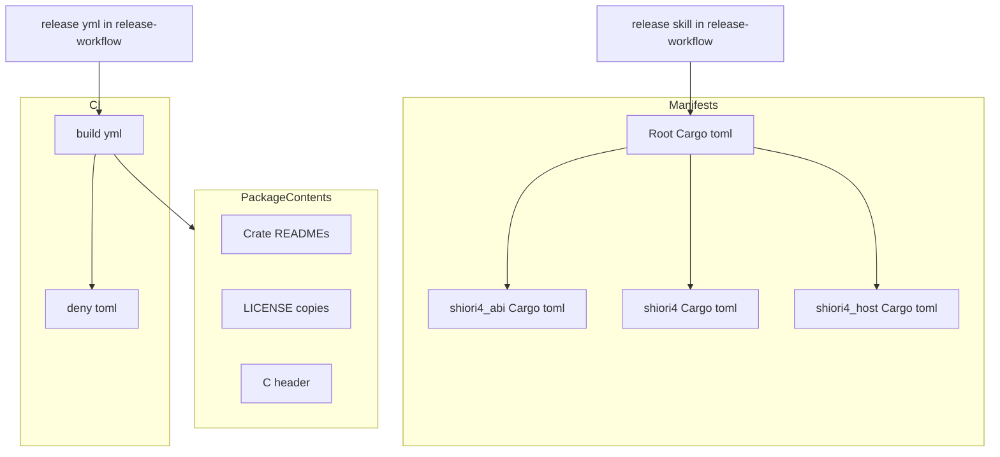
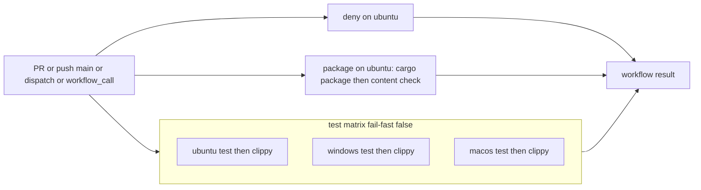

# Design Document — crate-publish-ready

## Overview
**Purpose**: 3 クレート（`shiori4_abi`・`shiori4`・`shiori4_host`）を crates.io に出せる形（公開の直前まで）に整え、その形を PR ごとの CI で守る。
**Users**: 開発者（ekicyou）は手元と CI で「公開すれば通る」ことを確かめる。クレートの利用者（SHIORI 作者・ベースウェア作者・ABI を直接使う実装者）は crates.io / docs.rs で役割と入口を知る。後続の release-workflow spec は、本 spec の CI を gate として呼び、本 spec が決めた版の置き場所を書き換えて公開する。
**Impact**: Rust のソースには触れない。変わるのはマニフェスト 4 本・LICENSE の写し 3 本・README 4 本・CI 1 本・`deny.toml`・steering 3 本だけである。

### Goals
- 版を `[workspace.package] version = "0.0.1"` 1 か所と内部依存の版要求 2 か所に一本化する
- `cargo package --workspace` が、3 クレートとも未公開のまま依存の順に警告なしで通る
- PR・main への push・手動実行・`workflow_call` のいずれでも、同じ検査（3 OS の test・clippy、cargo-deny、パッケージ化）が走る

### Non-Goals
- crates.io への公開（初回の手動公開を含む）、release.yml、公開スクリプト、`/release` スキル、リリースノート
- クレートの API・ABI・挙動の変更、`lib.rs` への README の取り込み（`#![doc = include_str!]`）
- MSRV（1.85）での CI 検査、categories の指定、依存の自動更新（Dependabot など）

## Boundary Commitments

### This Spec Owns
- **版の置き場所の契約**: ワークスペースの版 1 か所と、`[workspace.dependencies]` の内部依存 2 項目の `version`。`Cargo.lock` はコミットしないので、版の置き場所に含まれない
- 共通メタデータ（authors・license・repository・homepage・keywords・edition・rust-version）の置き場所と値
- 各クレートのパッケージの中身（ソース・マニフェスト・README・LICENSE・`shiori4_abi` の C ヘッダ）
- `.github/workflows/build.yml` の検査項目・トリガ・合否の基準と、`deny.toml` の許可の設定
- `Cargo.lock` をコミットしない方針を保ち、その理由を steering に書くこと
- steering の記述: `tech.md`（版・メタデータ・ライセンス・CI・lock・Common Commands）、`structure.md`（内部依存の書き方・README の位置づけ）、`workflow.md` の「CI は無い」の 1 文

### Out of Boundary
- 公開そのもの、タグで動く CI、公開の認証（Trusted Publishing）、`/release` の手順（release-workflow が持つ）
- `workflow.md` の「前提: 完成の形」・DoD・リモート同期の運用の書き直し（release-workflow が持つ）
- `build.yml` に release-workflow が足すジョブ（公開スクリプトのテストなど）。本 spec は足せる形にしておくだけ
- Rust のソース（`src/lib.rs`）と C ヘッダの中身

### Allowed Dependencies
- ツール: cargo（stable。手元の確認は 1.99.1）、cargo-deny（`EmbarkStudios/cargo-deny-action@v2`）
- GitHub Actions: `actions/checkout@v6`・`dtolnay/rust-toolchain@stable`・`Swatinem/rust-cache@v2`・`EmbarkStudios/cargo-deny-action@v2`（pasta と同じもの。新しい Action は足さない）
- クレートの外部依存は増やさない（`shiori4_host` の `libloading = "0.8"` だけ）
- CI は秘密情報・書き込み権限を使わない（`permissions: contents: read`）

### Revalidation Triggers
- 版の置き場所・個数の変更（release-workflow の `/release` が前提にしている）
- `Cargo.lock` の方針の変更（release-workflow は lock が無く、`--locked` を使わずに公開することを前提にする）
- `build.yml` のトリガ（特に `workflow_call: {}`）・ジョブ名・入力の有無の変更（release.yml の gate が前提にしている）
- クレートの追加・改名、内部依存の向きの変更（公開の順 `shiori4_abi` → `shiori4` → `shiori4_host` が変わる）

## Architecture

### Existing Architecture Analysis
- 3 層のクレート（`shiori4_abi` ← `shiori4` ← `shiori4_host`）。依存は下向きだけで、本 spec はこの向きを変えない
- 現状: 各クレートに `version = "0.1.0"` 直書き、内部依存は path だけ、`license = "MIT OR Apache-2.0"`、`Cargo.lock` は `.gitignore` で無視、`.github/` なし
- OS 固有のコードは無く、テストは DLL なしで往復する（3 OS で同じテストが走る見込み）

### Architecture Pattern & Boundary Map



**Architecture Integration**:
- 採用するパターン: pasta の「`[workspace.package]` と `[workspace.dependencies]`（path＋version）を各クレートが `.workspace = true` で受ける」形と、pasta の build.yml の縮小版
- 境界: マニフェスト（版とメタデータ）・パッケージの中身（README・LICENSE・ヘッダ）・CI（検査）の 3 つ。release-workflow は右下の 2 本の矢印だけで本 spec に触れる
- 守る既存のパターン: 下向きの依存、`.workspace = true` による一括指定、DoD の Test Gate のコマンド
- Steering 準拠: 外部依存を増やさない、README は使い方の入口だけ、規約は `//!` に置く

### Technology Stack

| Layer | Choice / Version | Role in Feature | Notes |
|-------|------------------|-----------------|-------|
| Build / Package | cargo stable（resolver 3） | パッケージ化と検証（`cargo package --workspace`） | resolver 3 は `rust-version` を見て `libloading 0.8.9` を選ぶ（0.9 は Rust 1.88 が要る） |
| CI | GitHub Actions（ubuntu-latest・windows-latest・macos-latest） | test・clippy・deny・package | Action は pasta と同じ 4 つだけ |
| 依存検査 | cargo-deny（`EmbarkStudios/cargo-deny-action@v2`、既定の `check --all-features`） | ライセンス・勧告・取得元 | Action の既定の Rust は 1.85.0。edition 2024・lock v4 を読める |

## File Structure Plan

### Directory Structure
```
/
├── Cargo.toml                   # 変更: 版・共通メタデータ・[workspace.dependencies]
├── README.md                    # 変更: 各クレートの README / crates.io への導線
├── deny.toml                    # 新規: cargo-deny の許可の設定
├── .github/
│   └── workflows/
│       └── build.yml            # 新規: PR・push・手動・workflow_call の検査
├── shiori4_abi/
│   ├── Cargo.toml               # 変更: .workspace = true へ
│   ├── README.md                # 新規: crates.io の顔（ABI を直接使う実装者向け）
│   └── LICENSE                  # 新規: ルートの LICENSE の写し
├── shiori4/
│   ├── Cargo.toml               # 変更: .workspace = true、内部依存を workspace から
│   ├── README.md                # 新規: crates.io の顔（SHIORI 作者向け）
│   └── LICENSE                  # 新規: ルートの LICENSE の写し
└── shiori4_host/
    ├── Cargo.toml               # 変更: .workspace = true、内部依存を workspace から
    ├── README.md                # 新規: crates.io の顔（ベースウェア作者向け）
    └── LICENSE                  # 新規: ルートの LICENSE の写し
```

### Modified Files
- `.kiro/steering/tech.md` — 版の置き場所・共通メタデータ・MIT だけ・CI の検査内容・`Cargo.lock` をコミットしない理由・Common Commands（lint に `--workspace`、パッケージ化の検証）
- `.kiro/steering/structure.md` — 「クレート間はワークスペース内の `path` 依存で参照する」を「`[workspace.dependencies]` に path と version を持ち、各クレートは `.workspace = true` で受ける」に。各クレートの README（crates.io の顔）とルート README（入口）の位置づけ
- `.kiro/steering/workflow.md` — 「**CI を待たない**: このリポジトリに CI は無い。…」の 1 文だけを「PR では build.yml が走るが、マージ前の関門は DoD の Test Gate であり、CI の結果は待たない」の趣旨に直す

触れないファイル: `LICENSE`（本文）、`shiori4*/src/lib.rs`、`shiori4_abi/include/shiori4_abi.h`。

## System Flows



- 3 種のジョブは互いに待たない（`needs` なし）。どれか 1 つでも失敗すれば、ワークフロー全体（と `workflow_call` の呼び出し元）が失敗する
- `fail-fast: false` により、1 つの OS の失敗で他の OS を打ち切らない（5.3）
- test と clippy は同じジョブの別ステップにする。ジョブ名に OS が、ステップ名に検査名が出るので、PR 上で「どの OS のどの検査か」を見分けられる（5.7）

## Requirements Traceability

| Requirement | Summary | Components | Interfaces | Flows |
|-------------|---------|------------|------------|-------|
| 1.1 | 版を 1 か所・0.0.1 | WorkspaceManifest | `[workspace.package] version` | — |
| 1.2 | 各クレートは版を受け継ぐ | CrateManifests | `version.workspace = true` | — |
| 1.3 | 内部依存の版要求は workspace にだけ | WorkspaceManifest, CrateManifests | `[workspace.dependencies]`、`<dep>.workspace = true` | — |
| 1.4 | 手元は path、公開は crates.io の版 | WorkspaceManifest | `{ path, version }` | Package |
| 1.5 | 版の更新は 3 か所だけ | WorkspaceManifest | 版の置き場所の契約 | — |
| 1.6 | 食い違いで失敗する | WorkspaceManifest, BuildWorkflow | caret 要求の解決失敗 | Test, Package |
| 2.1 | MIT だけ | WorkspaceManifest | `license = "MIT"` | — |
| 2.2 | repository・homepage・authors | WorkspaceManifest, CrateManifests | `.workspace = true` | — |
| 2.3 | description を保つ | CrateManifests | `description`（現状の文のまま） | — |
| 2.4 | edition・rust-version を変えない | WorkspaceManifest | 現状の値 | — |
| 2.5 | メタデータの警告なし | WorkspaceManifest, LicenseCopies | `license-file` を使わない | Package |
| 2.6 | LICENSE 本文を同梱 | LicenseCopies, BuildWorkflow | 各クレートの `LICENSE`、同一性の検査 | Package |
| 2.7 | documentation を書かない | WorkspaceManifest | `documentation` なし | — |
| 2.8 | keywords | WorkspaceManifest, CrateManifests | `keywords = ["shiori", "ghost", "ukagaka"]` | — |
| 3.1 | 各クレートに README | CrateReadmes | 既定の `README.md` 自動検出 | Package |
| 3.2 | README の必須の中身 | CrateReadmes | README の節立て | — |
| 3.3 | 詳細は docs.rs へ誘導 | CrateReadmes | docs.rs への絶対 URL | — |
| 3.4 | 絶対 URL で参照 | CrateReadmes | 絶対 URL の規則 | — |
| 3.5 | ルート README は入口 | RootReadme | 各クレートへのリンク | — |
| 3.6 | 日本語だけ | CrateReadmes | — | — |
| 4.1 | 依存の順にパッケージ化と検証 | BuildWorkflow, WorkspaceManifest | `cargo package --workspace` | Package |
| 4.2 | 未公開のまま通る | BuildWorkflow | `--workspace`（一時のローカルレジストリ） | Package |
| 4.3 | C ヘッダを含む | BuildWorkflow | 既定の同梱＋中身の検査 | Package |
| 4.4 | 中身にソース・README・LICENSE、開発用ファイルなし | CrateManifests, LicenseCopies, CrateReadmes | 既定の同梱（クレートのディレクトリの追跡ファイル） | Package |
| 4.5 | 失敗したクレートと理由を出して非ゼロ | BuildWorkflow | cargo の終了コード・中身の検査のメッセージ | Package |
| 4.6 | アップロードしない | BuildWorkflow | `cargo package` だけを使う | Package |
| 5.1 | PR で 3 OS の test・clippy | BuildWorkflow | `test` ジョブ | Test |
| 5.2 | push・手動でも同じ | BuildWorkflow | `on: push / workflow_dispatch` | Test |
| 5.3 | 失敗は全体、他 OS は続行 | BuildWorkflow | `fail-fast: false` | Test |
| 5.4 | cargo-deny・許可は MIT/Apache-2.0/ISC | BuildWorkflow, DenyConfig | `deny` ジョブ、`[licenses] allow` | Deny |
| 5.5 | 違反で失敗し理由を表示 | DenyConfig | cargo-deny の診断 | Deny |
| 5.6 | CI でパッケージ化とヘッダの確認 | BuildWorkflow | `package` ジョブ | Package |
| 5.7 | OS・検査ごとに見分けられる | BuildWorkflow | ジョブ名・ステップ名 | 全体 |
| 5.8 | 公開・タグ・Release なし、秘密不要 | BuildWorkflow | `permissions: contents: read` | 全体 |
| 6.1 | 入力なしの呼び出しで同じ検査 | BuildWorkflow | `workflow_call: {}` | 全体 |
| 6.2 | 失敗を呼び出し元に返す | BuildWorkflow | ジョブの失敗の伝播 | 全体 |
| 6.3 | 入力・秘密を要求しない | BuildWorkflow | `workflow_call: {}` | — |
| 6.4 | 同じ検査項目・基準 | BuildWorkflow | トリガで分岐しない（`if:` を使わない） | 全体 |
| 7.1 | API・ABI・ヘッダ・挙動を変えない | 全体 | Rust ソースとヘッダに触れない | — |
| 7.2 | 既存テストと clippy が通る | BuildWorkflow | Test Gate と同じコマンド | Test |
| 7.3 | 外部依存を増やさない | CrateManifests | `libloading = "0.8"` のまま | Deny |
| 7.4 | 何も公開しない | BuildWorkflow | 4.6・5.8 と同じ | — |
| 8.1 | tech.md に版・メタデータ・MIT・CI | SteeringDocs | tech.md | — |
| 8.2 | tech.md に lock の方針 | SteeringDocs, LockPolicy | tech.md | — |
| 8.3 | Common Commands | SteeringDocs | tech.md | — |
| 8.4 | structure.md に内部依存・README | SteeringDocs | structure.md | — |
| 8.5 | workflow.md の 1 文 | SteeringDocs | workflow.md | — |

## Components and Interfaces

| Component | Domain | Intent | Req Coverage | Key Dependencies | Contracts |
|-----------|--------|--------|--------------|------------------|-----------|
| WorkspaceManifest | マニフェスト | 版・共通メタデータ・内部依存の唯一の置き場所 | 1.1, 1.3–1.6, 2.1, 2.2, 2.4, 2.5, 2.7, 2.8, 4.1 | cargo (P0) | State |
| CrateManifests | マニフェスト | 各クレートが workspace の値を受け継ぐ | 1.2, 1.3, 2.2, 2.3, 2.8, 4.4, 7.3 | WorkspaceManifest (P0) | State |
| LockPolicy | マニフェスト | `Cargo.lock` をコミットしない方針 | 8.2 | — | State |
| LicenseCopies | パッケージの中身 | 各パッケージに MIT の本文を入れる | 2.5, 2.6, 4.4 | ルート LICENSE (P0) | State |
| CrateReadmes / RootReadme | パッケージの中身 | crates.io の顔と、ワークスペースの入口 | 3.1–3.6, 4.4 | docs.rs・crates.io の URL (P2) | — |
| BuildWorkflow | CI | 3 OS の test・clippy、deny、package を 1 つのワークフローで | 1.6, 2.6, 4.1–4.6, 5.1–5.8, 6.1–6.4, 7.2, 7.4 | Actions 4 種 (P0), DenyConfig (P0) | Batch |
| DenyConfig | CI | 依存の許可の設定 | 5.4, 5.5, 7.3 | cargo-deny (P0) | State |
| SteeringDocs | ドキュメント | 版・CI・lock・内部依存・README の方針を steering に | 8.1–8.5 | 上の全コンポーネント (P1) | — |

### マニフェスト

#### WorkspaceManifest（`/Cargo.toml`）

| Field | Detail |
|-------|--------|
| Intent | 版・共通メタデータ・内部依存の版要求を 1 か所に置く |
| Requirements | 1.1, 1.3, 1.4, 1.5, 1.6, 2.1, 2.2, 2.4, 2.5, 2.7, 2.8, 4.1 |

**Responsibilities & Constraints**
- `[workspace]` の `resolver = "3"`・`members` は変えない
- `documentation` と `categories` は書かない（2.7、Out of scope）。`license-file` は書かない（2.5 の警告を避ける。research.md の実験 B）

**Contracts**: State [x]

##### State Management（マニフェストの契約）
```toml
[workspace.package]
version = "0.0.1"
edition = "2024"
rust-version = "1.85"
authors = ["Dot-Station Master <dot.station@gmail.com>"]
license = "MIT"
repository = "https://github.com/ekicyou/shiori4"
homepage = "https://github.com/ekicyou/shiori4"
keywords = ["shiori", "ghost", "ukagaka"]

[workspace.dependencies]
shiori4_abi = { path = "shiori4_abi", version = "0.0.1" }
shiori4 = { path = "shiori4", version = "0.0.1" }
```
- **版の置き場所の契約（release-workflow へ渡す）**: 手で書き換えるのは `[workspace.package] version` と、`[workspace.dependencies]` の `shiori4_abi`・`shiori4` の `version` の 3 か所だけ。`Cargo.lock` はコミットしないので、ほかに直すファイルは無い
- 版要求は pasta と同じ caret（`"0.0.1"`）。0.0.x の caret は実質厳密一致なので、版だけ上げて版要求を直し忘れると、ビルドもパッケージ化も `failed to select a version for the requirement` で失敗する（1.6、research.md の実験 E2 で確認）。0.1 以上で互換の範囲に収まる直し忘れは検出しない（1.6 の但し書きどおり）
- 外部依存 `libloading` は `[workspace.dependencies]` に移さず `shiori4_host` に残す（要件は内部依存だけを求める。移す価値は外部依存が 1 つの今は無い）

**Implementation Notes**
- Validation: `cargo package --workspace` が警告なしで通ること、`cargo package --list -p <crate>` の中身
- Risks: keywords は crates.io の制限（5 個以内・20 字以内・ASCII）に収まる

#### CrateManifests（`shiori4_abi/Cargo.toml`・`shiori4/Cargo.toml`・`shiori4_host/Cargo.toml`）
- 各クレートは `name` と現状の `description` だけを自前で持ち、`version`・`edition`・`rust-version`・`authors`・`license`・`repository`・`homepage`・`keywords` を `.workspace = true` で受ける（1.2, 2.2, 2.3, 2.8）
- 内部依存は `shiori4_abi.workspace = true`（`shiori4`）、`shiori4.workspace = true`（`shiori4_host`）。`libloading = "0.8"` はそのまま（1.3, 7.3）
- `readme`・`include`・`exclude` は書かない。README.md はクレートのディレクトリにあれば既定で検出され、パッケージにはクレートのディレクトリの git 追跡ファイルだけが入る（C ヘッダもこれで入る。4.3, 4.4）

#### LockPolicy（`/.gitignore`）

| Field | Detail |
|-------|--------|
| Intent | `Cargo.lock` をコミットしない今の方針を保つ |
| Requirements | 8.2 |

**決定**: `Cargo.lock` を**コミットしない**（tech.md の今の方針のまま。`.gitignore` も変えない）。設計ディスカッションで確定。
- 理由 1: ライブラリの lock は、そのクレートを依存に加えた利用者のビルドでは使われない。lock が効くのはこのリポジトリの CI と開発のビルドだけで、外部依存が `libloading` 1 つの今は再現性の利点が小さい
- 理由 2: lock が無ければ、CI は毎回その時点の最新の依存で検査する。これは利用者が実際に引く依存と同じで、ライブラリの検査に向く
- 理由 3: 版の更新が 3 か所の書き換えだけで済み（要件 1.5 の文言どおり）、lock の更新と古さの検査が要らない
- 代償: CI の結果は依存の新しい版の公開で変わり得る（再現性が無い）。pasta の `cargo publish --locked` は使えない（pasta は DLL を配るので lock に意味があるが、shiori4 は純粋なライブラリなので要らない）
- `--locked` はどのジョブにも付けない。cargo-deny はその場で依存を解決して検査する（research.md の Research Log「依存検査」）

**Contracts**: State [x]
- `.gitignore` の `Cargo.lock` の行を残す。release-workflow は lock が無いこと、`--locked` を使わずに公開することを前提にする

### パッケージの中身

#### LicenseCopies（`shiori4_abi/LICENSE`・`shiori4/LICENSE`・`shiori4_host/LICENSE`）
- ルートの `LICENSE` をバイト単位で写す。ルートの本文は変えない（2.6）
- 選ばなかった方法: `license-file = "../LICENSE"` を `license` と併記すると、ビルドのたびに `only one of license or license-file is necessary` の警告が出る（2.5 に反する）。`license-file` だけにすると crates.io で MIT と表示されない（2.1 に反する）。`include = ["../LICENSE"]` はパッケージの外のファイルなので無視される（research.md の実験 B・B2・C）
- 写しのずれは CI の `package` ジョブで検出する（BuildWorkflow の中身の検査）

#### CrateReadmes（`<crate>/README.md`）と RootReadme（`/README.md`）
- 各クレートの README は日本語だけで、次の節をこの順に持つ（3.2, 3.6）

| 節 | `shiori4_abi` | `shiori4` | `shiori4_host` |
|---|---|---|---|
| 役割（1〜2 文） | C ABI（関数テーブル・ShioriBytes・版・規約）。C ヘッダ付き | SHIORI 側の高水準層（v3/v4 の差の吸収） | ホスト（ベースウェア）側の高水準層 |
| 想定する利用者 | ABI を直接使う実装者（Rust 以外を含む） | SHIORI 作者 | ベースウェア作者 |
| 使い始めの入口 | `shiori_get_api`、`Shiori` trait と `export_shiori!`、C ヘッダ `include/shiori4_abi.h` | `Ghost` trait を実装し `export_ghost!`（`crate-type = ["cdylib"]`） | `Host` trait を実装し `GhostRuntime::load`、`Host::wake` で `GhostRuntime::pump` |
| 他の 2 クレートとの関係 | 何にも依存しない最下層 | `shiori4_abi` を再エクスポート、`shiori4_host` と語彙（`host_protocol`）を共有 | `shiori4` を再エクスポートして使う |
| 詳しいドキュメント | docs.rs の該当ページ（規約・設計方針はそこ）（3.3） | 同左 | 同左 |
| ライセンス | MIT（同梱の LICENSE） | 同左 | 同左 |

- 参照はすべて絶対 URL にする（3.4）: 他クレートは `https://crates.io/crates/<name>`、ドキュメントは `https://docs.rs/<name>`、リポジトリ内のファイルは `https://github.com/ekicyou/shiori4/blob/main/<path>`。相対リンクは使わない
- 規約の本文・使用例の全文は書かない（3.3。steering の「README は使い方の入口だけ」）
- ルート README はクレート表を残し、各行から各クレートの README（リポジトリ内の相対リンクで可。ルート README は crates.io に載らない）と crates.io のページへ辿れるようにする（3.5）

### CI

#### BuildWorkflow（`.github/workflows/build.yml`）

| Field | Detail |
|-------|--------|
| Intent | PR・push・手動・他ワークフローからの呼び出しで、同じ検査を回す |
| Requirements | 1.6, 2.6, 4.1–4.6, 5.1–5.8, 6.1–6.4, 7.2, 7.4 |

**Dependencies**
- Inbound: release-workflow の `release.yml`（gate として `uses: ./.github/workflows/build.yml`）(P0)
- External: `actions/checkout@v6`、`dtolnay/rust-toolchain@stable`（`components: clippy`）、`Swatinem/rust-cache@v2`、`EmbarkStudios/cargo-deny-action@v2` (P0)

**Contracts**: Batch [x]

##### Batch / Job Contract
- **Trigger**: `push`（branches: main）、`pull_request`（branches: main）、`workflow_dispatch`、`workflow_call: {}`（入力・秘密なし）
- **Workflow 設定**: `name: Build`、`permissions: contents: read`。トリガによる `if:` の分岐を持たない（6.4）
- **Jobs**（`needs` なし、並行）:

| job id | 表示名 | runs-on | ステップ（表示名: コマンド） | 要件 |
|---|---|---|---|---|
| `test` | `test-${{ matrix.os }}` | matrix `os: [ubuntu-latest, windows-latest, macos-latest]`、`fail-fast: false` | checkout → toolchain（clippy 入り）→ rust-cache → `Test`: `cargo test --all` → `Clippy`: `cargo clippy --all-targets --workspace -- -D warnings` | 5.1–5.3, 5.7, 7.2 |
| `deny` | `cargo-deny` | ubuntu-latest | checkout → `cargo deny check`: cargo-deny-action（既定の入力のまま） | 5.4, 5.5 |
| `package` | `package` | ubuntu-latest | checkout → toolchain → rust-cache → `Package`: `cargo package --workspace` → `Check package contents`: 下記 | 1.6, 2.6, 4.1–4.6, 5.6 |

- **`Check package contents` の検査**（bash、`set -euo pipefail`）:
  1. `cargo package --list -p shiori4_abi` の出力に `include/shiori4_abi.h` の行があること（4.3, 5.6）
  2. 3 クレートそれぞれで `cmp LICENSE <crate>/LICENSE` が一致すること（2.6）
  3. 失敗時は `::error::` で「どのクレートの何が欠けたか」を出して非ゼロで終わる（4.5）
- **Output**: ワークフローの成否だけ。成果物・タグ・Release・公開は作らない（4.6, 5.8）
- **Idempotency & recovery**: 何も書き込まないので、何度再実行してもよい
- **パッケージ化を ubuntu だけで回す理由**: パッケージの中身は git の追跡ファイルで決まり OS に依らない。検証のビルドは `test` ジョブが 3 OS で済ませている。Windows の CRLF 変換の影響を受けずに `cmp` できる

**Implementation Notes**
- Integration: release-workflow は `jobs.<gate>.uses: ./.github/workflows/build.yml` で呼ぶ。ジョブを足すときも `workflow_call` 時に同じ検査になる（6.4）
- Validation: 最初の PR で 3 OS のジョブが実際に通ることを確かめる（ubuntu / macOS は未確認）
- Risks: `cargo package` は未コミットの変更があると失敗する。CI は clean checkout なので問題ないが、手元では commit 後に実行する

#### DenyConfig（`/deny.toml`）
```toml
[licenses]
allow = ["MIT", "Apache-2.0", "ISC"]
confidence-threshold = 0.8

[bans]
multiple-versions = "warn"
wildcards = "deny"

[advisories]
unmaintained = "workspace"
yanked = "warn"

[sources]
unknown-registry = "deny"
unknown-git = "deny"
allow-registry = ["https://github.com/rust-lang/crates.io-index"]
allow-git = []
```
- 許可ライセンスは要件どおり 3 つだけ（5.4）。現在の依存（`cfg-if`・`windows-link` が MIT OR Apache-2.0、`libloading` が ISC、自クレートが MIT）で `advisories ok, bans ok, licenses ok, sources ok`、警告なし（research.md の実験 D）
- pasta からの差: 許可リストを絞る、`wildcards` を `deny` に（内部依存に version が付くので path だけの依存が無くなる）、`unknown-registry`・`unknown-git` を `deny` に（5.5 は「許可していない取得元で失敗」を求める。pasta の `warn` では失敗しない）、`db-path`・`db-urls` は既定値と同じなので省く

### ドキュメント

#### SteeringDocs（`.kiro/steering/tech.md`・`structure.md`・`workflow.md`）
- `tech.md`（8.1–8.3）:
  - Core Technologies か新しい節「公開とバージョン」に、版の置き場所の契約（3 か所。lock はコミットしないので含まない）、共通メタデータ、ライセンスは MIT だけ、を書く
  - 新しい節「CI」に、build.yml の 3 ジョブ（3 OS の test・clippy、cargo-deny、パッケージ化＋中身の検査）と `workflow_call` による呼び出しを書く
  - Key Technical Decisions の「`Cargo.lock` はコミットしない」は保ち、理由（ライブラリの lock は利用者のビルドで使われない。CI は利用者と同じく最新の依存で検査する。公開に `--locked` は使わない）を添える
  - Common Commands に `cargo clippy --all-targets --workspace -- -D warnings` と `cargo package --workspace` を書く（単独の `-p` は初回公開まで使えない旨を添える）
- `structure.md`（8.4）: Import Organization の「path 依存で参照する」を、`[workspace.dependencies]`（path＋version）と `.workspace = true` の書き方に直す。各クレートの README は crates.io の顔、ルート README は入口、と書く
- `workflow.md`（8.5）: 「**CI を待たない**」の箇条書きの「このリポジトリに CI は無い」だけを直す。マージの関門が Test Gate であること、CI の結果を待たないことは変えない

## Error Handling

| 失敗 | 検出する場所 | 表示 | 要件 |
|---|---|---|---|
| 版要求の直し忘れ（0.0.x） | すべてのジョブの cargo の依存解決 | `failed to select a version for the requirement` と対象クレート | 1.6 |
| パッケージ化・検証の失敗 | `package` ジョブ | cargo が `Packaging` / `Verifying <crate>` の後にエラーを出し非ゼロ | 4.5 |
| C ヘッダ・LICENSE の欠落やずれ | `Check package contents` | `::error::` でクレート名と欠けたもの | 4.3, 2.6, 4.5 |
| 依存のライセンス・勧告・取得元 | `deny` ジョブ | cargo-deny の診断（クレート名・理由） | 5.5 |
| OS ごとのテスト・lint の失敗 | `test-<os>` の `Test` / `Clippy` ステップ | ジョブ名とステップ名 | 5.3, 5.7 |

新しい勧告で変更と無関係に `deny` が落ちることは想定どおりとし、必要なら `deny.toml` の `[advisories] ignore` に理由付きで足す（その判断は開発者が行う）。

## Testing Strategy

本 spec はソースを変えないので、新しい単体テストは作らない。検証はコマンドと CI の実行で行う。

- **手元の検証（実装の完了条件）**
  1. コミット後に `cargo package --workspace` が 3 クレートとも `Packaging` → `Verifying` で通り、`warning:` を 1 行も出さない（1.1–1.4, 2.5, 4.1, 4.2）
  2. `cargo package --list -p <crate>` に `Cargo.toml`・`README.md`・`LICENSE`・`src/lib.rs` があり、`shiori4_abi` には `include/shiori4_abi.h` があり、`.kiro`・`.claude`・`.github`・`target` が無い（2.6, 3.1, 4.3, 4.4）
  3. 解凍した `.crate` の `Cargo.toml` に `version = "0.0.1"`・`license = "MIT"`・repository・homepage・authors・keywords があり、`documentation` が無い（1.1, 2.1, 2.2, 2.7, 2.8）
  4. 一時的に `[workspace.package] version` だけを `0.0.2` にすると `cargo build` が失敗する（1.6）。確認後に戻す
  5. `cargo test --all` と `cargo clippy --all-targets --workspace -- -D warnings` が通る（7.2）。`cargo deny check` が警告なしで通る（5.4）
- **CI の検証（最初の PR で）**
  1. `test-ubuntu-latest`・`test-windows-latest`・`test-macos-latest`・`cargo-deny`・`package` の 5 つのチェックが PR に別々に出て、すべて成功する（5.1, 5.4, 5.6, 5.7）
  2. main への push と手動実行（`workflow_dispatch`）でも同じ 5 つが走る（5.2）
  3. `workflow_call` の呼び出しは release-workflow の spec で実地に確かめる。本 spec では `on:` に `workflow_call: {}` があり、トリガで分岐する `if:` が無いことをレビューで確かめる（6.1–6.4）
- **ドキュメントの確認**: 各 README のリンクが絶対 URL であること、日本語だけであること、必須の節があること（3.2–3.6）。steering 3 本の差分が 8.1–8.5 を満たすこと

## Security Considerations
- `permissions: contents: read` で GITHUB_TOKEN を読み取りに絞る。秘密情報・環境（environment）を使わない（5.8, 6.3）
- `pull_request` トリガだけを使い、`pull_request_target` は使わない（フォークの PR に書き込み権限を渡さない）
- 依存の取得元を crates.io だけに絞る（`[sources]` の `deny`）

## Open Questions / Risks
- **リスク**: ubuntu / macOS でのテスト・clippy は未確認。落ちたら本 spec の中で直す（ソースの修正が要るなら要件 7.1 に触れないかを開発者に確かめる）
- **リスク**: docs.rs と crates.io のリンクは公開までは 404 になる（公開後に解消する。想定どおり）
