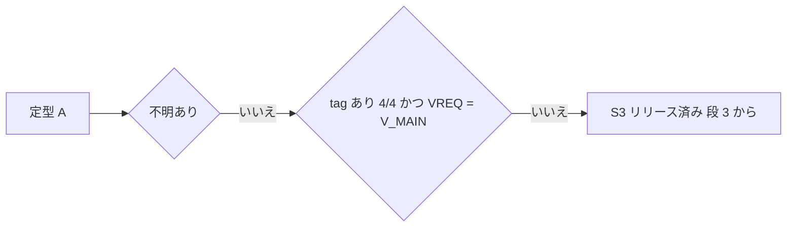

# 設計書 — release-bootstrap-cleanup

## Overview

release-workflow が初版 0.0.1 のためだけに持たせた判定・経路・手順書の節を取り除く。新しい仕組みは足さない。削るのは文書（Markdown）だけで、スクリプト・ワークフロー・テストには触れない。

### Goals
- `/release` の判定表と手順から初版の行・節・入口をなくし、「タグが無いのに公開済みがある」状態を S9 で例外なく止める（2.1〜2.4）
- 一度だけの準備の手順書を、設定のやり直しと新しいクレートの追加に使える形にする（3.1〜3.5）
- 撤去の前後で、v0.0.1 が 4/4 であることとリリースの仕組みの回帰が無いことを確かめる（1.1・1.2・4.1〜4.4）

### Non-Goals
- リリース CI・公開スクリプト・定型コマンド A〜D・補助スクリプトのテストの変更
- 前のタグが無い版の詳しいリリースノートの扱い（`release-notes.ps1` の一般の振る舞い。初版に限らない）
- 新しいクレートの初回公開・緊急時の手動公開の手順の中身の変更

## Boundary Commitments

### This Spec Owns
- `.claude/skills/release/procedure.md` の判定表の行 S2 と節「初版の経路【初版のみ】」の削除、段 2 の表の `Requirements` から初版の要件番号（14.2）を外すこと
- `.claude/skills/release/SKILL.md` の段 2 の入口の 1 行の削除
- `.github/release-ci-setup.md` の節「【初版のみ】初版 0.0.1 の手動公開」「【初版のみ】初版 0.0.1 のリリース」の削除と、0.0.1 に固有の言い回し（冒頭の箇条・全体の流れ・節「後片付け（必須）」の冒頭と手順 1）の書き直し

### Out of Boundary
- `.github/workflows/*.yml`・`.github/scripts/release/*.ps1`・`.claude/skills/release/scripts/*.ps1`・`.claude/settings.json`
- `doc/release-notes/`（`v0.0.1.md` はその版の見どころとして残す）
- crates.io・GitHub の設定（release-workflow のタスク 9 で済んでいる）

### Allowed Dependencies
- 状態の照会（定型コマンド A、`release-state.ps1`）を、撤去の前後の確認に読むだけで使う
- 補助スクリプトのテスト・`cargo test --all`・clippy を回帰の確認に使う

### Revalidation Triggers
- 手順書の見出しの名前を変えると、`release.yml` の集約 step・`publish-crate.ps1`・`procedure.md` の案内が指す先が切れる。本仕様は見出しを変えない（3.4）。変えるなら同時に直す

## Architecture

### Existing Architecture Analysis
- 初版の経路は release-workflow の要件 14.6 により 1 か所にまとめられ、`【初版のみ】` の印で見つかる: procedure.md の 122 行目（S2）と 513 行目以降（ファイルの最後の節）、SKILL.md の 78 行目、release-ci-setup.md の 38 行目と 96 行目の節
- 印の無い 0.0.1 に固有の記述は release-ci-setup.md の 11 行目・16〜19 行目（全体の流れ）・110 行目と 112 行目（後片付け）にある（release-workflow からの申し送り）
- 判定表の S9（タグ無し・公開済みが 0/4 以外）は、S2 を消すと今の S2 の状態を受ける。S9 の条件・次の手は変えなくてよい（2.2）

### 撤去の後の手順書の構成（節の順）

```
位置づけと全体の流れ（書き直し）
GitHub: environment `release`
crates.io: Trusted Publisher
後片付け（必須）（書き直し: 手で公開した後にいつも行う）
緊急時の手動公開
新しいクレートの初回公開
2 つ目以降のクレートの認証だけが失敗したとき
名前の対応表
```

全体の流れは「1. environment → 2. （公開対象のクレートが crates.io に無いとき）節『新しいクレートの初回公開』で手で公開 → 3. Trusted Publisher → 4. 後片付け」とする。設定をやり直すとき（改名・移管）は 1・3 を行い、新しいクレートを足すときは 2〜4 を行う、と 1 行添える。

## File Structure Plan

### Modified Files
- `.claude/skills/release/procedure.md` — 行 S2 を消す。段 2 の表の `Requirements` から `14.2` を外す。ファイルの最後の節「初版の経路【初版のみ】」を消す（2.1〜2.4）
- `.claude/skills/release/SKILL.md` — 段 2 の「S2【初版のみ】は…」の 1 行を消す（2.3）
- `.github/release-ci-setup.md` — 2 つの `【初版のみ】` 節を消し、冒頭の箇条・全体の流れ・節「後片付け（必須）」の冒頭と手順 1 を初版を前提にしない言い回しに直す（3.1〜3.5）

新しいファイルは作らない。

## System Flows

撤去の後の段 2 の判定（v0.0.1 が 4/4 の今の状態）:



タグが無く公開済みが 0/4 でない状態（元の S2 の状態を含む）は S9 で止まる。

## Requirements Traceability

| Requirement | Summary | 実現 |
|-------------|---------|------|
| 1.1, 1.2 | 撤去の前の 4/4 の確認 | 作業の最初に定型 A を実行し、4/4・不明 0 でなければ止まる（タスク 1） |
| 2.1 | 判定表に初版の行を持たない | procedure.md の S2 の行を消す。ほかの行は変えない |
| 2.2 | タグ無し・公開済みありは S9 で止まる | S9 の既存の条件がそのまま受ける（変更なし）。撤去の後に判定表を読んで確かめる |
| 2.3 | 初版の節と入口を持たない | procedure.md の最後の節と SKILL.md の 1 行を消す |
| 2.4 | 指していた記述を残さない | `git grep` で `S2`・`初版の経路` の残りが 0 件であることを確かめる |
| 3.1 | 2 つの初版の節を持たない | release-ci-setup.md の 2 節を消す |
| 3.2 | 全体の流れの書き直し | 上の「撤去の後の手順書の構成」の 4 手順 |
| 3.3 | 後片付けを一般の節として残す | 冒頭と手順 1 を「手で公開した後」の言い回しに直す |
| 3.4 | 指される見出しを保つ | 見出しを変えない。`release.yml`・`publish-crate.ps1`・procedure.md の参照先が実在することを確かめる |
| 3.5 | 削った節への参照を持たない | `git grep` で「初版 0.0.1 の手動公開」「初版 0.0.1 のリリース」が 0 件 |
| 4.1 | `【初版のみ】` が 0 件 | `git grep -n '【初版のみ】' -- ':!.kiro/specs'` が空 |
| 4.2 | 範囲外のファイルを変えない | `git diff --stat origin/main` が上の 3 ファイルと spec の文書だけ |
| 4.3 | 回帰 | 補助スクリプトのテスト・`cargo test --all`・clippy |
| 4.4 | 今の状態が S3 に当たる | 定型 A を判定表に当てて S3 になることを確かめる |

## Components and Interfaces

文書の変更だけで、インターフェースは変わらない。定型コマンド A の出力の形（release-workflow の design の Data Models）と判定表の列は、そのまま使う。

## Error Handling

- 撤去の前の確認で 4/4・不明 0 でなければ、何も削らずに止まる（1.2）
- 手順書の見出しを誤って変えた・消したときは、3.4 の確認（参照先の実在）で見つける

## Testing Strategy

- **撤去の前**: 定型 A（`-Version 0.0.1`）が `4/4`・`不明 0`（1.1）
- **文書の確認**: `git grep -n '【初版のみ】' -- ':!.kiro/specs'` が空（4.1）。`git grep -n -E 'S2|初版の経路|初版 0\.0\.1 の(手動公開|リリース)' -- .claude .github` が空（2.4・3.5）。`release.yml`・`publish-crate.ps1`・procedure.md が節の名前で指す見出し（名前の対応表・新しいクレートの初回公開・2 つ目以降のクレートの認証だけが失敗したとき・後片付け（必須））が手順書に実在する（3.4）
- **判定**: 定型 A（版の指定なし）の出力を撤去の後の判定表に当てると S3 になる（4.4）。タグ無し・3/4 の状態は S9 に当たる（2.2。表を読んで確かめる）
- **回帰**: `pwsh -NoProfile -File .github/scripts/release/release-scripts-test.ps1` が 12 項目すべて ok、`cargo test --all`・`cargo clippy --all-targets --workspace -- -D warnings` が通る（4.3）。`git diff --stat` が 3 ファイルと spec の文書だけ（4.2）
