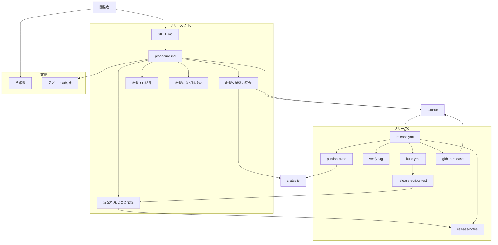
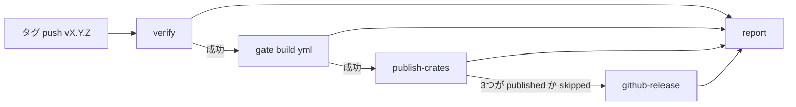
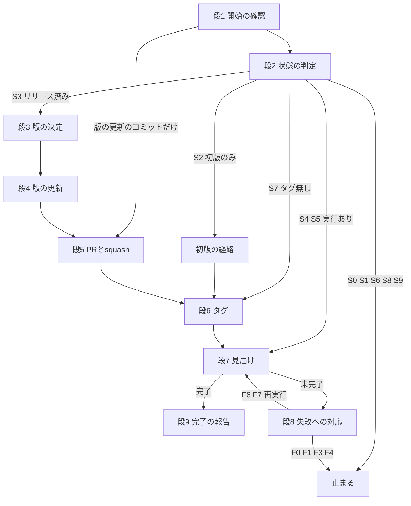
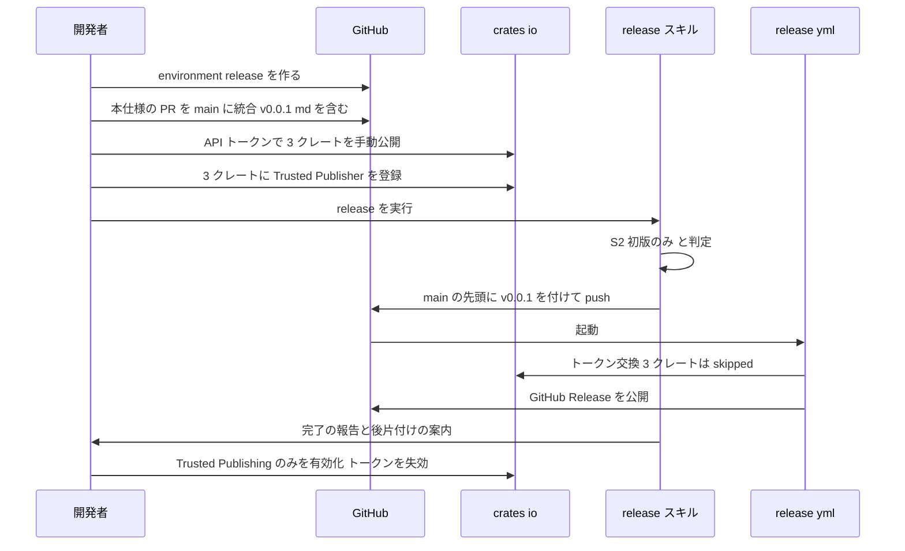

# 設計書 — release-workflow

## Overview

**Purpose**: shiori4 の 3 クレート（`shiori4_abi`・`shiori4`・`shiori4_host`）を、リリースタグの push だけで検査・公開・GitHub Release の作成まで行う仕組みを、開発者（ekicyou）に届ける。公開前の検査（タグと版の一致・main からの到達・CI 通過・依存の順）を人の注意から CI へ移し、開発者は `/release [X.Y.Z]` 1 つで版の更新から見届けまでを済ませる。

**Users**: 開発者は `/release` とセットアップ手順書を使う。エージェントは `/release` の手順（`procedure.md`）と定型コマンドに従って動く。クレートの利用者は GitHub Release の本文を読む。

**Impact**: 既存の資産のうち変えるのは `build.yml`（補助スクリプトのテストの job を 1 つ足す）と steering 2 本（`workflow.md`・`tech.md`）だけである。残りはすべて新規のファイルで、pasta（`C:\home\maz\git\pasta`）で実際に動いている一式を 3 クレート用に縮めて移す。Rust のソースには触れない。

### Goals

- `vX.Y.Z` の push で `release.yml` が verify → gate → publish-crates → github-release → report の順に走り、4 つの公開先（3 クレート＋GitHub Release）の結果を 1 枚の表で報告する
- 同じタグの再実行（失敗した job の再実行）で、公開済みは `skipped` になり、残りだけが進む
- `/release` が実際の状態から続きを判定し、版の決定・版の更新の PR・タグの push・CI の見届け・失敗した job の再実行・報告までを行う
- 手で公開した初版 0.0.1 に、タグと GitHub Release をそろえる経路を、後で丸ごと削れる形で持つ
- 開発者が手順書の順にたどれば、一度だけの準備が済む

### Non-Goals

- 初回セットアップ・手動公開の**実行**（開発者が行う）
- リリースの自動化（定期実行・main への push でのリリース）
- プレリリースの版、クレートごとに異なる版、crates.io 以外のレジストリ、バイナリの配布
- pasta 固有の部分（配布物のビルド・Marketplace・Azure・確認ワークフロー・マニュアル・口調の検査）
- 初版の経路の撤去（後続の spec `release-bootstrap-cleanup`）

## Boundary Commitments

### This Spec Owns

- **リリース CI**: `.github/workflows/release.yml` と `.github/scripts/release/*.ps1`。タグの検査・関門の呼び出し・crates.io への公開・GitHub Release の作成・結果の報告。status 契約（`status=`・`reason=`・`url=` の行と終了コード）
- **補助スクリプトのテスト**: `release-scripts-test.ps1` と、それを走らせる `build.yml` の job `release-scripts`（job の追加だけ）
- **リリーススキル**: `.claude/skills/release/`（`SKILL.md`・`procedure.md`・定型コマンド A〜D）。状態の判定表 S・失敗の判定表 F・定型コマンドの出力の形
- **初版の経路**: 判定表の行 `S2【初版のみ】` と `procedure.md` の節「初版の経路【初版のみ】」、手順書の `【初版のみ】` の節。`【初版のみ】` の印で全箇所を特定できること（14.6）
- **文書**: `.github/release-ci-setup.md`（手順書）、`doc/release-notes/README.md`（見どころの約束・内部の作業の決まり）、`doc/release-notes/v0.0.1.md`（初版の見どころ）
- **操作の許可**: `.claude/settings.json`（新規）のリリースに使う許可
- **steering**: `workflow.md` の「前提: 完成の形」・DoD の Test Gate・スキルドキュメント更新検討・リモート同期・ドキュメント保守、`tech.md` の公開とバージョン・CI

### Out of Boundary

- `build.yml` の既存の job（`test`・`deny`・`package`）・トリガ・入力・権限。足すのは job `release-scripts` だけ
- `Cargo.toml` の版の置き場所とメタデータ、各クレートの README、`Cargo.lock` をコミットしない方針（crate-publish-ready が持つ）。本仕様は版の 3 か所を**書き換える**だけで、置き場所と個数を変えない
- クレートの API と中身、`cargo test --all`・clippy の対象のソース
- GitHub・crates.io の設定の実行（environment の作成・Trusted Publisher の登録・`trustpub_only`・トークンの作成と失効）。手順書に書くだけ
- 初版の経路の撤去（`release-bootstrap-cleanup`）。撤去の後の判定表・手順書の形
- `CLAUDE.md`（確定事項 8）、`roadmap.md` の更新（`kiro-complete` が行う）

### Allowed Dependencies

- **crate-publish-ready の契約**: `build.yml` が `workflow_call: {}`（入力・秘密なし）で呼べること、版がルート `Cargo.toml` の 3 か所（`[workspace.package] version` と `[workspace.dependencies]` の `shiori4_abi`・`shiori4` の `version`）にあること、`cargo package --workspace` が通ること
- **GitHub Actions**: `actions/checkout@v6`・`dtolnay/rust-toolchain@stable`・`Swatinem/rust-cache@v2`（build.yml と同じ版）、`rust-lang/crates-io-auth-action@v1`、ホストランナーに入っている `pwsh` 7 と `gh`
- **crates.io**: 公開の API（`/api/v1/crates/{crate}`・`/api/v1/crates/{crate}/{version}`）とスパース索引（`index.crates.io`）を、認証なしで読む。公開は `cargo publish -p`
- **GitHub**: `gh`（手元は認証済み。CI では `GH_TOKEN: github.token`）
- 依存の向き: スキル側 → CI 側の補助スクリプト（定型コマンド D が `release-notes.ps1` を呼ぶ）は許す。CI 側（`release.yml`・`.github/scripts/release/` の公開スクリプト）はスキル側を呼ばない。例外は `release-scripts-test.ps1` が定型コマンド D をテストすることだけ

### Revalidation Triggers

- `release.yml` の job 名・step 名・`status=` の行の形を変えた → 定型コマンド B・`procedure.md`「結果表の作り方」・判定表 F を確かめ直す
- `verify-tag.ps1` の検査の条件を変えた → 定型コマンド C を合わせる
- 公開対象のクレートの追加・削除 → release.yml の step 列・集約 step・report の一覧、定型コマンド A のクレートの一覧、手順書の名前の対応表、`tech.md`
- 版の置き場所（`Cargo.toml` の 3 か所）が変わった（crate-publish-ready の側の変更）→ `verify-tag.ps1`・定型コマンド A・C・`procedure.md` 段 4 の個数「3」
- 内部の作業の決まり（`doc/release-notes/README.md`）を変えた → `release-notes.ps1` の定数を同時に直す（6.5）
- `【初版のみ】` の印の付け方・置き場所を変えた → `release-bootstrap-cleanup` の brief が前提にしている撤去の対象が変わる

## Architecture

### Existing Architecture Analysis

- 現在の資産は `build.yml`（`on: push(main)・pull_request(main)・workflow_dispatch・workflow_call: {}`、トップの `permissions: contents: read`、job `test`（3 OS）・`deny`・`package`）とルート `Cargo.toml` の版 3 か所だけ。`.github/scripts/`・`.github/release-ci-setup.md`・`doc/`・`.claude/skills/release/`・`.claude/settings.json` は無い
- `Cargo.lock` は `.gitignore` にあり、コミットしない。公開にも `--locked` を使わない（tech.md）
- `workflow.md` のリモート同期（PR・squash・CI を待たない・main へ直接 push しない）と危険な Git 操作の禁止（`git checkout -- <file>`・`git clean -fd` など）は、本仕様の手順も従う

### Architecture Pattern & Boundary Map

採用する形は **pasta の移植と縮小（Hybrid）**: job 構成・status 契約・スクリプトの引数・定型コマンドの出力の形・判定表の構造は pasta のまま写し、3 クレートで意味の無い部分を落とし、効くところだけ単純にする（認証を 1 回にする・添付を持たない・runs-on を ubuntu にする）。



**Architecture Integration**:
- 責務の分け方: CI が「取り消せない操作（公開）とその前の検査」を持ち、スキルが「人の判断が要る前後の手順（版の決定・PR・タグ・見届け・止まるか進むか）」を持つ。スキルは公開しない。CI は版を決めない・タグを作らない
- 守る既存の形: PR・squash・CI を待たない統合、main へ直接 push しない、build.yml の既存の job を変えない
- 新しい部品の理由: pasta の各ファイルに 1 対 1 で対応する（下の対応表）。新しく考える部品は初版の経路だけ
- steering との整合: 外部依存を足さない（Rust の依存は増えない）、`Cargo.lock` をコミットしない・`--locked` を使わない

### 依存の向き

```
文書（手順書・見どころの約束）
   ↑ 参照するだけ
SKILL.md → procedure.md → 定型コマンド A〜D → CI の補助スクリプト（release-notes.ps1）
                                              ↑
release.yml → build.yml（gate）／ verify-tag.ps1・publish-crate.ps1・release-notes.ps1・github-release.ps1
build.yml（job release-scripts）→ release-scripts-test.ps1 → CI の補助スクリプト・定型コマンド D
```

- 左から右へだけ呼ぶ。CI の補助スクリプト（`verify-tag`・`publish-crate`・`release-notes`・`github-release`）は互いを呼ばず、スキル側を呼ばない
- 定型コマンド C は `verify-tag.ps1` を呼ばずに同じ条件を自分で確かめる（タグを付ける前のコミットの中身を `git show` で読むため。pasta と同じ）。条件の同期は Revalidation Trigger で守る

### Technology Stack

| Layer | Choice / Version | Role in Feature | Notes |
|-------|------------------|-----------------|-------|
| CI | GitHub Actions、`actions/checkout@v6`・`dtolnay/rust-toolchain@stable`・`Swatinem/rust-cache@v2` | release.yml の job、gate としての build.yml の呼び出し | build.yml と同じ版にそろえる |
| 認証 | `rust-lang/crates-io-auth-action@v1`（Trusted Publishing、OIDC → 30 分のトークン） | crates.io の公開の認証 | job の先頭で 1 回だけ呼ぶ（下の判断 1） |
| スクリプト | PowerShell 7（`pwsh`、`#Requires -Version 7`） | 補助スクリプト・定型コマンド・テスト | ubuntu・windows・macos のホストランナーに入っている。手元は pwsh 7.6 |
| CLI | `gh`（ランナー同梱・手元は認証済み）、`git`、`cargo`（stable） | Release の作成、PR・run の操作、`cargo publish -p` | `--locked` を使わない |
| 外部サービス | crates.io API・スパース索引、GitHub API | 公開済みの判定、依存の反映待ち | 認証なしの読み取りは User-Agent `shiori4-release-ci (https://github.com/ekicyou/shiori4)` |

### pasta との対応表

| pasta のファイル | shiori4 のファイル | 変えた点 |
|------------------|--------------------|----------|
| `release.yml` verify | 同 verify | なし（スクリプト側で `package.json` の検査を外す） |
| `release.yml` gate | 同 gate | なし |
| `release.yml` build | — | 持たない（配布物が無い。`git diff --exit-code -- Cargo.lock` も持たない） |
| `release.yml` publish-crates | 同 publish-crates | 5 → 3 クレート、`needs: [verify, gate]`、`runs-on: ubuntu-latest`、auth step を 1 回だけ、集約 step の規則を 1 回の auth に合わせる |
| `release.yml` publish-vsce | — | 持たない |
| `release.yml` github-release | 同 github-release | artifact を使わない。`-OutFile` を外し `-BodyFile` だけ。Title `shiori4 vX.Y.Z`。`needs: [verify, publish-crates]`。理由 `immutable` を持たない |
| `release.yml` report | 同 report | 行を 4 つに。`build`・`publish-vsce` を needs と関門の判定から外す |
| `verify-tag.ps1` | 同 | 拡張の版（`package.json`）の検査を外す（5 → 4 条件） |
| `publish-crate.ps1` | 同 | `--locked` を外す（dry-run の表示も）。User-Agent。`cargo publish` の 401・403 を `reason=auth` にする（判断 3） |
| `release-notes.ps1` | 同 | 内部のスコープに `kiro` を足す。H1 に件数。`-BodyFile` は見どころ＋区切り＋詳しいリリースノートの全文 |
| `github-release.ps1` | 同 | 添付の判定・`-AssetDir`・`immutable` を外し、「無い → 公開で作る／下書き → 公開する／公開済み → skipped」だけにする |
| `publish-vsix.ps1` | — | 持たない |
| `release-scripts-test.ps1` | 同 | Claudia・`package.json` を外す。初版（前のタグが無い）・`kiro` スコープ・spec 名のスコープ・本文の新しい形・verify-tag の不合格の項目を足す。定型 D の項目を 4 行に |
| `release-ci-setup.md` | 同 | Azure・Marketplace・確認ワークフローの節を落とす。初版の手動公開と初版のリリースを `【初版のみ】` の節として持つ。`VSCE_PAT` を外す |
| `doc/release-notes/README.md` | 同 | 口調・出典リンクの決まり（書き方 4〜6 の口調の部分）と `book/` へのリンクを外す。内部の作業に `kiro` を足す。本文の形を「添付へのリンク」から「全文を直接置く」へ |
| `SKILL.md` | 同 | 7/7 → 4/4、6 ファイル → 2 ファイル、`release.ps1`・`npm`・`vsce` の記述を外す。段 2 に `S2【初版のみ】` の 1 行 |
| `procedure.md` | 同 | 段 4 を `Cargo.toml` の 3 か所と見どころだけに。判定表に `S2【初版のみ】`、節「初版の経路【初版のみ】」。F5 を欠番に。結果表の規則を 1 回の auth に。`RELEASE.md` を外す |
| `release-state.ps1`（A） | 同 | `package.json`・Marketplace を外す。クレートを 3 つに、集計を n/4 に、GitHub Release の判定から添付を外す。`main` の行で 3 か所の一致を見る |
| `ci-result.ps1`（B） | 同 | step の名前（`Publish shiori4*`）。「期限まで」を auth の step の完了からの経過で出す |
| `pretag-check.ps1`（C） | 同 | `package.json` の行を外す（5 → 4 行） |
| `highlights-check.ps1`（D） | 同 | Claudia の出典リンクの行を外す（5 → 4 行）。`-Repo ekicyou/shiori4` |
| `.claude/settings.json` | 同（新規） | `vsce` の文言を外す。`git merge --no-edit origin/main`・`git tag -a`・`gh pr view` の許可を足す。`v*:*` を外し、強制 push・削除・refspec の push・タグの付け直しを `ask` にする |

### 設計判断（research.md の「設計で決めること」への答え）

| # | 論点 | 判断 | 根拠 |
|---|------|------|------|
| 1 | 認証を 1 回か、クレートごとか | **job の先頭で 1 回だけ取り、3 つの publish step に渡す** | トークンは設定が一致するすべてのクレートに効く。同じ job での複数回の呼び出しは文書に無い（UNVERIFIED）。3 クレートは小さく 30 分に収まる見込み。期限切れは「失敗した job の再実行」で新しいトークンを取り直して続く |
| 2 | publish-crates の runs-on | **`ubuntu-latest`**（verify・github-release・report も同じ） | windows である理由（pasta の配布物のビルド）が無い。pwsh は ubuntu にもある |
| 3 | 添付を持たない形での「公開済み」の判定 | **GitHub Release が在り、下書きでないこと**だけ。定型 A は `あり（公開） <URL>`・`下書き`・`無し`・`不明`。github-release.ps1 は「無い → `gh release create --verify-tag`（公開で作る）／下書き → `gh release edit --draft=false`（題名と本文も入れ直す）／公開済み → skipped」。F5（immutable）は欠番 | 確定事項 4（添付を持たない）。下書きを経由する理由（添付をそろえてから公開する）が無くなる |
| 4 | 判定表への初版の行の入れ方 | **`S2【初版のみ】`**（pasta で初回の確認の行が使った欠番の位置）。条件に `V_MAIN` = `0.0.1` を含め、緊急時の手動公開（15.6）の後の版は S9 に落とす。条件と経路の本体は `procedure.md` の節「初版の経路【初版のみ】」に置き、判定表と SKILL.md には入口の 1 行だけを置く。見どころだけの PR の経路は持たない（確定事項 2） | 14.6。タグが無い行（S7〜S9）とは条件が重ならず、S9 より前で当たる。撤去すると S9 が受け持つ（12.6） |
| 5 | 補助スクリプトのテストの項目 | pasta の 1〜9 を縮め、初版（前のタグが無い）・`kiro` スコープ・spec 名のスコープ（載る／`release-workflow` は載らない）・本文の新しい形・verify-tag の不合格（版の不一致・main から到達できない）を足して 12 項目 | 要件 2.3・2.4・6.5・4.3〜4.5。公開スクリプト（`publish-crate`・`github-release`）はネットワークが要るのでテストに入れず、実装時の dry-run で確かめる |
| 6 | pasta 固有の語の残りの検出 | 実装の完了条件として、移したファイルに `pasta`・`vsce`・`vsix`・`Claudia`・`Marketplace`・`Azure`・`package.json`・`npm`・`book/`・`--locked`・`ekicyou/pasta` が 0 件であることを `git grep` で確かめる（CI のテストには入れない） | 初回の CI で初めて気づく写し漏れを、統合の前に止める。テストに入れるとテスト自身が語を含み、除外の規則が要る |
| 7 | settings.json の範囲 | リリースの許可（16.6）と、pasta と同じく `kiro-complete` の統合の説明（`gh pr merge` の許可は同じ規則を共有する）を入れる。タグの付け直し（`git tag -f`・`git push -f`）・`cargo publish`・`gh release create` は入れない | 16.6。許可の規則 `Bash(gh pr merge:*)` は 2 つのスキルで同じなので、分けても許可の範囲は変わらない |

## File Structure Plan

### Directory Structure

```
.github/
├── workflows/
│   ├── release.yml                   # 新規: リリース CI（verify → gate → publish-crates → github-release → report）
│   └── build.yml                     # 変更: job release-scripts を足すだけ
├── scripts/release/                  # 新規: リリース CI の補助スクリプト（pwsh 7）
│   ├── verify-tag.ps1                # タグの形・版の一致・main からの到達・見どころの 4 条件を検査し、版を出す
│   ├── publish-crate.ps1             # 1 クレートの公開済み判定・依存の反映待ち・cargo publish・status 出力
│   ├── release-notes.ps1             # 前のタグからの変更を分類した詳しいリリースノートと、Release の本文を作る
│   ├── github-release.ps1            # GitHub Release の作成・下書きの公開・公開済みの skip と status 出力
│   └── release-scripts-test.ps1      # 上の補助スクリプトと定型コマンド D を一時の git リポジトリで確かめる
└── release-ci-setup.md               # 新規: 一度だけの準備の手順書（【初版のみ】の節を含む）
.claude/
├── settings.json                     # 新規: リリースに使う操作の許可
└── skills/release/                   # 新規: /release スキル
    ├── SKILL.md                      # 実行の約束・止まり方・段 1〜9 の要約・直すとき
    ├── procedure.md                  # 段 1〜9 のコマンドと合否・判定表 S/F・定型コマンドの出力の形・初版の経路【初版のみ】
    └── scripts/
        ├── release-state.ps1         # 定型 A: 版の出どころと公開先の状態の照会（読むだけ）
        ├── ci-result.ps1             # 定型 B: リリース CI の実行・job・step・status 行の読み取り（読むだけ）
        ├── pretag-check.ps1          # 定型 C: タグを付けるコミットで verify-tag と同じ 4 条件（読むだけ）
        └── highlights-check.ps1      # 定型 D: 見どころのファイルの 4 つの確認（読むだけ）
doc/release-notes/
├── README.md                         # 新規: 見どころの約束と内部の作業の決まりの正
└── v0.0.1.md                         # 新規: 初版の見どころ（本仕様の実装の PR に含める）
```

### Modified Files

- `.github/workflows/build.yml` — job `release-scripts`（`ubuntu-latest`、checkout → `pwsh -NoProfile -File .github/scripts/release/release-scripts-test.ps1`）を末尾に足す。既存の job・トリガ・`permissions` は変えない（2.3）
- `.kiro/steering/workflow.md` — 「前提: 完成の形」（16.1）、DoD の Test Gate（16.3）、スキルドキュメント更新検討の表（リリーススキルの行）、リモート同期の版の更新の PR とタグ push の例外（16.2）、ドキュメント保守の表（16.4）
- `.kiro/steering/tech.md` — 「公開とバージョン」にリリース CI の段・公開の順・認証の方式・手元から公開しないこと、「CI」に release.yml と job `release-scripts`（16.5）

## System Flows

### リリース CI（release.yml）



- 上流の job が失敗すると、後続は `needs` の既定で走らない（1.4・2.2・3.9・4.2）。`report` だけは `if: always()` で走る（5.1）
- publish-crates の step 列: checkout → toolchain → cache → `Auth crates.io`（id `auth`）→ `Publish shiori4_abi`（id `pub_abi`）→ `Publish shiori4`（`-DependsOn shiori4_abi`、id `pub_shiori4`）→ `Publish shiori4_host`（`-DependsOn shiori4`、id `pub_host`）→ `Summarize crates.io results`（`if: always()`）。step が失敗すると後のクレートの step は走らない（3.9）
- 同じタグの実行は `concurrency: { group: release-${{ github.ref }}, cancel-in-progress: false }` で直列にする（1.5）。GitHub の仕様で、待っている実行が 2 つ以上になると古い待ちは新しい待ちに置き換わる（走っている実行は取り消さない）

### /release の段と判定



- 再開の位置は会話の記録でなく、定型 A の出力を判定表に上から当てて決める（12.1）
- 自動の再実行は F6・F7 だけ、1 回の `/release` で 3 回まで（11.4）

### 初版 0.0.1 の流れ（手順書とスキルの順）



## Requirements Traceability

| Requirement | Summary | Components | Interfaces | Flows |
|-------------|---------|------------|------------|-------|
| 1.1, 1.2 | タグ push だけで起動 | release.yml | `on.push.tags: ['v[0-9]+.[0-9]+.[0-9]+']` | リリース CI |
| 1.3, 1.4 | タグの 4 条件の検査と止まり方 | verify-tag.ps1・release.yml verify | VerifyTag の契約 | リリース CI |
| 1.5 | 同じタグの実行の直列化 | release.yml | `concurrency` | リリース CI |
| 2.1, 2.2 | build.yml を関門に | release.yml gate | `uses: ./.github/workflows/build.yml` | リリース CI |
| 2.3, 2.4 | 補助スクリプトのテスト | release-scripts-test.ps1・build.yml job release-scripts | ReleaseScriptsTest の契約 | — |
| 3.1, 3.8, 3.9 | 依存の順・反映待ち・後のクレートは not-run | release.yml publish-crates・publish-crate.ps1 | PublishCrate の契約 `-DependsOn` | リリース CI |
| 3.2, 3.3 | Trusted Publishing と environment `release` | release.yml publish-crates・手順書 | `environment: release`・`id-token: write` | 初版の流れ |
| 3.4, 3.5, 3.6, 3.7 | skipped・transient・not-registered・auth | publish-crate.ps1・集約 step | status 契約 | — |
| 3.10 | `--locked` を使わない・yank しない | publish-crate.ps1 | `cargo publish -p` | — |
| 3.11 | クレートごとの summary | publish-crate.ps1・集約 step | summary の行 | — |
| 4.1, 4.2 | 3 つがそろってから Release | release.yml github-release | `needs: [verify, publish-crates]` | リリース CI |
| 4.3, 4.4, 4.5 | 本文の形と詳しいリリースノート | release-notes.ps1 | ReleaseNotes の契約 `-BodyFile` | — |
| 4.6, 4.7 | 公開済み skip・下書きの公開 | github-release.ps1 | GitHubRelease の契約 | — |
| 4.8 | 書き込みの権限は github-release だけ・タグを作らない | release.yml・github-release.ps1 | `permissions`・`--verify-tag` | — |
| 5.1, 5.2, 5.3, 5.4 | 1 枚の表・止まった段・not-run の規則・次の手 | release.yml report・各集約 step | 結果の表 | リリース CI |
| 6.1, 6.2, 6.3, 6.4 | 見どころの置き場所・書き方・CI が足すもの・口調なし | doc/release-notes/README.md | — | — |
| 6.5 | 内部の作業の決まり | README.md・release-notes.ps1 | `$InternalScopes`・`Test-Internal` | — |
| 6.6, 6.7 | 材料の出し方と初版 | README.md・release-notes.ps1・定型 D | `-Head origin/main` | — |
| 7.1, 7.2, 7.3, 7.4, 7.5, 7.6 | 開始の確認 | procedure.md 段 1 | — | /release |
| 7.7, 7.8 | 手元で公開しない・コミットは版の更新だけ | SKILL.md 実行の約束 | — | — |
| 8.1, 8.2, 8.3, 8.4, 8.5, 8.6, 8.7 | 版の決定 | procedure.md 段 3・定型 A | 定型 A の出力 | /release |
| 9.1, 9.2, 9.3, 9.4, 9.5, 9.6 | 版の更新とコミット | procedure.md 段 4・定型 D | 段 4 の確認 | /release |
| 9.7, 9.8 | PR と squash | procedure.md 段 5 | — | /release |
| 10.1, 10.2, 10.3, 10.4, 10.5 | タグの作成と push | procedure.md 段 6・定型 C | 定型 C の出力 | /release |
| 11.1, 11.2, 11.3 | 実行の特定・待機・読み取り | procedure.md 段 7・定型 B | 結果表の作り方 | /release |
| 11.4, 11.5, 11.6, 11.7, 11.8, 11.9, 11.10, 11.11 | 失敗への対応 | procedure.md 段 8 判定表 F | — | /release |
| 12.1, 12.2, 12.3, 12.4, 12.6, 12.7 | 状態からの再開 | procedure.md 段 2 判定表 S | 定型 A の出力 | /release |
| 12.5 | 版の更新のコミットだけが残った場合 | procedure.md 段 1 手順 3 | — | /release |
| 13.1, 13.2, 13.3, 13.4, 13.5 | 完了の判定と報告 | procedure.md 段 7 手順 4・段 9・SKILL.md 止まり方 | 報告の形 | /release |
| 14.1 | 初版の手動公開の手順 | 手順書【初版のみ】 | — | 初版の流れ |
| 14.2, 14.4, 14.5, 14.6 | 初版の判定・完了・報告・隔離 | procedure.md S2【初版のみ】と節「初版の経路」・SKILL.md 段 2 の 1 行 | `【初版のみ】` の印 | 初版の流れ |
| 14.3 | v0.0.1.md を実装の PR に含める | doc/release-notes/v0.0.1.md | 定型 D | 初版の流れ |
| 15.1, 15.2, 15.3, 15.4, 15.5, 15.6, 15.7, 15.8, 15.9 | 手順書 | .github/release-ci-setup.md | 名前の対応表 | 初版の流れ |
| 16.1, 16.2, 16.3, 16.4 | workflow.md | .kiro/steering/workflow.md | — | — |
| 16.5 | tech.md | .kiro/steering/tech.md | — | — |
| 16.6 | 操作の許可 | .claude/settings.json | 許可の一覧 | — |
| 16.7 | テスト・clippy・PR の CI が通る | build.yml job release-scripts・全体 | — | — |

## Components and Interfaces

| Component | Domain | Intent | Req Coverage | Key Dependencies | Contracts |
|-----------|--------|--------|--------------|------------------|-----------|
| release.yml | CI | タグから公開・報告までの job 構成 | 1.1, 1.2, 1.4, 1.5, 2.1, 2.2, 3.1, 3.2, 3.3, 3.9, 3.11, 4.1, 4.2, 4.8, 5.1, 5.2, 5.3, 5.4 | build.yml (P0), crates-io-auth-action (P0) | Batch |
| verify-tag.ps1 | CI | タグの 4 条件の検査 | 1.3, 1.4 | git (P0) | Service |
| publish-crate.ps1 | CI | 1 クレートの冪等な公開 | 3.1, 3.4, 3.5, 3.6, 3.7, 3.8, 3.10, 3.11 | crates.io (P0), cargo (P0) | Service, Batch |
| release-notes.ps1 | CI | 詳しいリリースノートと本文 | 4.3, 4.4, 4.5, 6.5, 6.6, 6.7 | git (P0) | Service |
| github-release.ps1 | CI | Release の冪等な作成・公開 | 4.6, 4.7, 4.8 | gh (P0) | Service |
| release-scripts-test.ps1 | CI | 補助スクリプトのテスト | 2.3, 2.4, 16.7 | git (P0) | Batch |
| SKILL.md・procedure.md | スキル | 段 1〜9 と判定表 | 7.x, 8.x, 9.x, 10.x, 11.x, 12.x, 13.x, 14.2, 14.4, 14.5, 14.6 | 定型 A〜D (P0), gh (P0) | State |
| 定型 A〜D | スキル | 状態の照会・CI の結果・タグ前の検査・見どころの確認 | 8.2, 8.5, 8.6, 9.2, 10.2, 11.3, 12.1, 13.1 | crates.io (P1), gh (P0) | Service |
| release-ci-setup.md | 文書 | 一度だけの準備 | 14.1, 15.x | — | — |
| doc/release-notes/ | 文書 | 見どころの約束と初版の見どころ | 6.1, 6.2, 6.3, 6.4, 6.5, 6.6, 6.7, 14.3 | — | — |
| settings.json | 設定 | 操作の許可 | 16.6 | — | — |
| steering | 文書 | 開発の約束の更新 | 16.1, 16.2, 16.3, 16.4, 16.5 | — | — |

### 共通の契約: status 契約

公開の段のスクリプト（`publish-crate.ps1`・`github-release.ps1`）と集約 step・report が共有する形。pasta と同じ。

| 項目 | 形 |
|------|----|
| `$GITHUB_OUTPUT` の行 | `status=<published\|skipped\|failed>`、failed のときだけ `reason=<reason>`、Release は分かれば `url=<URL>` |
| `reason` の値 | `auth`（認証が得られない）・`not-registered`（クレートが crates.io に無い）・`transient`（判定できない応答・時間切れ）・`publish`（公開の失敗・予期しないエラー） |
| 終了コード | 0 = published・skipped、1 = failed |
| ログの行 | `$GITHUB_OUTPUT` があるときも `status=… [reason=…] [url=…]` を標準出力に 1 行出す（定型 B が読む） |
| summary の行 | `` - `<対象>` <版>: **<status>**（reason=<reason>） — <説明>（所要 <秒> 秒） `` |
| 手元での実行 | `$GITHUB_OUTPUT`・`$GITHUB_STEP_SUMMARY` が無ければ標準出力へ書く |

集約 step が出す結果の値には、このほかに `not-run`（前の段の失敗で行わなかった）がある（5.3）。

### リリース CI

#### release.yml

| Field | Detail |
|-------|--------|
| Intent | リリースタグの push だけで、検査・関門・公開・Release・報告を順に行う |
| Requirements | 1.1, 1.2, 1.4, 1.5, 2.1, 2.2, 3.1, 3.2, 3.3, 3.9, 3.11, 4.1, 4.2, 4.8, 5.1, 5.2, 5.3, 5.4 |

**Responsibilities & Constraints**
- トップ: `on: push: tags: ['v[0-9]+.[0-9]+.[0-9]+']` だけ（1.2）。`permissions: contents: read`。`concurrency`（1.5）
- 書き込みの権限（`contents: write`）は github-release だけ、`id-token: write` は publish-crates だけ（3.3・4.8）
- タグを作らない・動かさない。秘密（secrets）を使わない（3.2）

**Dependencies**
- Outbound: build.yml — 関門（P0）
- External: `rust-lang/crates-io-auth-action@v1` — Trusted Publishing のトークン（P0）

**Contracts**: Batch [x]

##### Batch / Job Contract

| job | needs | runs-on | 権限・environment | 主な step | outputs |
|-----|-------|---------|-------------------|-----------|---------|
| `verify` | — | ubuntu-latest、10 分 | contents: read | checkout（`fetch-depth: 0`）→ `git fetch origin main` → `verify-tag.ps1 -Tag $env:GITHUB_REF_NAME -Sha $env:GITHUB_SHA -MainRef origin/main` | `version` |
| `gate` | verify | （build.yml） | 呼び出し元の contents: read | `uses: ./.github/workflows/build.yml` | — |
| `publish-crates` | verify, gate | ubuntu-latest、60 分 | environment `release`、contents: read・id-token: write | checkout → toolchain → cache（key `publish`）→ `Auth crates.io` → `Publish shiori4_abi` → `Publish shiori4` → `Publish shiori4_host` → `Summarize crates.io results`（always） | `<crate>_status`・`<crate>_reason`（3 組） |
| `github-release` | verify, publish-crates | ubuntu-latest、20 分 | contents: write | checkout（`fetch-depth: 0`・`fetch-tags: true`）→ `Generate release notes`（`release-notes.ps1 -Tag -Repo $env:GITHUB_REPOSITORY -BodyFile $RUNNER_TEMP/release-body.md`）→ `Create GitHub Release`（`github-release.ps1 -Tag -Title "shiori4 $tag" -NotesFile …`、`GH_TOKEN: github.token`）→ `Summarize GitHub Release result`（always） | `status`・`reason`・`url` |
| `report` | verify, gate, publish-crates, github-release | ubuntu-latest、10 分、`if: always()` | contents: read | 各 job の outputs と結果から 1 枚の表を summary に書く | — |

**publish step の渡し方**: `env: CARGO_REGISTRY_TOKEN: ${{ steps.auth.outputs.token }}`、`run: ./.github/scripts/release/publish-crate.ps1 -Crate <crate> -Version $env:VERSION [-DependsOn <下位>]`。

**集約 step の規則（crates.io）**: クレートを公開の順に見て、最初に当てはまるものを使う。
1. publish step が `status` を書いた → その値（failed でなければ `reason` は空）
2. publish step の outcome が `failure`・`cancelled`（値を書かずに終わった）→ `failed`・`publish`
3. publish step が走らず、auth step の outcome が `failure` で、前のクレートに `failed` が無い → `failed`・`auth`
4. それ以外 → `not-run`

集約 step は summary に「クレート | status | reason | 次の手」の表を書く。次の手（5.4）: `auth` → 手順書の「名前の対応表」と照合する（2 つ目以降のクレートだけなら手順書の「2 つ目以降のクレートの認証だけが失敗したとき」）、`not-registered` → 手順書の「新しいクレートの初回公開」、`transient` → 失敗した job を再実行する、`publish` → ログを読む、`not-run` → 前の step の失敗で行わなかった。

**集約 step の規則（GitHub Release）**: 書いた値を使う。書いていなければ `failed`・`publish`。

**report の規則**（5.1〜5.3）: 行は crates.io の 3 クレートと GitHub Release の 4 つ。job の outputs の status が空なら、その job の result が `skipped` のときだけ `not-run`、ほかは「job の summary を参照（<job> の結果: <result>）」と書き、推測しない。`verify`・`gate`（gate の中の job を含む）が `success`・`skipped` 以外なら、表の前に止まった job と「**どの公開先にも公開していない**」を書く。末尾に GitHub Release の URL（無ければ「なし」）。report 自体は成功で終わる。

**Implementation Notes**
- Integration: gate の build.yml はトップの `permissions: contents: read` を持つので、呼び出し元の権限を超えない
- Validation: `release.yml` の構文は初回のタグ push まで実行で確かめられない。actionlint を使える環境なら手元で通す（任意）
- Risks: 30 分のトークンの期限（下の Performance）。`concurrency` の待ちの置き換え（上の System Flows）

#### verify-tag.ps1

| Field | Detail |
|-------|--------|
| Intent | タグの形・版の一致・main からの到達・見どころのファイルを検査し、版を出す |
| Requirements | 1.3, 1.4 |

**Contracts**: Service [x]

##### Service Interface

```powershell
param(
    [Parameter(Mandatory)][string]$Tag,          # 例: v0.0.2
    [Parameter(Mandatory)][string]$Sha,          # タグのコミット
    [Parameter(Mandatory)][string]$MainRef,      # 例: origin/main
    [string]$WorkspaceRoot = (Join-Path $PSScriptRoot '../../..')
)
# 成功: exit 0、$GITHUB_OUTPUT に version=X.Y.Z、summary に成功の 1 行
# 失敗: exit 1、summary に「## タグの検査: 失敗」と失敗した条件の箇条書きと「**どの公開先にも公開していない。**」
```
- 条件（すべて確かめてからまとめて報告する）: (1) `^v([0-9]+\.[0-9]+\.[0-9]+)\z`（大文字小文字を区別、ASCII 数字だけ）、(2) `Cargo.toml` の `[workspace.package]` の `version` がタグの版と同じ、(3) `git merge-base --is-ancestor $Sha $MainRef` が 0（1 なら不合格、それ以外は比べられないとして不合格）、(4) `doc/release-notes/v{版}.md` が在り、空白と改行だけでない
- pasta からの差: 拡張の版（`package.json`）の検査を外す

#### publish-crate.ps1

| Field | Detail |
|-------|--------|
| Intent | 1 クレートについて、公開済みの判定・依存の反映待ち・`cargo publish`・結果の出力を冪等に行う |
| Requirements | 3.1, 3.4, 3.5, 3.6, 3.7, 3.8, 3.10, 3.11 |

**Contracts**: Service [x] / Batch [x]

##### Service Interface

```powershell
param(
    [Parameter(Mandatory)][string]$Crate,        # shiori4_abi | shiori4 | shiori4_host
    [Parameter(Mandatory)][string]$Version,      # X.Y.Z
    [string[]]$DependsOn = @(),                  # 同じ実行で先に公開する下位のクレート（カンマ区切りも可）
    [switch]$DryRun,                             # 判定だけ。公開せず、行うはずの操作を表示する（トークン不要）
    [string]$ApiBase = 'https://crates.io'       # 検証用の差し替え
)
# 認証: 環境変数 CARGO_REGISTRY_TOKEN（cargo がそのまま読む）
# 出力: status 契約
```
- 順序: (1) `GET /api/v1/crates/{crate}` が 404 → `failed`・`not-registered`（3.6）。(2) `GET /api/v1/crates/{crate}/{version}` が 200 → `skipped`（3.4）。200・404 以外（障害・ネットワーク・時間切れ）はどちらの問い合わせでも `failed`・`transient`（3.5）。(3) `-DependsOn` の各クレートの同じ版がスパース索引に現れるのを 10 秒おきに最大 5 分待つ。時間切れでも公開へ進む（3.8）。(4) `cargo publish -p {crate}`（`--locked`・`--no-verify` を付けない。3.10）。依存の未解決（`failed to select a version for the requirement`・`no matching package named`）は 30 秒おきに 6 回まで再試行。出力に `status 401`・`status 403`（`the remote server responded with an error (status 40[13]`）があれば `failed`・`auth`（3.7、下の判断 3）。ほかの失敗は `failed`・`publish`。(5) 公開した版が API に現れるまで最大 5 分待つ。現れなければ `failed`・`transient`。現れたら `published`
- 行わないこと: yank・上書き・`--no-verify`（3.10）

**判断 3（pasta からの差）**: 認証を 1 回にすると、2 つ目以降のクレートの Trusted Publisher の不一致やトークンの期限切れは auth step でなく `cargo publish` の 401・403 として現れる。pasta どおり `publish` にすると、判定表 F7 が「再実行では直らない失敗 → 版を上げて出し直す」へ導き、設定を直せば済む失敗で版を捨てることになる。そこで 401・403 を `auth` に分類し、F3（セットアップ）で止める。期限切れとの見分けは定型 B の「期限まで」と手順書の節で行う（15.8）。

**Implementation Notes**
- Validation: ネットワークが要るのでテストに入れない。実装時に、手元で `-DryRun` を公開前（`not-registered`）と公開後（`skipped`）の状態で 1 度ずつ動かして確かめる
- Risks: `cargo` の 401・403 のメッセージの形は cargo の版で変わり得る。外れても `publish` に落ちるだけ（F7 の 1 回の切り分けの後に止まる）で、誤って公開はしない

#### release-notes.ps1

| Field | Detail |
|-------|--------|
| Intent | 1 つ前のリリースタグから範囲の終わりまでのコミットを分類し、詳しいリリースノートと Release の本文を作る |
| Requirements | 4.3, 4.4, 4.5, 6.5, 6.6, 6.7 |

**Contracts**: Service [x]

##### Service Interface

```powershell
param(
    [Parameter(Mandatory)][string]$Tag,          # vX.Y.Z
    [Parameter(Mandatory)][string]$Repo,         # owner/name（compare のリンクに使う）
    [string]$Head,                               # 範囲の終わり。指定するとタグの存在を求めない（タグ前の材料）
    [string]$OutFile,                            # 詳しいリリースノートの書き出し先。省くと標準出力
    [string]$BodyFile,                           # Release の本文の書き出し先
    [string]$WorkspaceRoot = (Join-Path $PSScriptRoot '../../..')
)
# 失敗: exit 1、標準エラーに理由。どのファイルも書かない（本文を書けなければ書いたノートも消す）
```
- 前のタグ: 形の合うタグのうち、版で並べて `-Tag` より小さい最大のもの。無ければ全履歴（6.7）で、`**Full Changelog**` の行を出さない
- 分類（件名に上から当てる）: 形の合わない件名 → 「そのほか」にそのまま。内部の作業 → 載せない（6.5: 種類 `spec`、スコープ `spec`・`discovery`・`roadmap`・`steering`・`skills`・`cc-sdd`・`release-workflow`・`kiro`、`kiro-` で始まるスコープ、`chore(release)`。大文字小文字を区別しない）。`!`（スコープの前後どちらも）→ 「⚠️ 動きが変わる変更」。`feat`・`fix`・`refactor`・`docs`・`test` → それぞれの見出し。ほか → 「🔧 そのほか」。マージコミットは除く
- 詳しいリリースノートの形: 1 行目 `# shiori4 vX.Y.Z の詳しいリリースノート（N 件）`、見出しは pasta と同じ 7 つの `##`（空の見出しは出さない、N が 0 なら「載せる変更はありません。」）、前のタグがあれば末尾に `**Full Changelog**: https://github.com/{Repo}/compare/{prev}...{Tag}`
- 本文（`-BodyFile`。4.3・4.5）: `{見どころ（CRLF → LF、末尾の空白と改行を落とす）}` + `\n\n---\n\n` + `{詳しいリリースノートの全文}`。添付へのリンクを持たない
- pasta からの差: `kiro` スコープ、H1 の製品名と件数、本文に全文を置く

#### github-release.ps1

| Field | Detail |
|-------|--------|
| Intent | リリースタグの GitHub Release を、冪等に作成・公開する |
| Requirements | 4.6, 4.7, 4.8 |

**Contracts**: Service [x]

##### Service Interface

```powershell
param(
    [Parameter(Mandatory)][string]$Tag,
    [string]$Title = "shiori4 $Tag",
    [Parameter(Mandatory)][string]$NotesFile,
    [switch]$DryRun
)
# 認証: GH_TOKEN。対象のリポジトリは gh の既定（checkout の remote）
# 出力: status 契約（url を含む）
```
- 判定: `gh release view $Tag --json isDraft,url` が成功 → 状態を読む。`release not found` → 無い。それ以外の失敗 → `failed`・`transient`
- 操作: 公開済み → `skipped`（作り直さない・上書きしない。4.6）。下書き → `gh release edit $Tag --draft=false --title $Title --notes-file $NotesFile`（4.7。下書きは公開されていないので本文を入れ直してよい）。無い → `gh release create $Tag --verify-tag --title $Title --notes-file $NotesFile`（タグを作らない。4.8）
- 操作の後に `gh release view` を取り直し、公開済みでなければ `failed`・`transient`、公開済みなら `published` と URL
- 行わないこと: 削除・`--clobber`・添付

#### release-scripts-test.ps1 と build.yml の job

| Field | Detail |
|-------|--------|
| Intent | 補助スクリプトを一時の git リポジトリで実際に動かして確かめる |
| Requirements | 2.3, 2.4, 16.7 |

**Contracts**: Batch [x]

##### Batch / Job Contract
- Trigger: build.yml の job `release-scripts`（PR・main への push・gate の呼び出しのすべてで走る）。手元では `pwsh -NoProfile -File .github/scripts/release/release-scripts-test.ps1`
- 前提: 一時のフォルダに git リポジトリを作り、決まった件名のコミットとタグを積む。ネットワーク・`gh`・crates.io を使わない。`GITHUB_OUTPUT`・`GITHUB_STEP_SUMMARY` を消してから子の pwsh で呼ぶ。終わりに一時のフォルダを消し、作業ツリーを変えない（2.4）
- 出力: 項目ごとに `ok N …` か `NG N … — 理由`。NG が 1 つでもあれば一覧と exit 1
- 項目（pasta の 1〜9 を縮め、足す）:

| # | 確かめること | 要件 |
|---|--------------|------|
| 1 | `feat(scope): … (#1)` が新機能に「- … (#1)」で載り、スコープの字が出力に無い | 4.4 |
| 2 | `fix(x)!:`・`feat!(y):` が「動きが変わる変更」に載り、ほかの見出しに重ならない | 4.4 |
| 3 | 内部の作業（`spec(discovery)`・`docs(roadmap)`・`chore(kiro-skills)`・`chore(kiro)`・`docs(release-workflow)`・`chore(release)`）が載らない | 6.5 |
| 4 | spec 名のスコープ（`feat(crate-publish-ready): … (#3)`）は載る | 6.5 |
| 5 | 接頭辞の無い件名が「そのほか」にそのまま載る | 4.4 |
| 6 | 空の見出しが出ず、見出しの順が決まりどおりで、末尾が `compare/v0.0.1...v0.0.2` | 4.4 |
| 7 | タグの無い版（`-Tag v0.0.3 -Head HEAD`）で同じ形が出て、1 行目が `# shiori4 v0.0.3 の詳しいリリースノート（N 件）` | 6.6 |
| 8 | 前のタグが無い版（最初のタグ `v0.0.1`）で全履歴が載り、`**Full Changelog**` の行が無い | 6.7 |
| 9 | `-BodyFile` の本文が「見どころ（末尾の空白を落とす）＋ `\n\n---\n\n` ＋ 詳しいリリースノートの全文」と一致する | 4.3, 4.5 |
| 10 | verify-tag.ps1: そろっている → 0、見どころが無い → 1、空白だけ → 1 | 1.3 |
| 11 | verify-tag.ps1: Cargo.toml の版が違う → 1、main から到達できないコミット → 1、`v0.0.2-rc.1` → 1 | 1.3 |
| 12 | 定型 D: 決まりどおり → 4 行とも合格、材料に無い番号 → 2 行目が不合格、動きが変わる点の抜け → 3 行目が不合格、spec 名 → 4 行目が不合格、空白だけ → 4 行とも不合格 | 9.2, 6.2 |

### リリーススキル

#### SKILL.md と procedure.md

| Field | Detail |
|-------|--------|
| Intent | `/release [X.Y.Z]` の段 1〜9 を、実際の状態から続きを判定しながら行う |
| Requirements | 7.1〜7.8（7.1, 7.2, 7.3, 7.4, 7.5, 7.6, 7.7, 7.8）, 8.1, 8.2, 8.3, 8.4, 8.5, 8.6, 8.7, 9.1, 9.2, 9.3, 9.4, 9.5, 9.6, 9.7, 9.8, 10.1, 10.2, 10.3, 10.4, 10.5, 11.1, 11.2, 11.3, 11.4, 11.5, 11.6, 11.7, 11.8, 11.9, 11.10, 11.11, 12.1, 12.2, 12.3, 12.4, 12.5, 12.6, 12.7, 13.1, 13.2, 13.3, 13.4, 13.5, 14.2, 14.4, 14.5, 14.6 |

**Responsibilities & Constraints**
- `SKILL.md` は実行の約束・止まり方・段の要約・まだ実地で確かめていない読み方・直すとき。`procedure.md` だけがコマンド・合否の基準・判定表を持つ（pasta と同じ分け方）
- frontmatter: `name: release`、`disable-model-invocation: true`、`argument-hint: '[X.Y.Z]（省略すると、すべての出どころの最大の版の PATCH + 1）'`
- 実行の約束（pasta の 1〜10 を写し、次を変える）: コミットしてよいのは段 4 の版の更新（`Cargo.toml` と `doc/release-notes/v{V}.md` の 2 ファイル）だけ（7.8）。手元で `cargo build`・`cargo test`・`cargo publish`・`gh release create` を実行しない。`cargo yank`・`gh release delete` をしない（7.7）。進み具合をファイルに書かない（7.8）
- 止まり方の報告の形（13.3）: 1 行目「リリース未完了: v{V}（止まった段: 段 N・理由）」、版が決まる前は「リリースを開始できない（…）」。項目: 公開済みの公開先・残っている公開先と結果・原因の区分・公開前の段で止めた場合の「どの公開先にも公開していない」（13.4、定型 A で 0/4 を確かめてから）・次に誰が何をするか・再開の方法

**Contracts**: State [x]

##### State Management — 実行変数

`VREQ`・`V_MAIN`・`V`・`BRANCH`・`PR`・`TARGET`・`RUN`・`ATTEMPT`・`N_AUTO`（初期 0）・`F7_DONE`（初期 いいえ）。意味と取り直し方は pasta と同じ。ファイルに書かない（7.8）。

##### 段ごとの要点（pasta からの差だけ）

| 段 | 要点 | 要件 |
|----|------|------|
| 1 | ブランチ（`main`・`HEAD` なら止まる）、必要な操作の 4 コマンド（`gh auth status`・`gh repo view --json viewerPermission,squashMergeAllowed`・`gh run list --workflow release.yml`・`git ls-remote --tags origin 'refs/tags/v*'`）、作業ツリー（`git merge-tree --write-tree origin/main HEAD` と `origin/main^{tree}` の比較）、版の更新のコミットだけが残る場合（件名 `chore(release): vX.Y.Z` が 1 つ、変更が `Cargo.toml` と `doc/release-notes/v{V}.md` の 2 ファイル）、main の取り込み（`git merge --no-edit origin/main`、衝突は `git merge --abort` で止まる） | 7.1〜7.6, 12.5 |
| 2 | 定型 A（版の指定なし）を判定表 S に上から当てる（下の表） | 12.1〜12.4, 12.6, 12.7, 14.2 |
| 3 | 候補（`VREQ` か `提案` の行）を形 `^(0|[1-9][0-9]*)\.(0|[1-9][0-9]*)\.(0|[1-9][0-9]*)\z` で確かめ、定型 A（`-Version {候補}`）で `不明` 0・`tag` 無し・公開済み 0/4・`GitHub Release` 無し・`PR` 無しを確かめる | 8.1〜8.7 |
| 4 | 下の「段 4 の版の更新」 | 9.1〜9.6 |
| 5 | `git diff --name-only origin/main...HEAD` が 2 ファイルだけ → `git push -u origin HEAD` → `gh pr create` → `gh pr merge {PR} --squash --delete-branch` → `gh pr view {PR} --json state,mergeCommit` が `MERGED <SHA>` → `TARGET` → 定型 C の 4 行が合格 | 9.7, 9.8 |
| 6 | `TARGET` の決定（段 5 から／S7 は `git log origin/main -1 --format=%H -F --grep="chore(release): v{V}"`、S7 で見どころだけ不合格なら `origin/main` の先頭で C をやり直す）→ 定型 C の 4 行が合格 → 同名のタグが無い → `git tag -a v{V} -m "Release v{V}" {TARGET}` → `git push origin v{V}` | 10.1〜10.5 |
| 7 | 実行の特定（タグ名とタグのコミットの両方が一致、最大 3 分）→ 待機（10 分 × 20 回）→ 定型 B と「結果表の作り方」→ 完了の判定（結論 `success`・4 つが published か skipped・定型 A が 4/4 で `不明` 0） | 11.1〜11.3, 13.1 |
| 8 | 判定表 F（下の表）。再実行は `gh run rerun {RUN} --failed`、タグの付け直しは承認があるときだけ（`git tag -f -a`・`git push -f origin v{V}`。許可の一覧に入れない） | 11.4〜11.11 |
| 9 | 「リリース完了: v{V}」・crates.io の 3 クレートの status・GitHub Release の URL・実行の URL・再実行の回数・手順との食い違い。文書は直さず食い違いに書く | 13.2, 13.5 |

##### 段 4 の版の更新（pasta の 6 ファイル → 2 ファイル）

`V_OLD` = `V_MAIN`。
1. 事前の確認: `grep -cF 'version = "{V_OLD}"' Cargo.toml` が `3`。違えば何も変えずに止まる
2. `Cargo.toml` の `version = "{V_OLD}"` を `version = "{V}"` に Edit の全置換で置き換える（3 か所。9.1）
3. 見どころを書く H1〜H4: H1 材料（`release-notes.ps1 -Tag v{V} -Repo ekicyou/shiori4 -Head origin/main`。最後の行が `compare/v{V_OLD}...v{V}`）→ H2 `doc/release-notes/v{V}.md` を README の書き方で書く → H3 定型 D（`-Version {V} -Head origin/main`）の 4 行が合格 → H4 不合格は直して H3 をやり直す。3 回直しても合格しなければ手順 5 で戻して止まる（9.2・9.3）
4. 確認（9.4・9.5）: `git diff --numstat` が `3 3 Cargo.toml` の 1 行だけ、`grep -cF 'version = "{V}"' Cargo.toml` が `3`、`git status --porcelain` が ` M Cargo.toml` と `?? doc/release-notes/v{V}.md` だけ、定型 D の 4 行が合格
5. 不合格のとき（9.5）: `Cargo.toml` の `version = "{V}"` を Edit の全置換で `version = "{V_OLD}"` に戻し、`doc/release-notes/v{V}.md` をパスを指定して消す。`git restore`・`git checkout --`・`git clean` を使わない（workflow.md の危険な Git 操作の禁止に合わせる。pasta からの差）
6. コミット（9.6）: `git add Cargo.toml doc/release-notes/v{V}.md` → `git commit -m "chore(release): v{V}"` → `git show --stat --format=%s HEAD` が件名と 2 ファイル。見どころの全文を示し、承認を求めずに段 5 へ

##### 判定表 S（段 2）

定型 A（版の指定なし）の出力に上から当て、最初に当てはまった行に従う。公開済みは `n/4`。

| # | `tag` | 公開済み | `run` | ほかの条件 | 判定 | 次の手 |
|---|-------|----------|-------|------------|------|--------|
| S0 | — | — | — | `不明` が 1 以上、または `main` の行が `不明`（3 か所の版が食い違う） | 判定できない | 止まる（12.6） |
| S1 | あり | 4/4 | — | `VREQ` = `V_MAIN` | 指定の版はリリース済み | エラー、別の版を求める（12.2） |
| S2【初版のみ】 | 無し | crates.io の 3 行が `あり`、`GitHub Release` が `無し` | — | `V_MAIN` が `0.0.1` | 初版の状態（14.2） | 節「初版の経路【初版のみ】」へ |
| S3 | あり | 4/4 | — | 上のどれでもない | リリース済み | 段 3 から（12.2） |
| S4 | あり | 3/4 以下 | 実行中 | — | CI が実行中 | 段 7 の手順 2 から（12.3） |
| S5 | あり | 3/4 以下 | `completed` | — | CI が未完了で終わった | 段 7 の手順 3 から（12.3） |
| S6 | あり | 3/4 以下 | 無し | — | タグはあるが実行が無い | 止まる（12.3） |
| S7 | 無し | 0/4 | — | `VREQ` が無いか `V_MAIN` と同じ | 版の更新は main にあり、タグが無い | 段 6 から（12.4） |
| S8 | 無し | 0/4 | — | `VREQ` が `V_MAIN` と違う | main に未リリースの版がある | 止まる（12.4・12.7） |
| S9 | 無し | 上以外 | — | — | タグが無いのに公開済みがある | 止まる（12.6） |

- S4・S5 で `VREQ` ≠ `V_MAIN` なら、`V_MAIN` の続きを先に行い `VREQ` は始めていないことを示す（12.7）

##### 判定表 F（段 8）

段 7 の結果表と定型 B の `job` の行に上から当てる。番号は pasta にそろえ、F2・F5 は欠番。

| # | 条件 | 区分 | 次の手 |
|---|------|------|--------|
| F0 | 実行の結論が `cancelled` | 取り消された | 再実行しない。止まる（11.11） |
| F1 | job `verify` か、名前が `gate` で始まる job が `failure`・`cancelled`・`timed_out` | 公開前の段の失敗 | 再実行しない。定型 A で 0/4 を確かめて「どの公開先にも公開していない」と止まる（11.7・13.4）。続きは「そのまま再実行」か「タグの付け直し」（11.8） |
| F3 | どれかが `failed`・`auth` | セットアップ | 定型 B のその publish step の「期限まで」が 0 以下なら、トークンの期限切れとして F6 に従う。それ以外は再実行しない。手順書の「名前の対応表」と「2 つ目以降のクレートの認証だけが失敗したとき」を示して止まる（11.5）。続きは「セットアップを直した後の続き」（11.6） |
| F4 | どれかが `failed`・`not-registered` | セットアップ | 再実行しない。手順書の「新しいクレートの初回公開」を示して止まる（11.5） |
| F6 | どれかが `failed`・`transient` | 一時的な失敗 | `N_AUTO` < 3 なら失敗した job を再実行、3 なら未完了で止まる（11.4） |
| F7 | どれかが `failed`・`publish`、または `failed`・`不明` | 切り分け | `F7_DONE` がいいえで `N_AUTO` < 3 なら 1 度だけ再実行、そうでなければ「再実行では直らない失敗」: 定型 A が 0/4 で Release 無しなら F1 と同じ報告、ほかは公開済みと未公開を示し版を上げる必要を報告（11.9・11.10） |

##### 結果表の作り方（段 7 の手順 3）

| 公開先 | 認証の step | 公開の step |
|--------|-------------|-------------|
| crates.io `shiori4_abi`・`shiori4`・`shiori4_host` | `Auth crates.io`（3 つで共有） | `Publish <クレート>` |
| GitHub Release | なし | `Create GitHub Release` |

| # | 条件 | `status` | `reason` |
|---|------|----------|----------|
| 1 | 公開の step が `success` | 最大の attempt の `line` の値。`line` が無ければ「published か skipped（区別できない）」 | なし |
| 2 | 公開の step が `failure`・`cancelled` | `failed` | 最大の attempt の `line` の `reason`。無ければ `publish` |
| 3 | 公開の step が `skipped` か `step` の行が無く、認証の step が `failure` で、公開の順で前のクレートに `failed` が無い | `failed` | `auth` |
| 4 | それ以外 | `not-run`。ただし job の結論が `failure`・`cancelled`・`timed_out` で、その job のどの公開先も `failed` でないときは先頭の公開先を `failed`（`不明`） | — |

**Implementation Notes**
- Validation: 段の完了は各段のコマンドの出力で判定する。テストを書かない（pasta と同じ）
- Risks: 再実行の後の読み方（定型 B の `step`・`line` が前の attempt を残すか）は pasta でも実地で確かめていない。SKILL.md の「まだ実地で確かめていない読み方」を引き継ぎ、1 回の auth と 401・403 の分類も同じ節に足す

#### 初版の経路【初版のみ】

| Field | Detail |
|-------|--------|
| Intent | 手で公開した 0.0.1 に、タグと GitHub Release をそろえる |
| Requirements | 14.2, 14.4, 14.5, 14.6 |

**置き場所と印（14.6）**: 経路の本体は `procedure.md` の節「初版の経路【初版のみ】」だけに置く。入口は判定表 S の行 `S2【初版のみ】` と、`SKILL.md` の段 2 の 1 行（「S2【初版のみ】は procedure.md の節「初版の経路【初版のみ】」に従う」）だけ。手順書の 0.0.1 に固有の節の見出しにも `【初版のみ】` を付ける。節の冒頭に「0.0.1 のためだけの経路。v0.0.1 が 4/4 になった後、release-bootstrap-cleanup が削る」と書く。`git grep -n '【初版のみ】'` で撤去の対象がすべて出ることを契約とする。ほかの段・判定表の行・スクリプト・テストは初版を知らない。

**節の中身**:
1. 条件の確かめ: `VREQ` が `V_MAIN` と違えば、`V_MAIN` の初版を先に仕上げることを示して止まる（12.7）。`V` = `V_MAIN`
2. `git fetch origin main` → `TARGET` = `git rev-parse origin/main`
3. 定型 C（`-Version {V} -Target {TARGET}`）の 4 行が合格（タグの形・版・到達・見どころが main にある）。見どころだけ不合格なら、初版の見どころが main に無いことを示して止まる（14.2・14.3。見どころだけの PR の経路は持たない）
4. 段 6 の手順 3（同名のタグ）から続ける。段 7・8 はふだんと同じ。完了の判定もふだんと同じ規則で、3 クレートが `skipped`・GitHub Release が `published` なら満たす（14.4）
5. 段 9 の報告に 2 行を足す（14.5）: 「CI の認証: step `Auth crates.io` が成功した（トークンの交換が通った。交換はクレートを指定しないので、クレートごとの公開の権限は CI から公開する次の版で初めて確かめられる）」「後片付け: 手順書の『後片付け』（3 クレートの Trusted Publisher の照合・Trusted Publishing のみの有効化・API トークンの失効と手元からの削除）を開発者が行う。エージェントは行わない」

**撤去の後（release-bootstrap-cleanup）**: S2 の行と節と SKILL.md の 1 行を消すと、同じ状態は S9 に当たって止まる（12.6）。ほかの段は変わらない。

#### 定型コマンド A〜D

| Field | Detail |
|-------|--------|
| Intent | 状態の照会・CI の結果・タグ前の検査・見どころの確認を、決まった形の行で出す。4 本とも読むだけ |
| Requirements | 8.2, 8.5, 8.6, 9.2, 10.2, 11.3, 12.1, 13.1 |

**Contracts**: Service [x]

```powershell
# A: release-state.ps1 [-Version X.Y.Z]        省くと origin/main の版を調べる
# B: ci-result.ps1 -Run <ID>
# C: pretag-check.ps1 -Version X.Y.Z -Target <SHA>
# D: highlights-check.ps1 -Version X.Y.Z [-Head origin/main]
# 呼び出し: リポジトリのルートで & "$PWD/.claude/skills/release/scripts/<name>.ps1" …（PowerShell ツールで 1 行）
```

出力の形は下の Data Models。A は crates.io に User-Agent を付け、200・404 以外とコマンドの失敗を `不明` にする（8.6）。C は `verify-tag.ps1` と同じ 4 条件をタグを付けるコミットの中身（`git show {TARGET}:…`）で確かめる。D は作業ディレクトリの `doc/release-notes/v{V}.md` を、`release-notes.ps1` の出力（材料）と `.kiro/specs/`・`.kiro/specs/completed/` のフォルダ名に照らす。

### 文書と設定

#### .github/release-ci-setup.md（手順書）

| Field | Detail |
|-------|--------|
| Intent | 一度だけの準備を、節の順にたどれば済むようにする |
| Requirements | 14.1, 15.1, 15.2, 15.3, 15.4, 15.5, 15.6, 15.7, 15.8, 15.9 |

節の構成（節の順が実施の順。ほかの文書・CI の案内は節を**番号でなく見出しの名前**で指す。撤去で番号が動いても参照が壊れないように）:

| 節 | 中身 | 要件 |
|----|------|------|
| 位置づけと全体の流れ | 1 度だけ行う設定であること。全体の流れ（environment → 本仕様の PR の統合 → 初版の手動公開 → Trusted Publisher → 初版のリリース → 後片付け）。ID・トークンの値をリポジトリ・Issue・PR・コミットに書かない。secrets を使わない | 15.1, 15.9 |
| GitHub: environment `release` | 必須: environment `release` を作り、Deployment branches and tags を「Selected」→ タグ `v*` に限る。推奨: main のブランチ保護（PR 必須）。タグのルールセットは求めない | 15.2 |
| 【初版のみ】初版 0.0.1 の手動公開 | 前提: 本仕様の PR が main に統合済み（`doc/release-notes/v0.0.1.md` を含む）。main の先頭を手元に取り、「新しいクレートの初回公開」の手順 1〜2 のトークンで `cargo publish --workspace`（cargo 1.90 以上）を 1 回実行し、3 クレートを依存の順に公開する。途中で失敗したら、残りを `-p` で依存の順に（下位が索引に現れてから）出す。`--locked` を付けない。トークンは後片付けまで失効させない（確定事項 3）。公開から初版のリリースまで、クレートを変える PR を main に入れない（手で公開した直後に初版のリリースへ進む） | 14.1 |
| crates.io: Trusted Publisher | 3 クレートそれぞれに、owner `ekicyou`・name `shiori4`・workflow `release.yml`・environment `release` を登録する。手動公開の後でないと登録できない | 15.3 |
| 【初版のみ】初版 0.0.1 のリリース | `/release` を実行する（S2【初版のみ】の経路）。report で 3 クレートが `skipped`・GitHub Release が `published` を確かめる | 14.4 |
| 後片付け（必須） | まず crates.io の画面で 3 クレートそれぞれの Trusted Publisher を「名前の対応表」と照合する（初版の CI は交換が通ったことしか確かめられないため）。そのうえで 3 クレートの「Trusted Publishing のみ」（Require trusted publishing for all new versions）を有効にし、API トークンを crates.io で失効させ、手元の `CARGO_REGISTRY_TOKEN`・`cargo login` の保存を消す。CI の認証が通ったのを確かめた後に行う | 15.5 |
| 緊急時の手動公開 | owner が「Trusted Publishing のみ」を一時的に無効に戻し、新しいトークンで手で公開し、トークンを失効させて元に戻す | 15.6 |
| 新しいクレートの初回公開 | スコープ `publish-new` の一時トークン → 手で公開 → トークンを失効 → Trusted Publisher を登録 → Trusted Publishing のみ → `release.yml`（publish step・集約 step・report の一覧）・定型 A のクレートの一覧・名前の対応表・`tech.md` を更新 | 15.7, 3.6 |
| 2 つ目以降のクレートの認証だけが失敗したとき | 定型 B の `Publish <クレート>` の「期限まで」が 0 以下（auth から 30 分を超えた）→ トークンの期限切れ。失敗した job を再実行すれば新しいトークンで続く。0 より大きい → そのクレートの Trusted Publisher の値を名前の対応表と照合する | 15.8 |
| 名前の対応表 | リポジトリ（owner `ekicyou`・name `shiori4`）・ワークフローのファイル名 `release.yml`（完全一致）・environment `release`（保護規則: タグ `v*`）・クレートと公開の順 `shiori4_abi` → `shiori4` → `shiori4_host` | 15.4, 3.7 |

#### doc/release-notes/README.md と v0.0.1.md

| Field | Detail |
|-------|--------|
| Intent | 見どころの約束と内部の作業の決まりの正。初版の見どころ |
| Requirements | 6.1, 6.2, 6.3, 6.4, 6.5, 6.6, 6.7, 14.3 |

- README の節: このフォルダの役割（置き場所・名前・CI の検査の対象で無ければどこにも公開しない・本文の先頭にそのまま置く・CI が版と件数の入った詳しいリリースノートの全文を足すので、見どころに版・件数・リンクを書かない。6.1・6.3）、書き方（日本語の Markdown・3〜5 件、直しだけの版は 1〜2 件・`###` の見出しと末尾の `(#N)`。元の PR が無い変更には付けない・動きが変わる点をすべて普通の文体の箇条書きで・spec 名と `feat(…):` の接頭辞を書かない。6.2）、口調の決まりは持たない（6.4）、内部の作業の表（6.5、`kiro` を含む。変えるときは `release-notes.ps1` の `$InternalScopes`・`Test-Internal` と同時に）、材料の出し方と確認（`release-notes.ps1 … -Head origin/main` と定型 D。前のタグが無い初版では全履歴が材料になり Full Changelog の行が出ない。6.6・6.7）
- v0.0.1.md: 本仕様の実装の PR に含める（14.3）。材料は全履歴（`feat(crate-publish-ready): … (#3)`・`feat(host): …`（PR なし）・`Initial commit`）。本仕様自身のコミット（スコープ `release-workflow`）は内部の作業なので材料に出ない。定型 D（`-Version 0.0.1 -Head HEAD`）の 4 行が合格であること

#### .claude/settings.json

| Field | Detail |
|-------|--------|
| Intent | リリーススキルが使う操作を許可し、取り返しのつかない操作を許可しない |
| Requirements | 16.6 |

- `permissions.allow`: `mcp__github__merge_pull_request`、`Bash(git fetch:*)`、`Bash(git merge --no-edit origin/main)`、`Bash(git merge origin/main:*)`、`Bash(git merge --abort)`、`Bash(git push -u origin HEAD)`、`Bash(git tag -a:*)`、`Bash(git push origin v*)`、`Bash(gh pr create:*)`、`Bash(gh pr merge:*)`、`Bash(gh pr view:*)`、`Bash(gh run list:*)`、`Bash(gh run view:*)`、`Bash(gh run rerun:*)`（`git tag -a`・`gh pr view` は `procedure.md` の段 5・6 が使う。pasta の `v*:*` は手順が使わず、refspec の push まで許すので持たない）
- `permissions.ask`: `Bash(git push *-f*)`、`Bash(git push *+*)`、`Bash(git push *-d*)`、`Bash(git push *:refs/*)`、`Bash(git push *:*main*)`、`Bash(git push *:v*)`、`Bash(git tag *-f*)`、`Bash(git tag *-d*)`。`*` は空白も含めて何にでも合い、`git push origin v*` は `--force`・`--delete`・`v1:refs/heads/main` にも合うので、これらを `ask` で毎回確認させる（評価は deny → ask → allow の順）。末尾の `:*` は前方一致の書き方と同じ意味になるので、コロンの後ろに文字を置いて書く。段 8 のタグの付け直しは承認の後にこの確認を通る
- `autoMode.allow`: `$defaults`、リリーススキルの説明 1 文（PR の作成と squash、タグの push、CI の閲覧と失敗した job の再実行。手元からの `cargo publish`・`gh release create` は行わない）、`kiro-complete` の squash の説明 1 文（pasta と同じ）
- 入れないもの: `git tag -f`・`git push -f`・`git push --force`・`cargo publish`・`gh release create`・`gh release delete`・`cargo yank`・main への push
- pasta からの差: `procedure.md` が実行する `git merge --no-edit origin/main` は pasta の `git merge origin/main:*` に前方一致しないので、その規則を足す

#### steering（workflow.md・tech.md）

| Field | Detail |
|-------|--------|
| Intent | 開発の約束と公開の運用を食い違わせない |
| Requirements | 16.1, 16.2, 16.3, 16.4, 16.5 |

- `workflow.md` 前提: 完成の形 — 「公開の仕組みができるまでは」の段落を、タグ push で CI が公開し、開発者は `/release` で版の更新から見届けまでを行う形に書き換える。spec の完成の判定（テストと clippy）は変えない（16.1）
- `workflow.md` DoD の Test Gate — 「リリースの補助スクリプト（`.github/scripts/release/`・`.claude/skills/release/scripts/`）を変えたときは、`pwsh -NoProfile -File .github/scripts/release/release-scripts-test.ps1` が通ること」を足す（16.3、確定事項 6）
- `workflow.md` スキルドキュメント更新検討 — 「ドメイン固有のスキルを足したら表を足す」の指示に従い、「リリースの仕組みの変更 → `.claude/skills/release/`」の 1 行の表を足す
- `workflow.md` リモート同期 — 版の更新の PR も同じ流れ（PR・squash・CI を待たない）で統合すること、直接 push の禁止の例外はリリースタグの ref の push（`git push origin vX.Y.Z`）だけであること、`settings.json` はタグ push を許可し、main への push・強制 push・削除・refspec の push・タグの付け直しは `ask` で確認させること（16.2）
- `workflow.md` ドキュメント保守の表 — 「リリースの仕組みの変更（release.yml・補助スクリプト・公開対象のクレート・版の置き場所・見どころの約束）」→ `.claude/skills/release/`（SKILL.md・procedure.md・scripts）・`.github/release-ci-setup.md`・`doc/release-notes/README.md`。CLAUDE.md は変えない（16.4）
- `tech.md` 公開とバージョン — リリース CI の段（verify → gate → publish-crates → github-release → report）、公開の順、Trusted Publishing（environment `release`・1 回の auth）、手元から公開しない（初回の手動公開と緊急時を除く）（16.5）
- `tech.md` CI — build.yml の job に `release-scripts` を足し、release.yml の 1 段落を足す（16.5）

## Data Models

### 定型 A の出力（状態の照会）

1 行に 1 つの事実を ` | ` で区切る。値の語は固定。

| 行 | 形 | 値 |
|----|----|----|
| `fetch` | `fetch \| origin/main \| <結果>` | `成功`・`不明` |
| `main` | `main \| Cargo.toml \| <版>` | `[workspace.package] version` の値。`version = "<版>"` が 3 か所でなければ `不明` |
| `照会する版` | `照会する版 \| <V>` | — |
| `tag` | `tag \| 最大 <版> \| v{V} <状態>` | `あり <SHA>`・`無し`。照会できなければ `tag \| 不明` |
| `crates.io` | `crates.io \| <クレート> \| 最大 <版> \| {V} <状態>`（3 行） | `あり`・`無し`・`不明（HTTP <コード>）` |
| `GitHub Release` | `GitHub Release \| 最大 <版> \| v{V} <状態>` | `あり（公開） <URL>`・`下書き`・`無し`・`不明` |
| `run` | `run \| <ID> \| <status> \| <conclusion> \| attempt <n> \| <URL>` | 無ければ `run \| 無し`、照会できなければ `run \| 不明` |
| `PR` | `PR \| 未統合 \| #<番号> \| <ブランチ> \| <URL>` | 件名が `chore(release): v{V}` の open な PR。無ければ `PR \| 無し` |
| `集計` | `集計 \| {V} の公開済み <n>/4 \| 不明 <m>` | 4 = 3 クレート + GitHub Release |
| `提案` | `提案 \| <版>（すべての出どころの最大 <版> の PATCH + 1）` | `不明` があれば `提案 \| 出せない（不明がある）` |

公開済みに数えるのは、crates.io の `あり` と GitHub Release の `あり（公開）` だけ（下書きは数えない）。

### 定型 B の出力（CI の結果）

| 行 | 形 |
|----|----|
| `run` | `run \| <ID> \| <status> \| <conclusion> \| attempt <n> \| <URL>` |
| `job` | `job \| <job 名> \| <結論>`（gate の中は `gate / <名前>`） |
| `step` | `step \| <job> \| <step 名> \| <結論> \| <所要> 秒`。`Publish shiori4*` には ` \| 期限まで <秒> 秒`（1800 − その step の完了と `Auth crates.io` の完了の差）が付く |
| `line` | `line \| attempt <n> \| <job> \| <step 名> \| status=<値> [reason=<値>] [url=<値>]` |

対象の job は `publish-crates`・`github-release`、対象の step は `^(Auth crates\.io|Publish |Create GitHub Release)`。

### 定型 C・D の出力

- C（4 行）: `タグの形 | v{V} | 合格/不合格`、`Cargo.toml の版 | <版> | …`、`main からの到達 | {TARGET} | …`、`見どころ | doc/release-notes/v{V}.md | …`
- D（4 行）: `見どころのファイル | <パス> | …`、`PR の番号 | <材料に無い番号 / なし> | …`、`動きが変わる点 | <載っていない番号 / なし> | …`、`spec 名 | <見つかった名前 / なし> | …`。ファイルが無いか空なら 4 行とも不合格

## Error Handling

### Error Strategy

- **取り消せない操作の前で止まる**: 公開の前の段（verify・gate）の失敗は何も公開しない（1.4・2.2）。スキルはタグの push の前に定型 C を必ず通す（10.2）
- **判定できないときは公開済みと見なさない**: crates.io・GitHub の 200・404 以外は `transient`（CI）・`不明`（スキル）にして止まるか再実行する（3.5・8.6・12.6）
- **冪等**: 公開済みのクレートは `skipped`、公開済みの Release は `skipped`、下書きは公開する。再実行は「失敗した job の再実行」だけで進む（3.4・4.6・4.7）
- **推測しない**: 値が書かれていない公開先は、走らなかったときだけ `not-run`、ほかは summary を参照させる（5.3・11.3）

### Error Categories and Responses

| 区分 | 例 | CI の結果 | スキルの対応 |
|------|----|-----------|--------------|
| タグ・版の不一致 | 版が違う・main から到達しない・見どころが無い | verify が失敗、どこにも公開しない | F1: 止まる。修正の後「タグの付け直し」は承認があるときだけ |
| 検査の失敗 | test・clippy・deny・package・release-scripts | gate が失敗 | F1 |
| セットアップ | Trusted Publisher の不一致・environment の制限 | `failed`・`auth` | F3: 止まる（期限切れは F6） |
| 未登録 | クレートが crates.io に無い | `failed`・`not-registered` | F4: 止まる |
| 一時的 | crates.io・GitHub の障害・時間切れ | `failed`・`transient` | F6: 自動で再実行（3 回まで） |
| 公開の失敗 | cargo publish のそのほかの失敗 | `failed`・`publish` | F7: 1 度だけ再実行して切り分け |
| 取り消し | 実行が取り消された | — | F0: 止まる |

### Monitoring

各 job の summary（一次情報）と report の表（二次情報）。publish-crate.ps1 はクレートごとの所要秒を summary に書き、定型 B が「期限まで」を出す。

## Testing Strategy

- **補助スクリプトのテスト（自動、CI と手元）**: `release-scripts-test.ps1` の 12 項目（上の表）。build.yml の job `release-scripts` で PR・main・gate のすべてで走る（2.3・2.4）
- **公開スクリプトの dry-run（実装時に手元で 1 度）**: `publish-crate.ps1 -Crate shiori4_abi -Version 0.0.1 -DryRun` が、手動公開の前は `failed`・`not-registered`、後は `skipped` を出す。`github-release.ps1 -Tag v0.0.1 -NotesFile <file> -DryRun` が「無い → create」を表示する（ネットワークは読むだけ）
- **定型 A〜C の手元の確かめ（実装時に 1 度）**: `release-state.ps1` が今の状態（main 0.0.1・タグ無し・crates.io 無し）で `集計 0/4`・`不明 0` と S7 相当の出力を出す。`pretag-check.ps1 -Version 0.0.1 -Target HEAD` が見どころを足した後に 4 行とも合格
- **初版の見どころ**: `highlights-check.ps1 -Version 0.0.1 -Head HEAD` の 4 行が合格（14.3）
- **pasta 固有の語の検出（実装の完了条件）**: `git grep -n -I -E 'pasta|vsce|vsix|Claudia|Marketplace|Azure|package\.json|npm|book/|--locked|ekicyou/pasta' -- .github .claude doc` が 0 件（判断 6）。`【初版のみ】` が SKILL.md・procedure.md・手順書にだけ出ることも `git grep` で確かめる（14.6）
- **回帰**: `cargo test --all` と `cargo clippy --all-targets --workspace -- -D warnings` が通る（Rust は変えない。16.7）。PR の CI（build.yml の 4 種の job）が通る
- **実地の確かめ（実装の外）**: 初版 0.0.1 の `/release`（3 skipped・Release published）と 0.0.2 の `/release`（CI からの初めての公開）。手順書と報告の「手順との食い違い」で拾う

## Security Considerations

- 長期の認証情報をリポジトリ・secrets に置かない。crates.io は Trusted Publishing の 30 分のトークンだけ（3.2）。トークンは publish step の環境変数にだけ渡す
- トークンを得られるのは environment `release`（タグ `v*` に限る）の job だけ（3.3・15.2）。Trusted Publisher にも environment を入れるので、ほかの environment からは交換できない
- 書き込みの権限は github-release の `contents: write` だけ（4.8）。`--verify-tag` でタグを作らない
- 手動公開の API トークンは、初版の確認の後に失効させ、「Trusted Publishing のみ」で閉じる（15.5）。手順書は ID・トークンの値を書かない（15.9）
- スキルの許可は、タグの付け直し・強制 push・手元からの公開を含まない（16.6）。付け直しは毎回人が許可の確認に答える

## Performance & Scalability

- **トークンの期限 30 分**: 1 回の auth の後、3 クレートの公開の合計が 30 分を超えると、残りのクレートは 401・403 で `failed`・`auth` になる。publish-crate.ps1 の待ちの上限はクレートあたり最大およそ 13 分（反映待ち 5 分・再試行 3 分・公開後の確認 5 分）だが、3 クレートは依存が少なく、ふつうは数分で終わる見込み。超えたときは定型 B の「期限まで」で見分け、失敗した job の再実行で新しいトークンを取り直して続く（公開済みは `skipped`）
- publish-crates の `timeout-minutes: 60`

## Open Questions / Risks

- 設計ディスカッションで確定した論点は research.md の「設計フェーズ: 確定事項」に一覧する
- Risk: `release.yml` と公開スクリプトの経路（auth の後の `cargo publish`）が初めて走るのは 0.0.2。失敗しても `failed` → 再実行・緊急時の手順で戻せ、取り消しの要る事故にはなりにくい
- Risk: 同じ job での auth の複数回の呼び出しを避けたので、その UNVERIFIED は消える。代わりに「1 回のトークンで 3 クレート」は crates.io のソースの読みに基づく（UNVERIFIED。0.0.2 で確かめる）
