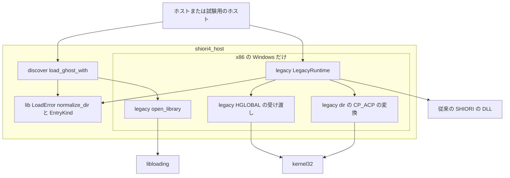
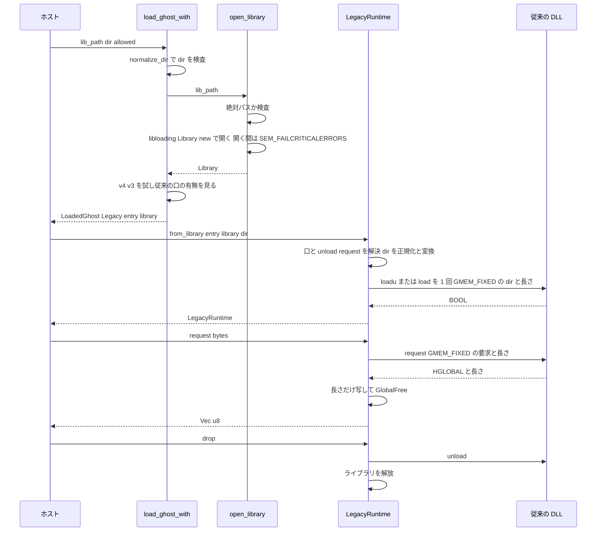
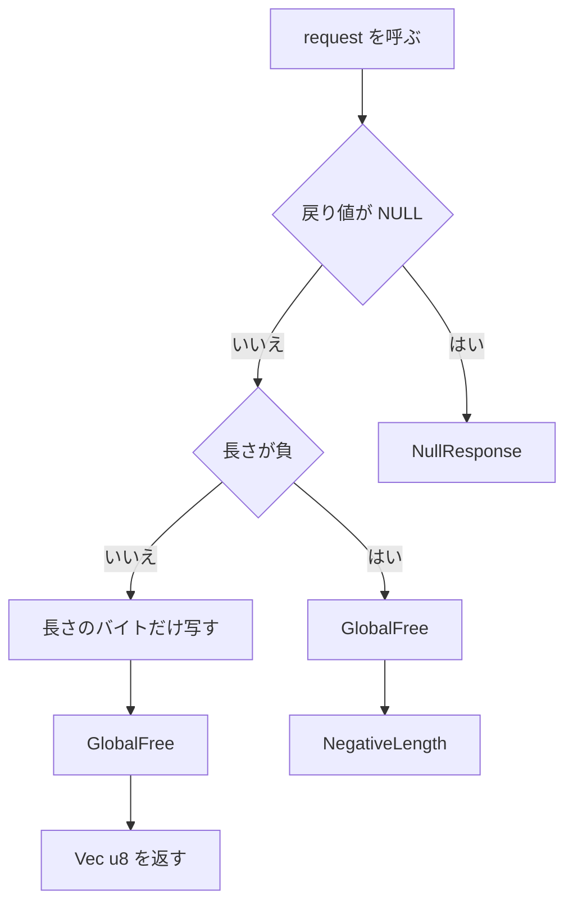

# 設計書: shiori3-legacy-host

## Overview
**Purpose**: x86 の Windows に限って、`shiori4_host` を従来の SHIORI/3.0 の DLL（HGLOBAL の `loadu`・`load`・`request`・`unload`）のホストとして使えるようにする。発見の口が `LoadedGhost::Legacy` で返したライブラリを、HGLOBAL の決まりどおりに初期化し、要求を往復させ、unload して解放する。

**Users**: 32bit の helper を書くベースウェアの作者（areka の `shiori_proxy.rs` の置き換え）、自分の HGLOBAL の入口を CI で試したい SHIORI の作者（pasta）、試験用のホスト `shiori4-testhost` の利用者。

**Impact**: x86 の Windows のビルドにだけ、新しいモジュール `legacy`（公開の型 `LegacyRuntime`・`LegacyRequestError`）が加わる。同じ環境で、発見の口は相対のライブラリのパスを開かずに断る（開き方そのものは今の `libloading` のまま）。ほかの環境のビルド・API・振る舞いは変わらない。

### Goals
- x86 の Windows で、従来の DLL を 1 回だけ初期化し（`loadu` を先に・無ければ `load`）、バイト列で往復させ、`unload` → 解放の順で後始末する。
- HGLOBAL の確保と解放の持ち主を SHIORI/3.0 の約束どおりにし、テストで数として確かめる。
- i686 の Windows の CI で、ビルド・テスト・clippy・試験用のホストの往復を毎回確かめる。
- 文書（crate doc・教科書の 3 章・steering）を、この口がある形に揃える。

### Non-Goals
- プロセスの起こし方・IPC・待ち時間・強制終了・カレントディレクトリ（ホストが持つ。決定 10）。
- 本文の文字コードの方針・中身の解釈・SHIORI/2.x の文字列の形（spec `shiori2-helpers`）。
- x86 の Windows 以外で従来の DLL を読むこと。ダイアログの抑止を x64 の Windows・`GhostRuntime::load`・`V3Runtime::load` へ広げること（議題 7）。
- x86 の配布の決まり（`TargetArch` に x86 を足す・i386 の PE の検査。議題 11）。
- SHIORI の側の不具合の取り繕い（Rust の `bool` を返す `load`。裁定 d）。
- 版を上げること。

## Boundary Commitments

### This Spec Owns
- `shiori4_host/src/legacy.rs`（x86 の Windows だけ）: kernel32 の宣言、HGLOBAL の受け渡し、`load` の dir の CP_ACP の変換と表せない文字の検出、従来の DLL の実行時の値 `LegacyRuntime`、要求の失敗の型 `LegacyRequestError`、相対のライブラリのパスを断ってから開く内部の口 `open_library`。
- 発見の口（`load_ghost_with`）の、x86 の Windows での相対のライブラリのパスの拒否。ダイアログの抑止は今の `libloading` が開く間に立てる `SEM_FAILCRITICALERRORS` に任せる（設計の議題 1）。発見の順そのものは持たない。
- `LoadError::InvalidPath` の意味の拡張（x86 の Windows で「ライブラリのパスが絶対パスでない」も含む）。
- テスト用の DLL `testdata/legacyghost/` と、確保と解放を数えるテストの内部の口（`#[cfg(test)]` だけ）。
- `test_dll` の x86 の Windows でのテスト用の DLL の作り方（`--target`）。
- 試験用のホストの x86 の Windows の枝（往復・`--entry legacy`・終了の状態）。
- CI の i686 の Windows の job。
- 文書の書き換え（crate doc・`LoadedGhost::Legacy` の doc・`migration.md`・`distribution.md`・`testhost.md`・`tech.md`・docs.rs の設定）。

### Out of Boundary
- 発見の順・許可する口の種類・`EntryKind`・`LoadedGhost` の形・`LoadError` の値の集合（abi-conventions。変えない）。
- `GhostRuntime`・`V3Runtime`・`Host`・ABI の規約（`shiori4_abi`）と C ヘッダ。`SHIORI_E_*` に値を足さない。
- 要求・応答の中身（開始行・ヘッダ・Charset・語彙）の解釈と変換。要求の組み立て（試験用のホストを除き、ホストが組む）。
- DLL の中のクラッシュ・応答しない DLL からの回復、別のプロセスで読むこと。
- 依存の DLL の探し方（`SetDllDirectory`・`LOAD_WITH_ALTERED_SEARCH_PATH` は使わない。今の振る舞いのまま）。
- x86 の配布の決まり（`dist.rs`）。
- x86 の C の例のビルド（CI の job `textbook` の C の例は今のまま x64）。

### Allowed Dependencies
- 外部の crate は今の `libloading`（0.8）だけ。ライブラリは今のまま `libloading::Library::new` で開く。
- Win32 は kernel32 の 4 関数（`GlobalAlloc`・`GlobalFree`・`GetACP`・`WideCharToMultiByte`）を `#[link(name = "kernel32")] unsafe extern "system"` で直接宣言する。`windows-sys`・`windows`・`log` は足さない。
- crate の中の依存の向き（下の Architecture）: `legacy.rs` が使ってよいのは `crate::LoadError`・`crate::EntryKind`（型）・`crate::normalize_dir` だけ。`load_ghost`・`load_ghost_with`・`GhostRuntime`・`V3Runtime` を使わない。`discover.rs` は x86 の Windows でだけ `legacy::open_library` を呼んでよい。
- テスト用の DLL `legacyghost` は外部の crate に依存しない（kernel32 を直接宣言する）。

### Revalidation Triggers
- `LegacyRuntime`・`LegacyRequestError` の公開の形（関数の名前・引数・戻り値・列挙の値）を変える → areka の helper・pasta の CI・`doc/textbook/testhost.md` を確かめ直す。
- 試験用のホストの x86 の Windows の表示・`--entry legacy`・終了の状態を変える → `testhost.md`・example の `//!`・CI の job `test-i686` と下流の CI。
- `load` の dir の変換の作法（CP_ACP・best-fit・65001 の扱い）を変える → 古い SHIORI の dir の受け取り、`migration.md` の記述。
- 発見の口の開き方（相対パス）を変える → x86 の Windows の既存の利用者（相対パスの `InvalidPath`）。
- `libloading` の版を上げる → 開く間のエラーモード（今は `SEM_FAILCRITICALERRORS` を立てる）が変わっていないか。変わればダイアログの抑止（要件 7.1）を自前で持つ要がある。
- 発見の順・`LoadedGhost::Legacy` の形が上流（abi-conventions）で変わる → 初期化の入口。

## Architecture

### Existing Architecture Analysis
- 発見の口 `load_ghost_with`（`discover.rs`）は dir の検査 → `libloading::Library::new` → v4 → v3 → 従来の口の有無、の順で、従来の口は呼ばずに `LoadedGhost::Legacy { entry, library }` で返す。この spec はその後ろに初期化の入口を足し、開く 1 行を x86 の Windows でだけ差し替える。
- 実行時の値の手本は `V3Runtime`（`v3.rs`）: `!Send`、Drop で unload → ライブラリの解放、UTF-8 でない応答はエラー。`LegacyRuntime` はこれに揃える。
- `normalize_dir`（`lib.rs` の非公開の関数）がそのまま要件 3.1 になる。子のモジュールから `crate::normalize_dir` で使える（`v3.rs` と同じ）。
- Win32 を外部の crate なしに宣言する前例は `lib.rs` の doc の例（`#[link(name = "kernel32")] unsafe extern "system"`）。
- `libloading` の `Library::new` は開く間だけエラーモードを `SEM_FAILCRITICALERRORS` に置き換え、`SEM_NOOPENFILEERRORBOX` を落とす。ただし `SEM_NOOPENFILEERRORBOX` が効くのは `OpenFile` 関数だけで、`LoadLibrary` の「依存の DLL が無い」などのダイアログを止めるのは `SEM_FAILCRITICALERRORS` なので、今の開き方で要件 7.1 を満たす。`libloading::Error` は外から作れない（research.md の設計フェーズ）ので、自前の `LoadLibraryW` に替えると失敗のときのエラーを作れない（設計の議題 1）。

### Architecture Pattern & Boundary Map



**Architecture Integration**:
- Selected pattern: x86 の Windows だけの 1 モジュール（ギャップ分析の Option B）。cfg は `lib.rs` の `mod`・`pub use` と `discover.rs` の開く 1 か所にだけ現れる。
- 依存の向き（違反はレビューで誤りとして扱う）: `lib.rs` の型と `normalize_dir`・`discover.rs` の `EntryKind` → `legacy.rs` → `discover.rs` の開く所（x86 の Windows だけ）。`legacy.rs` は発見の口を呼ばない。
- Existing patterns preserved: 役割ごとの別ファイル、`!Send` の実行時の値、Drop で unload → 解放、`unsafe` は `legacy.rs` の中に閉じて上位には安全な型だけを見せる、テストは同じファイルの `mod tests`、DLL を使うテストは `test_dll::lock()`。
- New components rationale: `LegacyRuntime`（要件 2・4・5・6）、`LegacyRequestError`（要件 4.4 の失敗の表し方）、`open_library`（要件 7）、`legacyghost`（要件 8）。
- Steering compliance: 芯は中身を解釈しない（tech.md）、依存は `libloading` だけ（tech.md）、`unsafe` は ABI に近い層に閉じる（tech.md）、版を上げない。

### Technology Stack

| Layer | Choice / Version | Role in Feature | Notes |
|-------|------------------|-----------------|-------|
| 言語 | Rust 1.85 以上・edition 2024 | 全体 | 変更なし |
| 動的読み込み | `libloading` 0.8 | ライブラリを開く（開く間の `SEM_FAILCRITICALERRORS` でダイアログを止める）・書き出しの解決 | 新しい依存なし・使い方も今のまま |
| OS の API | kernel32（直接宣言） | HGLOBAL・CP_ACP の変換 | x86 の Windows だけ。呼び出し規約は `extern "system"`（x86 では stdcall） |
| 従来の DLL の口 | `extern "C"`（x86 の `__cdecl`） | `loadu`・`load`・`request`・`unload` | ukadoc の DLL 共通仕様 |
| CI | GitHub Actions・`dtolnay/rust-toolchain@stable`（`targets: i686-pc-windows-msvc`）・`Swatinem/rust-cache@v2` | i686 の job | runner は `windows-latest`（x64）で `--target` |
| 文書 | docs.rs の `[package.metadata.docs.rs]` | i686 の Windows の頁 | `targets` の最初が既定の頁 |

## File Structure Plan

### Directory Structure
```
shiori4_host/
├── src/
│   └── legacy.rs              # 新規。x86 の Windows だけ。kernel32 の宣言・HGLOBAL・CP_ACP・LegacyRuntime・LegacyRequestError・open_library・テスト
testdata/
└── legacyghost/               # 新規。従来の口だけを持つテスト用 cdylib（依存なし・publish = false・自前の [workspace]）
    ├── Cargo.toml
    └── src/lib.rs             # loadu・load・request・unload と、テスト用の書き出し（数・最後の入力・応答の種類・load の戻り値）
```

### Modified Files
- `shiori4_host/src/lib.rs` — `#[cfg(all(windows, target_arch = "x86"))] mod legacy;` と `pub use legacy::{LegacyRequestError, LegacyRuntime};`。crate doc の「DLL の選び方と読み方」に従来の DLL の口の項目を足し、例の `Legacy` の枝の文を直す（要件 11.1）。`LoadError::InvalidPath` の doc を広げ、x86 の Windows でだけ Display の文を広げる（要件 7.3・設計の議題 7）。
- `shiori4_host/src/discover.rs` — x86 の Windows でだけ `libloading::Library::new` を `legacy::open_library`（相対パスを断ってから `Library::new`）に替える（要件 7.3）。`LoadedGhost::Legacy` と `load_ghost_with` の doc を直す（要件 11.1）。テスト `os_library_is_not_shiori4` の Windows の `kernel32.dll` を絶対パス（`%SystemRoot%\System32\kernel32.dll`）にする（要件 7.3 で相対が断られるため）。
- `shiori4_host/src/test_dll.rs` — x86 の Windows のテストでは `--target i686-pc-windows-msvc` を付けて作り、出力の場所に三つ組を入れる。legacyghost を作る `legacy_dll_path()` と、その書き出しを呼ぶ補助（`legacy_reset`・`legacy_set_response`・`legacy_set_load_result`・`legacy_stats`・`legacy_last_input`）を足す（後者は x86 の Windows だけ）。
- `shiori4_host/examples/shiori4-testhost.rs` — x86 の Windows の `run_legacy`（往復）、`--entry legacy`、`request error:` の行、冒頭の `//!` と `USAGE`（要件 10）。
- `shiori4_host/Cargo.toml` — `[package.metadata.docs.rs] targets = ["x86_64-unknown-linux-gnu", "i686-pc-windows-msvc"]`（要件 11.8）。
- `.github/workflows/build.yml` — job `test-i686` を足す（要件 9）。
- `doc/textbook/testhost.md` — x86 の Windows の振る舞いの節（要件 10.6・11.4）。
- `doc/textbook/migration.md` — 18・38 行の「既定の OEM コードページ」を CP_ACP に直して理由を添える、51 行を書き換える（要件 11.2・11.6）。
- `doc/textbook/distribution.md` — 214 行の文と、182 行の例の `Legacy` の枝の文（要件 11.3）。
- `.kiro/steering/tech.md` — CI の job の一覧（6 種）、Testing の節（legacyghost・i686）、`shiori4_host` の構成の図の項目（要件 11.5）。

## System Flows

### 発見から往復と後始末まで（x86 の Windows）



**Flow-level decisions**:
- dir の検査（`InvalidPath`）は、発見の口ではライブラリを開くより先（今のまま）。ライブラリのパスの検査はその次で、開くより先（要件 7.3）。
- `from_library` は DLL の関数を 1 つも呼ばずに、`entry` の口・`unload`・`request` の解決と dir の検査と変換と入力の確保を済ませる。どれかで失敗すれば `loadu`・`load` を呼ばずにライブラリを解放する（要件 2.3・4.3）。
- 初期化の失敗（BOOL が 0）では `unload` を呼ばずにライブラリを解放する（要件 2.5）。
- 入力の HGLOBAL は DLL に渡した時点で DLL のもの。ホストは失敗の道でも解放しない（要件 4.2）。

### 応答の受け取り



## Requirements Traceability

| Requirement | Summary | Components | Interfaces | Flows |
|-------------|---------|------------|------------|-------|
| 1.1 | x86 の Windows で口を公開 | LegacyRuntime・lib.rs の cfg | `pub use legacy::*` | — |
| 1.2 | ほかの環境で口と依存を含めない | lib.rs の cfg・依存なし | `#[cfg(all(windows, target_arch = "x86"))]` | — |
| 1.3 | ほかの環境の API と振る舞いを保つ | discover.rs の cfg の枝・InvalidPath の Display の cfg | — | — |
| 1.4 | ANSI の変換器を持たない | AcpEncoding | `WideCharToMultiByte` | — |
| 2.1 | Legacy のライブラリを受ける入口だけ | LegacyRuntime | `from_library(entry, library, dir)` | 発見から往復 |
| 2.2 | 片方を 1 回だけ呼ぶ | LegacyRuntime | `from_library` | 発見から往復 |
| 2.3 | unload か request が無ければ NotShiori4 | LegacyRuntime | `from_library` の解決 | 発見から往復 |
| 2.4 | BOOL を 32bit で 0 以外を成功 | LegacyRuntime | `LoadFn -> i32` | — |
| 2.5 | 失敗は LoadFailed・unload なしで解放 | LegacyRuntime | `from_library` | 発見から往復 |
| 2.6 | 発見の順を保つ | discover.rs（変えない） | `load_ghost_with` | — |
| 2.7 | 作ったスレッドだけ（!Send） | LegacyRuntime | `PhantomData<*mut ()>` | — |
| 3.1 | dir の検査と正規化 | LegacyRuntime・normalize_dir | `from_library` | — |
| 3.2 | loadu に UTF-8 | AcpEncoding | `dir_bytes` | — |
| 3.3 | load に CP_ACP | AcpEncoding | `dir_bytes`・`to_acp` | — |
| 3.4 | 表せない文字を知らせて続ける | AcpEncoding・LegacyRuntime | `LegacyRuntime::dir_lossy(ghost_dir)` | — |
| 3.5 | dir を GMEM_FIXED に NUL なしで | HglobalTransfer | `global_alloc_copy` | 発見から往復 |
| 4.1 | 要求を GMEM_FIXED に NUL なしで | HglobalTransfer | `global_alloc_copy` | 発見から往復 |
| 4.2 | 入力を解放しない | HglobalTransfer | `global_alloc_copy` | 発見から往復 |
| 4.3 | 確保できなければ呼ばずに失敗 | HglobalTransfer・LegacyRuntime | `AllocFailed`・`LoadFailed` | — |
| 4.4 | NULL は要求の失敗 | LegacyRequestError | `NullResponse` | 応答の受け取り |
| 4.5 | 長さだけ写して GlobalFree | HglobalTransfer | `take_response` | 応答の受け取り |
| 4.6 | 負の長さは失敗・解放する | HglobalTransfer | `NegativeLength` | 応答の受け取り |
| 4.7 | 芯は長さのまま返す | LegacyRuntime | `request(&[u8]) -> Vec<u8>` | — |
| 4.8 | 中身を解釈しない | LegacyRuntime | `request` | — |
| 5.1 | 文字列の口 | LegacyRuntime | `request_str` | — |
| 5.2 | 末尾の NUL をすべて落とす | LegacyRuntime | `request_str` | — |
| 5.3 | UTF-8 でなければエラー | LegacyRequestError | `InvalidUtf8` | — |
| 5.4 | Charset で変換しない | LegacyRuntime | `request_str` | — |
| 6.1 | unload を 1 回・その後に解放 | LegacyRuntime | `Drop` | 発見から往復 |
| 6.2 | 2 回初期化する手段なし | LegacyRuntime | `from_library` がライブラリを値で受ける | — |
| 6.3 | 1 モジュール 1 インスタンスを doc に | LegacyRuntime の doc | — | — |
| 6.4 | unload の後に呼ばない | LegacyRuntime | `Drop` が値を消費 | — |
| 7.1 | 開く間ダイアログを止める | OpenLibrary（`libloading` に任せる） | `open_library` | 発見から往復 |
| 7.2 | SetDllDirectory を使わない | OpenLibrary | — | — |
| 7.3 | 相対のライブラリのパスは InvalidPath | OpenLibrary・LoadError の doc | `open_library` | 発見から往復 |
| 8.1 | 本物の口を持つテスト用 DLL | LegacyGhost・test_dll | legacyghost の書き出し | — |
| 8.2 | 確保と解放の数の一致 | LegacyGhost・HglobalTransfer の数え口 | `legacyghost_stats`・`#[cfg(test)]` の数 | — |
| 8.3 | 選び方・dir・NULL・長さ・NUL・解放の試験 | legacy.rs の tests | — | — |
| 8.4 | 1 以外の 0 でない BOOL を成功 | legacy.rs の tests・LegacyGhost | `legacyghost_set_load_result` | — |
| 9.1 | i686 で build・test・clippy | CiJob | job `test-i686` | — |
| 9.2 | i686 で試験用のホストの往復 | CiJob | job `test-i686` の Round trips | — |
| 9.3 | 既存の job を同じに通す | CiJob（既存は変えない） | — | — |
| 9.4 | PR の CI を見届けて統合 | Integration & Migration Notes | — | — |
| 10.1 | x86 で従来の口を往復 | TesthostLegacy | `run_legacy` | — |
| 10.2 | ほかの環境は今の枝 | TesthostLegacy | `run_legacy`（cfg） | — |
| 10.3 | `--entry legacy` | TesthostLegacy | `parse_args` | — |
| 10.4 | 終了の状態・request error の行 | TesthostLegacy | `finish`・`request error:` | — |
| 10.5 | UTF-8 でない応答は置換して表示 | TesthostLegacy | `String::from_utf8_lossy` | — |
| 10.6 | 文書と CI を同じに直す | Docs・CiJob | — | — |
| 11.1 | crate doc と口の doc | Docs | — | — |
| 11.2 | migration.md の書き換え | Docs | — | — |
| 11.3 | distribution.md の書き換え | Docs | — | — |
| 11.4 | testhost.md の x86 の節 | Docs | — | — |
| 11.5 | tech.md | Docs | — | — |
| 11.6 | CP_ACP の記述を揃える | Docs | — | — |
| 11.7 | x86 だけの例の検査の場所 | Docs・CiJob | i686 の doctest | — |
| 11.8 | docs.rs の targets | Cargo.toml | `[package.metadata.docs.rs]` | — |
| 12.1 | x86 で既存の型を変えない | 全体 | — | — |
| 12.2 | 依存を足さず deny を通す | 全体 | — | — |
| 12.3 | 版を上げない | 全体 | — | — |
| 12.4 | 4 環境でテストと clippy | CiJob | `test`・`test-i686` | — |

## Components and Interfaces

| Component | Domain/Layer | Intent | Req Coverage | Key Dependencies (P0/P1) | Contracts |
|-----------|--------------|--------|--------------|--------------------------|-----------|
| LegacyRuntime | `legacy.rs`（x86 の Windows） | 従来の DLL を初期化・往復・後始末する実行時の値 | 1.1, 2.1–2.5, 2.7, 3.1, 3.4, 4.7, 4.8, 5.1–5.4, 6.1–6.4 | libloading (P0), HglobalTransfer (P0), AcpEncoding (P0) | Service, State |
| LegacyRequestError | `legacy.rs` | 要求の失敗の値 | 4.3, 4.4, 4.6, 5.3, 10.4 | — | Service |
| HglobalTransfer | `legacy.rs`（非公開） | 入力の確保と書き込み、応答の写しと解放 | 3.5, 4.1–4.6, 8.2 | kernel32 (P0) | Service |
| AcpEncoding | `legacy.rs`（非公開） | dir を `loadu`・`load` 用のバイト列にする | 1.4, 3.2–3.4 | kernel32 (P0) | Service |
| OpenLibrary | `legacy.rs`（`pub(crate)`）と `discover.rs` の呼び出し | 絶対パスだけを開く（ダイアログは libloading が止める） | 1.3, 2.6, 7.1–7.3 | libloading (P0) | Service |
| LegacyGhost | `testdata/legacyghost` | 従来の口と数を持つテスト用 DLL | 8.1–8.4, 9.2 | kernel32 (P0) | Service |
| TestDllSupport | `test_dll.rs`（`#[cfg(test)]`） | テスト用 DLL を同じ target で作り、書き出しを呼ぶ | 8.1, 9.1 | cargo (P0) | Service |
| TesthostLegacy | `examples/shiori4-testhost.rs` | x86 の Windows で従来の口を往復する枝 | 10.1–10.6 | LegacyRuntime (P0) | Batch |
| CiJob | `.github/workflows/build.yml` | i686 の build・test・clippy・往復 | 9.1–9.4, 11.7, 12.4 | GitHub Actions (P0) | Batch |
| Docs | 文書の各所・`Cargo.toml` | 使える環境・入口・ホストに残すもの | 6.3, 11.1–11.8 | — | — |

### legacy.rs（x86 の Windows だけ）

#### LegacyRuntime

| Field | Detail |
|-------|--------|
| Intent | `LoadedGhost::Legacy` のライブラリを受けて従来の DLL を 1 回だけ初期化し、バイト列（と任意の文字列）で往復させ、Drop で `unload` → 解放する |
| Requirements | 1.1, 2.1, 2.2, 2.3, 2.4, 2.5, 2.7, 3.1, 3.4, 4.7, 4.8, 5.1, 5.2, 5.3, 5.4, 6.1, 6.2, 6.3, 6.4 |

**Responsibilities & Constraints**
- 初期化の入口はこの 1 つだけ。パスから読む入口は作らない（議題 1）。
- `ghost_dir` には、発見の口に渡したのと同じ dir を渡す（`LoadedGhost::Legacy` は dir を持たないため）。型の doc に書く。
- `entry` が `Loadu` なら `loadu`、`Load` なら `load` を呼ぶ。それ以外（`V4`・`V3`）は `NotShiori4`。発見の口がすでに `loadu` を先に見て、許可された口で解決している（要件 2.1・2.6）。
- `entry` の口・`unload`・`request` の 3 つが揃わなければ、何も呼ばずに `NotShiori4`（要件 2.3）。
- 初期化の BOOL は `i32` で受け、`!= 0` を成功とする。下位 1 バイトで読む守りは持たない（要件 2.4・裁定 d）。
- 失敗の後始末: 初期化の前の失敗も、BOOL が 0 の失敗も、`unload` を呼ばずにライブラリを解放する（`library` を落とすだけ。要件 2.5）。
- `!Send`・`!Sync`（`PhantomData<*mut ()>`。要件 2.7）。メソッドは `&mut self`。
- 不変条件: 値がある間、DLL は初期化済みで、ライブラリは開いている。Drop だけが `unload` を呼び、その後でライブラリを解放する（フィールドの宣言の順。ライブラリが最後）。Drop の後は値が無いので関数を呼べない（要件 6.1・6.4）。
- 1 つのモジュールに 1 インスタンス。同じファイルを 2 回開くと同じモジュールになり、従来の ABI にはハンドルが無いので、2 体目は別のファイルか別のプロセスで読む。これを型の doc に書く（要件 6.3）。
- 中身を解釈しない。`request` は渡されたバイト列をそのまま書き、応答を長さのまま返す（要件 4.7・4.8）。`request_str` は末尾に続く NUL をすべて落として UTF-8 を確かめるだけで、Charset を見ない（要件 5.2・5.4）。
- poisoned の状態は持たない（従来の DLL はパニックを値で知らせない。research.md の Synthesis）。

**Dependencies**
- Inbound: ホスト・試験用のホスト — `LoadedGhost::Legacy` を渡す (P0)
- Outbound: HglobalTransfer — 入力と応答の受け渡し (P0)・AcpEncoding — dir のバイト列 (P0)・`crate::normalize_dir` — dir の検査 (P0)
- External: `libloading::Library` — 書き出しの解決とライブラリの寿命 (P0)

**Contracts**: Service [x] / API [ ] / Event [ ] / Batch [ ] / State [x]

##### Service Interface
```rust
#[cfg(all(windows, target_arch = "x86"))]
pub struct LegacyRuntime {
    // Drop の本体で unload を呼んだ後、宣言の順に落ちる。library は最後
    request: RequestFn,
    unload: UnloadFn,
    _not_send: PhantomData<*mut ()>,
    library: libloading::Library,
}

impl LegacyRuntime {
    /// LoadedGhost::Legacy の entry と library を受け、entry の口で 1 回だけ初期化する
    pub fn from_library(
        entry: EntryKind,
        library: libloading::Library,
        ghost_dir: impl AsRef<Path>,
    ) -> Result<Self, LoadError>;

    /// dir を load に渡すと CP_ACP で表せない文字が置き換わるか（loadu には関わらない）。
    /// 値を作らずに呼べるので、初期化の前にも、load が失敗した後にも確かめられる。
    /// dir の検査は from_library と同じ（InvalidPath）。変換の API の失敗は LoadFailed
    pub fn dir_lossy(ghost_dir: impl AsRef<Path>) -> Result<bool, LoadError>;

    /// 芯: 要求のバイト列を渡し、応答のバイト列を長さのまま受け取る
    pub fn request(&mut self, req: &[u8]) -> Result<Vec<u8>, LegacyRequestError>;

    /// 便利な層: 末尾に続く NUL をすべて落として UTF-8 を確かめる
    pub fn request_str(&mut self, req: &str) -> Result<String, LegacyRequestError>;
}

impl Drop for LegacyRuntime {
    /// unload() を 1 回（戻り値は見ない）→ ライブラリを解放
    fn drop(&mut self);
}

// 従来の DLL の口（ukadoc の DLL 共通仕様。x86 の __cdecl は Rust の extern "C"、long は i32）
type LoadFn = unsafe extern "C" fn(h: *mut c_void, len: i32) -> i32; // loadu・load
type RequestFn = unsafe extern "C" fn(h: *mut c_void, len: *mut i32) -> *mut c_void;
type UnloadFn = unsafe extern "C" fn() -> i32;
```
- `from_library` の手順（どれかが失敗したらそこで返り、DLL の関数は呼ばない）:
  1. `entry` が `Loadu`・`Load` のどちらでもなければ `NotShiori4`。
  2. `entry` の口（`loadu\0`・`load\0`）・`unload\0`・`request\0` を `library.get` で解決する。1 つでも無ければ `NotShiori4`（要件 2.3）。
  3. `normalize_dir(ghost_dir)`。`InvalidPath`（要件 3.1）。
  4. AcpEncoding の `dir_bytes(entry, &dir)` で `(bytes, lossy)`。変換の API の失敗は `LoadFailed`。
  5. HglobalTransfer の `global_alloc_copy(&bytes)`。NULL なら `LoadFailed`（要件 4.3）。
  6. 口を 1 回呼ぶ: `init(h, bytes.len() as i32)`。`h` は DLL のもの（要件 4.2）。
  7. 戻り値が 0 なら `LoadFailed`（`library` を落とす。要件 2.5）。0 以外なら値を作る（要件 2.4）。
- `request` の手順: `global_alloc_copy(req)`（NULL なら `AllocFailed` で、DLL を呼ばない。要件 4.3）→ `let mut len = req.len() as i32;` → `request(h, &mut len)` → HglobalTransfer の `take_response(p, len)`（要件 4.4〜4.6）。x86 の `usize` は 32bit で、スライスの長さは `isize::MAX`（= `i32::MAX`）以下なので、`as i32` で溢れない。
- `request_str` の手順: `request(req.as_bytes())?` → 末尾に続く `0` を落とす → `String::from_utf8`、失敗は `InvalidUtf8`（要件 5.2・5.3）。
- Preconditions: `library` は信頼できる従来の DLL（開いた時点で初期化のコードが動いている）。
- Postconditions: `Ok` なら `loadu`・`load` のどちらか一方がちょうど 1 回呼ばれ、成功を返している。`Err` なら `unload` は呼ばれておらず、ライブラリは解放されている。
- Invariants: 上の「不変条件」。

##### State Management
- State model: 「初期化済み」だけ（作られた値 = 初期化済み、Drop = unload 済みで解放済み）。途中の状態を外に見せない。
- Persistence & consistency: なし。
- Concurrency strategy: `!Send`・`!Sync`・`&mut self`。別スレッドから呼ぶ手段を型で消す。

**Implementation Notes**
- Integration: `lib.rs` に `#[cfg(all(windows, target_arch = "x86"))] mod legacy;` と `pub use legacy::{LegacyRequestError, LegacyRuntime};`。doc の中の他の型への参照は、ほかの環境で壊れる intra-doc link にしない（`LegacyRuntime` を crate doc から `[...]` で引かない）。
- Validation: `!Send` は x86 の doctest の `compile_fail`（`fn f<T: Send>() {} f::<LegacyRuntime>();`）で確かめる（i686 の CI で走る）。
- Risks: 利用者が自分で `Library::new` したライブラリを渡すと、ダイアログの抑止と絶対パスの検査が効かない。型の doc に「発見の口が返したライブラリを渡す」と書く。

#### LegacyRequestError

| Field | Detail |
|-------|--------|
| Intent | 従来の DLL の要求の失敗を、ABI のエラーの値を使わずに表す |
| Requirements | 4.3, 4.4, 4.6, 5.3, 10.4 |

**Contracts**: Service [x]

##### Service Interface
```rust
#[cfg(all(windows, target_arch = "x86"))]
#[derive(Debug, Clone, Copy, PartialEq, Eq)]
pub enum LegacyRequestError {
    /// 要求の入力のメモリ（GlobalAlloc）を確保できなかった。DLL は呼んでいない
    AllocFailed,
    /// request が NULL を返した
    NullResponse,
    /// request が負の長さを返した（応答のメモリは解放した）
    NegativeLength(i32),
    /// 文字列の口で、応答（末尾の NUL を落とした後）が UTF-8 でない
    InvalidUtf8,
}

impl fmt::Display for LegacyRequestError { /* 英語の 1 行。LoadError に揃える */ }
impl std::error::Error for LegacyRequestError {}
```
- Display: `failed to allocate request memory`・`request returned NULL`・`request returned a negative length ({n})`・`response is not valid UTF-8`。
- 失敗の後も `LegacyRuntime` は使い続けられる（DLL の状態は SHIORI のもの。読み直すかはホストが決める）。

#### HglobalTransfer（非公開）

| Field | Detail |
|-------|--------|
| Intent | HGLOBAL の持ち主の決まり（入力はホストが確保し DLL が解放、応答は DLL が確保しホストが解放）を 1 か所にまとめる |
| Requirements | 3.5, 4.1, 4.2, 4.3, 4.4, 4.5, 4.6, 8.2 |

**Contracts**: Service [x]

##### Service Interface
```rust
/// GMEM_FIXED で max(bytes.len(), 1) バイトを確保し、bytes をちょうど len バイトだけ書く（NUL を付けない）。
/// 返したハンドルの持ち主は呼んだ先の DLL。確保できなければ None
fn global_alloc_copy(bytes: &[u8]) -> Option<*mut c_void>;

/// request の戻り値を受け取る。NULL は NullResponse。len < 0 は GlobalFree して NegativeLength。
/// それ以外は len バイトだけ写し（NUL を探さない）、GlobalFree して返す
///
/// # Safety
/// p は DLL が GMEM_FIXED で確保した、少なくとも len バイトの領域か NULL
unsafe fn take_response(p: *mut c_void, len: i32) -> Result<Vec<u8>, LegacyRequestError>;

// kernel32（#[link(name = "kernel32")] unsafe extern "system"）
fn GlobalAlloc(flags: u32, bytes: usize) -> *mut c_void; // GMEM_FIXED = 0。ハンドル = 先頭のポインタ
fn GlobalFree(h: *mut c_void) -> *mut c_void;

#[cfg(test)]
pub(crate) static INPUTS_ALLOCATED: AtomicU32;  // global_alloc_copy が確保した数
#[cfg(test)]
pub(crate) static RESPONSES_FREED: AtomicU32;   // take_response が解放した数
```
- 確保の大きさを `max(len, 1)` にするのは、`GlobalAlloc(GMEM_FIXED, 0)` の振る舞いが文書で保証されていないため（手元では 1 バイトが返る。research.md）。長さの引数には本当の長さ（0 を含む）を渡す（要件 3.5・4.1）。
- 数え口は `#[cfg(test)]` だけで、公開の API にも試験用のホストにも出さない（要件 8.2・議題 9）。

#### AcpEncoding（非公開）

| Field | Detail |
|-------|--------|
| Intent | 正規化した dir を、`loadu` には UTF-8、`load` には CP_ACP のバイト列にし、表せない文字を見つける |
| Requirements | 1.4, 3.2, 3.3, 3.4 |

**Contracts**: Service [x]

##### Service Interface
```rust
/// entry が Loadu なら (dir の UTF-8, false)。Load なら to_acp(dir)。変換の API の失敗は LoadFailed
fn dir_bytes(entry: EntryKind, dir: &str) -> Result<(Vec<u8>, bool), LoadError>;

/// CP_ACP のバイト列と「表せない文字があった」。GetACP() が 65001 なら (s の UTF-8, false)。
/// それ以外は WideCharToMultiByte(CP_ACP, WC_NO_BEST_FIT_CHARS, utf16, len, .., NULL, &used) を
/// 長さの問い合わせと変換の 2 回で呼ぶ（cchWideChar に長さを渡し、NUL を出さない）。0 が返れば None
fn to_acp(s: &str) -> Option<(Vec<u8>, bool)>;

// kernel32
fn GetACP() -> u32;
fn WideCharToMultiByte(
    code_page: u32, flags: u32, wide: *const u16, wide_len: i32,
    out: *mut u8, out_len: i32, default_char: *const u8, used_default_char: *mut i32,
) -> i32;
```
- `WC_NO_BEST_FIT_CHARS`（0x400）で、表せない文字は既定の文字（`?`）になり `used_default_char` が立つ。best-fit（`é` → `e` のような似た文字への写し）はしない（設計の議題 6）。
- ACP が 65001 のとき（システムの UTF-8 の設定か、ホストの exe のマニフェストの `activeCodePage`）は、この旗と `used_default_char` が使えないので変換しない。正規化した dir は UTF-8 なので、そのまま CP_ACP のバイト列でもある。
- ANSI の変換表は持たない（要件 1.4）。
- 表せない文字があっても止めない。`load` はそのまま呼び、ホストは関連関数 `LegacyRuntime::dir_lossy(ghost_dir)`（`normalize_dir` と `to_acp` を使い回す）でいつでも確かめられる（要件 3.4・設計の議題 2）。

#### OpenLibrary（`pub(crate)`）

| Field | Detail |
|-------|--------|
| Intent | x86 の Windows の発見の口で、絶対パスのライブラリだけを開く |
| Requirements | 1.3, 2.6, 7.1, 7.2, 7.3 |

**Contracts**: Service [x]

##### Service Interface
```rust
/// 絶対パスでなければ InvalidPath（開かない）。絶対パスなら libloading::Library::new(lib_path)、
/// 失敗は LoadError::Library（今の発見の口と同じ）
pub(crate) fn open_library(lib_path: &OsStr) -> Result<libloading::Library, LoadError>;
```
- `discover.rs` の `load_ghost_with` は、`#[cfg(all(windows, target_arch = "x86"))]` で `crate::legacy::open_library(lib_path.as_ref())?`、それ以外で今の `libloading::Library::new(..).map_err(LoadError::Library)?` を使う。発見の順と残りの手順は変えない（要件 2.6・1.3）。
- ダイアログの抑止（要件 7.1）は `libloading::Library::new` に任せる。libloading 0.8 は開く間だけスレッドのエラーモードを `SEM_FAILCRITICALERRORS` にし、開き終えたら元に戻す。依存の DLL が無いときなどのダイアログを止めるのはこの旗で、`SEM_NOOPENFILEERRORBOX` は `OpenFile` 関数にしか効かない（設計の議題 1）。v4・v3 の DLL を開くときも同じ。`GhostRuntime::load`・`V3Runtime::load` は変えない。
- 自前の `LoadLibraryW` は使わない。使うと、失敗のときに `LoadError::Library` の `libloading::Error` を外から作れず、もう一度開く（`DllMain` が 2 回動く）要が出るため（設計の議題 1）。
- `SetDllDirectory` を使わない。探索の旗も付けない（今の libloading のフラグ 0 のまま。要件 7.2）。

### テスト用の DLL とテストの補助

#### LegacyGhost（`testdata/legacyghost`）

| Field | Detail |
|-------|--------|
| Intent | 従来の 4 つの口を本当に持ち、確保と解放の数と受け取った入力をテストに見せる cdylib |
| Requirements | 8.1, 8.2, 8.3, 8.4, 9.2 |

**Contracts**: Service [x]

##### Service Interface
```rust
// 従来の口（extern "C"・#[unsafe(no_mangle)]）
loadu(h: *mut c_void, len: i32) -> i32   // 入力を記録して GlobalFree。dir に "fail" を含むと 0、それ以外は LOAD_RESULT（既定 1）
load(h: *mut c_void, len: i32) -> i32    // 同上（呼ばれた口の数は別に数える）
request(h: *mut c_void, len: *mut i32) -> *mut c_void
    // 入力を記録して GlobalFree。応答の種類で:
    //   OK（既定）: "SHIORI/3.0 200 OK\r\nCharset: UTF-8\r\nValue: legacyghost\r\n\r\n"
    //   NULL: NULL を返す
    //   NEGATIVE: 応答を確保して *len = -1
    //   ECHO: 受けた要求をそのまま返す
    //   応答は len + 1 バイトを GMEM_FIXED で確保して末尾に NUL を置き（ukadoc の勧め）、*len は NUL を含めない
unload() -> i32                          // 数えて 1 を返す

// テスト用の書き出し
legacyghost_reset()                       // 数・最後の入力・応答の種類・LOAD_RESULT を既定に戻す
legacyghost_set_response(kind: u32)       // 0 = OK, 1 = NULL, 2 = NEGATIVE, 3 = ECHO
legacyghost_set_load_result(v: i32)
legacyghost_stats(out: *mut LegacyStats)
legacyghost_last_input(out: *mut u8, cap: usize) -> usize  // 最後に受けた入力（load・loadu・request）の長さ。cap まで写す

#[repr(C)]
struct LegacyStats { loadu: u32, load: u32, request: u32, unload: u32, inputs_freed: u32, responses_allocated: u32 }
```
- `shiori_get_api` を持たないので、既定の発見の順で `LoadedGhost::Legacy { entry: Loadu }` に解決する。
- 依存なし（kernel32 の `GlobalAlloc`・`GlobalFree` を直接宣言）。`publish = false`・自前の `[workspace]`（testghost と同じ形）。Windows でだけビルドする。
- 状態は DLL の static でプロセスに 1 つ。使うテストは `test_dll::lock()` を取り、別のハンドルで数を読み、`legacyghost_reset()` で戻す。

#### TestDllSupport（`test_dll.rs`）

| Field | Detail |
|-------|--------|
| Intent | テスト用の DLL をテストの実行ファイルと同じ target で作り、場所と書き出しの呼び方をテストに渡す |
| Requirements | 8.1, 9.1 |

**Contracts**: Service [x]

##### Service Interface
```rust
pub(crate) fn dll_path() -> &'static Path;          // 今のまま。x86 の Windows では --target i686-pc-windows-msvc を付け、
                                                    // target/testghost/i686-pc-windows-msvc/debug/testghost.dll を返す
#[cfg(all(windows, target_arch = "x86"))]
pub(crate) fn legacy_dll_path() -> &'static Path;   // testdata/legacyghost を target/legacyghost/i686-pc-windows-msvc/debug に作る
#[cfg(all(windows, target_arch = "x86"))]
pub(crate) fn legacy_stats(lib: &libloading::Library) -> LegacyStats; // ほかに legacy_reset・legacy_set_response・
                                                    // legacy_set_load_result・legacy_last_input（同じ形の薄い呼び出し）
```
- ビルドの共通部分（`cargo build --manifest-path .. --target-dir ..`・`CARGO_BUILD_TARGET` を外す）は 1 つの関数にまとめ、testghost と legacyghost で使い回す。
- x86 の Windows 以外の `dll_path()` の振る舞いと出力の場所は変えない（job `textbook` の場所も変わらない）。
- x86 の三つ組は `i686-pc-windows-msvc` に決め打つ（`target_env = "gnu"` の x86 はテストの対象にしない。research.md）。

### 試験用のホストと CI

#### TesthostLegacy（`examples/shiori4-testhost.rs`）

| Field | Detail |
|-------|--------|
| Intent | x86 の Windows で、従来の口に解決した DLL を初期化し、SHIORI/3.0 の要求の全文を 1 回往復させ、表示して unload する |
| Requirements | 10.1, 10.2, 10.3, 10.4, 10.5, 10.6 |

**Contracts**: Batch [x]

##### Batch / Job Contract
- Trigger: `shiori4-testhost [--entry v3|legacy] [-H "名前: 値"]... <SHIORI のファイル> <ゴーストのディレクトリ> [ID]`（`legacy` は x86 の Windows だけ）。
- Input / validation:
  - `--entry legacy` は x86 の Windows でだけ受け付け、許可する口を `[EntryKind::Loadu, EntryKind::Load]` にする。ほかの環境では今のまま引数の誤り（64）。`Args` の `v3_only: bool` は、許可する口（`None` = すべて・`Some(&[V3])`・`Some(&[Loadu, Load])`）を持つフィールドに替える（設計の議題 8）。
  - 要求は `v3_request(&request_headers(id, headers))`（v3 互換モードと同じ全文。`Charset: UTF-8`）のバイト列（要件 10.1）。
- Output / destination（stdout。x86 の Windows の `Legacy` の枝）:
  1. `entry: loadu`（または `load`）— 今のまま。
  2. `LegacyRuntime::from_library` の失敗は stderr に `load error: <名前>: <説明>` で終了の状態 3（今の `load error:` と同じ）。
  3. `request:` と要求の全文。
  4. 往復が成り立てば、応答の末尾に続く NUL を落として `String::from_utf8_lossy` で置き換えた文字列（要件 10.5）から `v3_status`（読めなければ 0）を取り、今の `finish` で `status:`・`response:` を出す（0 = 2xx・1 = 2xx 以外）。
  5. 要求の失敗は `request error: <名前>: <説明>`（名前は `AllocFailed`・`NullResponse`・`NegativeLength`）を出して終了の状態 2（要件 10.4）。`response:` は出さない。
  6. 値を落として `unloaded`。
- ほかの環境の `Legacy` の枝は今のまま（`従来の口は読まない（shiori3-legacy-host が足す）`・終了の状態 4。要件 10.2）。x86 の Windows では 4 は出ない。`EXIT_LEGACY` は x86 の Windows で使われないので、cfg で外す（clippy の dead_code を出さない）。
- Idempotency & recovery: 1 回の往復で終わる。
- 引数・表示・終了の状態の変更に合わせて、冒頭の `//!`・`USAGE`・`doc/textbook/testhost.md`・CI の job を直す（要件 10.6）。

#### CiJob（`.github/workflows/build.yml`）

| Field | Detail |
|-------|--------|
| Intent | i686 の Windows で、ワークスペースのビルド・テスト・clippy と試験用のホストの往復を確かめる |
| Requirements | 9.1, 9.2, 9.3, 9.4, 11.7, 12.4 |

**Contracts**: Batch [x]

##### Batch / Job Contract
- Trigger: build.yml の既存の trigger（`main` への push・PR・手動・`workflow_call`）。
- 新しい job `test-i686`（`name: test-i686-windows`・`runs-on: windows-latest`）:
  1. `actions/checkout@v6`、`dtolnay/rust-toolchain@stable`（`targets: i686-pc-windows-msvc`・`components: clippy`）、`Swatinem/rust-cache@v2`。
  2. `cargo test --all --target i686-pc-windows-msvc`（doctest も i686 で走る。要件 11.7）。
  3. `cargo clippy --all-targets --workspace --target i686-pc-windows-msvc -- -D warnings`。
  4. testghost・legacyghost・試験用のホストを `--target i686-pc-windows-msvc` でビルドする。
  5. Round trips（job `textbook` と同じ `expect` の形・bash）:
     - `expect 0 testhost legacyghost ws`（`loadu` で往復）
     - `expect 0 testhost --entry legacy legacyghost ws`
     - `expect 3 testhost legacyghost faildir`（`loadu` が 0）
     - `expect 0 testhost testghost ws`（i686 でも v4 で読める）
     - `expect 3 testhost --entry legacy testghost ws`（testghost は `unload`・`request` を持たないので `NotShiori4`）
     - 往復の出力に `Value: legacyghost` があることも確かめる。
- 既存の job（`test` 3 OS・`deny`・`package`・`release-scripts`・`textbook` 3 OS）は変えない（要件 9.3）。
- rust-cache は job の id で鍵が分かれるので `key` を付けない。

### 文書

#### Docs

| Field | Detail |
|-------|--------|
| Intent | 従来の DLL の口が使える環境・入口・ホストに残すものを、正本（コードの doc）と教科書と steering に揃えて書く |
| Requirements | 6.3, 11.1, 11.2, 11.3, 11.4, 11.5, 11.6, 11.7, 11.8 |

**Implementation Notes**（ファイルごとに書くこと）
- `legacy.rs` の `//!` と `LegacyRuntime` の doc: x86 の Windows（`cfg(all(windows, target_arch = "x86"))`）でだけある・ほかの環境では現れない・入口は `load_ghost_with` → `LoadedGhost::Legacy` → `LegacyRuntime::from_library`・1 つのモジュールに 1 インスタンス（2 体目は別のファイルか別のプロセス）・ホストに残すもの（プロセスの起こし方・IPC・待ち時間・強制終了・カレントディレクトリ・本文の文字コードの方針）・`load` の dir は CP_ACP（ukadoc の字面の OEM ではない理由）・信頼できる DLL だけを渡す。例は `no_run` で、i686 の CI の doctest でビルドされる（要件 6.3・11.1・11.7）。
- `lib.rs` の crate doc: 「DLL の選び方と読み方」に「従来の DLL の口（x86 の Windows だけ）: `LegacyRuntime`」の項目を足す（intra-doc link にしない）。例の `Legacy` の枝の文を「x86 の Windows では `LegacyRuntime::from_library` で読める（この例では許可していない）」に直す。例は全環境でビルドされるので x86 だけの型を書かない（要件 11.1・11.7）。
- `discover.rs` の `LoadedGhost::Legacy` の doc: 「この spec では初期化しない」を「`loadu`・`load` は呼んでいない。x86 の Windows では `LegacyRuntime::from_library` で初期化する」に直す。`load_ghost_with` の doc に x86 の Windows の開き方（ダイアログの抑止・相対のライブラリのパスは `InvalidPath`）を足す（要件 11.1）。
- `doc/textbook/migration.md`: 18・38 行の `load` の「既定の OEM コードページ」を「既定の ANSI コードページ（CP_ACP）」に直し、ukadoc の字面と違う理由（古い SHIORI は dir を `A` 系の API に渡し、それらは CP_ACP で読む）を添える。51 行を「従来の DLL を読む口は、x86 の Windows でだけ `shiori4_host` の `LegacyRuntime` にある（入口は `load_ghost_with` → `LoadedGhost::Legacy` → `LegacyRuntime::from_library`）」に書き換える（要件 11.2・11.6）。
- `doc/textbook/distribution.md`: 214 行を同じ趣旨に書き換え、182 行の例の文を crate doc の例と同じに直す（要件 11.3）。配布の決まりの写し（`shiori4_abi/tests/textbook.rs` が検査する所）には触れない。
- `doc/textbook/testhost.md`: 呼び方・引数の表に `--entry legacy`（x86 の Windows だけ）、表示の表に `request error:`、終了の状態の表の 2 と 4 に x86 の Windows の意味（4 は x86 の Windows では出ない）、x86 の Windows の出力の例を、ほかの環境の振る舞いと分けた節で足す（要件 10.6・11.4）。
- `.kiro/steering/tech.md`: CI の job を 6 種にして `test-i686` を足す。Testing に legacyghost と i686 の `--target` の作り方を足す。「`shiori4_host` も `libloading` だけ」は今のまま正しい（kernel32 を直接宣言する）ことを保つ（要件 11.5）。
- `shiori4_host/Cargo.toml`: `[package.metadata.docs.rs] targets = ["x86_64-unknown-linux-gnu", "i686-pc-windows-msvc"]`（最初が既定の頁。要件 11.8）。

## Data Models

### Data Contracts & Integration
従来の DLL との境界の契約（ukadoc の DLL 共通仕様）を、この設計が使う形で固定する。

| 口 | 引数 | 戻り値 | 入力の持ち主 | 出力の持ち主 |
|----|------|--------|--------------|--------------|
| `loadu` | `h`: GMEM_FIXED の UTF-8 の dir・`len`: バイト数（`i32`） | BOOL（`i32`、0 以外が成功） | ホストが確保・DLL が解放 | — |
| `load` | `h`: GMEM_FIXED の CP_ACP の dir・`len` | BOOL | ホストが確保・DLL が解放 | — |
| `request` | `h`: GMEM_FIXED の要求・`len`: `*mut i32`（入力の長さを入れ、応答の長さが返る） | HGLOBAL（NULL は失敗） | ホストが確保・DLL が解放 | DLL が確保・ホストが解放 |
| `unload` | なし | BOOL（見ない） | — | — |

- dir は正規化の後（絶対パス・`\` の区切り・末尾に `\` が 1 つ）。NUL を付けない（要件 3.5）。
- 呼び出し規約は `__cdecl`（Rust の x86 の `extern "C"`）。kernel32 は `extern "system"`。

## Error Handling

### Error Strategy
初期化の失敗は既存の `LoadError` に寄せ、値を足さない（要件 12.1）。要求の失敗は新しい `LegacyRequestError` で表す。どちらも DLL に渡したメモリの持ち主の決まりを崩さない（入力は解放しない・受け取った応答は必ず解放する）。

| 場面 | 結果 | DLL の呼び出し | 後始末 | 要件 |
|------|------|----------------|--------|------|
| x86 の Windows でライブラリのパスが相対 | `InvalidPath` | 開かない | — | 7.3 |
| ライブラリを開けない | `Library(libloading::Error)` | — | — | 7.1 |
| `entry` が V4・V3 | `NotShiori4` | 呼ばない | ライブラリを解放 | 2.1 |
| `entry` の口・`unload`・`request` が無い | `NotShiori4` | 呼ばない | ライブラリを解放 | 2.3 |
| dir が相対か UTF-8 でない | `InvalidPath` | 呼ばない | ライブラリを解放 | 3.1 |
| dir の CP_ACP の変換の API が失敗 | `LoadFailed` | 呼ばない | ライブラリを解放 | 3.3 |
| dir に CP_ACP で表せない文字 | 置き換えた dir で `load` の結果のまま（`LegacyRuntime::dir_lossy(dir)` が `true`） | `load` を呼ぶ | — | 3.4 |
| 入力の確保に失敗（初期化） | `LoadFailed` | 呼ばない | ライブラリを解放 | 4.3 |
| `loadu`・`load` が 0 | `LoadFailed` | 1 回呼んだ | `unload` なしでライブラリを解放 | 2.5 |
| 入力の確保に失敗（要求） | `AllocFailed` | 呼ばない | — | 4.3 |
| `request` が NULL | `NullResponse` | 呼んだ | 入力は DLL のもの | 4.4 |
| 応答の長さが負 | `NegativeLength(n)` | 呼んだ | 応答を `GlobalFree` | 4.6 |
| 文字列の口で UTF-8 でない | `InvalidUtf8` | 呼んだ | 応答は解放済み | 5.3 |

- `LoadError::InvalidPath` の doc は「dir が絶対パスでないか UTF-8 で表せない。x86 の Windows の発見の口では、ライブラリのパスが絶対パスでないときも」に広げる。Display は x86 の Windows でだけ `ghost directory or library path is not an absolute path, or the directory is not valid UTF-8` にし、ほかの環境は今の文のまま（要件 1.3・7.3・設計の議題 7）。

### Monitoring
- 芯は log を出さない。表せない文字はホストが `LegacyRuntime::dir_lossy(dir)` を呼んで自分の log に出す（初期化の前でも、`load` が失敗した後でもよい）。試験用のホストは往復の表示だけで、`dir_lossy` は表示しない（CI の契約を増やさない）。

## Testing Strategy

### Unit Tests（`legacy.rs` の `mod tests`。x86 の Windows だけ）
- `to_acp`: ASCII は UTF-8 と同じバイト列で `lossy == false`。サロゲート対の絵文字（`😀`）は ACP が 65001 でなければ `lossy == true` で、写った所が `?` だけ（best-fit の似た文字にならない）。ACP が 65001 なら UTF-8 のまま `lossy == false`（要件 3.3・3.4）。
- `dir_bytes`: `Loadu` は正規化した dir の UTF-8 そのもの、`Load` は `to_acp` の結果（要件 3.2・3.3）。
- `LegacyRequestError` の Display の文。

### Integration Tests（`legacy.rs`・`discover.rs` の `mod tests`。legacyghost を読む。`test_dll::lock()` を取る）
- 発見から往復: `load_ghost(legacy_dll_path(), dir, ..)` が `Legacy { entry: Loadu }` → `from_library` → 統計で `loadu == 1`・`load == 0`。`request_str` で `SHIORI/3.0 200 OK` と `Value: legacyghost`（要件 2.1・2.2・8.1・8.3）。
- `loadu` が無い DLL の扱い: `load_ghost_with(.., &[EntryKind::Load])` → `Legacy { entry: Load }` → `from_library` → `load == 1`・`loadu == 0`。`legacyghost_last_input` が `to_acp(dir)` と一致し、`Loadu` のときは dir の UTF-8 と一致（要件 3.2・3.3・8.3）。dir は ASCII でない文字を含める（`C:\ghost\é\` など）。
- `loadu` が失敗しても `load` へ戻らない: dir に `fail` → `LoadFailed`、統計で `loadu == 1`・`load == 0`・`unload == 0`（要件 2.5・8.3）。
- `unload`・`request` が無いと初期化しない: testghost のライブラリを `from_library(Loadu, ..)` → `NotShiori4`（ダミーの `loadu` は 0 を返すので、呼ばれていれば `LoadFailed` になる）（要件 2.3・8.3）。
- BOOL: `legacyghost_set_load_result` で 2・`0x100`（下位 1 バイトが 0）・`-1` → どれも成功。0 → `LoadFailed`（要件 2.4・8.4）。
- 応答: NULL → `NullResponse`。NEGATIVE → `NegativeLength(-1)` で、`responses_allocated` と `RESPONSES_FREED` の増えた数が一致。ECHO で `b"A\0B\r\n\0\0"` → 芯は 7 バイトのまま、`request_str` は `"A\0B\r\n"`。ECHO で Shift_JIS のバイト列 → 芯はそのまま返し、`request_str` は `InvalidUtf8`。ECHO で空の要求 → 空の応答（要件 4.4〜4.8・5.2・5.3・8.3）。
- 確保と解放の数: 初期化と数回の往復と drop の後に、`INPUTS_ALLOCATED` の増分 == `inputs_freed` の増分、`responses_allocated` の増分 == `RESPONSES_FREED` の増分（要件 4.2・8.2）。
- unload と解放の順: 別のハンドルを持って drop → `unload == 1`。別のハンドルを持たずに drop → `libloading::os::windows::Library::open_already_loaded(path)` が失敗する（モジュールが外れた）（要件 6.1・8.3）。
- 開き方: 相対のライブラリのパス（`legacyghost.dll`）→ `InvalidPath`。在らない絶対パス → `Library`。`os_library_is_not_shiori4` は絶対パスの kernel32 で `NotShiori4`（要件 7.3）。エラーモードは libloading が持つので、このクレートでは試験しない（要件 7.1）。
- `!Send`: `legacy.rs` の doc の `compile_fail` の例（要件 2.7）。

### E2E（CI の job `test-i686` と試験用のホスト）
- `shiori4-testhost <legacyghost> <ws>` が終了の状態 0 で `Value: legacyghost` を出す（要件 9.2・10.1）。
- `--entry legacy` で同じく 0（要件 10.3）。
- `fail` の dir で 3、testghost に `--entry legacy` で 3（要件 10.4）。
- `parse_args` の検査: x86 の Windows で `--entry legacy` が許可する口を `[Loadu, Load]` にする。ほかの環境で `--entry legacy` は誤り（要件 10.2・10.3）。

### 既存の環境
- ubuntu・windows（x64）・macos の `test`・`textbook` が今のまま通る（要件 9.3・12.4）。`cargo deny check` が通る（依存を足さない。要件 12.2）。

## Security Considerations
- ライブラリを開くと DLL の初期化のコードが動く。信頼できる DLL だけを渡すことを、`LegacyRuntime` と `load_ghost_with` の doc に今のまま書く。
- x86 の Windows の発見の口は絶対パスだけを開き、OS の探索の順で別の DLL を拾わない（要件 7.3）。
- `load` の dir は best-fit で似た文字に写さない。写すと、作者の意図と違う（在るかもしれない）ディレクトリの名前になる。
- `unsafe` は `legacy.rs` に閉じる。生の HGLOBAL・関数のポインタを公開の API に出さない。

## Integration & Migration Notes
- この spec の PR は CI を変える（job `test-i686`）。PR の CI が通るのを見届けてから統合する（workflow.md・要件 9.4）。
- x86 の Windows の既存の利用者: 発見の口に相対のライブラリのパスを渡していたら `InvalidPath` になる（議題 8）。release notes に書く。
- areka の helper の乗り換え: ライブラリを開く所から `request` までが `load_ghost_with(.., &[Loadu, Load])` と `LegacyRuntime` に置き換わる。違いは (1) dir の変換で best-fit をしない、(2) 表せない文字の警告は `LegacyRuntime::dir_lossy(dir)` を見て helper が出す、(3) 失敗の型が `LoadError`・`LegacyRequestError`。
- 版は上げない（`/release` が上げる）。

## 設計の議論の決定
2026-10-25 の設計の議論で、全議題を推奨案で確定した。本文はこの決定で書いてある。

1. **ライブラリの開き方**（要件 7.1・7.3。OpenLibrary）: 今の `libloading::Library::new` のまま開き、x86 の Windows では相対のライブラリのパスを開く前に `InvalidPath` で断るだけを足す。依存の DLL が無いときなどのダイアログを止めるのは `SEM_FAILCRITICALERRORS` で、libloading が開く間に立てている。`SEM_NOOPENFILEERRORBOX` は `OpenFile` 関数にしか効かない（Microsoft の `SetErrorMode` の文書）。自前の `LoadLibraryW` に替えると、失敗のときに `libloading::Error` を外から作れず、もう一度開く（`DllMain` が 2 回動く）要が出る。要件 7.1 の字面をこれに合わせて直した。
2. **CP_ACP で表せない文字の知らせ方**（要件 3.4。AcpEncoding・LegacyRuntime）: 関連関数 `LegacyRuntime::dir_lossy(ghost_dir) -> Result<bool, LoadError>`。値を作らずに呼べるので、`load` が失敗した後にも確かめられる。依存も `LoadError` の値も足さず、ライブラリは log を書かない。
3. **要求の失敗の表し方**（要件 4.4）: 専用の列挙 `LegacyRequestError`。NULL・負の長さに合う `SHIORI_E_*` は無く、足すと ABI の規約が変わる。
4. **i686 のテストの DLL の作り方**（要件 9.1）: `test_dll` が x86 の Windows のテストで `--target i686-pc-windows-msvc` を付けて作る。手元の x64 の toolchain からも `--target` で再現できる。
5. **テスト用の DLL の形**（要件 8.1）: 依存なしの新しい cdylib `testdata/legacyghost`。testghost は変えず、`unload`・`request` が無い DLL の試験に使う。
6. **CP_ACP の変換の作法**（要件 3.3）: `WC_NO_BEST_FIT_CHARS` と `lpUsedDefaultChar`。ACP が 65001 なら UTF-8 をそのまま。best-fit で似た文字に写すと、別の（在るかもしれない）ディレクトリの名前になるため。areka の helper（best-fit を許す）とはここが違う。
7. **`InvalidPath` の Display**（要件 7.3・1.3）: doc は全環境で広げ、Display の文は x86 の Windows でだけ広げる。ほかの環境の文は変えない。
8. **試験用のホストの細部**（要件 10.3・10.4）: `--entry legacy` は x86 の Windows でだけ受け付ける（ほかでは今のまま 64）。要求の失敗は stdout の `request error: <名前>: <説明>` で終了の状態 2（`abi error:` と同じく stdout）。
9. **公開の名前**（要件 2.1・5.1）: `LegacyRuntime::from_library(entry, library, dir)`・`request(&[u8]) -> Vec<u8>`（芯）・`request_str(&str) -> String`（便利な層）・`LegacyRuntime::dir_lossy(dir)`・`LegacyRequestError`。裁定 a で芯がバイト列なので、短い名前を芯に付ける。

**Risks**
- ライブラリは絶対パスで開いても、依存の DLL は DLL のディレクトリからは探さない（今の libloading と同じ）。依存の DLL を同じディレクトリに置く SHIORI は読めないことがある。この spec では変えず、doc に書く。
- i686 の CI は手元でも `cargo test --target i686-pc-windows-msvc` で再現できるが、初めての job なので PR の CI を見届ける（要件 9.4）。
- `libloading` の版を上げて、開く間のエラーモードの扱いが変わると、ダイアログの抑止（要件 7.1）が崩れる（Revalidation Triggers）。
