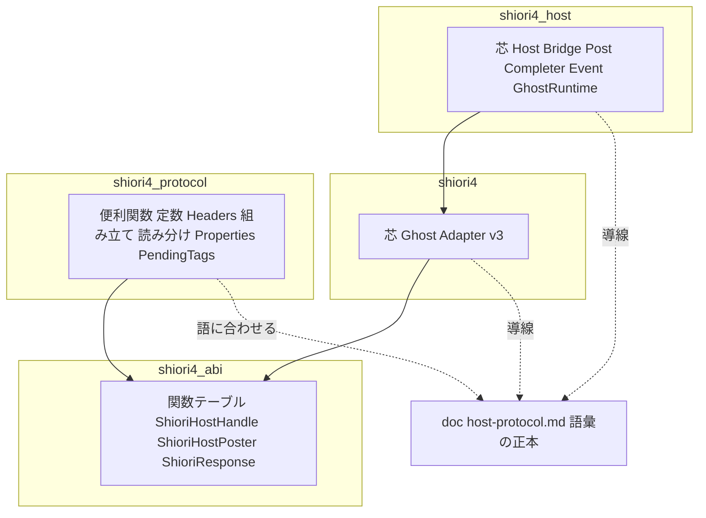
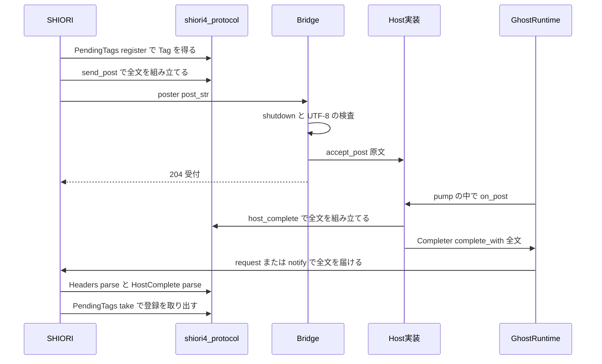
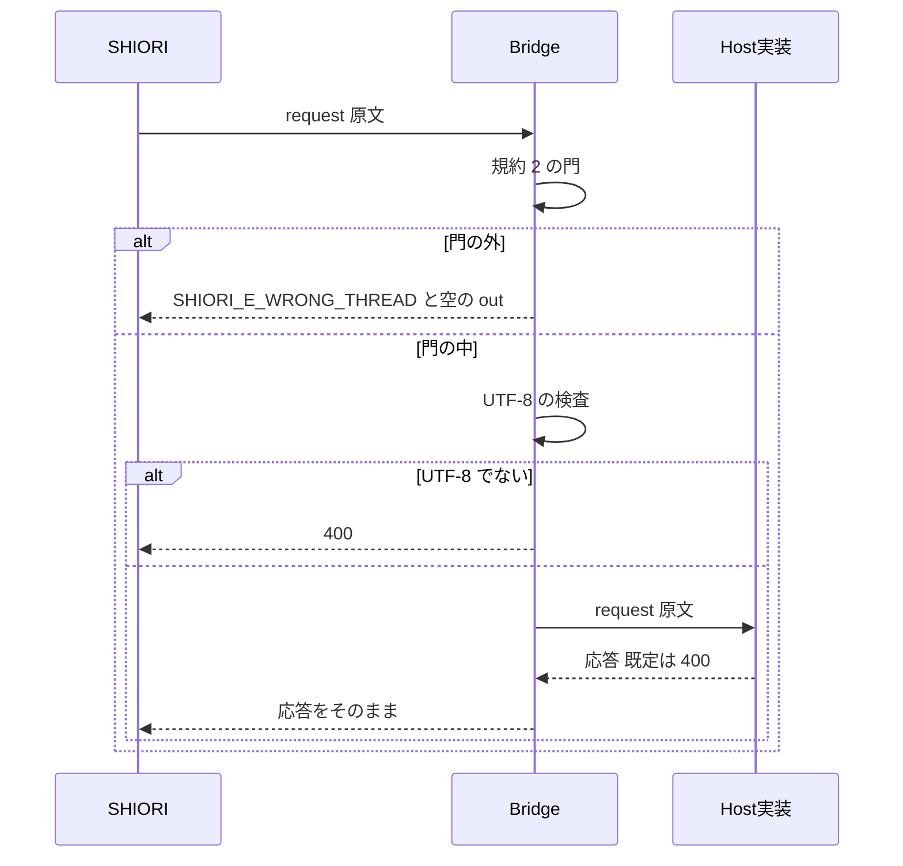

# 設計書 — host-protocol

## Overview

**Purpose**: この spec は、v4 で SHIORI とホストが交わすメッセージの語彙（brief.md の論点 1〜12 と、要件ディスカッション・pasta と areka の照合で足した決め事）を、ホスト側プロトコル仕様の文書 `doc/host-protocol.md` として shiori4 リポジトリに置き、pasta・areka・shiori4 の 3 者の正本にする。あわせて、`shiori4`・`shiori4_host` の芯（ABI の口と runtime）から中身の解釈を外し、仕様の語に合わせた解析と組み立ての便利関数を、芯から参照されない独立したクレート `shiori4_protocol`（依存は `shiori4_abi` だけ）にまとめる。

**Users**: SHIORI 実装者（pasta。`Ghost` を実装する人と、アクタースレッドで要求を組み立てて中継する人）と、ベースウェア実装者（areka。`Host` を実装する人）。abi-textbook は、この文書を語の表の上流として参照する。

**Impact**: `Ghost::request`／`notify`・`Host::request`／`accept_post` は解析済みの `Headers` ではなく原文（`&str`）を受ける。`Host::property` と `Bridge` の組み込みの `property` の応答は無くなり、`Host` が答えない要求はすべて 400 になる。`accept_post` の既定はすべてを受け付ける。`Completer` はヘッダの全文を何も足さずに届ける口 `complete_with` だけになる。`Headers`・`HeaderWriter`・`Properties`・`Lookup`・`PendingTags` は `shiori4` から新しいクレート `shiori4_protocol` へ移り、`shiori4_host` の再エクスポートは無くなる。公開するクレートは 4 つになる。ABI（C ヘッダのレイアウト・関数テーブル・定数・公開シンボル）と版は変えない。

### Goals
- 語彙の正本を 1 つの文書に置き、3 者が同じ一通りの意味で読めるようにする（要件 1〜7）。
- 芯が求めるのは「文字列の口で UTF-8 であること」だけにする（要件 8・9）。
- 便利関数を、`Ghost`・`Adapter`・`ShioriHostHandle` が無くても使える純粋な文字列の関数として出し、`Properties`・`PendingTags` はその上に載せる（要件 10、research.md 6 の 9）。
- 0.0.1 の API の変更を 1 度で済ませ、移行の一覧を残し、3 OS の CI を通す（要件 11）。

### Non-Goals
- ABI の規約（スレッド・寿命・log・load の dir・Charset）。abi-conventions が確定させた。
- ネットワーク越しの SSTP の受け口、ベースウェアの再生キュー、語の守らせ方（割り込ませる・待たせる・`Reason` を返す・必須ヘッダを付ける）。ホストの実装が持つ。
- ukadoc のプロパティの一覧。知らない `Command`・`Reason`・`Option` を判定すること。
- JSON-RPC など別の語の便利関数。将来、別のクレートとして並べる。
- v3 の全文を組み立てる・読む逆向きの変換（ホスト側から SHIORI/3.0 の全文を作る関数）。OPEN QUESTION 5。
- 版を上げること（0.0.2 は `/release` が出す）。教科書としての構成と例（abi-textbook）。

## Boundary Commitments

### This Spec Owns
- **語彙の正本**: `doc/host-protocol.md` の本文（要件 1〜7）。各クレートの `//!`・README・C ヘッダ・`shiori4_abi` の `//!` からこの文書への導線（それぞれ 1 か所）。
- **SHIORI 側の芯の口の形**（`shiori4/src/lib.rs`）: `Ghost` の `request`／`notify` が原文を受けること、`Adapter` が v4 の要求を解析せずに渡すこと、`mod v3` の `parse_request` が原文のヘッダ部分を返すこと（私的な Charset の読み取りを含む）。
- **ホスト側の芯の口の形**（`shiori4_host/src/lib.rs`）: `Host` の `request`／`accept_post` が原文を受けること、既定の応答 400・既定の受付 true、`Bridge` の素通し、`Post`・`Event`・`Completer` から解析と組み立てを外すこと。
- **便利関数のクレート** `shiori4_protocol`（`shiori4_protocol/`）: 語の定数、`Headers`・`HeaderWriter`、要求と post の組み立て、応答の組み立て、`OnHostComplete` の組み立てと解析、400 の読み分け、`Properties`・`Lookup`・`PendingTags`。
- **テスト**: 上の振る舞いのテスト、Charset を付けないことのテストの作り直し。
- **4 つ目の公開クレートのためのリリースの道具**: ワークスペースの members と `[workspace.dependencies]`、`build.yml`・`release.yml`・`/release` のスキル（`SKILL.md`・`procedure.md`・`scripts/release-state.ps1`）・`.github/release-ci-setup.md`。
- **steering と README の該当行**（要件 11.7）。

### Out of Boundary
- `Bridge::request` の先頭の規約 2 の門（abi-conventions が持つ。この spec は門の**後ろ**だけを書き替え、門は動かさない）。
- post のキュー・`pump`・unload での破棄・`Host::wake` の呼び方（振る舞いを変えない。要件 8.9）。
- `shiori4_abi` のコード（doc の 1 行を足すほかは触れない）。`ShioriHostHandle`・`ShioriHostPoster` の形。
- `shiori4_host` の読み込みの口（`discover.rs`・`dist.rs`・`V3Runtime` の本体）。テスト用の Ghost の書き直しだけを行う。
- pasta・areka への連絡の送信（要件 11.6。開発者の明示の指示で行う。設計は 2 回目の連絡の中身だけを決める）。
- リリースノート `doc/release-notes/v0.0.2.md` の作成（`/release` の段 4）。この spec は移行の一覧を文書の付録に置く。
- `shiori4_protocol` の初回の公開と Trusted Publisher の登録（Trusted Publishing では新しいクレートを作れないため、開発者が手元から行う。手順は `.github/release-ci-setup.md` に書く）。

### Allowed Dependencies
- クレートの依存（違反は誤りとして扱う）: `shiori4_host` → `shiori4` → `shiori4_abi`（今のまま）、`shiori4_protocol` → `shiori4_abi`（新規）。`shiori4`・`shiori4_host` の `[dependencies]` に `shiori4_protocol` を置かない。`shiori4_protocol` は `shiori4`・`shiori4_host` に依存しない。外部の依存を足さない（`shiori4_protocol` も std だけ）。
- `shiori4`・`shiori4_host`・`testdata/testghost` は、テストと doc の例のために `shiori4_protocol` を `[dev-dependencies]`（testghost は `[dependencies]`。公開しないため）に置いてよい。`[dev-dependencies]` は path だけで書き、`cargo publish` が外すので公開の順に影響しない。

### Revalidation Triggers
- `doc/host-protocol.md` の語（ID・ヘッダ名・値の語・ステータスの意味・並び）を変えたとき → areka の `shiori4-api`、pasta の v4 対応、abi-textbook の語の表。
- `Ghost`・`Host`・`Post`・`Completer`・`Event` のシグネチャを変えたとき → pasta 0.5.0・areka v0.2.0 の着手の前提、abi-textbook の例。
- `shiori4_protocol` の関数のシグネチャや型（`Rejection`・`HostComplete`・`SetPropertyError`）を変えたとき → pasta のアクタースレッドの組み立て、areka の `OnHostComplete` の出し方。
- `Bridge::request` の先頭の門や `in_call` の扱いを変えたとき → abi-conventions の規約 2。
- 文書の置き場所・URL を変えたとき → 各クレートの doc・README・C ヘッダの導線、下流の文書の参照。

## Architecture

### Existing Architecture Analysis
- 3 層のクレート。`shiori4` は `src/lib.rs` 1 ファイルで、`Headers`・`HeaderWriter`・`Ghost`・`Adapter`・`mod v3`・`mod host_protocol`（定数 6 個）・`Properties`・`PendingTags` を `// ====` で区切って持つ。
- 芯が中身を解釈している所は 5 か所ある: `Adapter`（v4 で `Headers::parse` して `Ghost` に渡す）、`Bridge::request`（`Host::request` に `Headers` を渡し、組み込みの `property` に答える）、`Host::accept_post` の既定（`Command` の有無）、`Post::new`（`Tag`・`Command` を読む）、`Completer::complete`／`complete_with`（`OnHostComplete` を組み立て、`Tag` を足す）。`Event::parsed`／`id` も解析つきのメソッドである。
- `v3::parse_request` は `Headers` を返す。`Headers` を移すと芯 → 便利関数の依存になるので、v3 の出力を原文に替える。
- `Bridge::request` の先頭に規約 2 の門（`owner` と `in_call`）がある。UTF-8 の検査はその後ろにある。

### Architecture Pattern & Boundary Map

**選んだ形**: 「芯は原文の運搬だけ、語は横に置いたクレートで」。便利関数は新しいクレート `shiori4_protocol`（依存は `shiori4_abi` だけ）にまとめる。SHIORI 側の関数もホスト側の関数も、文字列を受けて文字列（または ABI の `ShioriResponse`）を返す純粋な関数として同じクレートの直下に置く。`shiori4_host` は再エクスポートしない（すれば芯が依存することになるため）。research.md の Option B にあたる（2026-10-24 の設計ディスカッション議題 1 で確定）。



**Architecture Integration**:
- Domain boundaries: 語の意味は文書だけが持つ。芯は語を知らない（原文と UTF-8 だけ）。便利関数は文書の語を写したもので、使わなくても仕様に従える。
- Existing patterns preserved: 依存は下向きだけ。規約 2 の門・`!Send` のランタイム・キューと `pump`・Drop での後始末。structure.md の「層をまたぐ語彙は `shiori4` に置き、`shiori4_host` は再エクスポートする」は、語彙が `shiori4_protocol` に移るので書き替える（要件 11.7）。
- New components rationale: 別のクレートにするのは、芯が便利関数に依存しないことをクレートの依存でコンパイラに守らせるため（要件 9.3・10.1）。ソースを読む検査のテストは要らない。pasta は `shiori4` を入れずに `shiori4_abi` と `shiori4_protocol` だけで使える。将来の別の語（JSON-RPC など）は、別のクレートとして並べる。
- Steering compliance: 外部依存を足さない。規約と方針は `//!` に書き、README は入口だけ。テストは同じファイルの `mod tests`。

### Technology Stack

| Layer | Choice / Version | Role in Feature | Notes |
|-------|------------------|-----------------|-------|
| 言語 | Rust 1.85、edition 2024 | 4 クレート | 新しい std の機能は使わない |
| 文書 | Markdown（`doc/host-protocol.md`） | 語彙の正本 | crates.io のパッケージには入らない。docs.rs・README からは GitHub の URL で指す |
| 便利関数 | std だけ（`shiori4_protocol`） | 解析と組み立て | 新しい依存は無し |
| テスト | `cargo test --all`・`clippy -D warnings`（3 OS） | 振る舞いの検査 | 既存の CI に `shiori4_protocol` の `cargo package` の検査を足す |
| 公開 | crates.io（Trusted Publishing） | 4 クレートの公開 | 順は `shiori4_abi` → `shiori4_protocol` → `shiori4` → `shiori4_host`。`shiori4_protocol` の初回だけ手元から |

## File Structure Plan

### Directory Structure
```
doc/
└── host-protocol.md          # 新規。ホスト側プロトコル仕様（語彙の正本、要件 1〜7）と付録（0.0.1 からの移行・ukadoc の参照先）
shiori4_protocol/
├── Cargo.toml                # 新規。依存は shiori4_abi だけ。版などは workspace から
├── README.md                 # 新規。入口だけ（文書へのリンク）
└── src/lib.rs                # 新規。便利関数: 定数・Headers・HeaderWriter・組み立て・読み分け・HostComplete・Properties・Lookup・PendingTags・テスト
shiori4/src/
└── lib.rs                    # 変更。芯: Ghost（原文）・Adapter（v4 は素通し）・mod v3（原文を返す・私的な Charset の読み取り）・shiori_reason_phrase
```

### Modified Files
- `shiori4/src/lib.rs` — `Headers`・`HeaderWriter`・`host_protocol`（インラインのモジュール）・`Properties`・`Lookup`・`PendingTags` を `shiori4_protocol/src/lib.rs` へ移す。`Ghost`・`Adapter`・`v3::parse_request` を原文に替える。`//!` と crate doc の例を新しい形に書き直し、文書を指す。テスト用の `Echo`・`Counter` を原文で書き直す。
- `shiori4_host/src/lib.rs` — `Host::property` を削り、`Host::request`（`&str` → `ShioriResponse`、既定 400）・`accept_post`（`&str`、既定 true）に替える。`Bridge` の振り分けを素通しにする（門と UTF-8 の検査は残す）。`Post` から `headers`・`command`・`tag`・`wants_result` を、`Completer` から `tag`・`is_wanted`・`complete` を、`Event` から `parsed`・`id` を削る。`Completer::complete_with` を「全文をそのまま届ける」にする。`Headers`・`HeaderWriter`・`host_protocol` の再エクスポートを削る。`//!`（例・規約との対応・Charset の行）を書き直し、文書を指す。テスト（後述）を書き直す。
- `shiori4_host/src/v3.rs` — テスト用の Ghost（`EchoGhost`・`CountGhost`・`FailGhost`）を原文のシグネチャに替える。本体は変えない。
- `testdata/testghost/src/lib.rs` — `TestGhost::request` を原文のシグネチャに替え、`HeaderWriter` を `shiori4_protocol::HeaderWriter` から使う（`Cargo.toml` に `shiori4_protocol` を足す）。
- `shiori4_abi/include/shiori4_abi.h`・`shiori4_abi/src/lib.rs` — 「post の完了通知（v4）」の節の末尾に、語彙の正本を指す 1 行を足す（両方を同じ文で。ABI の文は変えない）。
- `Cargo.toml`（ルート） — `members` と `[workspace.dependencies]` に `shiori4_protocol` を足す（版の置き場所が 3 か所から 4 か所になる）。`shiori4/Cargo.toml`・`shiori4_host/Cargo.toml` に `[dev-dependencies]` を足す。
- `README.md`・`shiori4/README.md`・`shiori4_host/README.md` — クレートの表に `shiori4_protocol` を足し、`Headers`・`Properties`・`PendingTags`・`host_protocol` の記述を新しい置き場所に合わせ、文書へのリンクを 1 つ足す。
- `.github/workflows/build.yml`・`.github/workflows/release.yml`・`.github/scripts/release/`（必要なら）— クレートの並び（`cargo package` の検査・公開の step・結果の表）に `shiori4_protocol` を足す（公開の順は `shiori4_abi` → `shiori4_protocol` → `shiori4` → `shiori4_host`）。
- `.github/release-ci-setup.md` — Trusted Publisher の登録を 4 件にし、`shiori4_protocol` の初回の公開を手元から行う手順を足す。
- `.claude/skills/release/`（`SKILL.md`・`procedure.md`・`scripts/release-state.ps1`）— 3 クレートの並びを 4 つにする。
- `.kiro/steering/tech.md`・`.kiro/steering/structure.md`・`.kiro/steering/workflow.md`・`.kiro/steering/roadmap.md` — クレートの数と並び、`ID: property`・`host_protocol` の置き場所・再エクスポートの例・語彙の命名の行を、この spec の結果に合わせる（要件 11.7）。

## System Flows

### post から OnHostComplete まで（便利関数を使う場合）



- 芯（`Bridge`・`GhostRuntime`・`Completer`）は原文を運ぶだけで、`Tag`・`Command` を読まず、何も足さない。`Tag` を引き継ぐのは便利関数 `host_complete`（ホストが使う場合）。
- `Tag` の無い post では `host_complete` が `None` を返し、ホストは完了通知を出さない（文書: Tag の無い post は結果不要）。
- 配送の時機（post 中・host.request 中には届けない、unload で破棄）は今のまま（要件 8.9）。

### host.request（getproperty）の素通し



## Requirements Traceability

| Requirement | Summary | Components | Interfaces | Flows |
|-------------|---------|------------|------------|-------|
| 1.1 | 1 つの文書・日本語・論点 1〜12 | HostProtocolSpec | 文書の章立て | — |
| 1.2 | 芯は解釈しない・便利関数は任意 | HostProtocolSpec | 第 0 章 | — |
| 1.3 | 書式・Charset 無し | HostProtocolSpec | 第 1 章 | — |
| 1.4 | 当てはまる版 | HostProtocolSpec | 第 0 章 | — |
| 1.5 | doc・README からの導線、「暫定」を消す | CoreDocLinks, HelperCrate | `//!`・README・C ヘッダの 1 行 | — |
| 1.6 | ukadoc の参照 | HostProtocolSpec | 各章・付録 B | — |
| 1.8 | 運び方に依存しない | HostProtocolSpec | 第 0 章 | — |
| 1.7 | ヘッダ名の大文字小文字 | HostProtocolSpec, HelperCrate | 第 1 章・`Headers::get` | — |
| 2.1 | getproperty | HostProtocolSpec, HelperCrate | 第 3 章・`getproperty_request`・`getproperty_response` | getproperty の素通し |
| 2.2 | setproperty | HostProtocolSpec, HelperCrate | 第 3 章・`setproperty_request`・`Properties::set_on_host` | getproperty の素通し |
| 2.3 | property の改名・互換なし | HostProtocolSpec, HelperCrate | 第 3 章・付録 A・`ID_PROPERTY` の削除 | — |
| 2.4 | 名前の決まり | HostProtocolSpec | 第 3 章 | — |
| 2.5 | 値の改行の除去 | HostProtocolSpec, HelperCrate | 第 3 章・`getproperty_response` | — |
| 2.6 | 一覧は ukadoc | HostProtocolSpec | 第 3 章 | — |
| 3.1 | post は同じプロセスからの SSTP | HostProtocolSpec | 第 4 章 | — |
| 3.2 | SEND | HostProtocolSpec, HelperCrate | 第 4 章・`send_post` | post から OnHostComplete |
| 3.3 | NOTIFY と制限なし・拒否可 | HostProtocolSpec, HelperCrate | 第 4 章・`notify_post` | — |
| 3.4 | 宛先の固定 | HostProtocolSpec | 第 4 章 | — |
| 3.5 | Option の語とカンマ区切り | HostProtocolSpec, HelperCrate | 第 4 章・`OPTION_*`・`send_post` の options | — |
| 3.6 | post の戻り値は受付だけ | HostProtocolSpec | 第 4 章 | post から OnHostComplete |
| 3.7 | Tag は解釈しない文字列・一字も変えない | HostProtocolSpec, HelperCrate | 第 4 章・`host_complete`（値を写す） | post から OnHostComplete |
| 3.8 | post に要るヘッダ | HostProtocolSpec | 第 4 章 | — |
| 4.1, 4.2, 4.3, 4.4, 4.5, 4.6 | 割り込みと待ち・優先度・列・知らせ・OnBalloonBreak・NOTIFY への適用 | HostProtocolSpec | 第 5 章 | — |
| 5.1 | ヘッダとイベントは SHIORI/3.0 と同じ | HostProtocolSpec | 第 2 章 | — |
| 5.2 | 必須ヘッダ | HostProtocolSpec, HelperCrate | 第 2 章・`HEADER_*` | — |
| 5.3 | 状況によるヘッダ | HostProtocolSpec | 第 2 章 | — |
| 5.4 | post 起点の SenderType・SecurityLevel | HostProtocolSpec, HelperCrate | 第 2 章・`SENDER_TYPE_INTERNAL`・`SECURITY_LEVEL_LOCAL`・`host_complete` の lead | — |
| 5.5 | version など | HostProtocolSpec | 第 2 章 | — |
| 5.6 | ABI の版を載せない | HostProtocolSpec | 第 2 章 | — |
| 6.1, 6.2 | 届け方の既定・共通ヘッダ | HostProtocolSpec, HelperCrate | 第 6 章・`host_complete`・`HostComplete::parse` | post から OnHostComplete |
| 6.3, 6.4, 6.5 | SEND と NOTIFY の結果 | HostProtocolSpec, HelperCrate | 第 6 章・`OUTCOME_*`・`HostComplete` | — |
| 6.6, 6.7, 6.8, 6.9 | 応答の扱い・Status の意味・1 対 1・終了の前 | HostProtocolSpec | 第 6 章 | — |
| 7.1, 7.2, 7.3, 7.4 | 拒否の返し方と読み分け | HostProtocolSpec, HelperCrate | 第 7 章・`Rejection`・`rejection_response` | — |
| 7.5 | 500 と芯の既定 400 | HostProtocolSpec, HostCore | 第 7 章・`Host::request` の既定 | getproperty の素通し |
| 8.1 | 素通し | HostCore | `Host::request(&str)` | getproperty の素通し |
| 8.2 | 組み込みの応答を持たない | HostCore | `Host::property` の削除 | — |
| 8.3 | 既定は 400 | HostCore | `Host::request` の既定 | getproperty の素通し |
| 8.4 | 規約 2 の門を先頭に残す | HostCore | `Bridge::request` | getproperty の素通し |
| 8.5 | 非 UTF-8 は 400 | HostCore | `Bridge::request`・`Bridge::post` | 両方 |
| 8.6 | post の既定は受付 | HostCore | `Host::accept_post(&str)` | post から OnHostComplete |
| 8.7 | 完了通知の全文の口 | HostCore | `Completer::complete_with` | post から OnHostComplete |
| 8.8 | 芯の型は原文だけ | HostCore | `Post`・`Event`・`Completer` | — |
| 8.9 | キュー・pump・unload を変えない | HostCore | `GhostRuntime`（不変） | — |
| 9.1 | v4 は原文で Ghost へ | ShioriCore | `Ghost::request(&str)`・`Adapter` | — |
| 9.2 | v3 の変換は残す | ShioriCore | `v3::parse_request`・`v3::response` | — |
| 9.3 | 芯は便利関数に依存しない | ShioriCore | クレートの依存（`shiori4` は `shiori4_protocol` に依存しない） | — |
| 9.4 | 運搬の口を残す | ShioriCore | `ShioriHostHandle`・`ShioriHostPoster`（不変） | — |
| 10.1 | 独立したクレート | HelperCrate | `shiori4_protocol`（依存は `shiori4_abi` だけ） | — |
| 10.2 | 解析と組み立て | HelperCrate | `Headers`・`HeaderWriter` | — |
| 10.3 | 定数・property を残さない | HelperCrate | 定数の表 | — |
| 10.4 | SHIORI 側の組み立て | HelperCrate | `getproperty_request`・`setproperty_request`・`send_post`・`notify_post` | — |
| 10.5 | ホスト側の応答 | HelperCrate | `getproperty_response`・`rejection_response` | — |
| 10.6 | OnHostComplete の組み立て | HelperCrate | `host_complete` | post から OnHostComplete |
| 10.7 | PendingTags | HelperCrate | `PendingTags`（`register` を足す） | post から OnHostComplete |
| 10.8 | Properties と setproperty の別関数 | HelperCrate | `Properties::get`・`Properties::set_on_host` | — |
| 10.9 | 知らない語を判定しない | HelperCrate | 各関数の事後条件 | — |
| 10.10 | Charset を付けない | HelperCrate, HostCore | テスト `no_charset_in_core_and_helpers` | — |
| 11.1 | API の変更を 1 度で・移行の一覧 | 全体, HostProtocolSpec | 付録 A | — |
| 11.2 | ABI を変えない | 全体 | C ヘッダは注釈 1 行だけ | — |
| 11.3 | 版を上げない | 全体 | `Cargo.toml` に触れない | — |
| 11.4 | テスト | 全体 | Testing Strategy | — |
| 11.5 | 3 OS の CI | 全体 | 既存の build.yml | — |
| 11.6 | 2 回の連絡 | HostProtocolSpec（連絡で指す正本） | Integration & Migration Notes の 2 回目の連絡の中身（送信は開発者） | — |
| 11.7 | steering の同期 | SteeringSync | `tech.md`・`structure.md`・`workflow.md`・`roadmap.md` | — |
| 11.8 | 4 つ目の公開クレート | ReleaseTooling | ワークスペース・`build.yml`・`release.yml`・`/release`・`release-ci-setup.md` | — |

## Components and Interfaces

| Component | Domain/Layer | Intent | Req Coverage | Key Dependencies (P0/P1) | Contracts |
|-----------|--------------|--------|--------------|--------------------------|-----------|
| HostProtocolSpec | 文書 | 語彙の正本 | 1, 2, 3, 4, 5, 6, 7, 11.1 | brief.md・requirements.md（P0）、ukadoc（P1） | 文書の章立て |
| ShioriCore | `shiori4` 芯 | v4 は原文の素通し、v3 は全文の変換 | 9.1〜9.4 | `shiori4_abi`（P0） | Service |
| HostCore | `shiori4_host` 芯 | 要求と post の素通し、完了通知の全文の配送 | 7.5, 8.1〜8.9, 10.10 | `shiori4`（P0）、規約 2 の門（P0） | Service, State |
| HelperCrate | `shiori4_protocol` クレート | 語に合わせた解析と組み立て | 1.5, 1.7, 2.1〜2.5, 3.2〜3.7, 5.2, 5.4, 6.1〜6.5, 7.1〜7.4, 10.1〜10.10 | `shiori4_abi`（P0） | Service, State |
| CoreDocLinks / SteeringSync | doc・README・steering | 導線と記述の同期 | 1.5, 11.7 | HostProtocolSpec（P0） | — |
| ReleaseTooling | CI・`/release` | `shiori4_protocol` を公開の対象に加える | 11.8 | release.yml・Trusted Publishing（P0） | — |

### 文書

#### HostProtocolSpec（`doc/host-protocol.md`）

| Field | Detail |
|-------|--------|
| Intent | v4 の語彙を、3 者が同じ一通りの意味に読める 1 つの文書にする |
| Requirements | 1.1〜1.4, 1.6, 1.7, 2.1〜2.6, 3.1〜3.8, 4.1〜4.6, 5.1〜5.6, 6.1〜6.9, 7.1〜7.5, 11.1 |

**Responsibilities & Constraints**
- 日本語。規範の文は「〜する」「〜してよい」「〜しない」の 3 つの言い方にそろえる（「〜すべき」を使わない）。
- ukadoc の語を使う所は ukadoc を参照先として示し、意味を書き換えない（要件 1.6）。参照先は付録 B にまとめる。
- 語の値（ID・ヘッダ名・値の語）は、便利関数の定数と同じ綴りで書き、第 8 章の表で定数名と対応させる。
- 文書は crates.io のパッケージに入らない。クレートの doc からは `https://github.com/ekicyou/shiori4/blob/main/doc/host-protocol.md` で指す（OPEN QUESTION 4）。

**章立て（各章が持つ要件）**

| 章 | 中身 | 要件 |
|----|------|------|
| 0. この文書について | 正本であること、当てはまる版（shiori4 0.0.2 から。0.0.1 は付録 A）、語彙はメッセージごとに閉じていて ABI という運び方に依存せず、双方向の通信路（パイプ・IPC など）にもそのまま載せられること、芯は中身を解釈せず語を守らせるのはホストと SHIORI の実装であること、便利関数は任意で使わなくても従えること、ukadoc の扱い | 1.1, 1.2, 1.4, 1.6 |
| 1. 書式 | `名前: 値`・CRLF・ヘッダ部分だけ（開始行と終端の空行が無い）・Charset を付けない（abi-conventions）・受け手は大文字小文字を区別せず送り手は ukadoc の綴り | 1.3, 1.7 |
| 2. v4 の要求と応答 | SHIORI/3.0 と同じ語（違いは開始行と Charset）、必須ヘッダ 5 つ、状況によるヘッダ、post 起点の要求の `SenderType`（`internal,raise`／`internal`）と `SecurityLevel: local` の表、`version`・`name`・`craftman`・`craftmanw`、ABI の版を載せないこと | 5.1〜5.6 |
| 3. プロパティ | getproperty・setproperty の要求と応答、`property` からの改名と互換なし、名前の決まり（ukadoc の名前・接頭辞・大文字小文字）、値の改行の除去、一覧は ukadoc | 2.1〜2.6 |
| 4. post | 同じプロセスからの SSTP、SEND・NOTIFY、宛先の固定、`Option`（効く語・読まない語・知らない語・カンマ区切り）、戻り値は受付だけ、`Tag` の性質（値は `:` の後の空白を除いたもの。送り手は値の前後に空白を置かない）、要るヘッダ | 3.1〜3.8 |
| 5. 割り込みと待ち | 既定は割り込み・`nobreak` で待つ・新しいヘッダを作らない、優先度、列はホストの仕事、割り込まれた側への知らせ（3 つの場合の表）、`OnBalloonBreak` を使わない理由、NOTIFY への適用 | 4.1〜4.6 |
| 6. OnHostComplete | 届け方の既定、共通ヘッダ、SEND と NOTIFY の結果の表（200／204／400）、204 の例、応答の台本の扱いとその理由、`Status` の意味の別、1 対 1、終了の前 | 6.1〜6.9 |
| 7. 拒否とエラー | 400 ＋ `Reason: forbidden`、403 を足さない理由、`Reason` の読み分けの表（無し＝不正（未対応を含む）・`forbidden`＝拒否・未知＝理由不明の拒否）、当てはまる所（host.request の応答と OnHostComplete）、500 はホストの中の失敗、芯の既定は 400 | 7.1〜7.5 |
| 8. 語の一覧 | ID・ヘッダ名・値の語と `shiori4_protocol` の定数名の表 | 1.1（表の形）、10.3 の対応 |
| 付録 A. 0.0.1 からの移行 | 語の変更（`property` → `getproperty`）と、API の変更の一覧（Migration Strategy の表と同じもの） | 2.3, 11.1 |
| 付録 B. ukadoc の参照先 | SHIORI/3.0（`spec_shiori3.html`）、SSTP（`spec_sstp.html` の SEND・NOTIFY・Option）、プロパティシステム（`list_propertysystem.html`）、`OnBalloonBreak`（`list_shiori_event.html`） | 1.6 |

**Implementation Notes**
- Validation: 要件 1〜7 の各 AC を、章の中の 1 文以上で満たす。文書を書くタスクの完了条件に「要件 1.1〜7.5 の AC を 1 つずつ照らし、対応する章と文を一覧にする」を入れ、レビューはその一覧で照合する。
- Risks: 第 2 章の必須ヘッダの並び（ukadoc は `SecurityLevel` を「少なくとも ID より前」とする）を文書に書くかは、ukadoc の参照で足りる。文書は「ukadoc どおり」と書き、`host_complete` の lead で前に置けるようにする。

### SHIORI 側の芯

#### ShioriCore（`shiori4/src/lib.rs`）

| Field | Detail |
|-------|--------|
| Intent | v4 の要求を原文のまま `Ghost` に渡し、v3 の全文の変換だけを行う |
| Requirements | 9.1, 9.2, 9.3, 9.4 |

**Responsibilities & Constraints**
- v4: `Adapter` は `request`／`notify` の文字列を、解析せずにそのまま `Ghost` に渡す。応答もそのまま返す（Charset を見ず、付けない。abi-conventions のまま）。
- v3: `v3::parse_request` が開始行を読み、Charset を検査し（UTF-8 以外は 400）、ヘッダ部分の原文（終端の空行を除き、各行の CRLF は残す）を返す。Charset の読み取りは `mod v3` の中の私的な関数で行い、`shiori4_protocol` を使わない。`v3::response` は今のまま。
- 芯は `shiori4_protocol` に依存しない（要件 9.3。`[dependencies]` に無いので、コンパイラが守る）。`ShioriHostHandle`・`ShioriHostPoster`（`shiori4_abi`）はそのまま再エクスポートする（要件 9.4）。

**Dependencies**
- Outbound: `shiori4_abi` — 関数テーブル・`ShioriResponse`・運搬の口（P0）

**Contracts**: Service [x]

##### Service Interface
```rust
pub trait Ghost: Sized + 'static {
    const SUPPORTS_V3: bool = true;
    fn load(host: Option<ShioriHostHandle>, dir: &str) -> Result<Self, ShioriStatus>;
    /// req はヘッダ部分の原文。v4 はホストが渡したまま、v3 は開始行と終端の空行を除いたもの
    fn request(&mut self, req: &str) -> ShioriResponse;
    /// 既定は 204
    fn notify(&mut self, _req: &str) -> ShioriStatus { SHIORI_204_NO_CONTENT }
}

pub mod v3 {
    pub enum Method { Get, Notify }
    /// 不正な開始行と UTF-8 以外の Charset は Err(400)。Ok のヘッダ部分は req の部分文字列
    pub fn parse_request(req: &str) -> Result<(Method, &str), ShioriStatus>;
    pub fn response(status: ShioriStatus, body: &[u8]) -> Vec<u8>; // 変えない
}

```
- Preconditions: ABI 層が `req` を UTF-8 として検証済み（`shiori_str_arg`）。
- Postconditions: v4 では `Ghost` が受ける文字列はホストが渡したバイト列と同じ。v3 では `parse_request` の返すヘッダ部分は `Charset` 行を含めて元の順を保つ。
- Invariants: 芯は `ID`・`Command`・`Tag` を読まない。

**Implementation Notes**
- Integration: crate doc の例は `shiori4_protocol::Headers::parse(req)` と `shiori4_protocol::Properties` を使う形に書き直す（doc の例は便利関数を使ってよい）。`Ghost::notify` の doc の「Properties::get など」は `shiori4_protocol::Properties::get` を指す。
- Validation: `v3_roundtrip`（既存）を原文の Ghost で通す。v3 の Ghost が受ける文字列に開始行と終端の空行が無いことを確かめる。
- Risks: v3 の私的な Charset の読み取りは `Headers::get` と同じ規則（大文字小文字を区別しない名前・`:` で分ける・値の先頭の空白を除く）にする。規則がずれると v3 の 400 の判定が変わる。

### ホスト側の芯

#### HostCore（`shiori4_host/src/lib.rs`）

| Field | Detail |
|-------|--------|
| Intent | SHIORI からの要求と post を原文のまま `Host` に渡し、完了通知の全文を何も足さずに届ける |
| Requirements | 7.5, 8.1〜8.9, 10.10 |

**Responsibilities & Constraints**
- `Bridge::request` の順: ① 規約 2 の門（変えない）→ ② UTF-8 の検査（違えば 400、`Host` を呼ばない）→ ③ `Host::request(text)` の応答をそのまま返す。組み込みの応答は持たない。
- `Bridge::post` の順: ① shutdown（`SHIORI_E_SHUTDOWN`）→ ② UTF-8 の検査（違えば 400）→ ③ `Host::accept_post(text)`（false なら 400）→ ④ キュー → ⑤ `wake` → 204。中身は見ない。
- `Post` は原文と `Completer` だけを持つ。`Completer` は `EventSender` だけを持ち、`complete_with` で受け取った全文を 1 文字も変えずに `Event` にして積む。
- `GhostRuntime`・`EventSender`・`Delivery`・`Outcome`・`Delivered`・`pump`・Drop の後始末は変えない（要件 8.9）。
- `Host::log`・`accept_post`・`wake` の「`GhostRuntime` を Drop するスレッドを同期で待たない」の doc を残す。

**Dependencies**
- Inbound: SHIORI（ABI の `host->request`・`host->post`）（P0）
- Outbound: `Host` の実装（P0）、`shiori4`（`ShioriHost` の trait・`ShioriResponse`）（P0）

**Contracts**: Service [x] / State [x]

##### Service Interface
```rust
pub trait Host: Send + Sync + 'static {
    /// 同期の要求（SHIORI のスレッド、規約 2 の期間）。req は原文。既定は 400（このホストでは扱えない）
    fn request(&self, _req: &str) -> ShioriResponse { ShioriResponse::bad_request() }
    /// post の受付の判定（任意のスレッド。軽く保つ）。msg は原文。既定はすべて受け付ける
    fn accept_post(&self, _msg: &str) -> bool { true }
    /// 受け付けた post（pump の中）
    fn on_post(&self, post: Post);
    fn log(&self, _level: i32, _msg: &str) {}
    fn wake(&self) {}
}

pub struct Post { /* text: String, completer: Completer */ }
impl Post {
    pub fn text(&self) -> &str;
    pub fn into_completer(self) -> Completer;
    pub fn into_parts(self) -> (String, Completer);
}

/// post したインスタンスへ完了通知を届ける口（Send。別スレッドへ持ち出せる。1 回だけ使える）
pub struct Completer { /* sender: EventSender */ }
impl Completer {
    /// headers を何も足さず、何も検査せず、delivery で届ける。ランタイムが破棄された後は false
    pub fn complete_with(self, delivery: Delivery, headers: &str) -> bool;
}

pub struct Event { pub delivery: Delivery, pub headers: String }
impl Event {
    pub fn request(headers: impl Into<String>) -> Self;
    pub fn notify(headers: impl Into<String>) -> Self;
}
```
- Preconditions: `Host::request` は規約 2 の門を通った呼び出しでだけ呼ばれる。
- Postconditions: `Host::request` の戻り値は加工されずに SHIORI に返る。`complete_with` で積んだ `Event::headers` は引数と同じ文字列。
- Invariants: 芯は `ID`・`Command`・`Tag` を読まない。芯が自分で作る応答は 400（UTF-8 でない・`Host` の既定・`accept_post` の false）と 204（post の受付）と負の ABI エラーだけで、本文は空。

##### State Management
- 状態は今のまま（`Bridge` の `owner`・`in_call`・`shutdown`・`tx`、`GhostRuntime` のキュー）。この spec は状態を足さない。

**Implementation Notes**
- Integration: `Host::request` の戻り値は `Option<ShioriResponse>` から `ShioriResponse` に替える（組み込みへの回し先が無くなったため。既定の 400 は trait の既定の実装で持つ）。crate doc の例は `shiori4_protocol::Headers` で `getproperty` に答え、`shiori4_protocol::host_complete` と `complete_with` で完了を返す形にする（doctest で検査される）。`//!` の「規約との対応」の規約 2 の行から `Host::property` を消し、「Charset」の行を「芯が作る応答と便利関数が作るヘッダに Charset を付けない」にする。
- Validation: Testing Strategy の HostCore の項。
- Risks: 規約 2 の門を消す・後ろへ動かすことが唯一の回帰の急所。`request_from_other_thread_is_wrong_thread`・`request_outside_call_is_wrong_thread` で守る。

### 便利関数

#### HelperCrate（`shiori4_protocol/src/lib.rs`）

| Field | Detail |
|-------|--------|
| Intent | 文書の語に合わせた解析と組み立てを、使いたい人だけが使える純粋な関数で出す |
| Requirements | 1.5, 1.7, 2.1〜2.5, 3.2〜3.7, 5.2, 5.4, 6.1〜6.5, 7.1〜7.4, 10.1〜10.10 |

**Responsibilities & Constraints**
- クレートの `//!` の先頭で文書を指し、「`shiori4`・`shiori4_host` はこのクレートに依存しない。使わなくても仕様に従える」と書く。「暫定」と書かない（要件 1.5）。
- 組み立ての関数は文字列を受けて文字列（または `ShioriResponse`）を返し、`ShioriHostHandle` を持たない（pasta の要望）。状態を持つのは `Properties` と `PendingTags` だけで、どちらも組み立ての関数の上に載る。
- 値は `HeaderWriter::push` を通し、CR・LF を取り除く。Charset を付けない（要件 10.10）。
- 知らない `Command`・`Reason`・`Option` の語を判定しない・拒否しない（要件 10.9）。`Rejection::Unknown` は読み分けであって拒否ではない。
- `property` の定数を残さない（要件 10.3）。

**Dependencies**
- Outbound: `shiori4_abi` — `ShioriResponse`・`ShioriStatus`・`ShioriHostHandle`・`ShioriHostPoster`・ステータスの定数（P0）
- Inbound: SHIORI の実装、ホストの実装、テスト（任意）

**Contracts**: Service [x] / State [x]

##### Service Interface
```rust
// ---- 語の定数（文書の第 8 章と同じ綴り） ----
pub const ID_GETPROPERTY: &str = "getproperty";
pub const ID_SETPROPERTY: &str = "setproperty";
pub const ID_HOST_COMPLETE: &str = "OnHostComplete";
pub const HEADER_ID: &str = "ID";
pub const HEADER_SENDER: &str = "Sender";
pub const HEADER_SENDER_TYPE: &str = "SenderType";
pub const HEADER_SECURITY_LEVEL: &str = "SecurityLevel";
pub const HEADER_SECURITY_ORIGIN: &str = "SecurityOrigin";
pub const HEADER_VALUE: &str = "Value";
pub const HEADER_COMMAND: &str = "Command";
pub const HEADER_TAG: &str = "Tag";
pub const HEADER_SCRIPT: &str = "Script";
pub const HEADER_EVENT: &str = "Event";
pub const HEADER_OPTION: &str = "Option";
pub const HEADER_STATUS: &str = "Status";
pub const HEADER_REASON: &str = "Reason";
pub const COMMAND_SEND: &str = "SEND";
pub const COMMAND_NOTIFY: &str = "NOTIFY";
pub const OPTION_NOBREAK: &str = "nobreak";
pub const OPTION_NOTRANSLATE: &str = "notranslate";
pub const OPTION_STRICT: &str = "strict";
pub const REASON_FORBIDDEN: &str = "forbidden";
pub const OUTCOME_COMPLETED: &str = "completed";
pub const OUTCOME_INTERRUPTED: &str = "interrupted";
pub const SENDER_TYPE_INTERNAL: &str = "internal";
pub const SECURITY_LEVEL_LOCAL: &str = "local";

// ---- ヘッダの解析と組み立て（lib.rs から移す。振る舞いは変えない） ----
pub struct Headers<'a> { /* items */ }
impl<'a> Headers<'a> {
    pub fn parse(text: &'a str) -> Self;
    pub fn get(&self, name: &str) -> Option<&'a str>; // 名前は大文字小文字を区別しない
    pub fn id(&self) -> Option<&'a str>;
    pub fn reference(&self, n: usize) -> Option<&'a str>;
    pub fn iter(&self) -> impl Iterator<Item = (&'a str, &'a str)> + '_;
}
pub struct HeaderWriter { /* buf */ }
impl HeaderWriter {
    pub fn new() -> Self;
    pub fn push(self, name: &str, value: &str) -> Self; // 値の CR・LF を除く
    pub fn push_raw(self, headers: &str) -> Self;
    pub fn finish(self) -> String;
    pub fn into_response(self) -> ShioriResponse; // 200
}

// ---- SHIORI 側: 要求と post の組み立て ----
pub fn getproperty_request(name: &str) -> String;              // ID / Reference0
pub fn setproperty_request(name: &str, value: &str) -> String; // ID / Reference0 / Reference1
/// Command: SEND / [Tag] / Script / [Option: a,b]
pub fn send_post(script: &str, options: &[&str], tag: Option<&str>) -> String;
/// Command: NOTIFY / [Tag] / Event / Reference0.. / [Option: a,b]
pub fn notify_post(event: &str, refs: &[&str], options: &[&str], tag: Option<&str>) -> String;

// ---- SHIORI 側: 応答と完了通知の読み分け ----
#[derive(Debug, Clone, Copy, PartialEq, Eq)]
pub enum Rejection {
    /// Reason が無い 400: 不正（未対応を含む）
    Invalid,
    /// Reason: forbidden
    Forbidden,
    /// 未知の Reason: 理由不明の拒否
    Unknown,
}
impl Rejection {
    pub fn from_reason(reason: Option<&str>) -> Self;
    /// status が 400 のときだけ Some。headers は応答または完了通知のヘッダ部分
    pub fn of(status: ShioriStatus, headers: &Headers<'_>) -> Option<Self>;
}

#[derive(Debug, Clone, Copy, PartialEq, Eq)]
pub struct HostComplete<'a> {
    pub tag: &'a str,              // Tag の値（変えない）
    pub status: ShioriStatus,      // Status（結果のステータスコード）
    pub command: &'a str,          // Reference0（無ければ ""）
    pub outcome: Option<&'a str>,  // Reference1（completed / interrupted / 知らない語もそのまま）
    pub rejection: Option<Rejection>, // status が 400 のときだけ
}
impl<'a> HostComplete<'a> {
    /// ID が OnHostComplete で、Tag と数として読める Status があるときだけ Some
    pub fn parse(h: &Headers<'a>) -> Option<Self>;
}

// ---- ホスト側: 応答と完了通知の組み立て ----
/// Some(v): 200 + Value（v の CR・LF を除く）。None: 204
pub fn getproperty_response(value: Option<&str>) -> ShioriResponse;
/// 400。reason が Some なら Reason を付ける（setproperty の不正・拒否、ほかの要求の拒否に使う）
pub fn rejection_response(reason: Option<&str>) -> ShioriResponse;
/// post の原文から Tag（値を変えずに）と Command を引き継ぎ、完了通知のヘッダ部分を組み立てる。
/// 並び: lead（原文のまま）/ ID / Tag / Status / Reference0: <Command> / Reference1.. / [Reason]
/// lead は ID より前に置く要求のヘッダ（Sender・SenderType・SecurityLevel・SecurityOrigin）。
/// post に Tag が無ければ None（組み立てない）
pub fn host_complete(
    post: &str,
    lead: &str,
    status: ShioriStatus,
    refs: &[&str],
    reason: Option<&str>,
) -> Option<String>;

// ---- SHIORI 側: 状態を持つもの（lib.rs から移す） ----
pub enum Lookup<'a> { Ready(&'a str), Missing, Pending } // 変えない
pub struct Properties { /* host, cache */ }
impl Properties {
    pub fn new(host: Option<ShioriHostHandle>) -> Self;
    pub fn is_live(&self) -> bool;
    /// v4 は getproperty_request で問い合わせる。200/204/それ以外の扱いは今のまま
    pub fn get(&mut self, name: &str) -> Lookup<'_>;
    pub fn cached(&self, name: &str) -> Option<&str>;
    /// キャッシュへの取り込み（ホストに送らない。今のまま）
    pub fn set(&mut self, name: impl Into<String>, value: impl Into<String>);
    /// setproperty をホストに送る。204 ならキャッシュも改行を除いた値に更新する
    pub fn set_on_host(&mut self, name: &str, value: &str) -> Result<(), SetPropertyError>;
    pub fn invalidate(&mut self, name: &str);
    pub fn clear(&mut self);
}
#[derive(Debug, Clone, Copy, PartialEq, Eq)]
pub enum SetPropertyError {
    /// v3（ホストを呼べない）
    Offline,
    /// 400。Reason の読み分け付き
    Rejected(Rejection),
    /// 204・400 以外の応答（200・500 など）と ABI エラー（負の値）
    Failed(ShioriStatus),
}

pub struct PendingTags<T> { /* next, map */ }
impl<T> PendingTags<T> {
    pub fn new() -> Self;
    /// Tag を発行して登録する（post はしない）。組み立てを別のスレッドで行う人のため
    pub fn register(&self, context: T) -> u64;
    /// 今のまま: Tag を付けて post し、受け付けられなければ登録を取り消す
    pub fn post(&self, poster: &ShioriHostPoster, context: T, headers: &str) -> Result<u64, ShioriStatus>;
    pub fn take(&self, tag: u64) -> Option<T>;
    pub fn take_from(&self, h: &Headers<'_>) -> Option<(u64, T)>;
    pub fn len(&self) -> usize;
    pub fn is_empty(&self) -> bool;
    pub fn clear(&self);
}
```
- Preconditions: なし（どの関数も任意の文字列を受ける）。`Properties::get`・`set_on_host` は規約 2 の期間の中で呼ぶ（`host.request` の規約。外なら ABI エラーが返り、`get` はキャッシュで代替する）。
- Postconditions: 組み立てた文字列は各行が CRLF で終わり、Charset を含まない。`host_complete` の `Tag` の値は post の `Tag` の値（`Headers::get` が返す、先頭の空白を除いた値）と同じ。`Option` は 2 つ以上なら `,` で区切る。
- Invariants: このクレートは `shiori4_abi` だけに依存し、`shiori4`・`shiori4_host` に依存しない。

##### State Management
- `Properties`: v4 はホストに問い合わせ、v3 は受動のキャッシュ（今のまま）。`set_on_host` の成功でキャッシュを更新する。
- `PendingTags`: `AtomicU64` の連番と `Mutex<HashMap>`（今のまま）。`register` は `post` の前半を切り出したもの。

**Implementation Notes**
- Integration: pasta のアクタースレッドからの使い方は「`register` → `send_post(.., Some(&tag.to_string()))` → `poster.post_str` → 失敗なら `take(tag)`」。areka は `Host::request` の中で `Headers::parse(req)` → `getproperty_response`／`rejection_response`、`on_post` で `host_complete(post.text(), lead, ..)` → `complete_with`。
- Validation: Testing Strategy の HelperCrate の項。
- Risks: `HostComplete::parse` は `ID` の値を大文字小文字を区別して比べる（ID の値はヘッダ名ではないため）。`Reason` の値は前後の空白を除いて `forbidden` と完全に一致したときだけ `Forbidden`。

### 検査・導線

#### CoreDocLinks / SteeringSync（summary-only）
- 文書への導線（要件 1.5）: `shiori4` の `//!`、`shiori4_host` の `//!`、`shiori4_protocol` の `//!`、`README.md`・`shiori4_protocol/README.md`・`shiori4/README.md`・`shiori4_host/README.md`、C ヘッダと `shiori4_abi` の `//!` の「post の完了通知（v4）」の節の末尾の 1 行（「運ぶ中身の語（Command・Tag・OnHostComplete の並び・拒否の返し方など）は、shiori4 リポジトリの doc/host-protocol.md（ホスト側プロトコル仕様）が定める」）。
- steering（要件 11.7）: `tech.md` の 3 層の図の `shiori4` の行と「メッセージ名（`ID: property` …）」の行、`structure.md` の `shiori4` の Purpose・Example、再エクスポートの例、命名の「プロトコル語彙」の行（`ID_*`／`HEADER_*` に `COMMAND_*`・`OPTION_*`・`REASON_*`・`OUTCOME_*`・`SENDER_TYPE_*`・`SECURITY_LEVEL_*` を足す）、「芯は中身を解釈しない」の 1 行を Key Technical Decisions に足す。

## Data Models

### Data Contracts & Integration
メッセージの形（ヘッダ部分。各行 `名前: 値` CRLF）。値は文書が正で、便利関数はこの形を作る。

| メッセージ | 向き | ヘッダの並び（便利関数が作る順） |
|------------|------|----------------------------------|
| getproperty の要求 | SHIORI → ホスト（request） | `ID: getproperty` / `Reference0: 名前` |
| getproperty の応答 | ホスト → SHIORI | 200 ＋ `Value: 値` ／ 204 ／ 400 ［＋ `Reason`］／ 500 |
| setproperty の要求 | SHIORI → ホスト（request） | `ID: setproperty` / `Reference0: 名前` / `Reference1: 値` |
| setproperty の応答 | ホスト → SHIORI | 204 ／ 400 ［＋ `Reason`］／ 500 |
| SEND | SHIORI → ホスト（post） | `Command: SEND` / ［`Tag`］ / `Script` / ［`Option`］ |
| NOTIFY | SHIORI → ホスト（post） | `Command: NOTIFY` / ［`Tag`］ / `Event` / `Reference0..` / ［`Option`］ |
| OnHostComplete | ホスト → SHIORI（request 既定、notify も可） | lead（`Sender`・`SenderType: internal`・`SecurityLevel: local`・`SecurityOrigin`）/ `ID: OnHostComplete` / `Tag` / `Status` / `Reference0: コマンド名` / ［`Reference1: completed｜interrupted`］ / ［`Reason`］ |

## Error Handling

### Error Strategy
- 芯が返すのは「運べない」ことだけ: 規約 2 の外（-7）、UTF-8 でない（400）、終了中（`SHIORI_E_SHUTDOWN`）、`Host` が答えない（400）、`accept_post` が false（400）。中身の誤りは `Host` と SHIORI の実装が決める。
- 便利関数は失敗しない（組み立ては常に文字列を返す）。読み取りの失敗は `None`（`HostComplete::parse`・`Rejection::of`）か `SetPropertyError` で表し、パニックしない。
- 400 と 500 の区別（要件 7.5）は文書が定め、`SetPropertyError` は 400 を `Rejected`、それ以外を `Failed(status)` に分ける。

### Monitoring
- 変えない（`Host::log` は任意のスレッドから。abi-conventions のまま）。

## Testing Strategy

### HostCore（`shiori4_host/src/lib.rs`）
- `bridge_passes_request_verbatim`: 規約 2 の期間の中で、知らない ID を含む任意の原文が 1 文字も変わらずに `Host::request` に届き、その応答がそのまま返る（8.1）。`ID: getproperty` にも芯は答えず `Host` に渡る（8.2）。
- `default_host_request_is_400_for_any_id`: `request` を実装しない `Host` で、`getproperty`・`property`・知らない ID がすべて 400 で本文が空（8.3。旧 `unknown_host_request_is_400` を作り直す）。
- `post_without_command_is_accepted_by_default`: `Command` の無い post（`Tag: 1` だけ、空文字列）が既定で 204 になり `on_post` に原文で届く。`accept_post` が false を返す `Host` では 400（8.6）。非 UTF-8 の request と post は `Host` を呼ばずに 400（8.5）。
- `completer_delivers_headers_verbatim`: `complete_with` で積んだ `Event` の `headers` が引数と同じで、`Tag` が足されない。`Tag` の無い post の `Completer` でも送れる（8.7・8.8）。
- 規約 2 の門: `request_from_other_thread_is_wrong_thread`（`calls` の期待値を 2 → 1 に直す）・`request_outside_call_is_wrong_thread`・`property_inside_load_request_notify`・`two_runtimes_on_two_threads` を、`CountHost::request` が `shiori4_protocol` で `getproperty` に答える形で通す（8.4・8.9）。
- `property_post_and_completion`（作り直し）: `TestGhost` が `Properties::get`・`PendingTags::post`（`send_post` で組み立て）、`TestHost` が `getproperty_response`・`host_complete`・`complete_with` を使い、`pump` で `done:dl:200:ok` が返る（10.4〜10.7 の往復、8.9）。

### HelperCrate（`shiori4_protocol/src/lib.rs`）
- 組み立ての表のテスト: `getproperty_request`・`setproperty_request`・`send_post`（Option 0・1・2 個、Tag の有無、Script の改行の除去）・`notify_post` の出力が Data Contracts の並びと一字一句一致する（10.4、3.5）。
- `getproperty_response`（値の改行の除去、None で 204）・`rejection_response`（Reason の有無）（10.5、2.5）。
- `host_complete`: Tag の値を変えずに写す（`Tag: abc-01` のような数でない値。`Tag:  abc` は `abc` として写す）、Command を Reference0 に、lead が ID より前、Reason の有無、Tag の無い post で None（10.6、3.7、5.4）。
- 読み分け: `Rejection::from_reason`（None・`forbidden`・未知の語）、`Rejection::of`（400 以外は None）、`HostComplete::parse`（SEND 200 completed・204・400 forbidden・ID 違い・Status 無し）（7.3、6.2〜6.5）。知らない Command・Option の語を拒まない（10.9）。
- `PendingTags`: `register` → `take` の往復、`post` の失敗で登録が消える、`take_from` の往復（10.7）。`Properties::set_on_host`: 204 でキャッシュ更新、400 ＋ forbidden で `Rejected(Forbidden)`、v3 で `Offline`（10.8。`ShioriHostBox` に載せたテスト用の `ShioriHost` で応答を返し分ける）。

### 横断
- `no_charset_in_core_and_helpers`（`builtin_responses_have_no_charset` と `completion_headers_have_no_charset` を作り直す）: `Bridge` の既定の 400・post の受付と、便利関数が作るすべての出力（要求・post・応答・完了通知）に `charset` が含まれない（10.10、11.4）。
- 依存の向き（9.3・10.1）は `Cargo.toml` で決まるので、検査のテストは置かない。`shiori4`・`shiori4_host` の `[dependencies]` に `shiori4_protocol` が無いことをレビューで確かめる（`[dev-dependencies]` は可）。
- 既存の v3 のテスト（`shiori4` の `v3_roundtrip`、`shiori4_host/src/v3.rs`）と DLL を読むテスト（`testdata/testghost`）が、原文の Ghost で通る（9.2）。
- crate doc の例（`shiori4_host` の `no_run`・`shiori4` の `ignore`）がコンパイルされる・書き直される。CI（3 OS の test と clippy）を通す（11.5）。

## Migration Strategy

0.0.1 → この spec の版（0.0.2 の予定）の移行の一覧。文書の付録 A に同じ表を置き、`/release` がリリースノートに写す（要件 11.1）。

| 0.0.1 | この spec の後 |
|-------|----------------|
| `ID: property` | `ID: getproperty`（`property` は受けない） |
| `shiori4::{Headers, HeaderWriter, Properties, Lookup, PendingTags, host_protocol}` | `shiori4_protocol::{…}`（新しいクレート。依存に足す） |
| `shiori4::host_protocol::ID_PROPERTY` | `shiori4_protocol::ID_GETPROPERTY`（と `ID_SETPROPERTY` ほかの新しい定数） |
| `Ghost::request(&mut self, &Headers)`／`notify(&mut self, &Headers)` | `request(&mut self, &str)`／`notify(&mut self, &str)`。解析は `shiori4_protocol::Headers::parse(req)` |
| `shiori4::v3::parse_request -> (Method, Headers)` | `-> (Method, &str)` |
| `Host::property(&self, &str) -> Option<String>` | 削除。`Host::request` で `getproperty` に答える（`shiori4_protocol::getproperty_response`） |
| `Host::request(&self, &Headers) -> Option<ShioriResponse>`（None で組み込みへ） | `Host::request(&self, &str) -> ShioriResponse`（既定 400） |
| `Host::accept_post(&self, &Headers) -> bool`（既定は `Command` の有無） | `accept_post(&self, &str) -> bool`（既定 true） |
| `Post::headers`・`command`・`tag`・`wants_result` | 削除。`shiori4_protocol::Headers::parse(post.text())` |
| `Completer::tag`・`is_wanted`・`complete(delivery, status, refs)` | 削除。`shiori4_protocol::host_complete(..)` → `Completer::complete_with` |
| `Completer::complete_with`（Tag を自動で先頭に足す。Tag 無しは送らない） | 全文をそのまま届ける（何も足さない・検査しない） |
| `Event::parsed`・`Event::id` | 削除。`shiori4_protocol::Headers::parse(&ev.headers)` |
| `shiori4_host::{HeaderWriter, Headers, host_protocol}` の再エクスポート | 無し。`shiori4_protocol` を依存に足して使う |

## Integration & Migration Notes
- 2 回目の連絡（要件 11.6。送るのは開発者の明示の指示による）の中身: 正本の場所（`doc/host-protocol.md` と GitHub の URL）、便利関数のクレート `shiori4_protocol` と主な関数（`send_post`・`notify_post`・`Rejection`・`HostComplete`・`host_complete` の lead・`PendingTags::register`）、照合で足した語（requirements.md の「pasta・areka の照合で足したもの」1〜11）と設計で足した語（`Tag` の値の前後に空白を置かない）、上の移行の一覧、crates.io に出る版は `/release` の後に別に知らせること。
- `/release` の後のお知らせでは、版に固定した URL（`https://github.com/ekicyou/shiori4/blob/v0.0.2/doc/host-protocol.md`）を示す。クレートの doc と README は `main` を指したまま、文書の第 0 章の版の記述で当てはまる版を示す（`main` には未公開の語が載りうるため）。
- 実装の順: ① `shiori4_protocol` を作り移す（芯からの参照を残したまま）→ ② `shiori4` の芯を原文に替える → ③ `shiori4_host` の芯を替える → ④ テスト・testghost・doc・README → ⑤ 文書 → ⑥ steering。①〜③はコンパイルが通る単位で 1 つのタスクにまとめてよい。

## Open Questions（設計ディスカッションで確定させる）
入力（requirements.md・research.md）だけでは決め切れず、仮定を置いて書いた所。2026-10-24 の設計ディスカッションで、1 は新しいクレート `shiori4_protocol` に、2〜5・7〜9 は推奨案（仮定のまま）に確定した。6 は議論中。10（クレートの構成）は、トレイトを今の置き場所から動かさず、便利関数のクレートの名前を `shiori4_helper` から `shiori4_protocol` に改める案で確定した（中身が v4 の言葉を読み書きする部品一式であるため）。11 は文書の第 0 章に「運び方に依存しない」の 1 文を足す案で確定した（要件 1.8）。8 は文書の第 4 章とテストに入れ、2 回目の連絡に含める。5 は pasta に連絡した（pasta の中の SHIORI/3.0 の形との詰め替えは pasta の側の事柄）。検証の重大課題 1（文書の中身の照合）は HostProtocolSpec の Validation に、2（版の固定）は Integration & Migration Notes に反映した。

1. **便利関数の置き場所**（確定）: 新しいクレート `shiori4_protocol`（依存は `shiori4_abi` だけ）。当初の仮定 `shiori4::host_protocol` から、開発者の指摘（SHIORI 側とホスト側の両方で使う）で変えた。芯が依存しないことをコンパイラが守り、pasta は `shiori4` を入れずに使える。代わりに公開するクレートが 4 つになり、リリースの道具の更新と初回の手元からの公開が要る。
2. **完了通知の口の形**: 仮定は `Completer` を残して `complete_with(delivery, headers)` だけにする。代案は `complete` への改名、または `Completer` を消して `EventSender` を渡す。推奨は仮定のまま（brief の語と一致し、移行が小さい）。
3. **setproperty を送る関数の名前**: 仮定は `Properties::set_on_host`。代案は `set` をキャッシュ用から改名して送信に使う、など。推奨は仮定のまま（`set` の意味を変えずに紛れを避けられる）。
4. **文書の置き場所と URL**: 仮定は `doc/host-protocol.md` を GitHub の main の URL で指す。代案は `shiori4` のパッケージに入れて docs.rs に版ごとに載せる（`include_str!`）。推奨は仮定のまま（rustdoc の doctest・相対リンクの手当てが要らず、abi-textbook で見直せる）。
5. **v3 の逆向きの変換**: 仮定は足さない（`shiori4::v3::{parse_request, response}` は公開のまま、ホスト側から SHIORI/3.0 の全文を作る関数は無し）。推奨は仮定のまま（要件に無い。abi-textbook の試験用のホストで要れば足す）。なお pasta が要るのは SHIORI 側の詰め替え（v4 のヘッダ → SHIORI/3.0 の全文、その応答 → ステータスとヘッダ）で、pasta の中が SHIORI/3.0 の形で組まれているためである。
6. **`OnHostComplete` の必須ヘッダの渡し方**: 仮定は `host_complete` の `lead`（原文）で ID より前に置く。代案は必須ヘッダの値を構造体で受ける。推奨は仮定のまま（値はホストごとに 1 度組み立てれば足り、型を足さない）。
7. **移行の一覧と版の表記**: 仮定は、移行の表を文書の付録 A に置き、文書の第 0 章で「shiori4 0.0.2 から」と書く（roadmap の 0.0.2）。推奨は仮定のまま（版が 0.0.2 でなくなったら `/release` の段で直す）。
8. **`Host::request` の戻り値**: 仮定は `Option<ShioriResponse>` をやめ `ShioriResponse`（既定 400）にする。推奨は仮定のまま（組み込みへ回す先が無くなったため）。
9. **`Tag` を「一字も変えずに」の範囲**: `Headers::get` は `:` の後の先頭の空白を除く。仮定は「`Tag` の値は `:` の後の空白を除いたもの」とし、文書の第 4 章で「`Tag` の値の前後に空白を置かない」と定める。推奨は仮定のまま（SHIORI/3.0 の `名前: 値` の書式と一致する）。

## Supporting References
- ukadoc: SHIORI/3.0 <https://ssp.shillest.net/ukadoc/manual/spec_shiori3.html>（`#request`・`#response`。`SecurityLevel` は「少なくとも ID より前」、`SenderType` の語、`SecurityOrigin` の形）、SSTP <https://ssp.shillest.net/ukadoc/manual/spec_sstp.html>（`#method_send`・`#method_notify`、Option の `nobreak`・`notranslate`・`nodescript`・`strict`）、プロパティシステム <https://ssp.shillest.net/ukadoc/manual/list_propertysystem.html>、イベント一覧 <https://ssp.shillest.net/ukadoc/manual/list_shiori_event.html>（`OnBalloonBreak`）。
- 調査の記録と比べた案は `research.md` の「7. 設計フェーズ」。
