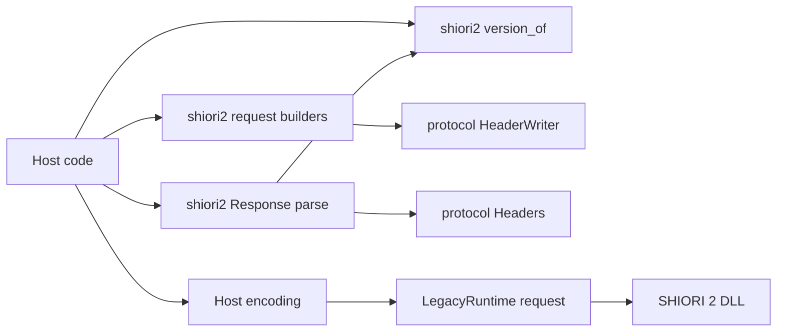
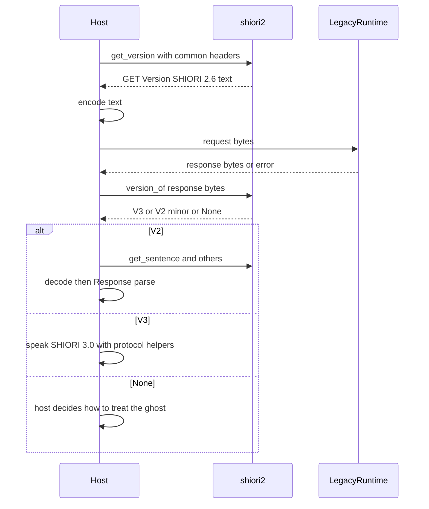

# 設計書: shiori2-helpers

## Overview
**Purpose**: ベースウェアの作者が SHIORI/2.x の DLL と話すための文字列の便利関数を、`shiori4_host` の新しい公開のモジュール `shiori2` に足す。持つのは、要求の組み立て（汎用の形 1 つと命令ごとの 9 つ）、応答の読み分け（開始行・ヘッダ・命令ごとの決まったヘッダ）、版の見分け（バイト列からも読む）の 3 つで、どれも状態を持たない純粋な関数である。

**Users**: SHIORI/2.x の DLL を `LegacyRuntime` で読むベースウェアの作者（areka の SHIORI/2.x の口の乗り換え先）、x64 の本体から IPC の向こうの 32bit の helper に送る文字列を組み立てる作者。

**Impact**: `shiori4_host` に `pub mod shiori2;`（`cfg` なし。全環境）が加わり、ルートの再エクスポートに `SHIORI_311_NOT_ENOUGH`・`SHIORI_312_ADVICE` が加わる。芯（`GhostRuntime`・`V3Runtime`・`LegacyRuntime`）、`shiori4::protocol`、SHIORI の側の振る舞い、依存は変わらない。

### Goals
- SSP が送るのと同じ形の SHIORI/2.x の要求を、命令の語・版・決まったヘッダを覚えずに組み立てられる。
- 応答の全文から、版・ステータス・ヘッダ・命令ごとの決まったヘッダ（無ければ `Value`）を読める。
- 文字コードを変える前のバイト列から、開始行の版だけで SHIORI/3.0 か SHIORI/2.x かを決められる。
- すべての振る舞いを `shiori2.rs` の `mod tests` で確かめ、crate doc と教科書から導く。

### Non-Goals
- SHIORI/3.0 の出来事から SHIORI/2.x の命令への移し方（ホストが持つ。3.6）。
- 文字コードの変換と Charset の方針（ホストが持つ。1.5・7.7）。
- DLL の読み込み・HGLOBAL の受け渡し（`LegacyRuntime`）。要求を送ることと、決まった版を覚えておくこと（ホスト。7.6）。
- `TEACH` の 311・312 を受けて問い直す繰り返し（4.7）。
- 廃止された `COMMUNICATE`・310、SAORI・MAKOTO。ユーザーの言葉の `GET Sentence SHIORI/2.0` とゴーストどうしの会話の `GET Sentence SHIORI/2.3` の命令ごとの関数（汎用の形で作る）。
- 試験用のホストの変更、版を上げること。

## Boundary Commitments

### This Spec Owns
- `shiori4_host/src/shiori2.rs`（全環境）: 要求の組み立て（`request` と命令ごとの 9 つの関数）、応答の型 `Response<'a>` とその読み分け・決まったヘッダの取り出し、版の型 `Version` と版の見分け `version_of`、それらのテスト。
- 開始行の語の検査の決まり（空白・CR・LF・空の語は失敗）と、版の見分けの決まり（開始行の版の語だけを ASCII として読む）。
- `shiori4_host/src/lib.rs` の 3 か所: `pub mod shiori2;`、ルートの再エクスポートへの `SHIORI_311_NOT_ENOUGH`・`SHIORI_312_ADVICE` の追加、crate doc の「DLL の選び方と読み方」への道案内の 1 項目。
- 文書: `doc/textbook/migration.md` の「v3 互換モードと旧来の DLL」の箇条への 1 行、`shiori4_host/README.md` の「使い始めの入口」への 1 文。

### Out of Boundary
- `shiori4::protocol` の型・関数・定数（`Headers`・`HeaderWriter` は使うだけで変えない）。`shiori4::v3` の SHIORI の側の振る舞い（SHIORI/2.x の要求に 400）。
- 芯の口（`GhostRuntime`・`V3Runtime`・`LegacyRuntime`・`load_ghost*`）。どれも `shiori2` を参照しない。
- 文字コードの変換、Charset の方針、出来事の移し方、要求を送る順と回数、決まった版の保持、`TEACH` の繰り返し。
- 試験用のホスト（`shiori4_host/examples/shiori4-testhost.rs`）、CI の job、`shiori4_abi`・C ヘッダ。
- steering（`tech.md`・`structure.md`）の同期は kiro-complete の段で行う（この spec の実装のタスクに入れない）。

### Allowed Dependencies
- `shiori2.rs` が使ってよいのは std と、`shiori4::protocol::{Headers, HeaderWriter}`、`shiori4::shiori4_abi` の `ShioriStatus`（`crate::ShioriStatus` の再エクスポート経由でよい）だけ。
- `shiori2.rs` は crate の中のほかのモジュール（`v3`・`discover`・`dist`・`legacy`・`lib.rs` の芯の型）を使わない。逆に、芯のどのファイルも `shiori2` を使わない（向きは「ホストのコード → `shiori2` → `shiori4::protocol`」だけ）。
- 外部の crate を足さない（`libloading` も使わない）。

### Revalidation Triggers
- `shiori2` の公開の形（関数の名前・引数・戻り値・`Version` の値・`Response` の欄とメソッド）を変える → areka の spec `shiori2-protocol` の乗り換え、教科書の一言。
- 版の見分けの決まり（何を `SHIORI/3.0` と読むか・`None` にする範囲）を変える → 版の切り替えをこの関数に任せているホスト。
- 命令ごとの関数の開始行の版や決まったヘッダを変える → SSP と同じ形を前提にしている SHIORI/2.x の DLL との往復。
- `shiori4::protocol::Headers` の読み分けの規則・`HeaderWriter` の CR/LF の除き方が上流（host-protocol）で変わる → `shiori2` の読み分けと組み立てがそのまま引き継ぐので、テストを確かめ直す。

## Architecture

### Existing Architecture Analysis
- `shiori4_host` は役割ごとにファイルを分ける（`v3.rs`・`discover.rs`・`dist.rs`・`legacy.rs`）。`dist.rs` は DLL を読まない純粋な関数のモジュールで、`shiori2.rs` はこれと同じ置き方をする（違いは `pub mod` で、モジュールごと公開する点。`protocol` と同じく名前空間で使う便利関数のため）。
- 「芯は中身を解釈しない」（tech.md）。解析と組み立ては芯から独立した便利関数に置く。`shiori2` はホストの側の便利関数で、`protocol` と同じ位置づけになる。
- `lib.rs` のテスト `core_refers_to_protocol_only_by_its_reexport` は `lib.rs` のコードの行（注釈を除く）の `protocol` の語だけを数える。`shiori2.rs` の中で `shiori4::protocol` を使っても、`lib.rs` の crate doc に `shiori2` を書いても落ちない。`lib.rs` のコードの行には `protocol` の語を足さない。
- `protocol` の形に合わせる: 組み立ては `String` を返し、読み分けは借用（`Headers<'a>`）で返し、読めないときは `Option` の `None`（`HostComplete::parse` と同じ）。公開の enum に `#[non_exhaustive]` を付けない（`LoadError`・`Rejection` と同じ）。

### Architecture Pattern & Boundary Map



**Architecture Integration**:
- Selected pattern: 状態の無い関数の集まり（1 ファイル・3 節。research.md の Option C）。版の切り替えの手順は「最初の要求を作る関数」と「応答から版を読む関数」の 2 つで表し、手順を進める型は持たない（7.6）。
- Domain/feature boundaries: 文字列（とバイト列）の形だけを持つ。バイト列を運ぶ `LegacyRuntime` とは型でつながらず、ホストが文字コードを変えて間をつなぐ。
- Existing patterns preserved: `HeaderWriter` で値の CR/LF を除く、`Headers` の読み分けの規則、`Option` で読めないことを返す、`// ====` の節分け、同じファイルの `mod tests`。
- New components rationale: 開始行の組み立てと読み分け・空行までの切り出し・版の見分けは、今どこにも公開の関数が無い（research.md の Key Findings）。
- Steering compliance: 依存を足さない・芯は中身を解釈しない・コメントと doc は日本語・`cargo clippy -D warnings`。

### Technology Stack

| Layer | Choice / Version | Role in Feature | Notes |
|-------|------------------|-----------------|-------|
| Library | Rust 1.85+・edition 2024（std のみ） | 文字列の組み立てと読み分け | 新しい依存なし |
| 上流の便利関数 | `shiori4::protocol`（`Headers`・`HeaderWriter`） | ヘッダの行の読み分けと組み立て | 変えずに使う |
| ABI の型 | `shiori4_abi::ShioriStatus`（`i32`）・`SHIORI_311_NOT_ENOUGH`・`SHIORI_312_ADVICE` | ステータスの数とその定数 | 2 つの定数をルートで再エクスポートする |

## File Structure Plan

### Directory Structure
```
shiori4_host/src/
└── shiori2.rs   # 新規。SHIORI/2.x の文字列の便利関数（全環境）
    ├── //!                    モジュールの doc（持つもの・持たないもの・例 1 つ）
    ├── // ==== 要求の組み立て   request・命令ごとの 9 つ・非公開の開始行の検査
    ├── // ==== 応答の読み分け   Response<'a>（parse と決まったヘッダの取り出し）
    ├── // ==== 版の見分け       Version・version_of・非公開の版の語の読み分け
    └── #[cfg(test)] mod tests  2〜7 のテスト
```

### Modified Files
- `shiori4_host/src/lib.rs` — `mod` の並び（`dist` の後）に `pub mod shiori2;` を足す（`cfg` なし）。ルートの `pub use shiori4::shiori4_abi::{..}` に `SHIORI_311_NOT_ENOUGH`・`SHIORI_312_ADVICE` を足す。crate doc の「DLL の選び方と読み方」の `LegacyRuntime` の項の後に、`shiori2` への道案内の 1 項目を足す（`protocol` の語をコードの行に書かない）。
- `doc/textbook/migration.md` — 「v3 互換モードと旧来の DLL」の箇条の `LegacyRuntime` の項の後に、SHIORI/2.x で話す DLL には `shiori4_host::shiori2` を使うと導く 1 行を足す。表の版 2 の行は変えない。Rust の例は足さない（doctest に載るため）。
- `shiori4_host/README.md` — 「使い始めの入口」の `LegacyRuntime` の段落の末尾に、SHIORI/2.x の要求の組み立てと応答の読み分けは `shiori2` にあるという 1 文を足す。

## System Flows

### 版の見分けと切り替え（ホストが進める）



- 版は開始行の版の語だけで決め、ステータスは見ない（6.5・7.5）。`SHIORI/3.0 400 Bad Request`（shiori4 の SHIORI の側の答え）も `V3` と読む。
- `LegacyRuntime::request` が `Err` を返したときは、ホストは応答を持たないので版は分からない。ホストは `version_of(&[])`（空の応答と同じ扱いで `None`）か、`Err` をそのまま「分からない」として扱う（7.4）。
- 決まった版を覚えておくのも、この後どちらで話すかを選ぶのもホスト（7.6）。最初の要求を SHIORI/3.0 の要求にするホストも、同じ `version_of` で見分けられる（7.8）。

## Requirements Traceability

| Requirement | Summary | Components | Interfaces | Flows |
|-------------|---------|------------|------------|-------|
| 1.1 | 公開のモジュール `shiori2` | LibWiring | `pub mod shiori2;` | — |
| 1.2 | OS・arch で限らない | LibWiring | `cfg` を付けない | — |
| 1.3 | 既存の形を変えない | LibWiring | 足すだけ（再エクスポートの追加は既存の形を変えない） | — |
| 1.4 | 外部の依存を足さない | 全体 | Allowed Dependencies | — |
| 1.5 | 文字コードを変換しない | RequestBuilder・Response | `&str` で組み立て読む。`version_of` だけバイト列 | — |
| 1.6 | 芯は `shiori2` に依存しない | LibWiring | Allowed Dependencies の向き | — |
| 1.7 | SHIORI の側を変えない | — | `shiori4` に触れない | — |
| 2.1 | 開始行・順のヘッダ・空行・CRLF | RequestBuilder | `request` | — |
| 2.2 | 命令の語なしの開始行 | RequestBuilder | `request(.., None, ..)` | — |
| 2.3 | 版を渡したとおりに書く | RequestBuilder | `request` の `version` | — |
| 2.4 | 値の CR・LF を除く | RequestBuilder | `HeaderWriter::push` | — |
| 2.5 | 開始行の語の空白・CR・LF は失敗 | RequestBuilder | `request` が `None` | — |
| 2.6 | 渡さないヘッダを足さない | RequestBuilder | `request`・命令ごとの関数 | — |
| 3.1 | 9 つの命令の関数（SSP の版） | RequestBuilder | `get_version` ほか 8 つ | 版の見分け |
| 3.2 | 共通のヘッダを先に・既定なし | RequestBuilder | 引数 `common` | — |
| 3.3 | `Reference0` から番号を振る | RequestBuilder | `get_sentence`・`teach` | — |
| 3.4 | `GhostEx` をゴーストごとに 1 行 | RequestBuilder | `notify_other_ghost_name` | — |
| 3.5 | 汎用の形と同じ全文 | RequestBuilder | 命令ごとの関数は `request` と同じ組み立てを使う | — |
| 3.6 | 出来事の移し方を持たない | RequestBuilder | 引数をそのまま書く | — |
| 4.1 | 版・ステータス・ヘッダを返す | Response | `Response::parse` | — |
| 4.2 | CRLF・LF・空行で止める | Response | 空行までを切り出して `Headers::parse` | — |
| 4.3 | 理由句を使わない | Response | 版の語とステータスの語だけ読む | — |
| 4.4 | 知らないステータスも数で | Response | `status: ShioriStatus` | — |
| 4.5 | 読めない開始行は失敗 | Response | `parse` が `None` | — |
| 4.6 | SHIORI/3.0 を取り違えない | Response・VersionDetector | `Version::V3` | — |
| 4.7 | 311・312 を見分けられる | Response・LibWiring | `status` と再エクスポートした定数 | — |
| 5.1 | 決まったヘッダの取り出し | Response | `sentence`・`word`・`string`・`status_header`・`id`・`craftman`・`version_header` | — |
| 5.2 | 無ければ値なし | Response | `Option::None` | — |
| 5.3 | 無ければ `Value`・両方なら決まったヘッダ | Response | 取り出しのメソッド（`id`・`craftman` を除く。仮定 A3） | — |
| 5.4 | ステータスによらず取り出す | Response | メソッドは `status` を見ない | — |
| 5.5 | 取り出したまま返す | Response | `Headers::get` の値の借用 | — |
| 6.1 | バイト列の開始行の ASCII から版 | VersionDetector | `version_of` | 版の見分け |
| 6.2 | 文字列でも同じ結果 | VersionDetector | `version_of(impl AsRef<[u8]>)` | 版の見分け |
| 6.3 | 開始行より後ろを読まない | VersionDetector | 最初の LF より前だけ | — |
| 6.4 | 形でなければ分からない | VersionDetector | `None` | 版の見分け |
| 6.5 | ステータスで見分けない | VersionDetector | 版の語だけを読む | 版の見分け |
| 7.1 | 最初の要求 `GET Version SHIORI/2.6` | RequestBuilder | `get_version` | 版の見分け |
| 7.2 | SHIORI/3.0 なら 3.0 で話す | VersionDetector | `Some(Version::V3)` | 版の見分け |
| 7.3 | SHIORI/2.x なら 2.x と小さい方の番号 | VersionDetector | `Some(Version::V2(n))` | 版の見分け |
| 7.4 | 分からない・応答なし | VersionDetector | `None`（空の応答も） | 版の見分け |
| 7.5 | ステータスを使わない | VersionDetector | 6.5 と同じ | 版の見分け |
| 7.6 | DLL を呼ばず状態を持たない | RequestBuilder・VersionDetector | 状態の無い関数 2 つ | 版の見分け |
| 7.7 | Charset で文字コードを決めない | VersionDetector | `Charset` を読まない（ホストは `Response::headers` から読める） | — |
| 7.8 | どの要求への応答にも当てられる | VersionDetector | 要求を受け取らない `version_of` | 版の見分け |
| 8.1 | 同じファイルの `mod tests` | Tests | `shiori2.rs` の `mod tests` | — |
| 8.2 | 一次資料と SSP の記録の例 | Tests | Testing Strategy の例 | — |
| 8.3 | 試験用のホストを変えない | — | File Structure Plan に含めない | — |
| 8.4 | crate doc の道案内と関数の doc | LibWiring・Docs | `lib.rs` の crate doc・`shiori2.rs` の `//!` と `///` | — |
| 8.5 | 移行の手引きへの 1 行 | Docs | `migration.md` | — |
| 8.6 | 出ていない版を番号で書かない | Docs | 版の番号を書かない（要るときは「次の版の印」） | — |
| 8.7 | clippy と test を今の job で通す | 全体 | CI の job を変えない | — |

## Components and Interfaces

| Component | Domain/Layer | Intent | Req Coverage | Key Dependencies (P0/P1) | Contracts |
|-----------|--------------|--------|--------------|--------------------------|-----------|
| RequestBuilder | `shiori2.rs` の節「要求の組み立て」 | SHIORI/2.x の要求の全文を作る | 1.5, 2.1–2.6, 3.1–3.6, 7.1, 7.6 | `HeaderWriter`（P0） | Service |
| Response | `shiori2.rs` の節「応答の読み分け」 | 応答の全文を版・ステータス・ヘッダに分け、決まったヘッダを取り出す | 1.5, 4.1–4.7, 5.1–5.5 | `Headers`（P0）、VersionDetector（P0） | Service |
| VersionDetector | `shiori2.rs` の節「版の見分け」 | 開始行の版の語から `Version` を読む | 4.6, 6.1–6.5, 7.2–7.8 | なし | Service |
| LibWiring | `lib.rs` | モジュールの公開・定数の再エクスポート・crate doc | 1.1–1.3, 1.6, 4.7, 8.4 | — | — |
| Docs | `migration.md`・`README.md`・`shiori2.rs` の doc | 道案内と、持たないものの明記 | 8.4–8.6 | — | — |
| Tests | `shiori2.rs` の `mod tests` | 2〜7 の振る舞いを確かめる | 8.1, 8.2 | 上の 3 つ（P0） | — |

### shiori2.rs

#### RequestBuilder

| Field | Detail |
|-------|--------|
| Intent | メソッド・命令・版・ヘッダから SHIORI/2.x の要求の全文を作る |
| Requirements | 1.5, 2.1, 2.2, 2.3, 2.4, 2.5, 2.6, 3.1, 3.2, 3.3, 3.4, 3.5, 3.6, 7.1, 7.6 |

**Responsibilities & Constraints**
- 全文は `<開始行>\r\n` ＋ ヘッダの行（`HeaderWriter::push` で `Name: Value\r\n`。値の CR・LF を除く）＋ `\r\n`。
- 開始行は `<method> <command> SHIORI/<version>`、命令が無ければ `<method> SHIORI/<version>`。
- 開始行の語（`method`・`command`・`version`）に空白（ASCII の空白）・CR・LF が含まれるか、語が空なら `None`（2.5。空の語は仮定 A1）。取り除いて続けない。
- ヘッダの名前は検査しない（`HeaderWriter` と同じ）。渡されないヘッダ（`Charset` を含む）は書かない（2.6）。
- 命令ごとの関数は、開始行の語を定数で持ち、`common` を先に、命令に固有のヘッダを後に書く。汎用の形と同じ非公開の組み立てを通るので、同じ引数の `request(..).unwrap()` と同じ全文になる（3.5）。語は定数なので失敗せず `String` を返す。

**Dependencies**
- Inbound: ホストのコード — 要求を作る（P0）
- External: `shiori4::protocol::HeaderWriter` — ヘッダの行と CR/LF の除去（P0）

**Contracts**: Service [x]

##### Service Interface
```rust
// headers・common は (名前, 値) の並びで、渡した順に書く。
// common は共通のヘッダ（Charset・Sender・SecurityLevel・SecurityOrigin など）で、既定の値は持たない
pub fn request(method: &str, command: Option<&str>, version: &str, headers: &[(&str, &str)]) -> Option<String>;

pub fn get_version(common: &[(&str, &str)]) -> String;                                   // GET Version SHIORI/2.6
pub fn get_sentence(common: &[(&str, &str)], event: &str, references: &[&str]) -> String; // GET Sentence SHIORI/2.2・Event・Reference0..
pub fn get_word(common: &[(&str, &str)], kind: &str) -> String;                          // GET Word SHIORI/2.0・Type
pub fn get_status(common: &[(&str, &str)]) -> String;                                    // GET Status SHIORI/2.0
pub fn get_string(common: &[(&str, &str)], id: &str) -> String;                          // GET String SHIORI/2.5・ID
pub fn notify_owner_ghost_name(common: &[(&str, &str)], ghost: &str) -> String;          // NOTIFY OwnerGhostName SHIORI/2.3・Ghost
pub fn notify_other_ghost_name(common: &[(&str, &str)], ghosts: &[(&str, &str, &str)]) -> String; // NOTIFY OtherGhostName SHIORI/2.3・GhostEx（名前, 本体のサーフィス, 相方のサーフィス）
pub fn teach(common: &[(&str, &str)], word: &str, references: &[&str]) -> String;        // TEACH SHIORI/2.4・Word・Reference0..
pub fn translate_sentence(common: &[(&str, &str)], sentence: &str) -> String;            // TRANSLATE Sentence SHIORI/2.6・Sentence
```
- 公開の型の別名や引数の構造体は足さない（並びは `&[(&str, &str)]` のまま）。
- Preconditions: なし（どの文字列も受ける）。
- Postconditions: 戻り値は CRLF の行の並びで、最後は空行（`\r\n\r\n`）で終わる。ヘッダの行の数は `common.len()` ＋ 命令に固有の行の数（`Reference` は渡した数、`GhostEx` はゴーストの数）。
- Invariants: 戻り値の開始行は 1 行（値に CR・LF が入っても行は増えない）。`notify_other_ghost_name` の 1 行の値は `名前\x01本体のサーフィス\x01相方のサーフィス`（3.4）。

**Implementation Notes**
- Integration: ヘッダの名前は非公開の定数（または綴りそのまま）で持ち、公開の定数は足さない（仮定 A4）。`ID`・`Event`・`Status`・`Value` は `protocol::HEADER_*` を使い回してよい。
- Validation: `request` の検査だけが失敗を返す。命令ごとの関数は検査を通らない語を持たないので、非公開の組み立てを直に呼ぶ。
- Risks: `GET Sentence` の `Status`・`BaseEvent` は SSP では `Event` と `Reference` の間に入るが、`common` は常に先に書く。ヘッダの順に決まりは無い（一次資料 [P2]）ので往復は変わらない。順まで SSP に合わせたいホストは `request` を使う。

#### Response

| Field | Detail |
|-------|--------|
| Intent | 応答の全文を版・ステータス・ヘッダに読み分け、命令ごとの決まったヘッダを取り出す |
| Requirements | 1.5, 4.1, 4.2, 4.3, 4.4, 4.5, 4.6, 4.7, 5.1, 5.2, 5.3, 5.4, 5.5 |

**Responsibilities & Constraints**
- 開始行は最初の LF までの 1 行（末尾の CR を除く）。ASCII の空白で区切った 1 つ目の語を VersionDetector の決まりで `Version` に読み、2 つ目の語を ASCII の数字だけの `ShioriStatus` として読む。3 つ目より後ろ（理由句）は読まない（4.3）。
- 版が `Version` に読めないか、ステータスの語が無いか数でないなら `None`（4.5）。知らない数（例: 299・999）は数のまま返す（4.4）。
- ヘッダは開始行の次の行から、最初の空行（`\n` か `\r\n` だけの行）の手前までを切り出して `Headers::parse` に渡す（4.1・4.2）。空行が無ければ末尾まで。
- 決まったヘッダの取り出しは `status` を見ない（5.4）。値は `Headers::get` の借用をそのまま返す（5.5）。

**Dependencies**
- Inbound: ホストのコード — 文字コードを変えた後の応答を読む（P0）
- Outbound: VersionDetector — 開始行の版の語を読む（P0）
- External: `shiori4::protocol::Headers` — ヘッダの読み分けの規則（P0）

**Contracts**: Service [x]

##### Service Interface
```rust
#[derive(Debug, Clone)]
pub struct Response<'a> {
    /// 開始行の版
    pub version: Version,
    /// 開始行のステータスの数（311 は SHIORI_311_NOT_ENOUGH、312 は SHIORI_312_ADVICE と比べる）
    pub status: ShioriStatus,
    /// 空行までのヘッダ（Charset もここから読む）
    pub headers: Headers<'a>,
}

impl<'a> Response<'a> {
    pub fn parse(text: &'a str) -> Option<Self>;

    /// GET Sentence・TRANSLATE Sentence: Sentence、無ければ Value
    pub fn sentence(&self) -> Option<&'a str>;
    /// GET Word: Word、無ければ Value
    pub fn word(&self) -> Option<&'a str>;
    /// GET String: String、無ければ Value
    pub fn string(&self) -> Option<&'a str>;
    /// GET Status: Status（分けずに原文のまま）、無ければ Value
    pub fn status_header(&self) -> Option<&'a str>;
    /// GET Version: ID（Value に代えない）
    pub fn id(&self) -> Option<&'a str>;
    /// GET Version: Craftman（Value に代えない）
    pub fn craftman(&self) -> Option<&'a str>;
    /// GET Version: Version、無ければ Value
    pub fn version_header(&self) -> Option<&'a str>;
}
```
- Preconditions: `text` は文字コードを変えた後の UTF-8 の文字列。
- Postconditions: `Some` のとき `version` と `status` は開始行から読んだもの。`headers` に空行より後ろの行は入らない。
- Invariants: 決まったヘッダと `Value` の両方があれば決まったヘッダを返す（5.3）。どちらも無ければ `None`（5.2）。

**Implementation Notes**
- Integration: 311・312 の見分けは `status` の数で行い、`TEACH` の続きを送るかはホストが決める（4.7）。比べる定数をルートで再エクスポートする（LibWiring）。
- Validation: `status_header`・`version_header` の名前は、欄の `status`・`version` と取り違えないための接尾辞（仮定 A5）。
- Risks: `id`・`craftman` に `Value` の代わりを当てない（仮定 A3）。当てると `Value` 1 つが 3 つのメソッドから同じ値で返り、名前と作者の取り違えになる。

#### VersionDetector

| Field | Detail |
|-------|--------|
| Intent | 開始行の版の語だけを ASCII として読み、SHIORI/3.0 か SHIORI/2.x かを返す |
| Requirements | 4.6, 6.1, 6.2, 6.3, 6.4, 6.5, 7.2, 7.3, 7.4, 7.5, 7.6, 7.7, 7.8 |

**Responsibilities & Constraints**
- 最初の LF より前だけを見る（6.3）。末尾の CR を除き、最初の ASCII の空白（無ければ行の終わり）までを版の語とする。ステータスより後ろは見ない（6.5・7.5）。
- 版の語が `SHIORI/` ＋ ASCII の数字 1 つ以上 ＋ `.` ＋ ASCII の数字 1 つ以上の形のときだけ数を読む。そうでなければ（空・ASCII でない・数字が無い）`None`（6.4）。
- 大きい方が 3 で小さい方が 0 なら `V3`、大きい方が 2 なら `V2(小さい方)`。それ以外の形の合う版（`SHIORI/1.0`・`SHIORI/3.1`・`SHIORI/4.0` など）と、小さい方が `u8` に入らない数は `None`（仮定 A2）。
- 文字コードを仮定しない。`&str` は `as_bytes()` と同じに読むので、文字列とバイト列で同じ結果（6.2）。`Charset` を読まない（7.7）。

**Dependencies**
- Inbound: ホストのコード（`LegacyRuntime::request` の戻り値のバイト列をそのまま渡す）（P0）、Response（P0）

**Contracts**: Service [x]

##### Service Interface
```rust
#[derive(Debug, Clone, Copy, PartialEq, Eq)]
pub enum Version {
    /// SHIORI/3.0。この後は SHIORI/3.0 で話す
    V3,
    /// SHIORI/2.x。値は開始行の小さい方の番号（SHIORI/2.6 なら 6）。この後は SHIORI/2.x で話す
    V2(u8),
}

/// 応答の開始行の版。分からなければ None（空の応答も None）
pub fn version_of(response: impl AsRef<[u8]>) -> Option<Version>;
```
- Preconditions: なし。
- Postconditions: 戻り値は応答の最初の行の版の語だけで決まる（どの要求への応答でも同じに読む。7.8）。
- Invariants: 同じ応答の `Response::parse(text).map(|r| r.version)` が `Some` なら、`version_of(text)` と一致する（どちらも同じ非公開の読み分けを通る）。

**Implementation Notes**
- Integration: 版の切り替えの手順は `get_version`（7.1）と `version_of`（7.2〜7.4）の 2 つの関数で、手順の型・状態は持たない（7.6）。ホストは `LegacyRuntime::request` が `Err` を返したら「分からない」として扱う（7.4）。
- Validation: `#[non_exhaustive]` を付けない（仮定 A6）。
- Risks: 版の語の後ろに空白が無く理由句が続く壊れた開始行（`SHIORI/2.6200 OK`）は小さい方を 6200 と読みかけるが、`u8` に入らないので `None`。

### lib.rs と文書

#### LibWiring・Docs（概要のみ）
- `lib.rs`: `pub mod shiori2;`（`cfg` なし）を `mod dist;` の後に置く。`pub use shiori4::shiori4_abi::{..}` に `SHIORI_311_NOT_ENOUGH`・`SHIORI_312_ADVICE` を足す（1.3 は「既存の形を変えない」で、足すことは許す）。crate doc の「DLL の選び方と読み方」に「SHIORI/2.x の文字列の形: `shiori2`（要求の組み立て・応答の読み分け・開始行の版の見分け。文字コードの変換・出来事の移し方・DLL の読み込みは持たない）」の項を足す。
- `shiori2.rs` の `//!`: 持つもの 3 つと、持たないもの（文字コードの変換・Charset の方針・出来事の移し方・DLL の読み込みと HGLOBAL は `LegacyRuntime` とホスト）を書き、`get_version` → `version_of` → `Response::parse` の実行できる例を 1 つ置く（DLL を使わないので doctest で走らせる）。関数ごとに `///` で開始行と書くヘッダを書く（8.4）。
- `migration.md`・`README.md`: それぞれ 1 行・1 文。版の番号を書かない（8.6）。

## Data Models

### Data Contracts & Integration
- 要求（組み立ての出力）: `<method>[ <command>] SHIORI/<version>\r\n(<Name>: <Value>\r\n)*\r\n`。文字は UTF-8 の `String`。送る前の文字コードの変換はホスト。
- 応答（読み分けの入力）: `SHIORI/<major>.<minor> <status>[ <reason>]` の開始行、CRLF か LF の行、空行で終わる。`Response::parse` は UTF-8 の `&str`、`version_of` は任意のバイト列。
- `Version` の値の集合: `V3`（`SHIORI/3.0` だけ）、`V2(n)`（`SHIORI/2.n`、`n` は 0〜255）。

## Error Handling

### Error Strategy
- 失敗は `Option::None` の 1 種類で返し、失敗の型（enum）は持たない（仮定 A6）。`protocol` の `HostComplete::parse` と同じ形。
  - `request`: 開始行の語が壊れている（作りの誤り）→ `None`。ホストは定数を渡すので、`expect` で落としてよい。
  - `Response::parse`: 開始行が読めない（`SHIORI/` で始まらない・版かステータスが読めない・版が `V3`／`V2` に入らない）→ `None`。
  - `version_of`: 版が分からない（空の応答を含む）→ `None`。ホストはそのゴーストの扱いを決める（7.4）。
- 決まったヘッダが無いのは失敗ではなく `None`（5.2）。
- パニックしない（添字の範囲外・数の溢れは `None` にする）。

### Monitoring
- 持たない（ログはホストが持つ。純粋な関数）。

## Testing Strategy

すべて `shiori4_host/src/shiori2.rs` の `#[cfg(test)] mod tests`（8.1）。全環境で走る（x86 の Windows に限らない）。例は一次資料・SSP の記録・華和梨の応答から取る（8.2）。

### Unit Tests: 要求の組み立て
- `request("GET", Some("Sentence"), "2.2", &[("Charset","Shift_JIS"),("Event","OnBoot")])` が `GET Sentence SHIORI/2.2\r\nCharset: Shift_JIS\r\nEvent: OnBoot\r\n\r\n` になり、ヘッダは渡した順（2.1）。`command: None` で `TEACH SHIORI/2.4\r\n…`（2.2）。版 `"2.0"`〜`"2.6"` をそのまま書く（2.3）。
- 値の `"a\r\nb"` が `ab` になり行が増えない（2.4）。`method`・`command`・`version` に `" "`・`"\r"`・`"\n"` を含むときと空の語は `None`（2.5）。ヘッダを渡さなければ `Charset` の行が無い（2.6）。
- 9 つの命令の関数それぞれの全文を、SSP の記録の形（例: `GET Version SHIORI/2.6\r\nCharset: UTF-8\r\nSender: SSP\r\n\r\n`）と比べる（3.1・7.1）。`common` が命令に固有のヘッダより前（3.2）。
- `get_sentence(c, "OnBoot", &["a","b"])` が `Reference0: a`・`Reference1: b` の順（3.3）。`teach` も同じ。`notify_other_ghost_name` に 2 体を渡すと `GhostEx: 名前\x010\x0110` の行が 2 行、渡した順（3.4）。
- 命令ごとの関数の結果が、同じ引数で作った `request(..).unwrap()` と一致する（9 つすべて。3.5）。出来事の名前と `Reference` が変わらずに書かれる（3.6）。

### Unit Tests: 応答の読み分けと決まったヘッダ
- 華和梨の `SHIORI/2.6 200 OK\r\nCharset: Shift_JIS\r\nCraftman: KawariDevelopmentTeam\r\nID: KAWARI.kdt\r\nVersion: 7.4.0\r\n\r\n` が `V2(6)`・200・ヘッダ 4 つに読め、`id`・`craftman`・`version_header` が値を返す（4.1・5.1）。
- LF だけの応答も同じに読む。空行の後ろの `Sentence: x` を読まない（4.2）。`SHIORI/2.6 200` と `SHIORI/2.6 200 Whatever` が同じ（4.3）。`SHIORI/2.6 299 X` が 299（4.4）。
- `HTTP/1.0 200 OK`・`SHIORI/2.6 OK`・`SHIORI/x.y 200 OK`・空の文字列が `None`（4.5）。`SHIORI/3.0 200 OK` が `V3`（4.6）。311・312 の `status` が `SHIORI_311_NOT_ENOUGH`・`SHIORI_312_ADVICE` と等しく、`sentence()` も読める（4.7・5.4）。
- `Sentence` が無く `Value` があれば `sentence()` が `Value` を返し、両方あれば `Sentence`。どちらも無ければ `None`（5.2・5.3）。`word`・`string`・`status_header`・`version_header` も同じ。`id`・`craftman` は `Value` に代えない。
- `Status: neuron,neuronm` が分けずに原文のまま、`Sentence` の `\h\s[0]` がエスケープの解釈なしで返る（5.5）。

### Unit Tests: 版の見分け
- Shift_JIS の本文を持つバイト列 `b"SHIORI/2.6 200 OK\r\nSentence: \x82\xa0\r\n\r\n"` が `Some(V2(6))`（6.1）。同じ内容の ASCII の `&str` と `&[u8]` が同じ結果（6.2）。
- 開始行の後ろに壊れたバイト列や `SHIORI/3.0` の行があっても、最初の行だけで決まる（6.3）。空・`SHIORI/2`・`SHIORI/2.`・`SHIORI/２.６`（全角）・非 ASCII の版の語が `None`（6.4）。
- `SHIORI/2.6 400 Bad Request` が `V2(6)`、shiori4 の SHIORI の側の答え `SHIORI/3.0 400 Bad Request` が `V3`（6.5・7.2・7.3・7.5）。`SHIORI/1.0`・`SHIORI/3.1`・`SHIORI/2.300` が `None`（7.4・仮定 A2）。
- `version_of` と `Response::parse(..).map(|r| r.version)` が同じ例の集まりで一致する（Invariant）。

### 既存の環境
- `cargo test --all`・`cargo clippy --all-targets --workspace -- -D warnings` を今の CI の job（`test`・`test-i686`）のまま通す（8.7）。`shiori2.rs` の `//!` の例は doctest で走る。`core_refers_to_protocol_only_by_its_reexport` が通ったままであることを確かめる（1.3・1.6）。

## Security Considerations
- 値の CR・LF を除き、開始行の語の CR・LF・空白を失敗にするので、要求に行を差し込まれない（2.4・2.5）。ヘッダの名前は検査しない（`HeaderWriter` と同じ。名前はホストの定数）。
- 読み分けは借用だけで、添字と数の溢れを `None` にし、どの入力でもパニックしない。

## Integration & Migration Notes
- 既存の利用者は何も変わらない（足すだけ）。areka は SHIORI/2.x の口を、`get_version`・`version_of`・命令ごとの関数・`Response` に乗り換えられる（areka の spec `shiori2-protocol` と突き合わせるのは下流の作業）。
- 実装の後、kiro-complete の段で `tech.md`・`structure.md` の `shiori4_host` の中身の一覧に `shiori2` を足す。

## Open Questions / Risks（設計ディスカッションで決める）
設計の下書きは次の仮定で書いた。どれも要件からは決め切れないもの。

- **A1 空の開始行の語**: `request` は空白・CR・LF に加えて、空の `method`・`command`・`version`（`Some("")`）も失敗にする。2.5 は空を挙げていないが、空の語は壊れた開始行（`GET  SHIORI/2.4`）を作るため。
- **A2 `Version` の範囲**: `SHIORI/3.0` だけを `V3`、`SHIORI/2.n`（`n` は `u8`）を `V2(n)` とし、`SHIORI/3.1`・`SHIORI/1.x`・`SHIORI/4.0` は `None`（分からない）にする。要件は 3.0 と 2.x だけを挙げ、6.4 は推測で埋めないことを求めるため。
- **A3 `Value` の代わりを当てる範囲**: `sentence`・`word`・`string`・`status_header`・`version_header` に当て、`id`・`craftman` には当てない。5.3 を GET Version の 3 つすべてに当てると、`Value` 1 つが名前・作者・版の 3 つとして返るため。
- **A4 ヘッダの名前の定数**: `shiori2` に公開の定数を足さない。命令ごとの関数と取り出しのメソッドが名前を隠し、ホストが書く共通のヘッダは `protocol::HEADER_SENDER` などか綴りで足りるため。
- **A5 取り出しのメソッドの名前**: 欄 `status`・`version` と重なる 2 つを `status_header`・`version_header` にする。
- **A6 失敗と版の型の形**: 失敗の enum を持たず `Option` で返す。`Version` に `#[non_exhaustive]` を付けない（コードベースの公開の enum に前例が無く、0.0.x の版はどれも互換を崩せるため）。
- **A7 311・312 の定数**: ルートの再エクスポートに `SHIORI_311_NOT_ENOUGH`・`SHIORI_312_ADVICE` を足す（今は `shiori4_host::shiori4::` からしか届かない）。
- **A8 README**: `shiori4_host/README.md` に 1 文足す（crates.io の顔に新しい公開のモジュールを載せる。要件 8 は求めていない）。
