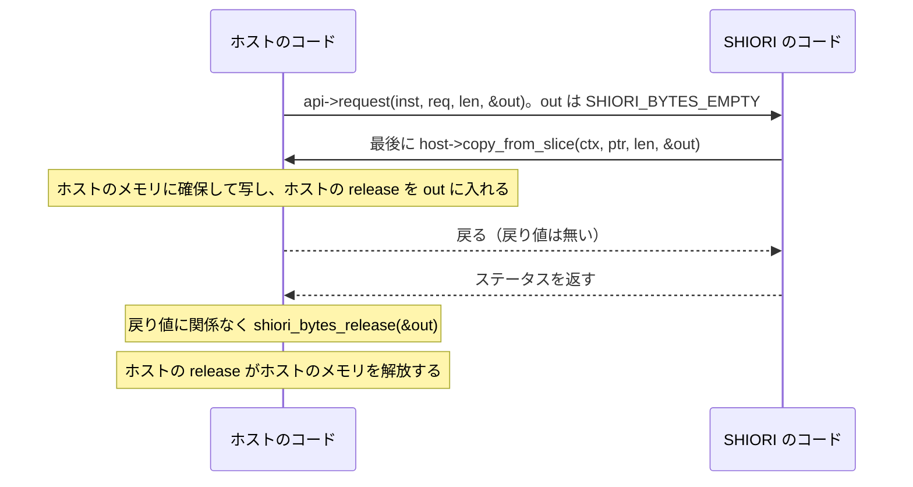

# C の書き手向けの説明

Rust 以外の言語で SHIORI やホストを書く人に向けて、所有権・版の判定・スレッド・例外の扱いを C の言葉で述べる。教科書の目次は [doc/textbook/README.md](https://github.com/ekicyou/shiori4/blob/main/doc/textbook/README.md) にある。

## この章の読み方

- 規約の正本は C ヘッダ [`shiori4_abi/include/shiori4_abi.h`](https://github.com/ekicyou/shiori4/blob/main/shiori4_abi/include/shiori4_abi.h) の冒頭の注釈である。この章は正本を言い直したもので、食い違ったら正本が正しい。
- 「スレッド規約 2」「ABI 規約 5」などの引き方は、[規約の一覧](https://github.com/ekicyou/shiori4/blob/main/doc/textbook/rules.md)の「番号の付け方と引用の仕方」に従う。
- C のコードの塊は、どれも C の例のファイルか C ヘッダの行をそのまま抜き出したものである。そのままであることは CI が確かめる（`shiori4_abi/tests/textbook.rs`）。
- C の例は次の 3 本で、CI が 3 つの OS でビルドして動かす。
  - [`doc/textbook/c/minimal_shiori.c`](https://github.com/ekicyou/shiori4/blob/main/doc/textbook/c/minimal_shiori.c): v4 のテーブルだけを返す最小の SHIORI。
  - [`doc/textbook/c/versioned_shiori.c`](https://github.com/ekicyou/shiori4/blob/main/doc/textbook/c/versioned_shiori.c): v4 と v3 互換モードで別の静的なテーブルを返す SHIORI。
  - [`doc/textbook/c/minimal_host.c`](https://github.com/ekicyou/shiori4/blob/main/doc/textbook/c/minimal_host.c): ライブラリを開いて `OnBoot` を 1 回要求する最小のホスト。v3 の枝はビルドだけを検査する（CI の testghost は v4 を返すので、v3 の枝は通らない）。

## 所有権

所有権が移るのは、`out` に書き込まれる `ShioriBytes` だけである（ABI 規約 5）。`out` の `ShioriBytes` は、どちらの向きでも常にホストが作り、ホストの `release` で解放する（ABI 規約 5）。つまり `ShioriBytes` の確保と解放は、どちらの向きでもホストのメモリとホストのコードだけで起きる。

| 受け渡すもの | 誰が作る | 誰が書く | 誰が `release` を呼ぶ | いつまで有効 |
|--------------|----------|----------|------------------------|--------------|
| `api->request` の `out`（SHIORI の応答） | ホスト。SHIORI が `host->copy_from_slice` を呼ぶと、ホストが自分のメモリへ写して作る（ABI 規約 5） | SHIORI が呼んだ `host->copy_from_slice` が書く。SHIORI はそれを最後に行う（ABI 規約 6） | ホスト（呼び出した側）。戻り値に関係なく呼ぶ（ABI 規約 6） | ホストが `release` を呼ぶまで。`release` はどのスレッドからでも、unload の後でもよい（スレッド規約 6） |
| `host->request` の `out`（ホストの応答。v4 だけ） | ホスト | ホスト（呼ばれた側）。最後に書く（ABI 規約 6） | SHIORI（呼び出した側）。戻り値に関係なく `shiori_bytes_release(&out)` を呼ぶ（ABI 規約 6） | SHIORI が `release` を呼ぶまで。unload が返った後に SHIORI が呼んでよいホストの関数は、これだけである（スレッド規約 5） |
| 引数の `(ptr, len)`（`req`・`msg` など） | 呼び出した側 | 呼び出した側 | 呼ばない（借用で、所有権は移らない） | 呼び出しの間だけ。保持するなら受け取った側がコピーする（ABI 規約 4） |
| `api->load` の `dir` | ホスト | ホスト | 呼ばない（借用） | 呼び出しの間だけ。絶対パス・OS の区切り・末尾に区切りあり・UTF-8（load の規約 1） |

SHIORI の応答の `out` は、次の順で受け渡される。



`minimal_host.c` のホストは、`copy_from_slice` を `malloc` と `memcpy` で、`release` を `free` で書く。写せなかったときは、このホストが決めた印（`copy_failed` の番地）を `owner` に入れ、SHIORI には知らせない（ABI 規約 5）。

```c
/* ---- ホストのテーブル。out の ShioriBytes は常にホストが作り、ホストの release で解放する（ABI 規約 5） ---- */
static char copy_failed; /* 写せなかったときに out に残す、このホストが決めた印 */

static void release(ShioriBytes* b) { /* いつでも・どのスレッドから呼ばれてもよい（スレッド規約 6） */
    free(b->owner);
    *b = (ShioriBytes)SHIORI_BYTES_EMPTY;
}
static void copy_from_slice(void* ctx, const uint8_t* ptr, size_t len, ShioriBytes* out) {
    (void)ctx;
    uint8_t* p = malloc(len ? len : 1);
    if (!p) { /* SHIORI には知らせず、印を残す（ABI 規約 5） */
        *out = (ShioriBytes){ NULL, 0, &copy_failed, NULL };
        return;
    }
    if (len) memcpy(p, ptr, len);
    *out = (ShioriBytes){ p, len, p, release };
}
```

SHIORI の側は、応答の文字列を `host->copy_from_slice` に渡すだけで、`release` を書かない。写せたかどうかも確かめず、`out` をそのまま返す（ABI 規約 5）。`minimal_shiori.c` の `request` の後半は次のとおりである。

```c
    /* out はホストが作る（ABI 規約 5）。呼ばれた側は out を最後に書く（ABI 規約 6） */
    const ShioriHostApi* h = ((Inst*)inst)->host;
    h->copy_from_slice(h->ctx, (const uint8_t*)res, sizeof res - 1, out);
    return SHIORI_200_OK;
```

## `release` を呼ぶ時と呼ぶスレッド

- `ShioriBytes.release` は常にホストの関数で、いつでも・どのスレッドから呼ばれてもよい。インスタンスの unload の後に呼ばれてもよい（スレッド規約 6）。そのためホストの `release` は、インスタンスの状態（`ctx` やインスタンスごとのデータ）に頼らず、`ShioriBytes` の中の `owner` だけで解放する。上の `minimal_host.c` の `release` は `b->owner` を `free` するだけである。
- 呼び出した側は、戻り値に関係なく `out` を解放する（ABI 規約 6）。戻り値が負（ABI エラー）のときの `out` は空だが（戻り値 2）、それでも `shiori_bytes_release(&out)` を呼ぶ。C ヘッダの `shiori_bytes_release` は、`release` が NULL なら何もしない。

```c
static inline void shiori_bytes_release(ShioriBytes* b) {
    if (b && b->release) b->release(b);
}
```

`minimal_host.c` は、`out` を `SHIORI_BYTES_EMPTY` で始め、応答を表示した後に、戻り値に関わらず解放する。

```c
    ShioriBytes out = SHIORI_BYTES_EMPTY;
    ShioriStatus st = api->request(inst, (const uint8_t*)req, strlen(req), &out);
    printf("abi %u\nstatus %d\n", (unsigned)v, (int)st);
    int copied = out.owner != &copy_failed;
    if (!copied) fprintf(stderr, "copy_from_slice failed\n");
    if (out.len) fwrite(out.ptr, 1, out.len, stdout);
    shiori_bytes_release(&out); /* 戻り値に関わらず解放する（ABI 規約 6） */
```

SHIORI が `host->request` を呼んだときも同じで、どの戻り値でも `shiori_bytes_release(&out)` を呼ぶ（ABI 規約 6）。

## 静的 CRT で作る DLL

SHIORI を静的 CRT（MSVC の `/MT`）で作り、ホストと SHIORI の CRT が別になっても関係ない。境界を越えて所有権が移る `ShioriBytes` は、どちらの向きでもホストの `copy_from_slice`（または `host->request`）が作り、ホストの `release` が解放する（ABI 規約 5）。引数の `(ptr, len)` は借用で、受け取った側は解放しない（ABI 規約 4）。そのため、一方の CRT の `malloc` で確保したものを、もう一方の CRT の `free` で解放することが起きない。SHIORI が自分の CRT で確保するもの（`minimal_shiori.c` のインスタンスの状態など）は、SHIORI の中で確保して SHIORI の中で解放する。

CI は Windows で 2 本の C の SHIORI（`minimal_shiori.c`・`versioned_shiori.c`）を `/MT` でビルドし、Rust で書いた試験用のホスト（`shiori4-testhost`）から読んで往復を確かめる（[`.github/workflows/build.yml`](https://github.com/ekicyou/shiori4/blob/main/.github/workflows/build.yml) の job `textbook`）。

## 版の判定

### ホストの側

ホストは `shiori_get_api(4)` を呼び、NULL なら `shiori_get_api(3)` を試す（DLL の口と発見の順 2）。返ったテーブルの `abi_version` は要求した版と一致する（版 4）ので、ホストはそれも確かめる。`minimal_host.c` の手順は次のとおりである。

```c
    uint32_t v = SHIORI_ABI_VERSION; /* 4 が NULL なら 3 を試す（DLL の口と発見の順 2） */
    const ShioriApi* api = get_api(v);
    if (!api) api = get_api(v = SHIORI_ABI_VERSION_3);
    /* 版が要求と一致し（版 4）、基本のフィールドが揃っているか。
     * 将来足されたフィールドは struct_size を使って同じ形で確かめる（ABI 規約 7）。ここでは notify で示す */
    if (!api || api->abi_version != v || !SHIORI_API_IS_VALID(api) || !SHIORI_HAS_FIELD(api, ShioriApi, notify)) {
        fprintf(stderr, "no usable table\n");
        close_lib(lib);
        return 1;
    }
```

どちらも NULL なら、そのライブラリは読めなかったものとして扱い、SHIORI/3.0 の書き出し（`loadu`・`load`）へは進まない（DLL の口と発見の順 2）。

### SHIORI の側

SHIORI は、対応する版ごとに別の静的なテーブルを持ち、要求された版のテーブルを返す。対応できない版には NULL を返す（ABI 規約 1）。テーブルの `abi_version` は要求された版と一致させる（版 4）。`versioned_shiori.c` の終わりは次のとおりである。

```c
/* 版ごとに別の静的なテーブル。abi_version は要求された版と一致させる（版 4） */
static const ShioriApi API_V4 = { sizeof(ShioriApi), SHIORI_ABI_VERSION, load_v4, unload, request_v4, notify_v4 };
static const ShioriApi API_V3 = { sizeof(ShioriApi), SHIORI_ABI_VERSION_3, load_v3, unload, request_v3, notify_v3 };
SHIORI_EXPORT const ShioriApi* shiori_get_api(uint32_t v) { /* ほかの版には NULL（ABI 規約 1） */
    if (v == SHIORI_ABI_VERSION) return &API_V4;
    if (v == SHIORI_ABI_VERSION_3) return &API_V3;
    return NULL;
}
```

`load` で受け取る `host` の確かめ方も版ごとに違う。v4 の `load_v4` は `SHIORI_HOST_API_IS_VALID(host)` と `copy_from_slice` の有無を確かめる。v3 互換モードの `host` は `copy_from_slice` だけを持つテーブル（`request`・`post`・`log` は NULL）なので（版 2）、`load_v3` は `copy_from_slice` があるかだけを確かめる。

```c
static void* load_v3(const ShioriHostApi* host, const uint8_t* dir, size_t dir_len) {
    (void)dir; (void)dir_len;
    /* host は copy_from_slice だけを持つテーブル。log は無く、この例は自身のログも持たないので、失敗は NULL を返すだけ（load の規約 3） */
    if (!host || !SHIORI_HAS_FIELD(host, ShioriHostApi, copy_from_slice) || !host->copy_from_slice)
        return NULL;
    return new_inst(host);
}
```

v3 互換モードでは、要求も応答も SHIORI/3.0 の全文になる（版 2）。v4 のペイロードはヘッダ部分だけで、開始行を持たない（版 1）。

## 最小のホストの流れ

`minimal_host.c` は次の順で動く。

1. ライブラリを開き、`shiori_get_api` を探す。Windows は `LoadLibraryW`（引数の UTF-8 を `MultiByteToWideChar` で UTF-16 に変える）と `GetProcAddress`、それ以外は `dlopen` と `dlsym` を使う。
2. `shiori_get_api(4)` を呼び、NULL なら `shiori_get_api(3)` を呼ぶ（上の「ホストの側」）。
3. 版に合わせて `ShioriHostApi` を組み、`api->load` を呼ぶ。
4. `ID: OnBoot` の要求を `api->request` で送り、戻り値と応答を表示して、戻り値に関わらず `out` を解放する。
5. `api->unload` を呼び、ライブラリを閉じる。

ライブラリを開く部分は次のとおりである。

```c
#ifdef _WIN32
#include <windows.h>
static void* open_lib(const char* path) { /* 引数は UTF-8 とみなし、UTF-16 に変えて開く */
    wchar_t w[4096];
    return MultiByteToWideChar(CP_UTF8, 0, path, -1, w, 4096) ? (void*)LoadLibraryW(w) : NULL;
}
static ShioriGetApiFn find_get_api(void* lib) {
    return (ShioriGetApiFn)GetProcAddress((HMODULE)lib, SHIORI_GET_API_SYMBOL);
}
static void close_lib(void* lib) { FreeLibrary((HMODULE)lib); }
#else
#include <dlfcn.h>
static void* open_lib(const char* path) { return dlopen(path, RTLD_NOW | RTLD_LOCAL); }
static ShioriGetApiFn find_get_api(void* lib) { return (ShioriGetApiFn)dlsym(lib, SHIORI_GET_API_SYMBOL); }
static void close_lib(void* lib) { dlclose(lib); }
#endif
```

版を決めた後の load → request → unload は次のとおりである。v4 の要求は `doc/host-protocol.md` 第 2.2 節の 5 つのヘッダを持つ。v3 は同じヘッダに開始行・`Charset: UTF-8`・空行を足した SHIORI/3.0 の全文である。

```c
    /* host は unload が返るまで有効にしておく（スレッド規約 5）。v3 は copy_from_slice だけ（版 2） */
    ShioriHostApi host = v == SHIORI_ABI_VERSION
        ? (ShioriHostApi){ sizeof host, v, NULL, host_request, host_post, host_log, copy_from_slice }
        : (ShioriHostApi){ sizeof host, v, NULL, NULL, NULL, NULL, copy_from_slice };
    void* inst = api->load(&host, (const uint8_t*)argv[2], strlen(argv[2]));
    if (!inst) {
        fprintf(stderr, "load failed\n");
        close_lib(lib);
        return 1;
    }
    /* v4 はヘッダ部分だけ（版 1）、v3 は SHIORI/3.0 の要求全文（版 2）。
     * ホストが必ず付けるヘッダと並びは doc/host-protocol.md 第 2.2 節 */
#define HEADERS "SecurityLevel: local\r\nID: OnBoot\r\nSender: minimal_host\r\n" \
                "SenderType: internal\r\nSecurityOrigin: null\r\n"
    const char* req = v == SHIORI_ABI_VERSION ? HEADERS : "GET SHIORI/3.0\r\nCharset: UTF-8\r\n" HEADERS "\r\n";
    ShioriBytes out = SHIORI_BYTES_EMPTY;
    ShioriStatus st = api->request(inst, (const uint8_t*)req, strlen(req), &out);
    printf("abi %u\nstatus %d\n", (unsigned)v, (int)st);
    int copied = out.owner != &copy_failed;
    if (!copied) fprintf(stderr, "copy_from_slice failed\n");
    if (out.len) fwrite(out.ptr, 1, out.len, stdout);
    shiori_bytes_release(&out); /* 戻り値に関わらず解放する（ABI 規約 6） */
    api->unload(inst);
    close_lib(lib);
    return SHIORI_IS_SUCCESS(st) && copied ? 0 : 1;
}
```

`host` は `main` の中の変数で、`api->unload` が返った後まで生きている（スレッド規約 5）。

## `SHIORI_HAS_FIELD` で足されたフィールドを確かめる

構造体は末尾にだけフィールドを足し、足す関数ポインタは NULL を許す。受け取った側は `struct_size` を見て、フィールドがあるかを判定する（ABI 規約 7）。C ヘッダはその判定を `SHIORI_HAS_FIELD` で書き、基本のフィールドが揃っているかを `SHIORI_API_IS_VALID`・`SHIORI_HOST_API_IS_VALID` で書く。

```c
/* 追加フィールドが存在するかの判定
 * 例: SHIORI_HAS_FIELD(api, ShioriApi, notify) */
#define SHIORI_HAS_FIELD(p, T, f) \
    ((size_t)(p)->struct_size >= offsetof(T, f) + sizeof(((T*)0)->f))

/* 基本フィールドが揃っているか */
#define SHIORI_API_IS_VALID(p) \
    ((p)->abi_version >= SHIORI_ABI_VERSION_MIN && SHIORI_HAS_FIELD(p, ShioriApi, notify))
#define SHIORI_HOST_API_IS_VALID(p) \
    ((p)->abi_version >= SHIORI_ABI_VERSION && SHIORI_HAS_FIELD(p, ShioriHostApi, log))
```

ホストの側では、上の「版の判定」の `minimal_host.c` の手順が `SHIORI_HAS_FIELD(api, ShioriApi, notify)` で確かめている。`notify` は `SHIORI_API_IS_VALID` も確かめる基本のフィールドで、この例は将来足されたフィールドを確かめる形を示すために重ねて書いている。SHIORI の側では、`minimal_shiori.c` の `load` が `copy_from_slice` を確かめる。足される関数ポインタは NULL を許す（ABI 規約 7）ので、NULL でないことも確かめる。

```c
    if (!host || !SHIORI_HOST_API_IS_VALID(host)) return NULL;
    int ok = SHIORI_HAS_FIELD(host, ShioriHostApi, copy_from_slice) && host->copy_from_slice;
```

## スレッド規約を C の言葉で

`api` は SHIORI の返した `ShioriApi`、`host` はホストが渡した `ShioriHostApi` を指す。

1. ホストは `api->load`・`api->request`・`api->notify`・`api->unload` を、ホストが決めた 1 つのスレッドからだけ呼ぶ（スレッド規約 1）。このスレッドはインスタンスごとに決まり、同じ DLL の 2 つのインスタンスは別々のスレッドから呼ばれうる（スレッド規約 1）。
2. SHIORI が `host->request` を呼べるのは、`api->load`・`api->request`・`api->notify` を呼ばれているスレッドから、その関数が返るまでの間だけである（スレッド規約 2）。SHIORI が自分で起こしたスレッドからは呼ばない（スレッド規約 2）。外れた呼び出しには、ホストが `SHIORI_E_WRONG_THREAD` を返してよく、そのとき `out` は空である（スレッド規約 2）。v3 互換モードの `host->request` は NULL である（版 2）。
3. ホストの `request` の関数（SHIORI から呼ばれる `host->request`）の中から、ホストは SHIORI（`api->request` など）を呼び返さない（スレッド規約 3）。この誤りを表す値が `SHIORI_E_REENTRANT` である（スレッド規約 3）。
4. `host->post` と `host->log` は、SHIORI のどのスレッドからでも呼べる（スレッド規約 4）ので、ホストの `post`・`log` の関数は、どのスレッドから呼ばれても動くように書く（スレッド規約 4）。ホストは `msg` をコピーしてすぐ返る（`post` はキューに積む）（スレッド規約 4）。
5. `host` の指す `ShioriHostApi` は、`api->unload` が返るまで有効である（スレッド規約 5）。SHIORI は `api->unload` が返った後に `host` のどの関数も呼ばない（例外は `ShioriBytes.release` だけ）ので、自分で起こしたスレッドが `host->post` などを呼ぶなら、`api->unload` が返る前にそのスレッドが `host` に触れないようにする（スレッド規約 5）。unload を始めたホストは `host->post` に `SHIORI_E_SHUTDOWN` を返してよい（スレッド規約 5）。`api->unload` は長く止まらないように書く（スレッド規約 5）。
6. `ShioriBytes.release` は常にホストの関数で、いつでも・どのスレッドからでも、インスタンスの unload の後でも呼ばれうる（スレッド規約 6）。`host->copy_from_slice` も、どのスレッドから呼ばれてもよい（スレッド規約 6）。ホストはこの 2 つの関数を、それに耐えるように書く（スレッド規約 6）。
7. `api->notify` ですぐ `SHIORI_204_NO_CONTENT` を返し、処理を後で行ってよい（スレッド規約 7）。後回しにした処理の中では `host->request` を呼べない（スレッド規約 2 の期間の外であるため）ので、ホストへの依頼には `host->post` を使う（スレッド規約 7）。

## 例外とパニックを境界の外へ出さない

`shiori_get_api` が返すテーブルの関数は、例外・パニックを境界の外へ出さず、`SHIORI_E_PANIC` を返す（ABI 規約 8）。`SHIORI_E_PANIC` を受けたホストは、そのインスタンスを unload する（戻り値 2）。負の戻り値のときの `out` は空なので（戻り値 2）、`out` は最後に書く（ABI 規約 6）。値を返さない `unload` は例外を捨て、ポインタを返す `load` は NULL を返す（v4 は先に `host->log` で理由を出す。load の規約 3）。言語ごとの書き方は次のとおりである。

- C: 例外は無い。`setjmp`・`longjmp` で境界の関数の外へ飛ばない。
- C++: 書き出す関数とテーブルの関数を `extern "C"` で書き、その本体を `try` で包んで、`catch (...)` で `SHIORI_E_PANIC` を返す（`load` は NULL）。
- Rust: `shiori4_abi::export_shiori!`（`shiori4::export_ghost!` もこれを使う）が作るテーブルの関数が `catch_unwind` でパニックを止め、`request`・`notify` は `SHIORI_E_PANIC` を、`load` は NULL を返す。
- Zig: panic は捕まえて戻れないので、境界の関数の中で panic を起こさない作りにする。誤りはエラーの値で受け、`export` の関数の中で 500 などのステータス（続けられないなら `SHIORI_E_PANIC`）に変えて返す。panic の handler に頼らない。
